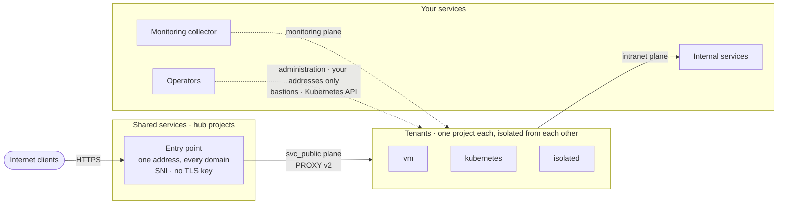

# openstack-multitenant-reference

[](https://github.com/CyprisTech/openstack-multitenant-reference/actions/workflows/ci.yml)
[](LICENSE)
[](https://github.com/CyprisTech/openstack-multitenant-reference/releases)
[](https://opentofu.org)
[](https://www.terraform.io)

Run several tenants on one OpenStack account — **one project each** — sharing a public entry point, monitoring and internal services, with every flow between them explicit and an isolation test to run after each change. Built on the [terraform-openstack-tenant](https://github.com/CyprisTech/terraform-openstack-tenant) module.

> [!NOTE]
> **`v0.2.1`** runs on clouds whose operator provides the shared planes (private and sovereign clouds). Public clouds, with planes built by the account holder, are in progress ([ADR-0003](docs/adr/0003-scope-and-plane-provisioning.md)).

**Start here:** [getting started](#getting-started) to deploy it; the [architecture](docs/concepts/architecture.md) and the [trade-offs](docs/concepts/trade-offs.md) to evaluate it.

## Table of contents

- [What you get](#what-you-get)
- [Is it for you?](#is-it-for-you)
- [Two contexts](#two-contexts)
- [How it fits together](#how-it-fits-together)
- [Getting started](#getting-started)
- [Day-to-day](#day-to-day)
- [Before production](#before-production)
- [Ready for, not yet demonstrated](#ready-for-not-yet-demonstrated)
- [Documentation](#documentation)
- [Status and requirements](#status-and-requirements)
- [Roadmap](#roadmap)
- [Related project](#related-project)
- [Contributing](#contributing)
- [Security](#security)
- [License](#license)

## What you get

The shared planes are, inside one account, the hub-and-spoke that OpenStack does not offer natively — the role a transit gateway plays on other clouds.

- **A project per tenant**, with its own credentials and quotas, joined to the shared services through its own routers: nothing else crosses.
- **One public address for every domain.** The shared entry point routes by SNI without decrypting: it never holds a tenant's TLS keys, and passes the client address to the backend.
- **Ready for central monitoring and internal services.** Your collector reaches every tenant's metrics, tenants never reach each other's; internal services are reachable only by the tenants allowed to use them ([integration points](docs/reference/integration-points.md)).
- **Kubernetes as a tenant type**: a cluster in a tenant project, created with Cluster API, published, monitored and administered like any tenant — useful on clouds without a managed Kubernetes offer.
- **An isolation test** that checks every flow, allowed and denied, to run after every change and to show customers or auditors how isolation is verified ([check the isolation](docs/guides/check-isolation.md)).

## Is it for you?

| You… | |
|---|---|
| host several customers, teams or environments on one OpenStack account | **Yes** |
| need Kubernetes on an OpenStack cloud without a managed offer | **Yes**, as a tenant type |
| run a single application or tenant | Use [terraform-openstack-tenant](https://github.com/CyprisTech/terraform-openstack-tenant) and its examples |
| give each customer its own OpenStack account, or span several clouds | Not yet: shared planes do not cross accounts. Manage each account as a single tenant with the module; an encrypted overlay between accounts is on the [roadmap](#roadmap) |
| want an operated, production-ready platform | See projects such as Sovereign Cloud Stack or Azimuth; this is a reference with a [checklist](#before-production) |

## Two contexts

The architecture is the same; only the way the shared planes are provided changes.

| | Public cloud | Private or sovereign cloud |
|---|---|---|
| Shared planes | Private networks of a hub project, shared with the tenant projects (Neutron RBAC) | External networks provided by the cloud operator |
| Rights needed | Member role in each project | Member role; the operator prepares the planes |
| Getting started | In progress | [Private cloud](docs/getting-started/private-cloud.md) |

## How it fits together



Each stack has its own state and its own `clouds.yaml` entry, and finds the other stacks' objects by name. Topology, flows and decisions: [architecture](docs/concepts/architecture.md) and [ADRs](docs/adr/README.md).

| Stack | What it creates |
|---|---|
| [`stacks/shared/entry-point`](stacks/shared/entry-point/README.md) | Octavia in TCP on 80 and 443 in front of two Traefik instances on different hosts, routing by SNI, client address in PROXY v2 |
| [`stacks/tenants/vm`](stacks/tenants/vm/README.md) | Instances serving domains through the entry point, reachable from it only |
| [`stacks/tenants/isolated`](stacks/tenants/isolated/README.md) | A workload with no public address, no Internet and no path to other tenants |
| [`stacks/tenants/kubernetes`](stacks/tenants/kubernetes/README.md) | A Kubernetes cluster with Cluster API (node image: [`images/kubernetes-node`](images/kubernetes-node/README.md)): ingress through the entry point, metrics on the monitoring plane, API on the administration network |

Every stack can add a bastion for administration, reachable only from your addresses.

## Getting started

- [Private or sovereign cloud](docs/getting-started/private-cloud.md): about 20 minutes with the entry point and a `vm` tenant.
- Public cloud: in progress.

<details>
<summary>Output of a real run of the isolation test</summary>

```console
$ kubectl apply -f stacks/tenants/kubernetes/demo/whoami.yaml && kubectl -n demo rollout status deploy/whoami
namespace/demo unchanged
deployment.apps/whoami unchanged
service/whoami unchanged
httproute.gateway.networking.k8s.io/whoami configured
deployment "whoami" successfully rolled out
$ LB=$(tofu -chdir=stacks/shared/entry-point output -json load_balancer | jq -r .floating_ip)
$ for i in $(seq 12); do curl -sk --resolve apps.platform.example.org:443:$LB https://apps.platform.example.org/ | grep X-Real-Ip; done | sort | uniq -c
     12 X-Real-Ip: 198.51.100.100
$ python3 tests/isolation/check.py --key ~/.ssh/id_ed25519 --platform-kubeconfig $KUBECONFIG
from                   to                                                    port  expected actual
test runner            entry point (public IP)                                443  open     open     ok
test runner            entry point (public IP)                                 80  open     open     ok
test runner            web, published address 192.0.2.101                     443  closed   closed   ok
test runner            web, published address 198.51.100.3                    443  closed   closed   ok
edge t1-edge-1         web, published address 192.0.2.101                     443  open     open     ok
edge t1-edge-1         web, published address 198.51.100.3                    443  open     open     ok
collector              t1-edge-1 (monitoring 198.51.100.4)                   9100  open     open     ok
collector              t1-edge-1 (monitoring 198.51.100.4)                   8082  open     open     ok
collector              t1-edge-2 (monitoring 198.51.100.12)                  9100  open     open     ok
collector              t1-edge-2 (monitoring 198.51.100.12)                  8082  open     open     ok
collector              t1-isolated-1 (monitoring 198.51.100.5)               9100  open     open     ok
collector              t1-web-1 (monitoring 198.51.100.13)                   9100  open     open     ok
collector              t1-web-2 (monitoring 198.51.100.14)                   9100  open     open     ok
edge t1-edge-1         t1-isolated-1 (monitoring 198.51.100.5)               9100  closed   closed   ok
edge t1-edge-1         t1-web-1 (monitoring 198.51.100.13)                   9100  closed   closed   ok
edge t1-edge-1         t1-web-2 (monitoring 198.51.100.14)                   9100  closed   closed   ok
web t1-web-1           t1-edge-1 (monitoring 198.51.100.4)                   9100  closed   closed   ok
web t1-web-1           t1-edge-2 (monitoring 198.51.100.12)                  9100  closed   closed   ok
web t1-web-1           t1-isolated-1 (monitoring 198.51.100.5)               9100  closed   closed   ok
web t1-web-1           edge t1-edge-1 (private 10.20.0.108)                   443  closed   closed   ok
isolated t1-isolated-1 web, published address 192.0.2.101                     443  closed   closed   ok
isolated t1-isolated-1 web, published address 198.51.100.3                    443  closed   closed   ok
isolated t1-isolated-1 t1-edge-1 (monitoring 198.51.100.4)                   9100  closed   closed   ok
isolated t1-isolated-1 t1-edge-2 (monitoring 198.51.100.12)                  9100  closed   closed   ok
isolated t1-isolated-1 t1-web-1 (monitoring 198.51.100.13)                   9100  closed   closed   ok
isolated t1-isolated-1 t1-web-2 (monitoring 198.51.100.14)                   9100  closed   closed   ok
isolated t1-isolated-1 Internet (1.1.1.1)                                     443  closed   closed   ok
platform Services      ingress and Prometheus on the stack addresses            -  yes      yes      ok
edge t1-edge-1         platform ingress 198.51.100.1                          443  open     open     ok
test runner            platform ingress 198.51.100.1                          443  closed   closed   ok
web t1-web-1           platform ingress 198.51.100.1                          443  closed   closed   ok
isolated t1-isolated-1 platform ingress 198.51.100.1                          443  closed   closed   ok
collector              platform Prometheus 198.51.100.11                     9090  open     open     ok
edge t1-edge-1         platform Prometheus 198.51.100.11                     9090  closed   closed   ok
web t1-web-1           platform Prometheus 198.51.100.11                     9090  closed   closed   ok
isolated t1-isolated-1 platform Prometheus 198.51.100.11                     9090  closed   closed   ok
test runner (operator) platform Kubernetes API 192.0.2.102                   6443  open     open     ok
platform pod           edge bastion 198.51.100.2 (SSH)                         22  closed   closed   ok
platform pod           web bastion 192.0.2.103 (SSH)                           22  closed   closed   ok
platform pod           isolated bastion 192.0.2.104 (SSH)                      22  closed   closed   ok
platform pod           intranet service 192.0.2.12                           8080  open     open     ok
web t1-web-1           intranet service 192.0.2.12                           8080  closed   closed   ok
isolated t1-isolated-1 intranet service 192.0.2.12                           8080  closed   closed   ok
43/43 rows as expected
```

</details>

## Day-to-day

| Task | Guide |
|---|---|
| Add a tenant | [add-a-tenant](docs/guides/add-a-tenant.md) |
| Publish a domain | [publish-a-domain](docs/guides/publish-a-domain.md) |
| Check the isolation after a change | [check-isolation](docs/guides/check-isolation.md) |
| Discover a Kubernetes tenant | [kubernetes-tour](docs/guides/kubernetes-tour.md) |
| Tear down | [teardown](docs/guides/teardown.md) |

## Before production

This is a reference, not an operated platform. Before production, plan for:

- **backups** of the tenants' volumes and of each Kubernetes cluster (Velero, etcd snapshots work unchanged);
- **central logs and alerting**, next to the metrics collector;
- **single sign-on and audit** of the administration access;
- **several sites**, if one is not enough: the code takes the site as an input, failover is not provided;
- **capacity per compute host**: the entry point instances are in anti-affinity, a replacement needs room on another host than the other's.

## Ready for, not yet demonstrated

| | Why it fits | Not yet done |
|---|---|---|
| **GitOps** | Everything Cluster API needs is plain YAML rendered by the stack (ClusterClass, `Cluster`, add-on proxies): Flux or Argo CD can reconcile it as is ([trade-off 12](docs/concepts/trade-offs.md#12-add-ons-declared-with-cluster-api-not-gitops)) | A reconciliation loop that reverts drift |
| **Backups** | Volumes are Cinder volumes behind the CSI driver; etcd runs on kubeadm control-plane nodes: Velero and etcd snapshots apply unchanged | A restore drill |
| **Several sites** | The site is an input of every stack and part of every name; routes and records come from outputs ([sites](docs/concepts/architecture.md#sites)) | An entry point per site, a DNS switch, a failover drill |

## Documentation

| | |
|---|---|
| **Getting started** | [Private or sovereign cloud](docs/getting-started/private-cloud.md) |
| **Guides** | [Add a tenant](docs/guides/add-a-tenant.md) · [Publish a domain](docs/guides/publish-a-domain.md) · [Check the isolation](docs/guides/check-isolation.md) · [Kubernetes tour](docs/guides/kubernetes-tour.md) · [Tear down](docs/guides/teardown.md) |
| **Reference** | [Integration points](docs/reference/integration-points.md) · [Planes contract](docs/reference/planes-contract.md) · [Isolation matrix](docs/reference/isolation-matrix.md) · [Test procedure](docs/reference/test-procedure.md) · [Route publication script](scripts/publish-routes.sh) · stack READMEs above |
| **Concepts** | [Architecture](docs/concepts/architecture.md) · [How a tenant joins a plane](docs/concepts/plane-attachment.md) · [Trade-offs](docs/concepts/trade-offs.md) · [Landscape](docs/concepts/landscape.md) · [Test results](docs/concepts/test-results.md) · [ADRs](docs/adr/README.md) · [Plane bindings spec](docs/specs/plane-bindings.md) |
| **Tests** | [Isolation test](tests/isolation/README.md) · fixtures: [collector](tests/fixtures/collector/README.md), [intranet service](tests/fixtures/intranet-service/README.md) · [node image boot check](tests/integration/node-image/README.md) · [two floating IPs on a port](tests/integration/dual-floating-ip/README.md) |
| **Project** | [Changelog](CHANGELOG.md) · [Contributing](CONTRIBUTING.md) · [Support](SUPPORT.md) · [Security](SECURITY.md) |

## Status and requirements

| Part | Status |
|---|---|
| Entry point, `vm` and `isolated` tenants, bastions, monitoring integration | delivered, tested |
| Kubernetes tenant: creation, ingress, federation, hardening, teardown | delivered, tested; a few requests are lost while a node is drained ([test results](docs/concepts/test-results.md#platform-hardening-and-first-day-2-operation-2026-10-28)) |
| Kubernetes tenant: upgrade, scaling, credential rotation | next |
| Public clouds: shared planes built by the account holder | in progress |

Tested on a private OpenStack 2025.1 cloud (OpenStack-Ansible, OVN, Octavia amphora, Designate) with OpenTofu 1.13.2 and provider 3.4.0: apply, empty plan after apply, HTTPS end to end, isolation test, destroy without leftover. Not yet tested on a public OpenStack cloud. CI validates every configuration on OpenTofu and Terraform, lowest supported and latest ([test results](docs/concepts/test-results.md)).

| Component | Requirement |
|---|---|
| OpenTofu or Terraform | >= 1.9 |
| Provider `terraform-provider-openstack/openstack` | `~> 3.2` |
| Module | [terraform-openstack-tenant](https://github.com/CyprisTech/terraform-openstack-tenant) `v0.1.2`, pinned in every stack |
| OpenStack | Keystone v3, Nova, Glance, Octavia; Neutron with routers and **several floating IPs on one port** (from different external networks: one per plane); Cinder for boot volumes and Designate for the monitoring and public DNS records, both optional |
| Credentials | One project per tenant, project-scoped credentials (`member`, plus `load-balancer_member` if your Octavia policy requires it), one `clouds.yaml` entry per stack |
| Planes | The [planes contract](docs/reference/planes-contract.md): names, ranges, MTUs, reserved ranges, DNS zone |

Quotas per project: [sizing](docs/concepts/architecture.md#sizing).

## Roadmap

| Release | Content | Status |
|---|---|---|
| v0.1.0 – v0.2.1 | Entry point, `vm` and `isolated` tenants, monitoring integration, Kubernetes tenant, isolation test, test procedure | released |
| **v0.3.0** | One account, one project per tenant; shared planes on public clouds; documentation by task; new stack layout (breaking: paths) | in progress |
| next | Kubernetes tenant day-to-day operations: upgrade, scaling, credential rotation | planned |
| later | Planes as code for cloud operators, with cloud-baseline ([terraform-openstack-tenant](https://github.com/CyprisTech/terraform-openstack-tenant) `v0.2`) | planned |
| later | Failover between sites | planned |
| later | Tenants in several accounts or clouds, joined by an encrypted overlay | planned |

## Related project

[terraform-openstack-tenant](https://github.com/CyprisTech/terraform-openstack-tenant): the OpenTofu and Terraform modules every stack of this repository is built on. They describe one tenant in a single declarative model; this repository shows how several tenants share one account.

## Contributing

Contributions, and test reports from other clouds, are welcome. Read [CONTRIBUTING.md](CONTRIBUTING.md) for the checks, the tests on a real cloud and the commit rules, and follow the [Code of Conduct](CODE_OF_CONDUCT.md). For questions, see [SUPPORT.md](SUPPORT.md).

## Security

Report vulnerabilities privately, as described in [SECURITY.md](SECURITY.md). Never attach state files, credentials or infrastructure details to issues or pull requests.

## License

Copyright © 2025-2026 Cypris Tech and contributors. Licensed under the [Apache License 2.0](LICENSE).

Maintained by [Gregory Gabrielian](https://github.com/CyprisTech) at [Cypris Tech](https://github.com/CyprisTech).
