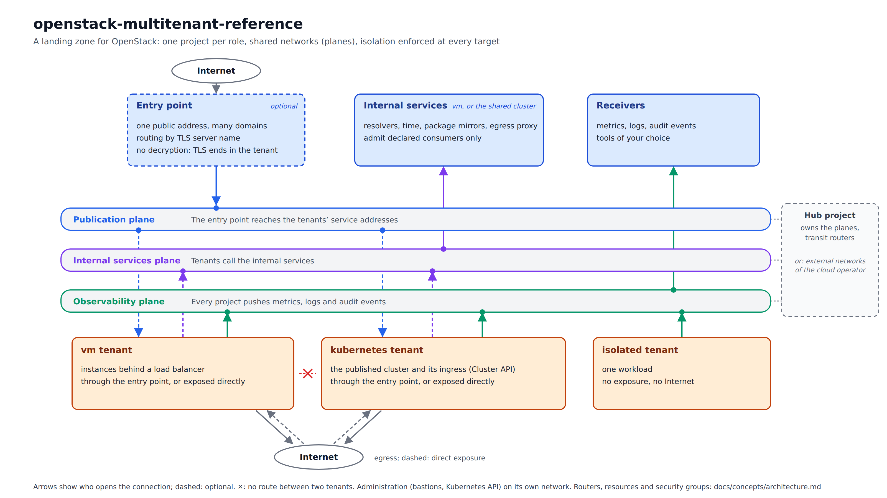

# openstack-multitenant-reference

[](https://github.com/CyprisTech/openstack-multitenant-reference/actions/workflows/ci.yml)
[](LICENSE)
[](https://github.com/CyprisTech/openstack-multitenant-reference/releases)
[](https://opentofu.org)
[](https://www.terraform.io)
[](docs/concepts/test-results.md)
[](https://scorecard.dev/viewer/?uri=github.com/CyprisTech/openstack-multitenant-reference)
[](https://www.bestpractices.dev/projects/16343)

A landing zone for OpenStack: a reference architecture, with deployable OpenTofu and Terraform code, for organising your projects on an OpenStack cloud — tenants isolated from each other, sharing networks and services under explicit, tested rules.



**Read:** [why](#why) and the [design areas](#design-areas) to evaluate it, [getting started](#getting-started) to deploy it, the [ADRs](docs/adr/README.md) for the reasoning.

## Contents

- [Why](#why) · [Terms](#terms) · [Design areas](#design-areas) · [Principles](#principles) · [How it fits together](#how-it-fits-together)
- [What the repository contains](#what-the-repository-contains) · [Built on terraform-openstack-tenant](#built-on-terraform-openstack-tenant) · [Scope](#scope)
- [Getting started](#getting-started) · [Day-to-day](#day-to-day) · [Before production](#before-production) · [Documentation](#documentation)
- [Status](#status) · [Requirements](#requirements) · [Contributing](#contributing) · [Security](#security) · [License](#license)

## Why

Public clouds call it a *landing zone*: the structure an organisation puts in place before running workloads — how resources are divided, how networks connect, how services are exposed, observed and administered, and how isolation is enforced. AWS, Azure and Google Cloud provide one, and the design areas they cover are well established.

OpenStack provides the building blocks — projects, Neutron networks and routers, Octavia, Designate, Keystone — but no organising layer above them: no transit gateway or peering between projects, no shared ingress, no conventions spanning the projects of an organisation. Each deployment reinvents them, usually as a few shared networks and hand-written rules whose effect nobody can verify. This repository proposes that layer as a reference: decisions, reusable code and a tested scenario.

## Terms

| Term | Meaning |
|---|---|
| Tenant | A project running workloads, isolated from the other tenants |
| Shared service | A service run once for several tenants, in its own project; the entry point that publishes the tenants' domains is one |
| Plane | A shared network that connects tenants and shared services; any number, each with its own purpose. Each project joins it through its own router and, on each plane, either provides a service (role `shared`) or consumes (role `tenant`) |
| Operator plane | A plane provided by the cloud operator as an external network |
| Hub plane, hub project | A plane you build yourself, with a member role, as a network of a hub project shared with the other projects; the hub project holds the planes and a transit router, and runs nothing |
| Service address | The address through which a tenant exposes a service; the domains it serves are published to it |
| Ingress | A cluster's entry for HTTP traffic: Traefik as a Gateway API controller, behind a load balancer at an address prepared by the stack. Applications attach `HTTPRoute`s to its `Gateway`; the Kubernetes `Ingress` object is not used |
| Integration point | Where a platform service of your choice (metrics, logs, backups…) plugs in: plane, flows, admission, what each stack configures |
| Region | A set of OpenStack services with its own endpoints. A project is not tied to a region; its resources and the planes are. Each region has its own planes, hub and entry point; an encrypted overlay joins the hubs of several regions |
| Site | The name of a region in a deployment, an input of every stack and part of every name |
| Cloud operator | Who runs the OpenStack cloud: the provider, or your own infrastructure team |
| Administrators | Who deploys and runs the stacks of this reference, from named addresses |

## Design areas

The design areas of a landing zone, and the answer of this reference to each. The decisions are recorded in [ADRs](docs/adr/README.md); [Status](#status) gives the release that delivers each area.

| Design area | Question | Answer of this reference |
|---|---|---|
| Resource organisation | How are the projects organised? | One project per tenant, per shared service, and a hub project for the shared networks ([ADR-0003](docs/adr/0003-scope-and-boundary.md)) |
| Network topology and connectivity | How do isolated projects reach common networks and services? | Shared networks (*planes*), any number, provided by the cloud operator or built with a member role; each project provides or consumes on each plane, and routes follow from these roles. Several regions are joined by an encrypted overlay between their hubs ([ADR-0004](docs/adr/0004-planes-and-isolation.md), [ADR-0003](docs/adr/0003-scope-and-boundary.md) D2) |
| Network services | How do tenants resolve names, keep time, install packages and reach the Internet? | Resolvers, time and package mirrors offered as shared services on the planes; egress to the Internet only through a declared path; IPv4 and IPv6 ([network services](docs/concepts/architecture.md#network-services)) |
| Security and isolation | What keeps projects apart, and how is it proven? | Security groups at every target, a stated threat model, and an executable test of every flow, allowed and denied ([ADR-0004](docs/adr/0004-planes-and-isolation.md)) |
| Exposure | How are services published to the Internet? | One address per service; a shared entry point for many domains on few addresses, or an address per tenant; TLS stays with the tenant, which obtains its certificates by ACME DNS-01 ([ADR-0006](docs/adr/0006-exposure.md)) |
| Observability | How are isolated projects observed? | Metrics, logs and audit events pushed by each project to receivers of your choice; nothing connects into a project ([ADR-0007](docs/adr/0007-monitoring.md)) |
| Identity and access | Who administers what, from where? | One least-privilege credential per stack and project; bastions and APIs open to named administrator addresses only ([ADR-0005](docs/adr/0005-stacks-contracts-and-access.md)) |
| Resilience and continuity | What survives the loss of a host, a zone, a site? | Instances and load balancers spread over hosts and availability zones; an entry point per region with failover by DNS; the architecture rebuilt from code and protected states; tenant data backed up through an integration point ([resilience](docs/concepts/architecture.md#resilience-and-continuity)) |
| Automation | How is it all described and changed? | Independent stacks, one state and one credential each, contracts passed as outputs, a tested procedure, a GitOps pipeline as an integration point ([ADR-0005](docs/adr/0005-stacks-contracts-and-access.md)) |
| Workload platforms | What runs in a project? | Virtual machines, or Kubernetes created with Cluster API, both in the same isolation model. The reference owns what the landing zone requires of the cluster lifecycle; upgrades and scaling are Cluster API's ([ADR-0003](docs/adr/0003-scope-and-boundary.md) D3, [ADR-0002](docs/adr/0002-platform-kubernetes.md), [ADR-0009](docs/adr/0009-kubernetes-lifecycle.md)) |
| Governance, identity federation, cost | Quotas, single sign-on, budgets | Level 1, not in this repository: projects, quotas and roles through the module's [`cloud-baseline`](https://github.com/CyprisTech/terraform-openstack-tenant) on a private cloud, or the provider's IAM on a public one; single sign-on and budgets are yours ([scope](#scope)) |

## Principles

- **The project is the unit of isolation.** Every tenant and every shared service has its own credentials, quotas and networks.
- **Everything that crosses projects goes through a declared shared network.** Nothing is reached through an undeclared path; tenants never reach each other.
- **Isolation is enforced at each target and verified.** Routes are not a security boundary; security groups are, and a test probes every flow after each change.
- **Flows are initiated by the side that holds the route back.** Tenants expose one address per service and push what they send; nothing opens a way into a tenant for someone else's convenience.
- **The reference owns the architecture, not the tools.** Platform services (metrics, logs, internal services) plug into documented integration points with the tools you choose ([integration points](docs/reference/integration-points.md)).
- **Works with a member role.** Nothing requires administrator rights on the cloud, so it applies to public and sovereign clouds as well as private ones.

## How it fits together

The [overview](#openstack-multitenant-reference) at the top shows how the parts fit together. Arrows show who opens the connection: the entry point reaches the tenants' service addresses through the publication plane, the tenants push to the receivers and call the internal services through the other planes, and nothing on a plane opens a connection into a tenant. Each tenant joins only the planes it needs. The planes shown are those of the reference scenario; the [architecture](docs/concepts/architecture.md) details each part.

## What the repository contains

| Layer | Content | Use |
|---|---|---|
| Decisions | [ADRs](docs/adr/README.md), [trade-offs](docs/concepts/trade-offs.md), [who it is for](docs/concepts/audiences.md) | read, challenge, adapt |
| Building blocks | [`stacks/shared/planes`](stacks/shared/planes/README.md) (any planes, a role per plane, provided or built), [`modules/`](modules) (joining a plane, admission rules, bastion, metrics agent, ACME client, [Kubernetes cluster](modules/kubernetes-cluster/README.md)) | use as they are |
| Reference scenario | Three planes (publication, observability, internal services); a shared entry point; a metrics receiver and an internal service, test fixtures that stand in for yours; the [shared cluster](stacks/shared/kubernetes/README.md) (a Kubernetes cluster for shared services), whose services are demonstrated, not operated; three tenant types ([`vm`](stacks/tenants/vm/README.md), [`isolated`](stacks/tenants/isolated/README.md), [`kubernetes`](stacks/tenants/kubernetes/README.md)); the [isolation test](docs/guides/check-isolation.md) | deploy as a working example, then adapt or extend |

The scenario is one instance of the design, chosen to exercise the design areas. Its three planes, by purpose and by name in the code:

| Purpose | Key in `shared/planes` |
|---|---|
| Publication: the entry point reaches the tenants' service addresses | `publication` |
| Observability: every project pushes its metrics, logs and audit events | `observability` |
| Internal services offered to some tenants | `internal` |

Another plane or shared service is declared in `shared/planes`; the stacks that join it name it in their call to [`modules/plane-attachment`](modules/plane-attachment/README.md). Each stack has its own state and `clouds.yaml` entry ([architecture](docs/concepts/architecture.md)).

| Stack | Role in the scenario |
|---|---|
| [`stacks/shared/planes`](stacks/shared/planes/README.md) | The planes: adopts the cloud operator's external networks, or builds shared networks in the hub project with a transit router; derives the routes of every project |
| [`stacks/shared/entry-point`](stacks/shared/entry-point/README.md) | A load balancer and two proxies routing by TLS server name to the tenants' service addresses, without decrypting |
| [`stacks/shared/kubernetes`](stacks/shared/kubernetes/README.md) | The shared cluster, not published: an internal ingress and layer 4 services, admitted to their consumers only |
| [`stacks/tenants/vm`](stacks/tenants/vm/README.md) | Virtual machines behind a load balancer, published through the entry point or with their own address |
| [`stacks/tenants/isolated`](stacks/tenants/isolated/README.md) | A workload with no exposure and no way out but the observability plane |
| [`stacks/tenants/kubernetes`](stacks/tenants/kubernetes/README.md) | The published cluster, a Kubernetes cluster created with Cluster API ([node image](images/kubernetes-node/README.md)) |

## Built on terraform-openstack-tenant

Every stack describes its project with the [terraform-openstack-tenant](https://github.com/CyprisTech/terraform-openstack-tenant) module, and inherits its properties:

- **One model for every project.** Tenants, shared services and the hub are described the same way — networks, routers, security groups, instances, load balancers, DNS — so the architecture is a composition, not a collection of scripts.
- **Composition across stacks and teams.** Objects owned by another stack are passed in as values (*adoption*), never looked up behind the caller's back; outputs follow a provider-neutral contract that upper layers (Kubernetes, configuration management, inventories) consume.
- **Safe day-to-day changes.** Every resource key comes from the input: one plan, no `-target`, and an empty plan after apply. Lifecycle behaviours are fixed and documented, and inputs are validated before anything is created.
- **Least privilege by construction.** A member role on the project is enough; the module reads no other project and creates no unnecessary secret.
- **No imposed tooling.** No backend, secret store or CI tool; OpenTofu and Terraform on equal footing; tested on a real cloud before every release.
- **The same model down to the foundation.** Its [`cloud-baseline`](https://github.com/CyprisTech/terraform-openstack-tenant) module describes what needs the administrator role — projects, quotas, users, shared networks — with the same model, for private clouds.

## Scope

The reference owns how the projects are organised, connected, exposed and kept available. The cloud foundation below, the platform services and the workloads above, and what joins from outside connect to it at a stated place ([ADR-0003](docs/adr/0003-scope-and-boundary.md)).


For each need outside it, where it connects: [who it is for](docs/concepts/audiences.md#outside-the-reference-compatible-with-it). For a single project, use [terraform-openstack-tenant](https://github.com/CyprisTech/terraform-openstack-tenant) and its examples directly.

## Getting started

- [Getting started](docs/getting-started/README.md): one path for every cloud; only the configuration of the planes differs. About 20 minutes with the entry point and a `vm` tenant.

<details>
<summary>Output of a real run: HTTPS through the entry point, then the isolation test (interface mode, one project per stack, 2026-11-03)</summary>

```console
$ for d in site-a.example.org site-b.example.org apps.published.example.org; do
    for i in $(seq 12); do curl -sk --resolve $d:443:$LB https://$d/ | grep -E "client=|X-Real-Ip"; done | sort | uniq -c; done
     12 host=site-a.example.org  client=198.51.100.100
     12 host=site-b.example.org  client=198.51.100.100
     12 X-Real-Ip: 198.51.100.100
$ python3 tests/isolation/check.py --receiver tests/fixtures/receiver --key ~/.ssh/id_ed25519 --published-kubeconfig published.kubeconfig
from                   to                                                    port  expected actual
test runner            entry point (public IP)                                443  open     open     ok
test runner            entry point (public IP)                                 80  open     open     ok
test runner            web service address 10.21.0.90                         443  closed   closed   ok
edge t1-edge-1         web service address 10.21.0.90                         443  open     open     ok
edge t1-edge-1         web t1-web-1 (private 10.21.0.144)                     443  closed   closed   ok
isolated t1-isolated-1 web service address 10.21.0.90                         443  closed   closed   ok
web t1-web-1           edge t1-edge-1 (private 10.20.0.46)                    443  closed   closed   ok
edge t1-edge-1         receiver 10.34.0.12                                   9090  open     open     ok
web t1-web-1           receiver 10.34.0.12                                   9090  open     open     ok
isolated t1-isolated-1 receiver 10.34.0.12                                   9090  open     open     ok
receiver               t1-edge-1 metrics (private 10.20.0.46)                9100  closed   closed   ok
receiver               t1-web-1 metrics (private 10.21.0.144)                9100  closed   closed   ok
receiver               t1-isolated-1 metrics (private 10.22.0.127)           9100  closed   closed   ok
receiver               series pushed by edge                                    -  yes      yes      ok
receiver               series pushed by web                                     -  yes      yes      ok
receiver               series pushed by isolated                                -  yes      yes      ok
web t1-web-1           isolated t1-isolated-1 (private 10.22.0.127)            22  closed   closed   ok
isolated t1-isolated-1 web t1-web-1 (private 10.21.0.144)                     443  closed   closed   ok
isolated t1-isolated-1 Internet (192.0.2.1)                                     443  closed   closed   ok
published Service      ingress on the stack address                             -  yes      yes      ok
edge t1-edge-1         published ingress 10.24.0.10                           443  open     open     ok
test runner            published ingress 10.24.0.10                           443  closed   closed   ok
web t1-web-1           published ingress 10.24.0.10                           443  closed   closed   ok
isolated t1-isolated-1 published ingress 10.24.0.10                           443  closed   closed   ok
published pod          receiver 10.34.0.12                                   9090  open     open     ok
receiver               series pushed by published                               -  yes      yes      ok
test runner (administrator) published Kubernetes API 198.51.100.1             6443  open     open     ok
published pod          edge bastion 198.51.100.2 (SSH)                          22  closed   closed   ok
published pod          web bastion 192.0.2.100 (SSH)                           22  closed   closed   ok
published pod          isolated bastion 192.0.2.101 (SSH)                      22  closed   closed   ok
published pod          internal service 198.51.100.3                          8080  open     open     ok
web t1-web-1           internal service 198.51.100.3                          8080  closed   closed   ok
isolated t1-isolated-1 internal service 198.51.100.3                          8080  closed   closed   ok

33/33 rows as expected
```

</details>

## Day-to-day

| Task | Guide |
|---|---|
| Add a tenant | [add-a-tenant](docs/guides/add-a-tenant.md) |
| Publish a domain | [publish-a-domain](docs/guides/publish-a-domain.md) |
| Open a service after qualification | [open-a-service](docs/guides/open-a-service.md) |
| Give a tenant trusted certificates | [certificates](docs/guides/certificates.md) |
| Check the isolation after a change | [check-isolation](docs/guides/check-isolation.md) |
| Discover the published cluster | [kubernetes-tour](docs/guides/kubernetes-tour.md) |
| Upgrade a Kubernetes cluster, rotate its credential | [kubernetes-lifecycle](docs/guides/kubernetes-lifecycle.md) |
| Tear down | [teardown](docs/guides/teardown.md) |

## Before production

This is a reference, not an operated platform. What stays yours:

- **the tools** behind the integration points: metrics, logs and audit receivers, backup and secret stores;
- **identity**: single sign-on for the administration access (your identity provider, or the provider's IAM);
- **certificates**: the tenants run in demonstration mode (self-signed) until `certificates` is set ([guide](docs/guides/certificates.md));
- **capacity**: quotas per project ([sizing](docs/concepts/architecture.md#sizing)) and room per compute host — the entry point instances are in anti-affinity, and a replacement needs room on another host;
- **the trade-offs**: read [them](docs/concepts/trade-offs.md) against your own constraints.

## Documentation

| | |
|---|---|
| **Getting started** | [Getting started](docs/getting-started/README.md) · [Where the planes come from](examples/planes/README.md) |
| **Guides** | [Add a tenant](docs/guides/add-a-tenant.md) · [Publish a domain](docs/guides/publish-a-domain.md) · [Open a service](docs/guides/open-a-service.md) · [Certificates](docs/guides/certificates.md) · [Check the isolation](docs/guides/check-isolation.md) · [Kubernetes tour](docs/guides/kubernetes-tour.md) · [Kubernetes lifecycle](docs/guides/kubernetes-lifecycle.md) · [Tear down](docs/guides/teardown.md) |
| **Reference** | [Integration points](docs/reference/integration-points.md) · [Planes contract](docs/reference/planes-contract.md) · [Isolation matrix](docs/reference/isolation-matrix.md) · [Test procedure](docs/reference/test-procedure.md) · [Domain publication script](scripts/publish-domains.sh) · stack READMEs above |
| **Concepts** | [Who it is for](docs/concepts/audiences.md) · [Architecture](docs/concepts/architecture.md) · [How a tenant joins a plane](docs/concepts/plane-attachment.md) · [Connecting two tenants](docs/concepts/connecting-tenants.md) · [Trade-offs](docs/concepts/trade-offs.md) · [Landscape](docs/concepts/landscape.md) · [Test results](docs/concepts/test-results.md) · [ADRs](docs/adr/README.md) · [Specs](docs/specs/README.md): [Kubernetes cluster for shared services](docs/specs/kubernetes-shared-services.md), [Certificates of the tenants](docs/specs/tenant-certificates.md) |
| **Tests** | [Isolation test](tests/isolation/README.md) · fixtures: [metrics receiver](tests/fixtures/receiver/README.md), [internal service](tests/fixtures/internal-service/README.md), [ACME authority](tests/fixtures/acme/README.md) · [node image boot check](tests/integration/node-image/README.md) |
| **Project** | [Changelog](CHANGELOG.md) · [Contributing](CONTRIBUTING.md) · [Support](SUPPORT.md) · [Security](SECURITY.md) |

## Status

The design above is the target of `v1.0`. Each release delivers part of it, tested end to end on a real cloud ([test results](docs/concepts/test-results.md)); the order of the next ones may change.

| Release | Design areas delivered | |
|---|---|---|
| `v0.1` – `v0.2` | First entry point, tenants and isolation test, operator planes only | released |
| `v0.3` | Resource organisation; planes provided by the cloud operator or built with a member role; isolation and its test; exposure by service addresses, domains published without interruption; the integration point for metrics (push contract, the receiver is yours); identity and access; automation; VM and Kubernetes tenants | released |
| **`v0.4`** | Certificates of the tenants ([spec](docs/specs/tenant-certificates.md)); a Kubernetes cluster for shared services ([spec](docs/specs/kubernetes-shared-services.md)); the Kubernetes lifecycle the landing zone requires ([ADR-0009](docs/adr/0009-kubernetes-lifecycle.md)); direct exposure of both tenant types, without the entry point | released |
| `v0.5` | Availability zones; recovery of the architecture | |
| `v0.6` | Network services: resolvers, time, package mirrors, egress; IPv6; routed operator planes (address scopes, with [`cloud-baseline`](https://github.com/CyprisTech/terraform-openstack-tenant)) | |
| `v0.7` | Integration points, contracts only (the tools are yours): logs and audit; backups of tenant data; secrets; a GitOps pipeline | |
| `v0.8` | Several regions joined by an encrypted overlay; failover of the entry point between regions | |
| `v1.0` | The whole design, tested on a private and on a public OpenStack cloud; stable interfaces | |
| after `v1.0` | Integrations of platform tools (level 3) in a separate repository, when users ask for them | |

The current state is tested on a private OpenStack 2025.1 cloud (OpenStack-Ansible, OVN, Octavia amphora, Designate) with OpenTofu 1.13.2 and provider 3.4.0, each stack in its own project, from empty projects, with both kinds of planes: apply, empty plan after apply, HTTPS end to end, a domain published under load without a lost request, certificates from an internal ACME authority on both tenant types, the shared cluster with its consumers, credential rotation and Kubernetes upgrade, isolation test (44/44 with the shared cluster, 47/47 with the published cluster, on both kinds of planes), destroy without leftover. Let's Encrypt takes the same path with another directory; it is not tested by the maintainers. CI validates every configuration on OpenTofu and Terraform, lowest supported and latest.

## Requirements

| Component | Requirement |
|---|---|
| OpenTofu or Terraform | >= 1.9 |
| Provider `terraform-provider-openstack/openstack` | `~> 3.2` |
| Module | [terraform-openstack-tenant](https://github.com/CyprisTech/terraform-openstack-tenant) `v0.1.5`, pinned in every stack |
| OpenStack | Keystone v3, Nova (metadata service), Glance, Octavia (amphora); Neutron with routers, and network sharing by RBAC for hub planes; Cinder for boot volumes and Designate for the public records and the ACME DNS-01 challenges, both optional |
| Credentials | One project per tenant and per shared service, plus the hub project for hub planes; project-scoped credentials (`member`, plus `load-balancer_member` if your Octavia policy requires it), one `clouds.yaml` entry per stack |
| Planes | Operator planes: the [planes contract](docs/reference/planes-contract.md) (names, ranges, MTUs, reserved ranges). Hub planes: built by [`stacks/shared/planes`](stacks/shared/planes/README.md) |

Quotas per project: [sizing](docs/concepts/architecture.md#sizing).

## Contributing

Contributions, and test reports from other clouds, are welcome. Read [CONTRIBUTING.md](CONTRIBUTING.md) for the checks, the tests on a real cloud and the commit rules, and follow the [Code of Conduct](CODE_OF_CONDUCT.md). For questions, see [SUPPORT.md](SUPPORT.md).

## Security

Report vulnerabilities privately, as described in [SECURITY.md](SECURITY.md). Never attach state files, credentials or infrastructure details to issues or pull requests.

## License

Copyright © 2025-2026 Cypris Tech and contributors. Licensed under the [Apache License 2.0](LICENSE).

Maintained by [Gregory Gabrielian](https://github.com/CyprisTech) at [Cypris Tech](https://github.com/CyprisTech).
