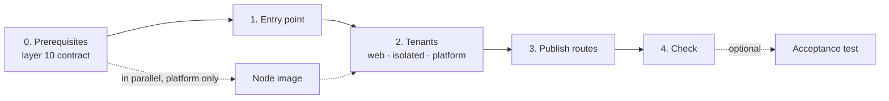

# openstack-multitenant-reference

[](https://github.com/CyprisTech/openstack-multitenant-reference/actions/workflows/ci.yml)
[](LICENSE)
[](https://github.com/CyprisTech/openstack-multitenant-reference/releases)
[](https://opentofu.org)
[](https://www.terraform.io)

A reference architecture for several tenants sharing one OpenStack cloud, Kubernetes included: each tenant isolated in its own project, published through a single public entry point, monitored and administered through dedicated network planes, and **every isolation claim checked by an executable test**. Built on the [terraform-openstack-tenant](https://github.com/CyprisTech/terraform-openstack-tenant) module, with its design choices argued in ADRs and their costs stated.

> [!NOTE]
> **`v0.2.0`:** the public entry point, the `web` and `isolated` tenants with bastions and monitoring, and the Kubernetes `platform` tenant (Cluster API Provider OpenStack); reachability matrix **43/43**, full teardown without leftover ([test report](docs/testing.md)). Layer 10 (the shared planes) is provided by the operator through a [contract](docs/architecture.md#layer-10-contract); cloud-baseline will provide it with module `v0.2`.

**Start here:** [quick start](#quick-start) to deploy it, [what it demonstrates](#what-it-demonstrates) to judge it, [landscape](docs/landscape.md) for the technologies.

## Table of contents

- [Who it is for](#who-it-is-for)
- [What it demonstrates](#what-it-demonstrates)
- [Ready for, not yet demonstrated](#ready-for-not-yet-demonstrated)
- [Architecture](#architecture)
- [Architecture overview](#architecture-overview)
- [Status](#status)
- [Requirements](#requirements)
- [Quick start](#quick-start)
- [Acceptance test](#acceptance-test)
- [Documentation](#documentation)
- [Roadmap](#roadmap)
- [Related project](#related-project)
- [Contributing](#contributing)
- [Security](#security)
- [License](#license)

## Who it is for

Platform teams, integrators and cloud architects who run workloads for several tenants on a **private or sovereign OpenStack cloud**, without a managed Kubernetes service and without admin rights on the cloud, and who must show that tenants are isolated. Use it as a design to adapt, a set of tested stacks to start from, or a checklist of what bites in practice (the [test report](docs/testing.md) lists every defect the tests revealed).

## What it demonstrates


| Claim | How | Proof |
|---|---|---|
| **Isolation is tested, not asserted** | The reachability matrix of the specification is a script: it probes every flow from outside, from inside each tenant and from the Kubernetes cluster, and fails on any difference | [`tests/reachability`](tests/reachability/README.md): 43/43 rows |
| **A network model where every flow is explicit** | One project per tenant; shared planes (`svc_public`, `monitoring`, `intranet`); one router per plane with source NAT; publishing on a plane with a floating IP of that plane; security groups that admit addresses as seen through source NAT | [Network topology of a tenant](docs/architecture.md#network-topology-of-a-tenant) |
| **One public entry point, TLS kept by each tenant** | Octavia in TCP mode and two Traefik instances routing by SNI without decrypting; the client address carried by a single PROXY v2 header to the application, through a second load balancer for Kubernetes | [Ingress data path](docs/architecture.md#ingress-data-path); 12/12 requests with the client address |
| **Kubernetes inside the same model** | Cluster API with CAPO: declarative cluster from a ClusterClass, self-managed after `clusterctl move`; ingress, metrics and API published on the planes like any tenant; machine remediation, certificate rotation, metrics-server | [ADR-0002](docs/adr/0002-platform-kubernetes.md), [platform tour](docs/platform-tour.md) |

## Ready for, not yet demonstrated

The design leaves room for the following; none of them is tested yet, so none of them is claimed.

| Topic | Why it fits | What a test would add |
|---|---|---|
| **GitOps** | Everything Cluster API needs is plain YAML (ClusterClass, Cluster, add-on proxies), rendered by the stack: Flux or Argo CD can reconcile it as is | A reconciliation loop that reverts drift ([trade-off 12](docs/trade-offs.md#12-add-ons-declared-with-cluster-api-not-gitops)) |
| **Several sites** | The site is an input of every stack and part of every name; routes and records come from outputs, never from hand-written addresses | An edge per site, a DNS switch, a failover drill ([sites](docs/architecture.md#sites)) |
| **Backups** | Volumes are Cinder volumes behind the CSI driver; etcd runs on kubeadm control-plane nodes: standard tools (Velero, etcd snapshots) apply unchanged | A restore drill |

**Public clouds need more than a test.** Layers 20 and 30 need no admin rights, but the layer 10 contract asks for planes that are external networks, which only a cloud's operator can create: the reference targets private and sovereign clouds you operate. Realising the planes as shared private networks on a public cloud (an OVHcloud vRack, for example) is specified for a later milestone: [plane bindings](docs/specs/plane-bindings.md).

It is a reference, not a product: stacks to read, run and adapt.

The technologies used at each layer, and why, are on one page: [landscape](docs/landscape.md).

## Architecture


The cloud operator provides **layer 10**: the shared network planes, the public and administration networks, the monitoring DNS zone and the collector. **Layer 20** is the single public entry point. **Layer 30** holds the tenants, each in its own stack, joining only the planes it needs. Every instance is exposed to the collector through a floating IP of the monitoring plane, and administered through an optional bastion of its stack.

One state per stack. Stacks find each other's objects by name, never through remote state, and each takes its own `clouds.yaml` entry, so the tenants can live in one project or in several. The full topology, the request flow and the decisions are in [docs/architecture.md](docs/architecture.md) and [ADR-0001](docs/adr/0001-reference-architecture.md).

## Architecture overview

| Component | Where | What it does |
|---|---|---|
| **Layer 10** (operator) | [contract](docs/architecture.md#layer-10-contract) | Shared planes `svc_public`, `monitoring`, `intranet`; public and administration networks; monitoring DNS zone; the collector and its addresses; MTU and reserved ranges |
| **Public entry point** | [`stacks/20-public-edge`](stacks/20-public-edge/README.md) | Octavia in TCP on 80 and 443 in front of two Traefik instances on different hosts: routing by SNI without decrypting, client address forwarded with PROXY v2 |
| **Tenant `web`** | [`stacks/30-tenants/web`](stacks/30-tenants/web/README.md) | Two web instances published on `svc_public`, reachable from the entry point only; outputs its routes |
| **Tenant `isolated`** | [`stacks/30-tenants/isolated`](stacks/30-tenants/isolated/README.md) | A workload whose only router joins the monitoring plane: no public address, no Internet, no path to other tenants |
| **Tenant `platform`** (optional) | [`stacks/30-tenants/platform`](stacks/30-tenants/platform/README.md), [`images/kubernetes-node`](images/kubernetes-node/README.md) | Kubernetes with Cluster API: ingress on `svc_public` behind the entry point, Prometheus on `monitoring`, API on the administration network; node image built with image-builder |
| **Route publication** | [`scripts/publish-routes.sh`](scripts/publish-routes.sh) | Collects the routes of the tenants and rolls them onto the entry point, one instance at a time; no address written by hand |
| **Bastions** (optional, every stack) | each stack | Small instance with a floating IP on the administration network and a second port on the tenant network; SSH to the tenant instances only from it |
| **Acceptance test** | [`tests/`](tests/reachability/README.md) | Reachability matrix with a test collector and an intranet demonstration service (test fixtures, not part of the architecture) |

## Status

| Part | Status |
|---|---|
| ADR-0001, architecture specification, trade-offs | done |
| Stack 20 `public-edge` | delivered, tested |
| Stacks 30 `web` and `isolated`, bastions | delivered, tested |
| Monitoring through floating IPs and DNS discovery | delivered, tested |
| Executable reachability matrix and test collector | delivered; 27/27 rows in v0.1.0, 43/43 with `platform` |
| Kubernetes node image (image-builder) | delivered in v0.2.0, tested |
| Stack 30 `platform` (Kubernetes, CAPO): ingress, federation, API restricted to operators, teardown | delivered in v0.2.0, tested |
| Machine remediation, certificate rotation, metrics-server; rolling replacement of all machines | tested; requests lost during node drains, fix to do ([testing](docs/testing.md)) |
| Kubernetes version upgrade, scaling, credential rotation | next |
| GitOps, several sites, backups | the design is ready for them; not tested |
| Layer 10 as code (`stacks/10-shared-planes`, cloud-baseline) | planned, with module `v0.2` |
| Failover between sites | later |

Tested on a private OpenStack 2025.1 cloud (OpenStack-Ansible, Neutron with OVN, Octavia amphora, Designate) with OpenTofu 1.13.2 and provider 3.4.0: apply, empty plan after apply, HTTPS end to end, reachability matrix, destroy without leftover. CI validates every configuration on OpenTofu and Terraform, lowest supported version and latest. Results, and the defects the tests revealed, are in [docs/testing.md](docs/testing.md). Not yet tested on a public OpenStack cloud.

## Requirements

| Component | Requirement |
|---|---|
| OpenTofu or Terraform | >= 1.9 |
| Provider [`terraform-provider-openstack/openstack`](https://registry.terraform.io/providers/terraform-provider-openstack/openstack/latest) | `~> 3.2` |
| Module | [terraform-openstack-tenant](https://github.com/CyprisTech/terraform-openstack-tenant) `v0.1.2`, pinned by tag in every stack |
| OpenStack services | Keystone v3, Nova, Neutron (routers, floating IPs from several external networks on one port), Glance, Octavia; Cinder for boot volumes (optional); Designate for the monitoring and public DNS records (optional) |
| Credentials | Project-scoped, no admin role: for example an application credential with `member` (plus `load-balancer_member` if your Octavia policy requires it); one `clouds.yaml` entry per stack |
| Tools for the matrix | Python 3 (standard library), `ssh`, `jq` |

**Layer 10 contract.** The operator must provide, per site ([full list](docs/architecture.md#layer-10-contract)):

- the networks `svc_public` and `monitoring` (`intranet` for `platform`), visible to the tenant projects, each with a subnet usable as a router gateway, and their CIDRs;
- a public network with floating IPs reachable from the Internet, and a default route to the Internet for package installation at first boot;
- the **MTU** of each plane and of the tenant overlay: set `network_mtu` to the smallest value. OVN routers do not send "fragmentation needed" by default, so a larger MTU silently drops large packets (the TLS handshake hangs);
- the address ranges reserved by the cloud, which tenant networks must avoid;
- a DNS zone shared with the projects for the monitoring records, and the collector's addresses (`monitoring.collector_cidrs`);
- an Octavia flavor (active/standby recommended for the entry point), an Ubuntu LTS image and flavors.

**Quotas.** Layers 20 and 30 of v0.1.0 need at least 5 instances, 9 vCPU, 9 GiB of RAM, 1 load balancer and 8 floating IPs (1 public, 2 `svc_public`, 5 `monitoring`), plus one small instance and one floating IP per bastion, and the test collector. The [sizing table](docs/architecture.md#sizing) gives the figures per project, `platform` included.

## Quick start



> [!WARNING]
> These steps create real resources: instances, Octavia load balancers, floating IPs and DNS records. Use a dedicated project.

Two paths: **see it work** (steps 0 to 4 with `web` only, about 20 minutes, no Kubernetes) or **the full reference** (every tenant, then the acceptance test). Every stack follows the same pattern: copy `terraform.tfvars.example` to `terraform.tfvars` (git-ignored), adapt it, then `tofu init && tofu apply` (`terraform` works the same). The examples use fictional names and documentation address ranges.

### 0. Prerequisites

- OpenTofu or Terraform ≥ 1.9, `jq`, Python 3, `ssh` and the `openstack` client.
- A `clouds.yaml` entry for each stack, with a project-scoped credential (`member`, plus `load-balancer_member` if your Octavia policy requires it). No `OS_*` variable in the shell: the client would mix it with the entry.
- The [layer 10 contract](docs/architecture.md#layer-10-contract) met: plane names and ranges, MTU (`network_mtu`), monitoring DNS zone, reserved ranges, **and the addresses of your collector** (`monitoring.collector_cidrs`). Without a collector, use `[]`: metrics stay closed.
- An SSH key in `admin.users` of every stack, and the same `site` in every stack.
- For `platform` only: build the [node image](images/kubernetes-node/README.md) now, in parallel; it depends on nothing else.

### 1. Public entry point

```bash
cd stacks/20-public-edge && cp terraform.tfvars.example terraform.tfvars   # adapt
tofu init && tofu apply
```

### 2. Tenants

Independent of each other; apply the ones you need.

```bash
cd stacks/30-tenants/web      && cp terraform.tfvars.example terraform.tfvars && tofu init && tofu apply
cd stacks/30-tenants/isolated && cp terraform.tfvars.example terraform.tfvars && tofu init && tofu apply
```

`platform`: follow [its README](stacks/30-tenants/platform/README.md) (stack, cluster credential, `create-cluster.sh`): about 20 minutes, plus 25 minutes once for the node image.

### 3. Publish routes

```bash
OS_CLOUD=<entry of stack 20> scripts/publish-routes.sh
```

It gathers the routes of the tenants and replaces the entry point instances one at a time; run it again after any change of a tenant's routes.

### 4. Check

```bash
curl -k --resolve site-a.example.org:443:<public IP of the entry point> https://site-a.example.org/
```

The answer shows the backend and the client address it received through the PROXY protocol. `tofu output load_balancer` in stack 20 gives the public IP.

## Acceptance test

Proves every isolation claim of the [matrix](docs/architecture.md#reachability-matrix). It needs two test fixtures: a [test collector](tests/integration/collector/README.md) (when you have no collector of your own; its `collector_cidrs` output then goes into the stacks) and, with `platform`, the [intranet demonstration service](tests/integration/intranet-service/README.md).

```bash
python3 tests/reachability/check.py --stacks stacks --collector tests/integration/collector \
  --user ops --key ~/.ssh/id_ed25519 \
  --platform-kubeconfig platform.kubeconfig   # with platform
```

Every row prints the source, the destination, the port, the expected and the actual result; the script exits with status 1 if any row differs. The full cycle, with a checkpoint after every step and measured durations, is the [test procedure](docs/test-procedure.md): about 35 minutes from an empty project to the acceptance test. A guided discovery of the cluster, with real outputs, is in [docs/platform-tour.md](docs/platform-tour.md).

### Clean up

Run `delete-cluster.sh` on the platform bootstrap instance, then `tofu destroy` in the reverse order: test fixtures, `platform`, `isolated`, `web`, `20-public-edge`. Delete the node image when you no longer need it.

## Documentation

Suggested reading order: this README, the landscape, the architecture, the trade-offs, the ADRs, then the test report and the platform tour. To deploy, start with the [quick start](#quick-start).

| Document | Content |
|---|---|
| [Quick start](#quick-start) | Deploy the architecture in four steps |
| [Acceptance test](#acceptance-test) | Prove every isolation claim with the reachability matrix |
| [docs/landscape.md](docs/landscape.md) | Technologies per layer, alternatives considered, why |
| [docs/architecture.md](docs/architecture.md) | Topology, flows, reachability matrix, layer 10 contract, sites, sizing |
| [docs/trade-offs.md](docs/trade-offs.md) | What each choice costs and when the alternative is better |
| [docs/adr/](docs/adr/README.md) | Architecture decision records |
| [docs/test-procedure.md](docs/test-procedure.md) | Full test cycle: every step, its checkpoint and measured duration |
| [docs/testing.md](docs/testing.md) | Test environment, results and findings |
| [docs/platform-tour.md](docs/platform-tour.md) | Guided discovery of the Kubernetes cluster, with real outputs |
| [docs/specs/plane-bindings.md](docs/specs/plane-bindings.md) | Spec for a later milestone: planes on public clouds |
| [scripts/publish-routes.sh](scripts/publish-routes.sh) | Publishes the routes of the tenants on the entry point |
| [CHANGELOG.md](CHANGELOG.md) | Changes per release |
| [tests/reachability/](tests/reachability/README.md) | Executable reachability matrix |
| [tests/integration/](tests/integration/) | [Test collector](tests/integration/collector/README.md), [intranet service](tests/integration/intranet-service/README.md), [node image boot check](tests/integration/node-image/README.md), [dual floating IP](tests/integration/dual-floating-ip/README.md) |
| Stack READMEs | [20-public-edge](stacks/20-public-edge/README.md), [30-tenants/web](stacks/30-tenants/web/README.md), [30-tenants/isolated](stacks/30-tenants/isolated/README.md), [30-tenants/platform](stacks/30-tenants/platform/README.md), [images/kubernetes-node](images/kubernetes-node/README.md) |

## Roadmap

| Release | Content | Status |
|---|---|---|
| **v0.1.0** | Layers 20 and 30 in one site (entry point, `web`, `isolated`), bastions, monitoring through floating IPs and DNS, reachability matrix; layer 10 provided by the operator; module `v0.1.2` | released 2026-10-27 |
| **v0.2.0** | Stack 30 `platform`: Kubernetes with Cluster API Provider OpenStack, node image, route publication, hardening (remediation, certificate rotation, metrics-server), Service addresses owned by Terraform, teardown | released 2026-10-28 |
| next | Day-2 operations: Kubernetes upgrade, scaling, credential rotation; no request lost during node drains and entry point replacement | planned |
| later | Layer 10 as code (`stacks/10-shared-planes`) with cloud-baseline (terraform-openstack-tenant `v0.2`) | planned |
| later | GitOps for clusters and add-ons, dedicated management cluster, backups | planned |
| later | Public clouds: planes as shared private networks ([spec](docs/specs/plane-bindings.md)) | specified, not started |
| later | Failover between sites: an edge per site, runbook, failover drill | planned |

## Related project

[terraform-openstack-tenant](https://github.com/CyprisTech/terraform-openstack-tenant): the OpenTofu and Terraform modules every stack of this repository is built on. They describe one OpenStack tenant in a single declarative model; this repository shows how several tenants fit together in one cloud.

## Contributing

Contributions, and test reports from other clouds, are welcome. Read [CONTRIBUTING.md](CONTRIBUTING.md) for the checks, the tests on a real cloud and the commit rules, and follow the [Code of Conduct](CODE_OF_CONDUCT.md). For questions, see [SUPPORT.md](SUPPORT.md).

## Security

Report vulnerabilities privately, as described in [SECURITY.md](SECURITY.md). Never attach state files, credentials or infrastructure details to issues or pull requests.

## License

Copyright © 2025-2026 Cypris Tech and contributors. Licensed under the [Apache License 2.0](LICENSE).

Maintained by [Gregory Gabrielian](https://github.com/CyprisTech) at [Cypris Tech](https://github.com/CyprisTech).
