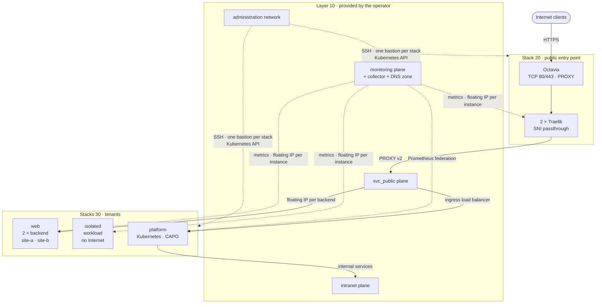

# openstack-multitenant-reference

[](https://github.com/CyprisTech/openstack-multitenant-reference/actions/workflows/ci.yml)
[](LICENSE)
[](https://github.com/CyprisTech/openstack-multitenant-reference/releases)
[](https://opentofu.org)
[](https://www.terraform.io)

A reference architecture for several tenants sharing one OpenStack cloud, Kubernetes included: each tenant isolated in its own project, published through a single public entry point, monitored and administered through dedicated network planes, and **every isolation claim checked by an executable test**. Built on the [terraform-openstack-tenant](https://github.com/CyprisTech/terraform-openstack-tenant) module, with its design choices argued in ADRs and their costs stated.

> [!NOTE]
> **First release, `v0.1.0`:** the public entry point and the `web` and `isolated` tenants, with bastions and monitoring; reachability matrix **27/27**. **Since v0.1.0, on `main`, tested, not yet released:** the Kubernetes `platform` tenant (Cluster API Provider OpenStack); the matrix passes **42/42** rows with it ([test report](docs/testing.md)). Layer 10 (the shared planes) is provided by the operator through a [contract](docs/architecture.md#layer-10-contract); cloud-baseline will provide it with module `v0.2`.

## Table of contents

- [Who it is for](#who-it-is-for)
- [What it demonstrates](#what-it-demonstrates)
- [What it is not](#what-it-is-not)
- [Architecture](#architecture)
- [Architecture overview](#architecture-overview)
- [Status](#status)
- [Requirements](#requirements)
- [Quick start](#quick-start)
- [Documentation](#documentation)
- [Roadmap](#roadmap)
- [Related project](#related-project)
- [Contributing](#contributing)
- [Security](#security)
- [License](#license)

## Who it is for

Platform teams, integrators and cloud architects who run workloads for several tenants on a **private or sovereign OpenStack cloud**, without a managed Kubernetes service and without admin rights on the cloud, and who must show that tenants are isolated. Use it as a design to adapt, a set of tested stacks to start from, or a checklist of what bites in practice (the [test report](docs/testing.md) lists every defect the tests revealed).

## What it demonstrates

| Claim | How | Proof |
|---|---|---|
| **Isolation is tested, not asserted** | The reachability matrix of the specification is a script: it probes every flow from outside, from inside each tenant and from the Kubernetes cluster, and fails on any difference | [`tests/reachability`](tests/reachability/README.md): 42/42 rows |
| **A network model where every flow is explicit** | One project per tenant; shared planes (`svc_public`, `monitoring`, `intranet`); one router per plane with source NAT; publishing on a plane with a floating IP of that plane; security groups that admit addresses as seen through source NAT | [Network topology of a tenant](docs/architecture.md#network-topology-of-a-tenant) |
| **One public entry point, TLS kept by each tenant** | Octavia in TCP mode and two Traefik instances routing by SNI without decrypting; the client address carried by a single PROXY v2 header to the application, through a second load balancer for Kubernetes | [Ingress data path](docs/architecture.md#ingress-data-path); 12/12 requests with the client address |
| **Kubernetes inside the same model** | Cluster API with CAPO: declarative cluster from a ClusterClass, self-managed after `clusterctl move`; ingress, metrics and API published on the planes like any tenant; machine remediation, certificate rotation, metrics-server | [ADR-0002](docs/adr/0002-platform-kubernetes.md), [platform tour](docs/platform-tour.md) |

## What it is not

- **Not a product.** It is a reference: stacks to read, run and adapt. Glue between Terraform and Cluster API is a script; there is no GitOps yet ([trade-offs](docs/trade-offs.md#12-add-ons-declared-with-cluster-api-not-gitops)).
- **Not multi-site.** One site in this version; the code is site-ready ([sites](docs/architecture.md#sites)).
- **No backup.** etcd and application data backups are not covered yet.
- **Not tested on a public cloud yet.** Results come from a private OpenStack 2025.1 cloud.

The technologies used at each layer, and why, are on one page: [landscape](docs/landscape.md).

## Architecture



The cloud operator provides **layer 10**: the shared network planes, the public and administration networks, the monitoring DNS zone and the collector. **Layer 20** is the single public entry point. **Layer 30** holds the tenants, each in its own stack, joining only the planes it needs. Every instance is exposed to the collector through a floating IP of the monitoring plane, and administered through an optional bastion of its stack.

One state per stack. Stacks find each other's objects by name, never through remote state, and each takes its own `clouds.yaml` entry, so the tenants can live in one project or in several. The full topology, the request flow and the decisions are in [docs/architecture.md](docs/architecture.md) and [ADR-0001](docs/adr/0001-reference-architecture.md).

## Architecture overview

The components below are deployed in this order by the [quick start](#quick-start); each title matches a step.

### 0. Prerequisites — layer 10, provided by the operator

The shared planes `svc_public` (backends published to the entry point) and `monitoring` (metrics), the public network (floating IP of the entry point, Internet access at first boot), the administration network (bastions), a DNS zone shared with the projects for the monitoring records, and the collector. The operator also publishes the MTU of the planes and of the tenant overlay, and the address ranges tenants must avoid. Full list: [layer 10 contract](docs/architecture.md#layer-10-contract).

### 1. Test collector

[`tests/integration/collector`](tests/integration/collector/README.md) — a small instance standing for the monitoring collector, so that the reachability matrix can be run. It reaches the monitoring plane through its own router with source NAT: the tenants see one known address, the `collector_cidrs` output, which every stack admits on its metrics ports. With a real collector, use its addresses instead.

### 2. Public entry point

[`stacks/20-public-edge`](stacks/20-public-edge/README.md) — one entry point for every public domain: an Octavia load balancer in TCP on 80 and 443 with PROXY protocol pools, in front of two Traefik instances on different hosts that route by SNI without terminating TLS and forward the client address with PROXY protocol v2. Routers join the public network, `svc_public` and `monitoring`. Outputs the addresses the edge uses on `svc_public`, which the tenants admit.

### 3. Tenant `web`

[`stacks/30-tenants/web`](stacks/30-tenants/web/README.md) — two web instances on different hosts serving `site-a` and `site-b`, each published on `svc_public` with a floating IP of that plane and reachable on 443 from the entry point only. The backend is a demonstration nginx that terminates TLS and reports the client address it received. It reads the entry point's addresses by name, so it is applied after stack 20, and outputs the routes the entry point needs.

### 4. Route publication

Not a stack: the `routes` output of `web` becomes the `routes` variable of stack 20, without writing any address by hand. Routes are written by cloud-init, so the two Traefik instances are replaced **one at a time**: the load balancer always keeps a healthy member.

### 5. Tenant `isolated`

[`stacks/30-tenants/isolated`](stacks/30-tenants/isolated/README.md) — a workload whose only router joins the monitoring plane: no public address, no Internet access, no path to the other tenants. Its metrics endpoint is open to the collector only.

### 6. Kubernetes node image

[`images/kubernetes-node`](images/kubernetes-node/README.md) — a private image built with image-builder (Packer) in its own build network: Kubernetes, containerd and the images of the control plane preinstalled. It outlives the clusters that use it.

### 7. Tenant `platform`

[`stacks/30-tenants/platform`](stacks/30-tenants/platform/README.md) — Terraform prepares the network, its routers to `svc_public`, `monitoring` and `intranet`, and a bootstrap instance; `create-cluster.sh` creates the cluster with Cluster API (three control-plane nodes, workers, add-ons) and moves Cluster API into it. Its ingress is published on `svc_public` and routed by the entry point like any backend; its Prometheus on `monitoring`; its API on the administration network, for operators only.

### 8. Intranet demonstration service

[`tests/integration/intranet-service`](tests/integration/intranet-service/README.md) — an internal service on the intranet that only `platform` may reach, for the matrix.

### 9. Reachability matrix

[`tests/reachability/check.py`](tests/reachability/README.md) — the isolation claims as a test. It probes every flow of the [matrix](docs/architecture.md#reachability-matrix) from the outside, from inside each tenant through its bastion, from the collector and from a pod of the cluster, and fails on any difference: 42 rows with `platform`.

### Bastions (optional, every stack)

Each stack can add a bastion: a small instance in its own network, with a floating IP on the administration network and a second port on the tenant network. SSH to the tenant instances is admitted from the bastion only. The reachability matrix needs them.

## Status

| Part | Status |
|---|---|
| ADR-0001, architecture specification, trade-offs | done |
| Stack 20 `public-edge` | delivered, tested |
| Stacks 30 `web` and `isolated`, bastions | delivered, tested |
| Monitoring through floating IPs and DNS discovery | delivered, tested |
| Executable reachability matrix and test collector | delivered; 27/27 rows in v0.1.0, 42/42 with `platform` |
| Kubernetes node image (image-builder) | on `main`, tested |
| Stack 30 `platform` (Kubernetes, CAPO): ingress, federation, API restricted to operators | on `main`, tested, not yet released |
| Machine remediation, certificate rotation, metrics-server; rolling replacement of all machines | in test ([MR in review](docs/testing.md)) |
| Kubernetes version upgrade, scaling, credential rotation | next |
| Backups (etcd, data) | not covered |
| Layer 10 as code (`stacks/10-shared-planes`, cloud-baseline) | planned, with module `v0.2` |
| Failover between sites | later |

Tested on a private OpenStack 2025.1 cloud (OpenStack-Ansible, Neutron with OVN, Octavia amphora, Designate) with OpenTofu 1.13.2 and provider 3.4.0: apply, empty plan after apply, HTTPS end to end, reachability matrix, destroy without leftover. CI validates every configuration on OpenTofu and Terraform, lowest supported version and latest. Results, and the defects the tests revealed, are in [docs/testing.md](docs/testing.md). Not yet tested on a public OpenStack cloud.

## Requirements

| Component | Requirement |
|---|---|
| OpenTofu or Terraform | >= 1.9 |
| Provider [`terraform-provider-openstack/openstack`](https://registry.terraform.io/providers/terraform-provider-openstack/openstack/latest) | `~> 3.2` |
| Module | [terraform-openstack-tenant](https://github.com/CyprisTech/terraform-openstack-tenant) `v0.1.2`, pinned by tag in every stack |
| OpenStack services | Keystone v3, Nova, Neutron (routers, floating IPs from several external networks on one port), Glance, Octavia; Cinder for boot volumes (optional); Designate for the monitoring and public DNS records (optional) |
| Credentials | Project-scoped, no admin role: for example an application credential with `member` (plus `load-balancer_member` if your Octavia policy requires it); one `clouds.yaml` entry per stack |
| Tools for the matrix | Python 3 (standard library), `ssh`, `jq` |

**Layer 10 contract.** The operator must provide, per site ([full list](docs/architecture.md#layer-10-contract)):

- the networks `svc_public` and `monitoring` (`intranet` for `platform`), visible to the tenant projects, each with a subnet usable as a router gateway, and their CIDRs;
- a public network with floating IPs reachable from the Internet, and a default route to the Internet for package installation at first boot;
- the **MTU** of each plane and of the tenant overlay: set `network_mtu` to the smallest value. OVN routers do not send "fragmentation needed" by default, so a larger MTU silently drops large packets (the TLS handshake hangs);
- the address ranges reserved by the cloud, which tenant networks must avoid;
- a DNS zone shared with the projects for the monitoring records, and the collector's addresses (`monitoring.collector_cidrs`);
- an Octavia flavor (active/standby recommended for the entry point), an Ubuntu LTS image and flavors.

**Quotas.** Layers 20 and 30 of v0.1.0 need at least 5 instances, 9 vCPU, 9 GiB of RAM, 1 load balancer and 8 floating IPs (1 public, 2 `svc_public`, 5 `monitoring`), plus one small instance and one floating IP per bastion, and the test collector. The [sizing table](docs/architecture.md#sizing) gives the figures per project, `platform` included.

## Quick start

```mermaid
flowchart LR
    P["0. Prerequisites"] --> C["1. Test collector"] --> E["2. Public entry point"] --> W["3. Tenant web"] --> R["4. Route publication"] --> I["5. Tenant isolated"] --> IMG["6. Node image"] --> K["7. Tenant platform"] --> S["8. Intranet service"] --> M["9. Reachability matrix"]
```



> [!WARNING]
> These steps create real resources: instances, an Octavia load balancer, floating IPs and DNS records. Use a dedicated project.

Every stack follows the same pattern: copy `terraform.tfvars.example` to `terraform.tfvars` (git-ignored), adapt it to your cloud, then `tofu init && tofu apply` (`terraform` works the same). The examples use fictional names and documentation address ranges.

### 0. Prerequisites

- OpenTofu or Terraform ≥ 1.9, `jq`, Python 3 and `ssh`.
- A `clouds.yaml` entry for each stack, with a project-scoped credential (`member`, plus `load-balancer_member` if your Octavia policy requires it). No `OS_*` variable in the shell: the client would mix it with the entry.
- The [layer 10 contract](docs/architecture.md#layer-10-contract) met: plane names and ranges, MTU (`network_mtu`), monitoring DNS zone, reserved ranges to avoid.
- An SSH key: put its public part in `admin.users` of every stack and in `ssh_keys` of the collector.
- The same `site` in every stack: it prefixes the resource names, and the tenants find the entry point by it.

### 1. Test collector

```bash
cd tests/integration/collector
tofu init && tofu apply
tofu output -json collector_cidrs
```

Set this value as `monitoring.collector_cidrs` in the three stacks.

### 2. Public entry point

```bash
cd stacks/20-public-edge
cp terraform.tfvars.example terraform.tfvars   # public_network, planes, network_mtu, monitoring, bastion
tofu init && tofu apply
```

Check: `tofu output load_balancer` gives the public floating IP; port 80 answers with a redirection to HTTPS.

### 3. Tenant `web`

```bash
cd stacks/30-tenants/web
cp terraform.tfvars.example terraform.tfvars   # same site, egress_network, planes, network_mtu, monitoring, bastion
tofu init && tofu apply
```

Check: `tofu output routes` lists both domains with their published addresses.

### 4. Route publication

```bash
cd stacks/30-tenants/web
tofu output -json routes | jq '{routes: .}' > ../../20-public-edge/routes.auto.tfvars.json

cd ../../20-public-edge
tofu apply -replace='module.edge.module.instance["SITE-edge-1"].openstack_compute_instance_v2.this'
# wait until the member is ONLINE again: openstack loadbalancer member list SITE-edge-https
tofu apply -replace='module.edge.module.instance["SITE-edge-2"].openstack_compute_instance_v2.this'
```

`SITE` is your `site`. Check: `curl -k --resolve site-a.example.org:443:<public floating IP> https://site-a.example.org/` answers `200` with `host=site-a.example.org` and the client address the backend received through the PROXY protocol.

### 5. Tenant `isolated`

```bash
cd stacks/30-tenants/isolated
cp terraform.tfvars.example terraform.tfvars   # same site, monitoring_plane, network_mtu, monitoring, bastion
tofu init && tofu apply
```

### 6. Node image (for `platform`)

```bash
cd images/kubernetes-node/build-network && cp terraform.tfvars.example terraform.tfvars && tofu init && tofu apply
cd .. && cp build.json.example build.json && OS_CLOUD=<entry> ./build.sh
cd build-network && tofu destroy      # the image stays
```

### 7. Tenant `platform`

Follow [`stacks/30-tenants/platform`](stacks/30-tenants/platform/README.md): apply the stack, copy the cluster credential to the bootstrap instance, run `create-cluster.sh`, then add the platform domains to the routes of stack 20 (step 4).

### 8. Intranet demonstration service

```bash
cd tests/integration/intranet-service && tofu init && tofu apply
```

### 9. Reachability matrix

```bash
python3 tests/reachability/check.py --stacks stacks --collector tests/integration/collector \
  --user ops --key ~/.ssh/id_ed25519 \
  --platform-kubeconfig platform.kubeconfig   # omit for the v0.1.0 scenario
```

Every row prints the source, the destination, the port, the expected and the actual result; the script exits with status 1 if any row differs.

### Clean up

Run `delete-cluster.sh` on the bootstrap instance, then `tofu destroy` in the reverse order: intranet service, `platform`, `isolated`, `web`, `20-public-edge`, the collector. Delete the node image when you no longer need it.

## Documentation

Suggested reading order: this README, the landscape, the architecture, the trade-offs, the ADRs, then the test report and the platform tour.

| Document | Content |
|---|---|
| [docs/landscape.md](docs/landscape.md) | Technologies per layer, alternatives considered, why |
| [docs/architecture.md](docs/architecture.md) | Topology, flows, reachability matrix, layer 10 contract, sites, sizing |
| [docs/trade-offs.md](docs/trade-offs.md) | What each choice costs and when the alternative is better |
| [docs/adr/](docs/adr/README.md) | Architecture decision records |
| [docs/testing.md](docs/testing.md) | Test environment, results and findings |
| [docs/platform-tour.md](docs/platform-tour.md) | Guided discovery of the Kubernetes cluster, with real outputs |
| [tests/reachability/](tests/reachability/README.md) | Executable reachability matrix |
| [tests/integration/](tests/integration/) | [Test collector](tests/integration/collector/README.md), [intranet service](tests/integration/intranet-service/README.md), [node image boot check](tests/integration/node-image/README.md), [dual floating IP](tests/integration/dual-floating-ip/README.md) |
| Stack READMEs | [20-public-edge](stacks/20-public-edge/README.md), [30-tenants/web](stacks/30-tenants/web/README.md), [30-tenants/isolated](stacks/30-tenants/isolated/README.md), [30-tenants/platform](stacks/30-tenants/platform/README.md), [images/kubernetes-node](images/kubernetes-node/README.md) |

## Roadmap

| Release | Content | Status |
|---|---|---|
| **v0.1.0** | Layers 20 and 30 in one site (entry point, `web`, `isolated`), bastions, monitoring through floating IPs and DNS, reachability matrix; layer 10 provided by the operator; module `v0.1.2` | released |
| next | Stack 30 `platform`: Kubernetes with Cluster API Provider OpenStack; node image; day-2 operations (upgrade, scaling, credential rotation) | tested, release pending |
| later | GitOps for clusters and add-ons, dedicated management cluster, backups | planned |
| next | Results on a public OpenStack cloud | planned |
| v0.2 | Layer 10 as code (`stacks/10-shared-planes`) with cloud-baseline (terraform-openstack-tenant `v0.2`) | planned |
| later | Failover between sites: an edge per site, runbook, failover drill | planned |

## Related project

[terraform-openstack-tenant](https://github.com/CyprisTech/terraform-openstack-tenant): the OpenTofu and Terraform modules every stack of this repository is built on. They describe one OpenStack tenant in a single declarative model; this repository shows how several tenants fit together in one cloud.

## Contributing

Contributions, and test reports from other clouds, are welcome. Read [CONTRIBUTING.md](CONTRIBUTING.md) for the checks, the tests on a real cloud and the commit rules, and follow the [Code of Conduct](CODE_OF_CONDUCT.md). For questions, see [SUPPORT.md](SUPPORT.md).

## Security

Report vulnerabilities privately, as described in [SECURITY.md](SECURITY.md). Never attach state files, credentials or infrastructure details to issues or pull requests.

## License

Copyright © 2025-2026 Cypris Tech and contributors. Licensed under the [Apache License 2.0](LICENSE).

Maintained by [Gregory Gabrielian](https://github.com/CyprisTech) at [Cypris Tech](https://github.com/CyprisTech).
