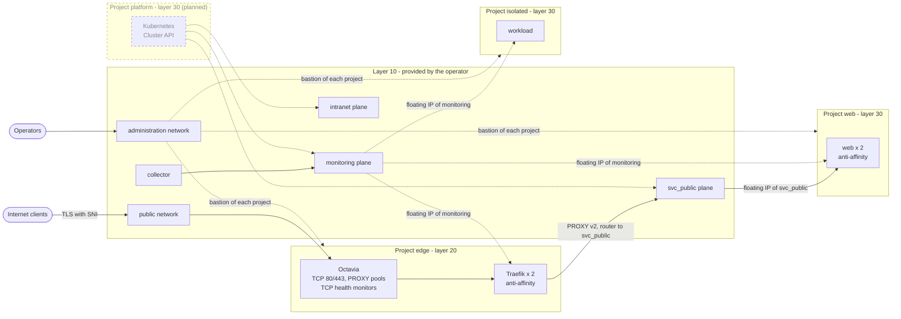
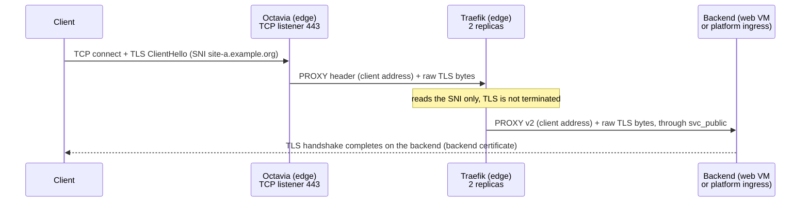
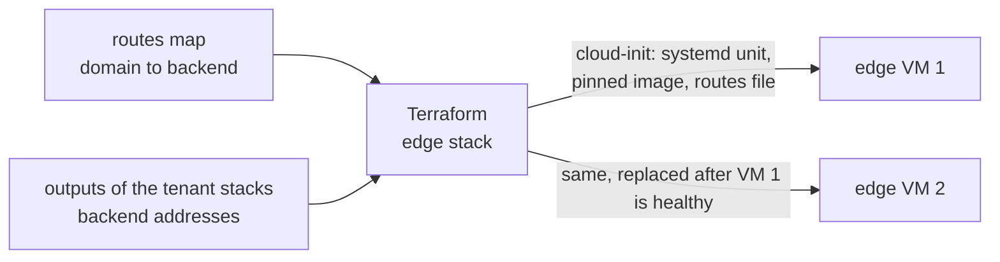
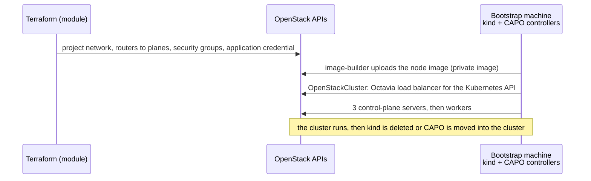

# Architecture

This document is the living specification of the reference architecture. The decisions behind it are recorded in [ADR-0001](adr/0001-reference-architecture.md); when the two disagree, the ADR states the intent and this document must be fixed.

All names are fictional: the organisation is `example.org`, and address ranges are left to the layer 10 contract.

> [!NOTE]
> **Delivered in v0.1.0:** layers 20 and 30 for the projects `edge`, `web` and `isolated`, with bastions, monitoring and the reachability matrix. **Planned:** the `platform` project (Kubernetes with Cluster API Provider OpenStack). This document specifies it already; the sections and rows that concern it describe the target, not delivered code.

## Topology

Four projects consume the planes shared by the operator. Each project joins only the planes it needs, through its own routers, with the routes advertised by DHCP; it is published on a plane with a floating IP of that plane, and administered through its own bastion.

| Project | Layer | Planes | Content |
|---|---|---|---|
| `edge` | 20 | `svc_public`, `monitoring` | Octavia load balancer with a public floating IP, two Traefik VMs (anti-affinity) |
| `web` | 30 | `svc_public`, `monitoring` | Two VMs (anti-affinity) serving `site-a.example.org` and `site-b.example.org`, each with an address on `svc_public` |
| `platform` (planned) | 30 | `svc_public`, `intranet`, `monitoring` | Kubernetes cluster created by CAPO; ingress load balancer with an address on `svc_public` |
| `isolated` | 30 | `monitoring` | One workload, no public address, no route to other tenants |

Backends are published on `svc_public` with addresses from that plane. Every project on `svc_public` can therefore reach them at the network level: **security groups restrict them to the edge Traefik instances** (see the reachability matrix).

## Public entry point

| Element | Setting |
|---|---|
| Octavia listener 443 | `TCP`, pool protocol `PROXY`, round robin, TCP health monitor on 443 |
| Octavia listener 80 | `TCP`, pool protocol `PROXY`; Traefik answers with a redirection to HTTPS |
| Traefik entry points | `proxyProtocol.trustedIPs` limited to the load balancer subnet |
| Traefik routers | TCP routers, `HostSNI` per domain, `tls.passthrough: true`, connection limit middleware |
| Traefik services | PROXY protocol v2 to backends that accept it |
| Traefik image | pinned version |

What the edge does not do: TLS termination, L7 routing, WAF. Each backend owns its certificates.

### Deployment of the edge instances

| Aspect | Setting |
|---|---|
| Runtime | Traefik container started by a systemd unit, no orchestrator |
| Installation | cloud-init, rendered by the module's `cloudinit` sub-module |
| Routes | file provider; the file is generated by Terraform |
| Change of routes | new cloud-init, instances replaced one at a time |
| Dashboard | not exposed; metrics on the `monitoring` plane |

## Kubernetes cluster creation

Planned: the `platform` stack is not delivered yet.

- CAPO uses the network prepared by Terraform; it does not create the project networks.
- The application credential is scoped to the `platform` project; no admin role is required.
- Versions of CAPO, Cluster API and Kubernetes are pinned in the stack.

## Reachability matrix

Each row is checked by the acceptance test ([`tests/reachability`](../tests/reachability/README.md)) after deployment, except the rows that involve `platform` or the `intranet` plane, which come with the `platform` stack. *Enforced by* names the mechanism that makes the row true.

| From | To | Port | Expected | Enforced by |
|---|---|---|---|---|
| Internet | edge load balancer | 80, 443 | allowed | public floating IP, security group |
| Internet | `web`, `platform`, `isolated` | any | denied | no public address |
| edge Traefik | `web` VMs | 443 | allowed | `svc_public` route, security group |
| edge Traefik | `platform` ingress | 443 | allowed | `svc_public` route, security group |
| `web` | `platform` ingress | 443 | denied | security group (source = edge only) |
| `platform` | `intranet` | any | allowed | router to `intranet` |
| `web` | `intranet` | any | denied | no router to `intranet` |
| `isolated` | `web`, `platform`, `edge` | any | denied | no route |
| Collector | every instance, through its `monitoring` floating IP | metrics ports | allowed | floating IP of `monitoring`, route to the plane range, security group (source = `collector_cidrs`) |
| Any tenant | another tenant, through `monitoring` floating IPs | metrics ports | denied | security group (source = `collector_cidrs` only: every tenant reaches the plane with an address of its range, through source NAT) |
| `isolated` | the Internet | any | denied | no egress router |

## Layer 10 contract

Until cloud-baseline (module v0.2) provides layer 10, the operator must supply the following objects. Layers 20 and 30 find them by name.

| Object | Requirement |
|---|---|
| Networks `svc_public`, `intranet`, `monitoring` | Visible to the tenant projects (shared or external), each with one subnet usable as a router gateway |
| Plane routes | The CIDR of each plane, to be advertised by DHCP in the tenant subnets |
| MTU | The MTU of each plane, and the largest MTU the cloud carries for tenant networks (lower when the tenant overlay itself runs over a tunnel). Tenant networks that join a plane use the smallest of these values (`network_mtu`): OVN routers do not send "fragmentation needed" by default, so a larger MTU silently drops large packets |
| Monitoring zone | A DNS zone shared with the tenant projects, where each stack writes the A records of its instances (collector service discovery) |
| Collector | A collector with an address in the `monitoring` range, outgoing TCP to the metrics ports, and its addresses published (`monitoring.collector_cidrs` of the stacks) |
| Reserved ranges | The ranges tenants must not use for their networks (ranges used by the cloud infrastructure) |
| Public network | A network providing floating IPs reachable from the internet, for the edge load balancer |
| Octavia | Available to the projects, with a load balancer flavor (amphora topology) |
| Image | An Ubuntu LTS cloud image visible to the projects |
| Flavors | Sizes listed in the sizing table below |
| DNS | A zone per project, or a shared zone where projects may write records (optional, Designate) |
| Quotas | At least the sizing table below, per project |

Security groups are declared by each tenant. A central catalogue shared by RBAC is an operator option that comes with cloud-baseline.

## Sites

Version 1 runs in one site. The code is site-ready so that failover between sites can be added later without restructuring:

| Rule | Why it matters later |
|---|---|
| The site is an input of every stack (cloud connection, availability zone), part of names and of the state key | The same stacks deploy a second site without collision |
| No hand-written address: routes and DNS records come from stack outputs of the same site | Each site generates its own routes |
| Layer 10 contract per site | Site B gets the same planes |
| Short TTL on public DNS records | Failover is a DNS change |

Planned for a later version: an edge per site (active/passive), a failover runbook with a DNS switch, a failover drill that replays the reachability matrix on the second site. Data replication is out of scope.

## Sizing

Indicative minimum to run the whole scenario. Without the planned `platform` project and its bootstrap machine, v0.1.0 needs 5 instances, 9 vCPU, 9 GiB of RAM, 1 load balancer and 8 floating IPs (1 public, 2 `svc_public`, 5 `monitoring`), plus the optional bastions and, for the reachability matrix, the test collector.

| Project | Instances | vCPU | RAM | Load balancers | Floating IPs |
|---|---|---|---|---|---|
| `edge` | 2 | 4 | 4 GiB | 1 | 1 public + 2 `monitoring` |
| `web` | 2 | 4 | 4 GiB | 0 | 2 `svc_public` + 2 `monitoring` |
| `platform` | 5 (3 control plane, 2 workers) | 10 | 20 GiB | 2 (API, ingress) | 1 `svc_public` (ingress) + monitoring to be defined with the cluster |
| `isolated` | 1 | 1 | 1 GiB | 0 | 1 `monitoring` |
| bootstrap (CAPO management) | 1 | 2 | 4 GiB | 0 | 0 |
| optional bastions (one per tenant) | 1 each | 2 each | 2 GiB each | 0 | 1 each, on the administration network |
| **Total without bastions** | **11** | **21** | **33 GiB** | **3** | **12** |
