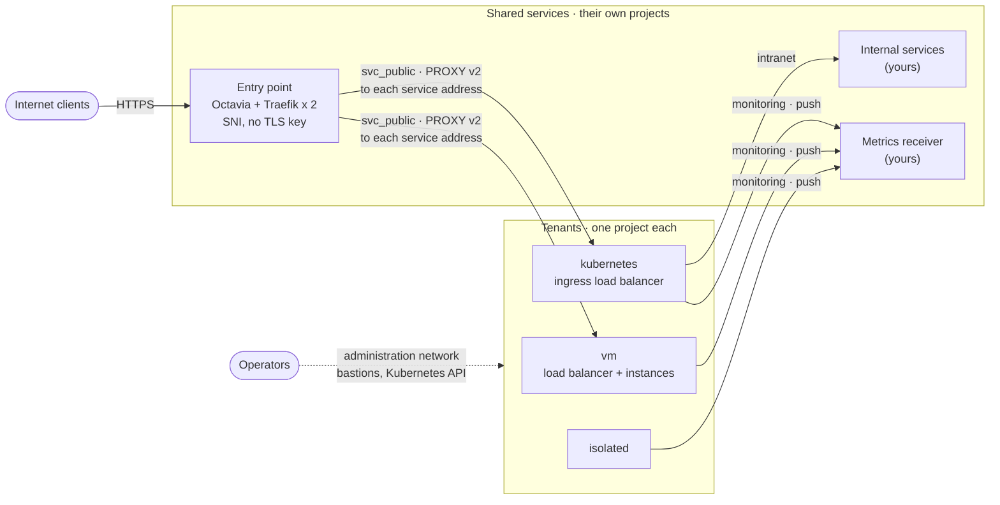
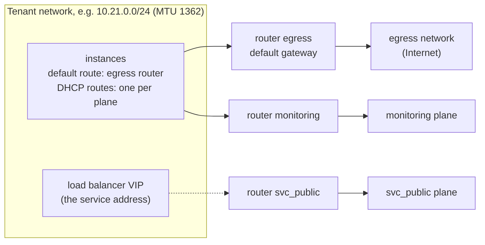
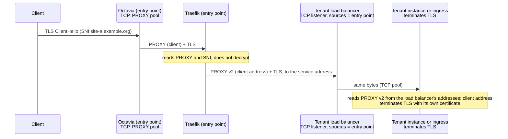
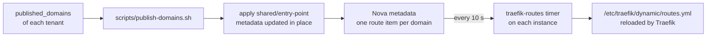
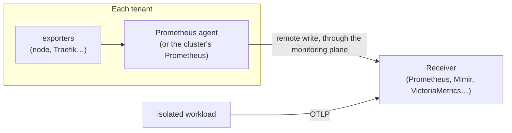
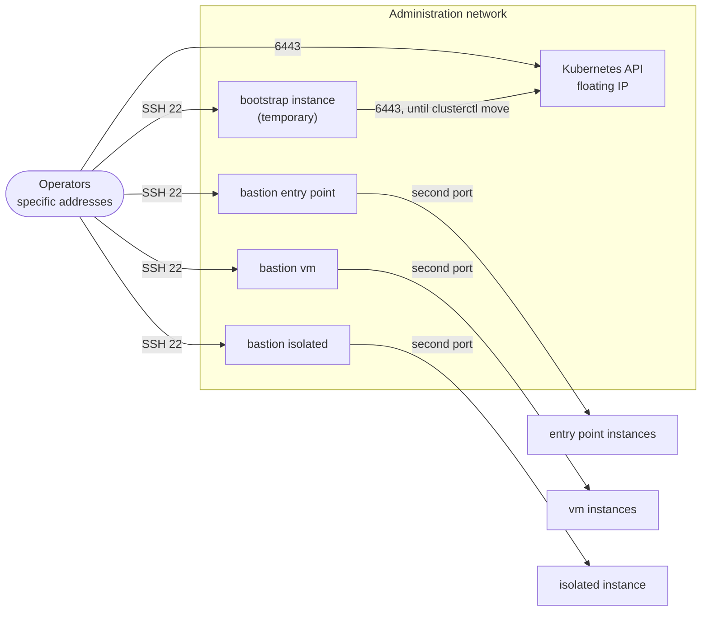
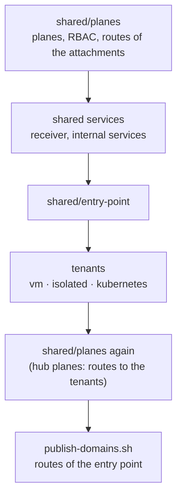
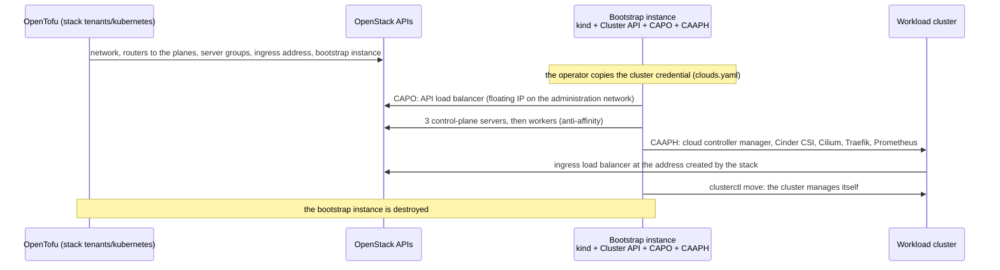

# Architecture

The living specification of the reference architecture: topology, data paths, lifecycle and sizing. The decisions behind it are recorded in the [ADRs](../adr/README.md); when the two disagree, the ADR states the intent and this document must be fixed.

All names are fictional: the organisation is `example.org`, and address ranges are documentation ranges or examples.

## Topology

One OpenStack account, **one project per role** ([ADR-0003](../adr/0003-scope-and-boundary.md)): one per tenant, one per shared service (or a project of shared services), and a hub project holding the network only when the planes are built by the account holder. Tenants and shared services meet on three **planes** ([ADR-0004](../adr/0004-planes-and-isolation.md)):

| Plane | Carries | Shared services on it (role `shared`) |
|---|---|---|
| `svc_public` | publication: the entry point to the tenants' service addresses | the entry point |
| `monitoring` | metrics pushed by every tenant | your metrics receiver |
| `intranet` | internal services consumed by some tenants | your internal services (registry, directory…) |

| Project | Planes | Content |
|---|---|---|
| entry point | `svc_public` (shared), `monitoring` | Octavia load balancer with a public floating IP, two Traefik instances in anti-affinity |
| `vm` tenant | `svc_public`, `monitoring` | instances behind a load balancer, the tenant's service address |
| `kubernetes` tenant | `svc_public`, `monitoring`, `intranet` | a cluster created with Cluster API; its ingress load balancer is the service address |
| `isolated` tenant | `monitoring` | one workload, no public address, no other way out |
| shared services | the planes they serve (`shared`) | the receiver, internal services; in the tests, [fixtures](../../tests/fixtures/receiver/README.md) |

The planes are provided by the cloud operator (external networks) or built in the hub project (shared networks and a transit router): the stacks are the same in both cases, only [`stacks/shared/planes`](../../stacks/shared/planes/README.md) changes ([How a tenant joins a plane](plane-attachment.md)).

## Network topology of a tenant

Each tenant network has **one router per network it joins**. One of them is the default gateway; the planes' ranges are routed through the others, by routes DHCP pushes to the instances.

How the router joins a plane, and how the tenant is seen there, depends on the plane ([ADR-0004](../adr/0004-planes-and-isolation.md), D1):

| Plane | Router joins with | The tenant is seen at | Service address on `svc_public` |
|---|---|---|---|
| operator plane, with NAT | its gateway (source NAT) | the router's gateway address; a floating IP for an address others must reach | a floating IP of `svc_public` on the load balancer |
| shared private plane (hub) | an interface, routes through the transit router | its own addresses | the load balancer's own address |

| Tenant | Default gateway | Other routers | Exposed |
|---|---|---|---|
| entry point | public network | `svc_public`, `monitoring` | public floating IP of its load balancer |
| `vm` | egress | `svc_public`, `monitoring` | its service address on `svc_public` (or a public floating IP, `exposure = "public"`) |
| `kubernetes` | egress | `svc_public`, `monitoring`, `intranet` | ingress (service address on `svc_public`), API (floating IP of the administration network) |
| `isolated` | `monitoring` | — | nothing |
| bastions | administration network | — (second port on the tenant network) | floating IP of the administration network |

No instance carries floating IPs of several networks ([ADR-0006](../adr/0006-exposure.md), D4): every flow on a plane is initiated from the side that holds the route back.

Three rules follow from this design, each learned from a test failure ([test results](test-results.md)):

- **MTU.** Tenant networks use the smallest MTU of the planes they join: OVN routers do not send "fragmentation needed", so a larger MTU drops large packets silently.
- **Sources.** An administration source is the address *as seen on the plane*, often a router's: read it on the target (`$SSH_CLIENT`), do not guess it.
- **Routes back.** Return traffic follows the instance's routes: a plane's range, and every range routed through it, must be advertised by DHCP on the tenant network.

## Ingress data path

The client address must reach the application; TLS is terminated by the tenant, never by the entry point. Exactly **one PROXY v2 header** travels end to end, written by the entry point.

| Hop | Source seen | Admitted by |
|---|---|---|
| Client → entry point load balancer | client | listener, public |
| Traefik → tenant service address | the entry point's address on `svc_public` (output `svc_public_sources`) | the tenant load balancer's `allowed_cidrs` (`edge_sources`) |
| Tenant load balancer → instances | amphora address, on the tenant network | security group of the instances; trusted as PROXY sender |

On the Kubernetes tenant the same path ends at the ingress: no `proxy-protocol` annotation on the Traefik Service (a second header breaks the handshake), and `externalTrafficPolicy: Local` (otherwise kube-proxy replaces the amphora address and Traefik drops the client address).

With `exposure = "public"`, a `vm` tenant's load balancer has its own public floating IP and adds the PROXY header itself (pool `PROXYV2`); the shared entry point is not involved ([ADR-0006](../adr/0006-exposure.md), D2).

## Public entry point

| Element | Setting |
|---|---|
| Octavia listener 443 | `TCP`, pool protocol `PROXY`, TCP health monitor on 443 |
| Octavia listener 80 | `TCP`, pool protocol `PROXY`; Traefik answers with a redirection to HTTPS |
| Traefik entry points | `proxyProtocol.trustedIPs` limited to the entry point network |
| Traefik routers | TCP routers, `HostSNI` per domain, `tls.passthrough: true`, connection limit per client |
| Traefik services | the tenant's service address, PROXY protocol v2 |
| Runtime | Traefik container started by a systemd unit, pinned image, no orchestrator |
| Static configuration | cloud-init; a change replaces the instances one at a time |
| Routes | instance metadata, one item per domain, updated in place ([ADR-0006](../adr/0006-exposure.md), D3) |
| Dashboard | not exposed |

What the entry point does not do: TLS termination, L7 routing, WAF. Each tenant owns its certificates, obtained with ACME DNS-01 challenges on its own zone ([ADR-0006](../adr/0006-exposure.md), D5).

### Publishing a domain

The timer leaves the routes untouched when the metadata service does not answer, or answers fewer routes than announced: an outage never removes a route. Limit: about 120 domains per entry point (Nova quota `metadata_items`, 128 by default).

## Monitoring data path

Monitoring is an integration point ([ADR-0007](../adr/0007-monitoring.md)): the reference states the contract, the receiver is yours.

| | Contract |
|---|---|
| Receiver | accepts Prometheus remote write (and OTLP); runs in a project of shared services, role `shared` on `monitoring` |
| Flow | from the tenants to the receiver's address and port; nothing on the plane connects into a tenant |
| Identification | labels `site`, `tenant`, `instance` on every series, not addresses |
| Silent target | detected by the receiver, alert on missing series |

## Administration paths

| Endpoint | Admitted | Not admitted |
|---|---|---|
| Bastions (SSH) | the operator addresses | every tenant, including the Kubernetes tenant (tested) |
| Kubernetes API | the operator addresses; the cluster's own addresses (added by CAPO); the bootstrap instance while it manages the cluster | anything else |
| Instances (SSH) | their stack's bastion; named operator addresses, none by default | anything else |

With one network for the administration and intranet roles, operator addresses must be single addresses, never the network range: tenants joining the intranet appear inside that range ([ADR-0005](../adr/0005-stacks-contracts-and-access.md), D5).

## Lifecycle

| Operation | Order |
|---|---|
| Deploy | planes → shared services → entry point → tenants (Kubernetes: node image first) → planes again on hub planes → publish the domains |
| Publish or withdraw a domain | `scripts/publish-domains.sh`: the entry point's metadata is updated in place |
| Add a tenant | [add a tenant](../guides/add-a-tenant.md) |
| Upgrade Kubernetes | new node image, then `spec.topology.version` of the Cluster |
| Tear down | [teardown](../guides/teardown.md): Kubernetes clusters first, then the tenants, the entry point, the shared services, the planes |

## Kubernetes cluster creation

The design is [ADR-0002](../adr/0002-platform-kubernetes.md); the stack is [`stacks/tenants/kubernetes`](../../stacks/tenants/kubernetes/README.md).

| Element | Setting |
|---|---|
| Cluster definition | ClusterClass and a `Cluster` object; versions pinned |
| Control plane | 3 nodes behind the CAPO load balancer |
| Workers | one machine deployment, anti-affinity |
| Pod network | Cilium, VXLAN, MTU = network MTU − 50 |
| Ingress | Traefik (Gateway API) behind a load balancer at the service address, PROXY v2 from the entry point |
| Metrics | in-cluster Prometheus, pushed to the receiver (remote write) |
| API | floating IP on the administration network, administration sources only |
| Credentials | application credential dedicated to the cluster (`member` and `load-balancer_member`), created by the operator and copied to the bootstrap instance; never in the state |

## Isolation matrix

The expected flows between the Internet, the planes, the tenants and the shared services are listed, row by row, in the [isolation matrix](../reference/isolation-matrix.md); the [isolation test](../guides/check-isolation.md) checks them on a deployment.

## Planes contract

What the stacks expect from planes provided by the operator (names, ranges, MTUs, reserved ranges) is the [planes contract](../reference/planes-contract.md).

## Sites

The reference runs in one site. The code is site-ready so that failover between sites can be added without restructuring:

| Rule | Why it matters later |
|---|---|
| The site is an input of every stack and part of every name | The same stacks deploy a second site without collision |
| No hand-written address: routes and admission rules come from stack outputs of the same site | Each site generates its own |
| One `shared/planes` per site | Site B gets the same planes |
| Short TTL on public DNS records | Failover is a DNS change |

Planned: an entry point per site (active/passive), a failover runbook with a DNS switch, a drill that replays the isolation test on the second site. Data replication is out of scope.

## Sizing

Indicative minimum for the whole scenario, with the default flavors of the examples.

| Project | Instances | vCPU | RAM | Load balancers | Floating IPs |
|---|---|---|---|---|---|
| entry point | 2 | 4 | 4 GiB | 1 | 1 public |
| `vm` tenant | 2 | 4 | 4 GiB | 1 | 1 on `svc_public` with an operator plane, none with a hub plane |
| `kubernetes` tenant | 5 (3 control plane, 2 workers) | 10 | 20 GiB | 2 (API, ingress) | 1 administration (API), 1 on `svc_public` with an operator plane |
| `isolated` tenant | 1 | 1 | 1 GiB | 0 | 0 |
| bootstrap (Cluster API management, temporary) | 1 | 2 | 4 GiB | 0 | 1 administration |
| receiver (tests) | 1 | 2 | 2 GiB | 0 | 1 on `monitoring` with an operator plane |
| optional bastions (one per stack) | 1 each | 2 each | 2 GiB each | 0 | 1 each, administration |
| **Total without bastions** | **12** | **23** | **35 GiB** | **4** | **2 to 5** |

With hub planes, the hub project holds one router per plane and no instance.
