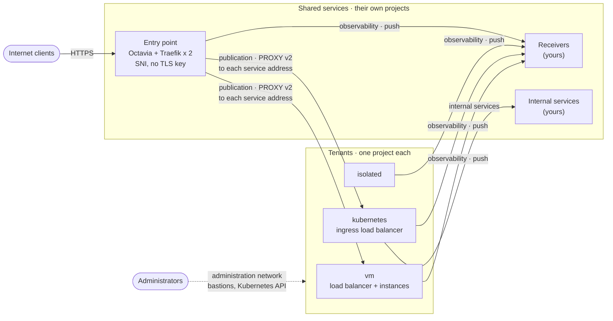
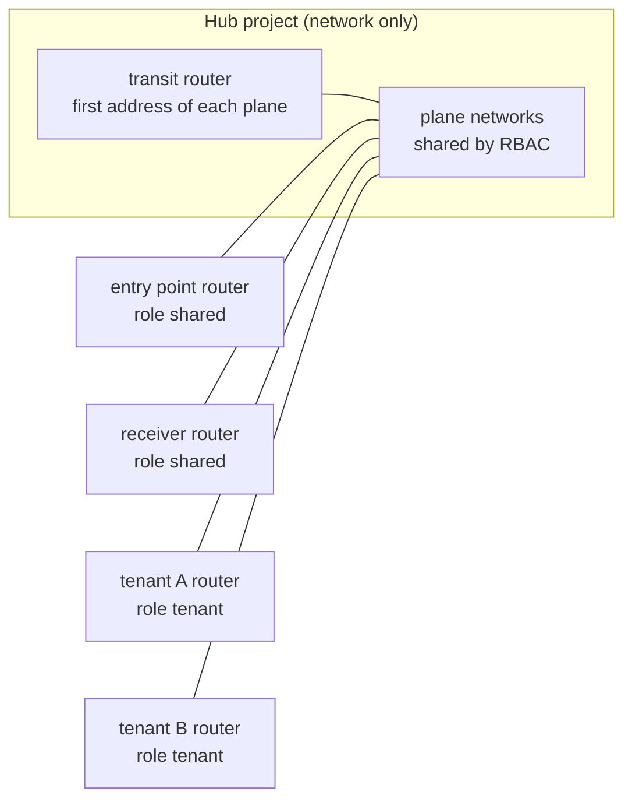
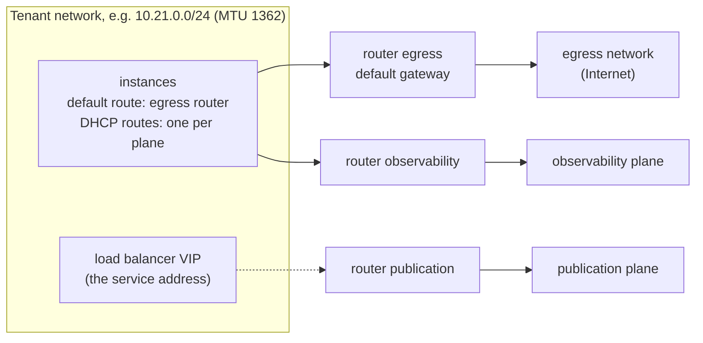
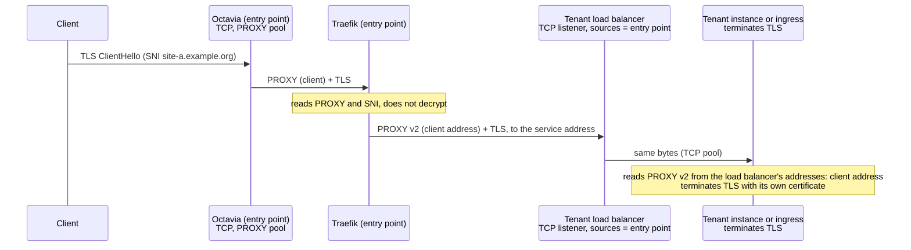
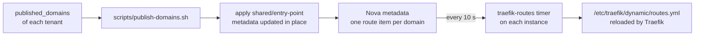
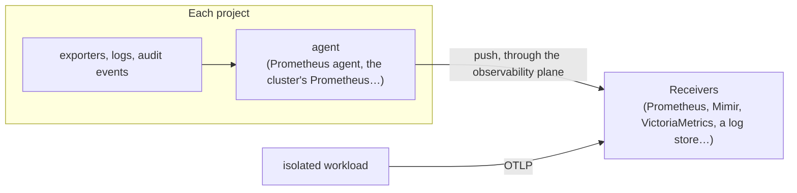
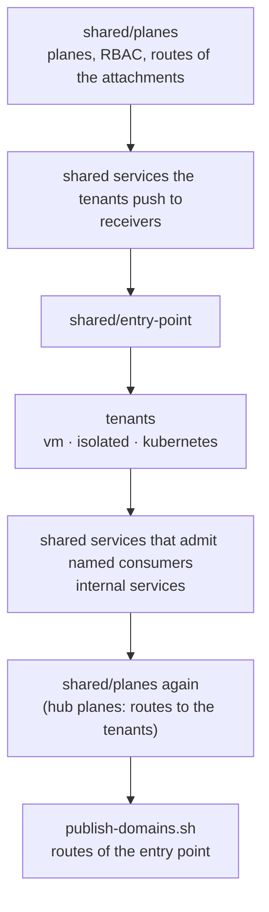
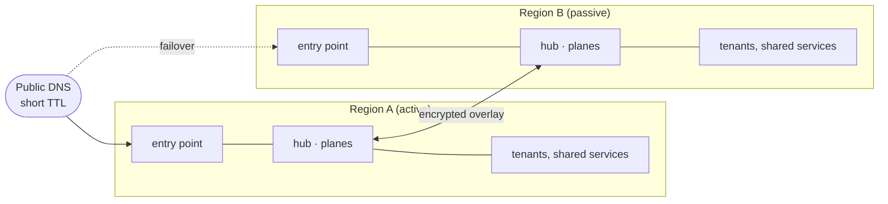

# Architecture

The living specification of the reference architecture, for the `v1.0` design: topology, data paths, network services, resilience, lifecycle and sizing. The terms are defined in the [README](../../README.md#terms). The decisions behind it are recorded in the [ADRs](../adr/README.md); when the two disagree, the ADR states the intent and this document must be fixed.

All names are fictional: the organisation is `example.org`, and address ranges are documentation ranges or examples.

## Topology

Your projects on an OpenStack cloud, **one project per role** ([ADR-0003](../adr/0003-scope-and-boundary.md)): one per tenant, one per shared service (or a project of shared services), and, in each region, a hub project holding the network only when you build the planes yourself, with a member role. Tenants and shared services meet on **planes** ([ADR-0004](../adr/0004-planes-and-isolation.md)), any number, each with its own purpose. The reference scenario has three:

| Plane | Purpose | Shared services on it (role `shared`) |
|---|---|---|
| publication | the entry point reaches the tenants' service addresses | the entry point |
| observability | every project pushes its metrics, logs and audit events | your receivers |
| internal services | services offered to some tenants | your internal services (registry, directory…) |

| Project | Planes | Content |
|---|---|---|
| entry point | publication (shared), observability | Octavia load balancer with a public floating IP, two Traefik instances in anti-affinity |
| `vm` tenant | publication, observability, internal services (optional) | instances behind a load balancer, the tenant's service address |
| `kubernetes` tenant | publication, observability, internal services | a cluster created with Cluster API; its ingress load balancer is the service address |
| `isolated` tenant | observability | one workload, no public address, no other way out |
| shared services | the planes they serve (`shared`) | the receiver, internal services; in the tests, [fixtures](../../tests/fixtures/receiver/README.md) |

The planes are provided by the cloud operator (external networks) or built in the hub project (shared networks and a transit router): the stacks are the same in both cases, only [`stacks/shared/planes`](../../stacks/shared/planes/README.md) changes ([How a tenant joins a plane](plane-attachment.md)).

With hub planes, every attached router routes through the transit router: tenants to the shared services, shared services to the tenants (through aggregates of their ranges), never a tenant to another. The hub discovers the address of each attached router and routes back to it.

## Network topology of a tenant

Each tenant network has **one router per network it joins**. One of them is the default gateway; the planes' ranges are routed through the others, by routes DHCP pushes to the instances. The example below is a `vm` tenant, whose default gateway reaches the Internet through a declared egress network; the `isolated` tenant has no such router, and its only router, to the observability plane, is its default gateway.

How the router joins a plane, and how the tenant is seen there, depends on the plane ([ADR-0004](../adr/0004-planes-and-isolation.md), D1):

| Plane | Router joins with | The tenant is seen at | Service address on the publication plane |
|---|---|---|---|
| operator plane, with NAT | its gateway (source NAT) | the router's gateway address; a floating IP for an address others must reach | a floating IP of the plane on the load balancer |
| shared private plane (hub) | an interface, routes through the transit router | its own addresses | the load balancer's own address |

| Tenant | Default gateway | Other routers | Exposed |
|---|---|---|---|
| entry point | public network | publication, observability | public floating IP of its load balancer |
| `vm` | egress | publication, observability, internal services (optional) | its service address on the publication plane (or a public floating IP, `exposure = "public"`) |
| `kubernetes` | egress | publication, observability, internal services | ingress (service address on the publication plane), API (floating IP of the administration network) |
| `isolated` | observability | — | nothing |
| bastions | administration network | — (second port on the tenant network) | floating IP of the administration network |

No instance carries floating IPs of several networks ([ADR-0006](../adr/0006-exposure.md), D4): every flow on a plane is initiated from the side that holds the route back.

Three rules follow from this design, each learned from a test failure ([test results](test-results.md)):

- **MTU.** Tenant networks use the smallest MTU of the planes they join: OVN routers do not send "fragmentation needed", so a larger MTU drops large packets silently.
- **Sources.** An administration source is the address *as seen on the plane*, often a router's: read it on the target (`$SSH_CLIENT`), do not guess it.
- **Routes back.** Return traffic follows the instance's routes: a plane's range, and every range routed through it, must be advertised by DHCP on the tenant network.

## Ingress data path

The client address must reach the application; TLS is terminated by the tenant, never by the entry point. Exactly **one PROXY v2 header** travels end to end, written by the entry point.

| Hop | Source seen | Admitted by |
|---|---|---|
| Client → entry point load balancer | client | listener, public |
| Traefik → tenant service address | the entry point's address on the publication plane (output `svc_public_sources`) | the tenant load balancer's `allowed_cidrs` (`edge_sources`) |
| Tenant load balancer → instances | amphora address, on the tenant network | security group of the instances; trusted as PROXY sender |

On the Kubernetes tenant the same path ends at the ingress: no `proxy-protocol` annotation on the Traefik Service (a second header breaks the handshake), and `externalTrafficPolicy: Local` (otherwise kube-proxy replaces the amphora address and Traefik drops the client address).

With `exposure = "public"`, a `vm` tenant's load balancer has its own public floating IP and adds the PROXY header itself (pool `PROXYV2`); the shared entry point is not involved ([ADR-0006](../adr/0006-exposure.md), D2).

## Public entry point

| Element | Setting |
|---|---|
| Octavia listener 443 | `TCP`, pool protocol `PROXY`, TCP health monitor on 443 |
| Octavia listener 80 | `TCP`, pool protocol `PROXY`; Traefik answers with a redirection to HTTPS |
| Traefik entry points | `proxyProtocol.trustedIPs` limited to the entry point network |
| Traefik routers | TCP routers, `HostSNI` per domain, `tls.passthrough: true`, connection limit per client |
| Traefik services | the tenant's service address, PROXY protocol v2 |
| Runtime | Traefik container started by a systemd unit, pinned image, no orchestrator |
| Static configuration | cloud-init; a change replaces the instances one at a time |
| Routes | instance metadata, one item per domain, updated in place ([ADR-0006](../adr/0006-exposure.md), D3) |
| Dashboard | not exposed |

What the entry point does not do: TLS termination, L7 routing, WAF. Each tenant owns its certificates ([Certificates](#certificates)).

### Publishing a domain

The timer leaves the routes untouched when the metadata service does not answer, or answers fewer routes than announced: an outage never removes a route. Limit: about 120 domains per entry point (Nova quota `metadata_items`, 128 by default).

## Certificates

TLS ends in the tenant ([ADR-0006](../adr/0006-exposure.md)); each tenant obtains and renews its certificates with the standard tool of its platform, from an ACME directory, through the DNS-01 challenge ([ADR-0008](../adr/0008-tenant-certificates.md)).

| Tenant | TLS ends on | Tool | Certificate |
|---|---|---|---|
| `vm` | each instance (nginx in front of the application) | lego, run by a systemd timer | one per instance; the site is enabled once it is issued |
| `kubernetes` | the ingress | cert-manager (`ClusterIssuer`, `Certificate`) | one for the cluster's domains, shared by the ingress replicas |
| shared services on Kubernetes | their own entry | cert-manager, the organisation's authority | see the [shared-services spec](../specs/kubernetes-shared-services.md) |

| Choice | Values |
|---|---|
| Authority | an ACME directory: Let's Encrypt for names published on the Internet, the organisation's authority (step-ca, Vault PKI, EJBCA…) for names served on internal planes only, with its root certificate |
| Challenge | DNS-01: works for public and internal names and any number of instances, needs no inbound port 80 |
| DNS provider | any provider of the tool; RFC 2136 with TSIG in the examples, one key per tenant restricted to the `_acme-challenge` records of its names |
| Provider credentials | one place per platform: `/etc/lego/dns.env` on the instances, a Secret in the `cert-manager` namespace; delivered by the stack today, by a secrets manager through the secrets integration point |

Without `certificates`, a tenant runs in **demonstration mode**: a self-signed certificate, with a warning at every plan. It is meant for evaluation only.

**A reverse-proxy tier** in front of the application instances (load balancer, two proxies, then the instances) is not shipped. Use it when one domain serves several applications or routes by path, when a web application firewall is needed, or when the application instances must not hold keys: the proxies then terminate TLS and hold the certificate. For one application, the instances terminate TLS themselves, which avoids a tier.

## Observability data path

Observability is an integration point ([ADR-0007](../adr/0007-monitoring.md)): the reference states the contract, the receivers are yours. Metrics, logs and audit events follow the same pattern: an agent next to the source pushes through the observability plane; nothing connects into a project.

| | Contract |
|---|---|
| Receivers | accept Prometheus remote write and OTLP for metrics, and a push protocol for logs and audit events; run in a project of shared services, role `shared` on the observability plane |
| Flow | from the projects to the receivers' addresses and ports; nothing on the plane connects into a project |
| Identification | labels `site`, `tenant`, `instance` on every series and every log line, not addresses |
| Silent source | detected by the receiver, alert on missing series |

## Network services

What every tenant needs from the network, offered the same way as any shared service ([ADR-0003](../adr/0003-scope-and-boundary.md), D4):

| Service | Design |
|---|---|
| Name resolution | Resolvers as a shared service on a plane, reachable by every tenant; the tenants' subnets point to them |
| Time | NTP servers as a shared service on the same plane |
| Packages and images | Mirrors and a registry as shared services, so that tenants without Internet access, such as `isolated`, can still be built and updated |
| Egress to the Internet | Only through a declared path: a router to an egress network in the tenant's own project, or a shared egress on a plane; never by default |
| IPv6 | Dual stack on the planes and the tenant networks; the same roles and admission rules for both families |

## Resilience and continuity

| Failure | Design |
|---|---|
| A host | Instances of a role in anti-affinity (hard for the entry point, soft or hard per tenant); load balancers in active/standby where the cloud offers it |
| An availability zone | Instances and load balancers spread over the zones of the region; planes and routers are regional in Neutron |
| A region | An entry point per region, active/passive, failover by DNS ([regions and sites](#regions-and-sites)) |
| A stack or its state | The architecture is rebuilt from code in a documented order; the states are kept in a backend that is itself backed up |
| Tenant data | Backed up by the tenants through the backup integration point; restored the same way |

## Administration paths

| Endpoint | Admitted | Not admitted |
|---|---|---|
| Bastions (SSH) | the administrator addresses | every tenant, including the Kubernetes tenant (tested) |
| Kubernetes API | the administrator addresses; the cluster's own addresses (added by CAPO); the bootstrap instance while it manages the cluster | anything else |
| Instances (SSH) | their stack's bastion; named administrator addresses, none by default | anything else |

With one network for the administration and internal services roles, administrator addresses must be single addresses, never the network range: tenants joining that plane appear inside its range ([ADR-0005](../adr/0005-stacks-contracts-and-access.md), D5).

## Lifecycle

| Operation | Order |
|---|---|
| Deploy | planes → shared services the tenants push to → entry point → tenants (Kubernetes: node image first) → shared services that admit named consumers (they need the tenants' sources) → planes again on hub planes → publish the domains |
| Publish or withdraw a domain | `scripts/publish-domains.sh`: the entry point's metadata is updated in place |
| Add a tenant | [add a tenant](../guides/add-a-tenant.md) |
| Upgrade Kubernetes | new node image, then `spec.topology.version` of the Cluster |
| Tear down | [teardown](../guides/teardown.md): Kubernetes clusters first, then the internal services, the tenants, the entry point, the receivers, the planes |

## Kubernetes cluster creation

The design is [ADR-0002](../adr/0002-platform-kubernetes.md); the stack is [`stacks/tenants/kubernetes`](../../stacks/tenants/kubernetes/README.md).

| Element | Setting |
|---|---|
| Cluster definition | ClusterClass and a `Cluster` object; versions pinned |
| Control plane | 3 nodes behind the CAPO load balancer |
| Workers | one machine deployment, anti-affinity |
| Pod network | Cilium, VXLAN, MTU = network MTU − 50 |
| Ingress | Traefik (Gateway API) behind a load balancer at the service address, PROXY v2 from the entry point |
| Metrics | in-cluster Prometheus, pushed to the receiver (remote write) |
| API | floating IP on the administration network, administration sources only |
| Credentials | application credential dedicated to the cluster (`member` and `load-balancer_member`), created by an administrator and copied to the bootstrap instance; never in the state |

## Isolation matrix

The expected flows between the Internet, the planes, the tenants and the shared services are listed, row by row, in the [isolation matrix](../reference/isolation-matrix.md); the [isolation test](../guides/check-isolation.md) checks them on a deployment.

## Lateral movement

The shared services are the only points that several tenants reach, and the entry point is the only one that reaches the tenants: a hub-and-spoke design concentrates lateral movement there rather than removing it. Their reach is bounded by the security groups of each target and checked by the [isolation test](../guides/check-isolation.md):

| Shared service | Reaches | Never reaches |
|---|---|---|
| Entry point | the tenants' service addresses, on their service port | a tenant's instances or other ports; the other shared services, except the receiver it pushes to |
| Receiver | nothing: every flow to it is pushed | a tenant, the other shared services |
| Internal service | nothing: its consumers call it | a tenant, the other shared services |
| Hub project | runs no instance | — |

- **A compromised entry point** can send requests to every published application, on its service port only, and holds no key: TLS ends in the tenant ([ADR-0006](../adr/0006-exposure.md)). It is the largest reach of the design, and the one the entry point needs to work.
- **A tenant** reaches a shared service on the ports of the service it consumes, and no other: SSH is admitted from the administrators' addresses only ([ADR-0005](../adr/0005-stacks-contracts-and-access.md)).
- **Routes exist between the shared services of a plane** ([ADR-0004](../adr/0004-planes-and-isolation.md)): only the security groups of the target close the flows that are not declared.
- **Spoofed sources.** Port security filters the ports of the instances, not those of the routers. A project allowed by the cloud's policy to disable port security on its own ports can send packets with another project's address through its router. They are blind: the answer goes to the real owner, so no TCP connection is established, and every service of the scenario listens on TCP. Services answering on UDP, such as name resolution and time, allow reflection; their integration point states it. The [test procedure](../reference/test-procedure.md) checks this on each cloud.
- **Beyond the network** ([ADR-0003](../adr/0003-scope-and-boundary.md), D4, level 3): the integrity of what a shared service distributes (images, packages, name resolution) and whom it authenticates are properties of the tool chosen for it, not of this architecture.

## Planes contract

What the stacks expect from planes provided by the cloud operator (names, ranges, MTUs, reserved ranges) is the [planes contract](../reference/planes-contract.md).

## Regions and sites

A project is not tied to a region, but its resources and the planes are: each region has its own planes, its own hub and its own entry point. The site is the name of a region in a deployment.

| Rule | Why |
|---|---|
| The site is an input of every stack and part of every name | The same stacks deploy in several regions without collision |
| No hand-written address: routes and admission rules come from stack outputs of the same region | Each region generates its own |
| One `shared/planes` per region; the hubs of the regions joined by an encrypted overlay | Shared services and tenants of one region reach those of another through the planes, with the same roles and checks |
| One entry point per region, active/passive, short TTL on the public records | Failover between regions is a DNS change, rehearsed by a drill that replays the isolation test in the other region |

Replicating tenant data between regions belongs to the tenants and to the backup integration point.

## Sizing

Indicative minimum for the whole scenario, with the default flavors of the examples.

| Project | Instances | vCPU | RAM | Load balancers | Floating IPs |
|---|---|---|---|---|---|
| entry point | 2 | 4 | 4 GiB | 1 | 1 public |
| `vm` tenant | 2 | 4 | 4 GiB | 1 | 1 on the publication plane with an operator plane, none with a hub plane |
| `kubernetes` tenant | 5 (3 control plane, 2 workers) | 10 | 20 GiB | 2 (API, ingress) | 1 administration (API), 1 on the publication plane with an operator plane |
| `isolated` tenant | 1 | 1 | 1 GiB | 0 | 0 |
| bootstrap (Cluster API management, temporary) | 1 | 2 | 4 GiB | 0 | 1 administration |
| receiver (tests) | 1 | 2 | 2 GiB | 0 | 1 on the observability plane with an operator plane |
| optional bastions (one per stack) | 1 each | 2 each | 2 GiB each | 0 | 1 each, administration |
| **Total without bastions** | **12** | **23** | **35 GiB** | **4** | **2 to 5** |

With hub planes, the hub project holds one router per plane and no instance.
