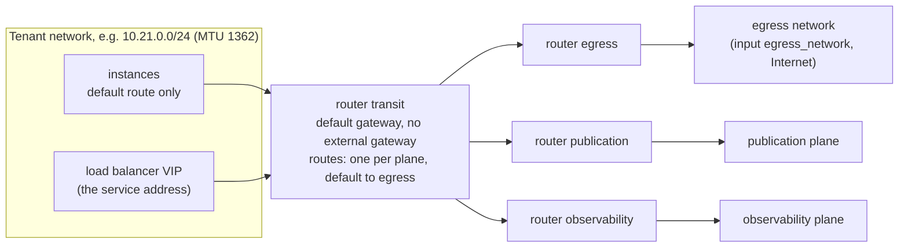
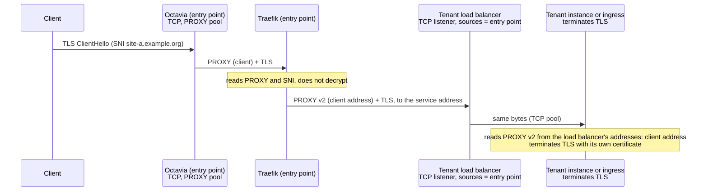
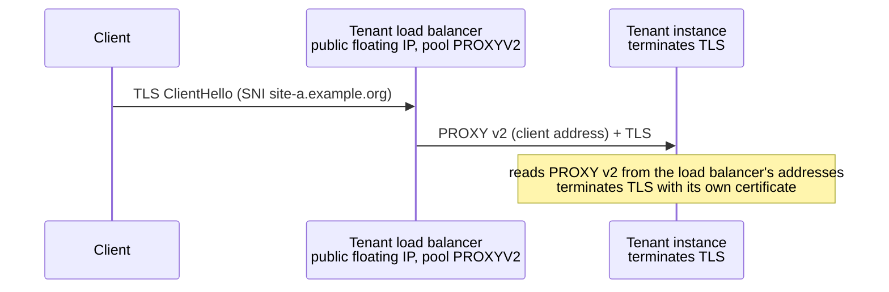
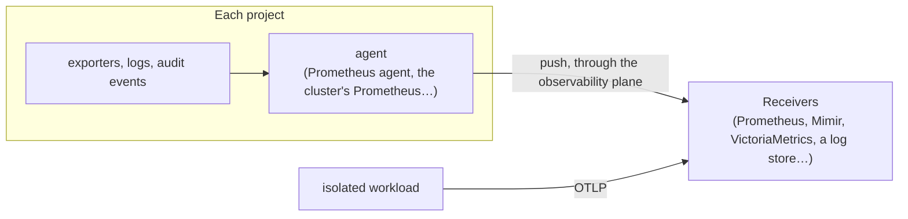
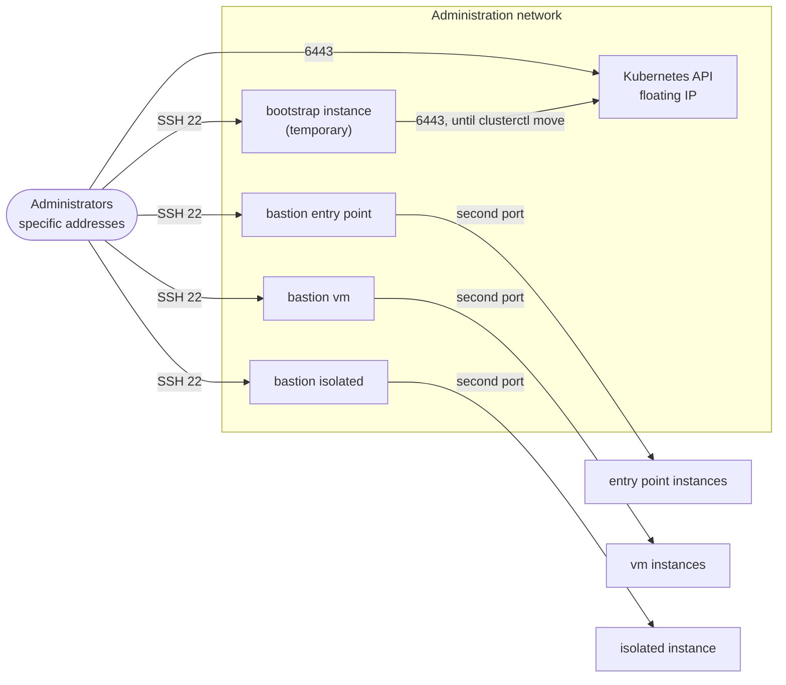
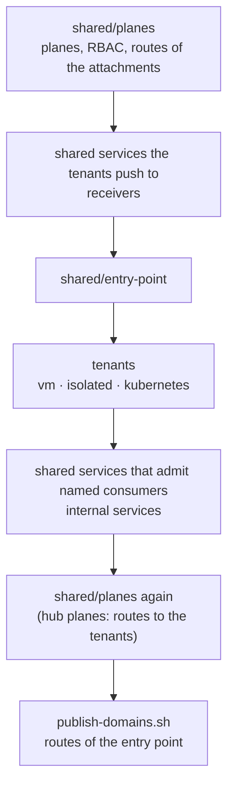

# Architecture

The living specification of the reference architecture, for the `v1.0` design: topology, data paths, network services, resilience and lifecycle; each part links to the page that details it. The terms are defined in the [README](../../README.md#terms). The decisions behind it are recorded in the [ADRs](../adr/README.md); when the two disagree, the ADR states the intent and this document must be fixed.

All names are fictional: the organisation is `example.org`, and address ranges are documentation ranges or examples.

Each section starts with its status: **delivered** (the release that brought it, tested by the maintainers) or **planned** (the release that will bring it, from the [status](../../README.md#status) of the README). The design of a planned part is the target; nothing of it exists in the code yet.

**Contents**

- Organisation: [Topology](#topology) · [Network topology of a tenant](#network-topology-of-a-tenant) · [Regions and sites](#regions-and-sites)
- Data paths: [Public entry point](#public-entry-point) · [Ingress data path](#ingress-data-path) · [Certificates](#certificates) · [Observability data path](#observability-data-path) · [Network services](#network-services)
- Security: [Administration paths](#administration-paths) · [Security model](#security-model) · [Planes contract](#planes-contract)
- Operations: [Resilience and continuity](#resilience-and-continuity) · [Lifecycle](#lifecycle) · [Kubernetes clusters](#kubernetes-clusters) · [Sizing and limits](#sizing-and-limits)

## Topology

**Status:** delivered: operator planes in `v0.1`, hub planes in `v0.3`.

Your projects on an OpenStack cloud, **one project per role** ([ADR-0003](../adr/0003-scope-and-boundary.md)): one per tenant, one per shared service (or a project of shared services), and, in each region, a hub project holding the network only when you build the planes yourself, with a member role. Tenants and shared services meet on **planes**: networks shared by several projects for one purpose, which each project joins through its own router ([ADR-0004](../adr/0004-planes-and-isolation.md)). There can be any number of them. The reference scenario has three:

| Plane | Purpose | Shared services on it (role `shared`) |
|---|---|---|
| publication | the entry point reaches the tenants' service addresses | the entry point |
| observability | every project pushes its metrics, logs and audit events | your receivers |
| internal services | services offered to some tenants | your internal services (registry, directory…) |

The source of this picture is the SVG next to the PNG in [`docs/images`](../images/). The entry point is optional: a tenant may expose its own load balancer with a public address ([ADR-0006](../adr/0006-exposure.md), D2). Who admits what on each target: the [isolation matrix](../reference/isolation-matrix.md).

| Project | Planes | Content |
|---|---|---|
| entry point | publication (shared), observability | Octavia load balancer with a public floating IP, two Traefik instances in anti-affinity |
| `vm` tenant | publication, observability, internal services (optional) | instances behind a load balancer, the tenant's service address |
| `kubernetes` tenant | publication, observability, internal services | a cluster created with Cluster API; its ingress load balancer is the service address |
| `isolated` tenant | observability | one workload, no public address, no other way out |
| shared services | the planes they serve (`shared`) | the receiver, internal services; in the tests, [fixtures](../../tests/fixtures/receiver/README.md) |

The planes are provided by the cloud operator (external networks) or built in the hub project (shared networks and a transit router): the stacks are the same in both cases, only [`stacks/shared/planes`](../../stacks/shared/planes/README.md) changes ([How a tenant joins a plane](plane-attachment.md)).

Who opens each connection is the whole rule of the design: the entry point opens to the tenants' service addresses, consumers open to the internal services, every project pushes to the receivers, and nothing opens from a tenant to another. The target's security group admits the declared sources only.

With hub planes, every attached router routes through the transit router: tenants to the shared services, shared services to the tenants (through aggregates of their ranges), never a tenant to another. The hub discovers the address of each attached router and routes back to it.

## Network topology of a tenant

**Status:** delivered; the transit router in `v0.5`.

Each tenant network has **one router per network it joins**, and a **transit router** with no external gateway, which holds the subnet's gateway address ([ADR-0013](../adr/0013-plane-routes-on-a-transit-router.md)). The instances have one route, the default route to the transit router; the transit router routes each plane's range to that plane's router, and the default route to the egress router. The subnet pushes no host routes: Octavia load balancers copy them once, when their VIP is plugged, and would miss any later change, while a route of the transit router applies at once. The example below is a `vm` tenant, whose egress router reaches the Internet through a declared egress network: an external network named in the stack's `egress_network` input, not a plane; the `isolated` tenant has no egress router, and its transit router sends the default route to the observability plane's router.

How the router joins a plane, and how the tenant is seen there, depends on the kind of plane: [How a tenant joins a plane](plane-attachment.md#which-mode-where) ([ADR-0004](../adr/0004-planes-and-isolation.md), D1).

For each stack of the scenario:

| Tenant | Default route of the transit router | Other routers | Exposed |
|---|---|---|---|
| entry point | public router | publication, observability | public floating IP of its load balancer |
| `vm` | egress | publication (through the entry point only), observability, internal services (optional) | its service address on the publication plane, or a public floating IP with `exposure = "public"` (then no router on the publication plane) |
| `kubernetes` | egress | publication (through the entry point only), observability, internal services (optional) | ingress: its service address on the publication plane, or a floating IP of `egress_network` with `exposure = "public"` (then no router on the publication plane); API: floating IP of the administration network |
| `isolated` | observability router | — | nothing |
| bastions | on its own network: its router on the administration network, which is the gateway; on the stack's network (`bastion_placement = "stack-network"`, [ADR-0014](../adr/0014-profiles.md), D2, when the administration network is the egress): the stack's transit router | — (second port on the tenant network), or none | floating IP of the administration network |

No instance carries floating IPs of several networks ([ADR-0006](../adr/0006-exposure.md), D4): every flow on a plane is initiated from the side that holds the route back.

Four rules follow from this design, each learned from a test failure ([test results](test-results.md)):

- **MTU.** Tenant networks use the smallest MTU of the planes they join: OVN routers do not send "fragmentation needed", so a larger MTU drops large packets silently.
- **Sources.** An administration source is the address *as seen on the plane*, often a router's: read it on the target (`$SSH_CLIENT`), do not guess it.
- **Routes back.** Return traffic follows the routes of the transit router: a plane's range, and every range routed through it, must be a route of the transit router, through that plane's router.
- **Routes on a router, not on the subnet.** Octavia load balancers keep the host routes they found when their VIP was plugged; a route on the transit router reaches them at once ([ADR-0013](../adr/0013-plane-routes-on-a-transit-router.md)). Each tenant has one router more for it: plan the router quotas.

## Public entry point

**Status:** delivered in `v0.1`; routes through instance metadata in `v0.3`.

One public address for every domain published through it: an Octavia load balancer in TCP with the PROXY protocol, and two Traefik instances in anti-affinity that route by SNI with TLS passthrough. The routes are instance metadata, one item per domain, updated in place ([ADR-0006](../adr/0006-exposure.md), D3). It does not terminate TLS, route at layer 7 or filter requests: each tenant owns its certificates. Its settings are in the [stack's README](../../stacks/shared/entry-point/README.md#settings); publishing a domain is a [guide](../guides/publish-a-domain.md).

## Ingress data path

**Status:** delivered: through the entry point in `v0.1`, direct exposure of both tenant types in `v0.4`.

On both paths, the client address reaches the application, and TLS is terminated by the tenant. A tenant is published through the shared entry point (`exposure = "entry-point"`, the default) or exposes its own public address (`exposure = "public"`, [ADR-0006](../adr/0006-exposure.md), D2).

### Through the shared entry point

Many domains of many tenants share one public address. The entry point does not decrypt; exactly **one PROXY v2 header** travels end to end, written by the entry point.

What each hop sees and who admits it:

| Hop | Source seen | Admitted by |
|---|---|---|
| Client → entry point load balancer | client | listener, public |
| Traefik → tenant service address | the entry point's address on the publication plane (output `publication_sources`) | the tenant load balancer's `allowed_cidrs` (`edge_sources`) |
| Tenant load balancer → instances | amphora address, on the tenant network | security group of the instances; trusted as PROXY sender |

On the published cluster the same path ends at the ingress: no `proxy-protocol` annotation on the Traefik Service (a second header breaks the handshake), and `externalTrafficPolicy: Local` (otherwise kube-proxy replaces the amphora address and Traefik drops the client address).

### Direct exposure

The tenant owns one public address and one load balancer for its domains alone; the shared entry point is not involved. A `vm` tenant's load balancer has its own public floating IP and adds the PROXY header itself (pool `PROXYV2`):

On [`stacks/tenants/kubernetes`](../../stacks/tenants/kubernetes/README.md), the ingress of the published cluster gets a floating IP of `egress_network`, open to any source; the cluster does not join the publication plane. No PROXY protocol on this path: Traefik trusts no PROXY sender and the load balancer adds no header; `externalTrafficPolicy: Local` keeps the client address.

## Certificates

**Status:** delivered in `v0.4`, tested with an internal ACME authority; Let's Encrypt takes the same path and is not tested by the maintainers.

TLS ends in the tenant ([ADR-0006](../adr/0006-exposure.md)); each tenant obtains and renews its certificates with the standard tool of its platform (lego on the instances, cert-manager in a cluster), from an ACME directory, through the DNS-01 challenge ([ADR-0008](../adr/0008-tenant-certificates.md)). Without `certificates`, a tenant runs in demonstration mode, with a self-signed certificate. The tools, the authorities and the credentials: [certificates guide](../guides/certificates.md).

**A reverse-proxy tier** in front of the application instances (load balancer, two proxies, then the instances) is not shipped. Use it when one domain serves several applications or routes by path, when a web application firewall is needed, or when the application instances must not hold keys: the proxies then terminate TLS and hold the certificate. For one application, the instances terminate TLS themselves, which avoids a tier.

## Observability data path

**Status:** metrics delivered in `v0.3`; logs and audit events planned in `v0.7` (integration points).

Observability is an integration point ([ADR-0007](../adr/0007-monitoring.md)): the reference states the contract, the receivers are yours. Metrics, logs and audit events follow the same pattern: an agent next to the source pushes through the observability plane; nothing connects into a project.

The contract between the sources and the receivers:

| | Contract |
|---|---|
| Receivers | accept Prometheus remote write and OTLP for metrics, and a push protocol for logs and audit events; run in a project of shared services, role `shared` on the observability plane |
| Flow | from the projects to the receivers' addresses and ports; nothing on the plane connects into a project |
| Identification | labels `site`, `tenant`, `instance` on every series and every log line, not addresses |
| Silent source | detected by the receiver, alert on missing series |

## Network services

**Status:** planned in `v0.6`, except the egress through the tenant's own router, delivered.

What every tenant needs from the network, offered the same way as any shared service ([ADR-0003](../adr/0003-scope-and-boundary.md), D4):

| Service | Design |
|---|---|
| Name resolution | Resolvers as a shared service on a plane, reachable by every tenant; the tenants' subnets point to them |
| Time | NTP servers as a shared service on the same plane |
| Packages and images | Mirrors and a registry as shared services, so that tenants without Internet access, such as `isolated`, can still be built and updated |
| Egress to the Internet | Only through a declared path: a router to an egress network in the tenant's own project, or a shared egress on a plane; never by default. **Today**, a tenant with an egress router reaches the Internet without filtering beyond the egress rules of its security groups; the shared egress, a single place to filter and log, comes with `v0.6` |
| IPv6 | IPv4 until `v1.0`: the reference creates no IPv6 subnet, and the isolation test checks that tenants have no routed IPv6. Afterwards, one family per deployment, IPv4 or IPv6 ([ADR-0015](../adr/0015-ipv6.md)) |

## Resilience and continuity

**Status:** placement over hosts and zones delivered in `v0.5`, with the rebuild guide; several regions planned in `v0.8`.

The reference places what it deploys; the cloud and the workloads provide the behaviour on a failure, as in the landing zones of the large providers ([ADR-0012](../adr/0012-resilience-scope.md)).

| Failure | Design | Tested by the maintainers |
|---|---|---|
| A host | Instances of a role in anti-affinity (hard for the entry point, soft or hard per tenant); load balancers in active/standby where the cloud offers it | the placement |
| An availability zone | Instances, Kubernetes nodes and volumes spread over the zones given to each stack; planes and routers are regional in Neutron | the placement, with mocked providers |
| A region | A site per region with its own entry point, active/passive, ready for a failover by DNS ([spec](../specs/regions.md)) | planned with `v0.8`: two sites deployed side by side; not the failover |
| A stack or its state | The architecture is rebuilt from code in a documented order ([rebuild](../guides/rebuild.md)); the states are kept in a backend that is itself backed up | every campaign rebuilds it from empty projects |
| Tenant data | Backed up by the tenants through the backup integration point; restored the same way | no: yours |

**What the cloud must provide** for the zones to protect anything:

- every plane and every router gateway present in each zone;
- storage zones aligned with the compute zones, or storage shared between them;
- load balancers whose amphorae are spread over zones (an Octavia setting of the operator);
- three zones for a Kubernetes control plane to keep its quorum when one zone is lost: with two zones, losing the zone that holds two of three control plane nodes stops the cluster.

**What stays yours:** deciding and running a failover, rehearsing it, replicating the tenants' data, and setting the recovery objectives (RTO, RPO) of each workload.

What each shared component takes down when it fails is listed with the [single points of failure](../reference/sizing-and-limits.md#single-points-of-failure).

## Administration paths

**Status:** delivered.

Who is admitted on each endpoint:

| Endpoint | Admitted | Not admitted |
|---|---|---|
| Bastions (SSH) | the administrator addresses | every tenant, including the Kubernetes tenant (tested) |
| Kubernetes API | the administrator addresses; the cluster's own addresses (added by CAPO); the bootstrap instance while it manages the cluster | anything else |
| Instances (SSH) | their stack's bastion; named administrator addresses, none by default | anything else |

With one network for the administration and internal services roles, administrator addresses must be single addresses, never the network range: tenants joining that plane appear inside its range ([ADR-0005](../adr/0005-stacks-contracts-and-access.md), D5).

## Lifecycle

**Status:** delivered.

The operations and their order:

| Operation | Order |
|---|---|
| Deploy | planes → shared services the tenants push to → entry point → tenants (Kubernetes: node image first) → shared services that admit named consumers (they need the tenants' sources) → planes again on hub planes → publish the domains |
| Publish or withdraw a domain | `scripts/publish-domains.sh`: the entry point's metadata is updated in place |
| Add a tenant | [add a tenant](../guides/add-a-tenant.md) |
| Upgrade Kubernetes | new node image, then `spec.topology.version` of the Cluster |
| Rebuild after a loss | [rebuild](../guides/rebuild.md): the same order, from the first lost step |
| Tear down | [teardown](../guides/teardown.md): Kubernetes clusters first, then the internal services, the tenants, the entry point, the receivers, the planes |

## Kubernetes clusters

**Status:** delivered: published cluster in `v0.2`, shared cluster and lifecycle in `v0.4`, repair of duplicated add-ons in `v0.5.1`, no longer needed with CAAPH v0.6.6.

A cluster is created by Cluster API with the OpenStack provider, from a temporary bootstrap instance, then manages itself ([ADR-0002](../adr/0002-platform-kubernetes.md)); its add-ons are declared with Cluster API, and its lifecycle beyond the landing zone is Cluster API's ([ADR-0009](../adr/0009-kubernetes-lifecycle.md)). A published cluster is a tenant ([`stacks/tenants/kubernetes`](../../stacks/tenants/kubernetes/README.md#how-the-cluster-is-created), where the creation and the settings are described); a cluster of shared services is a [shared service](../../stacks/shared/kubernetes/README.md) ([ADR-0010](../adr/0010-kubernetes-shared-services.md)).

## Security model

**Status:** delivered.

Who holds which credential, how far a compromised component reaches, and what inspects the traffic between projects: the [security model](security.md). The expected flows, row by row, are the [isolation matrix](../reference/isolation-matrix.md); the [isolation test](../guides/check-isolation.md) checks them on a deployment.

## Planes contract

What the stacks expect from planes provided by the cloud operator (names, ranges, MTUs, reserved ranges) is the [planes contract](../reference/planes-contract.md).

## Regions and sites

**Status:** the site as an input of every stack, delivered; several regions joined by an overlay, planned in `v0.8`.

A project is not tied to a region, but its resources and the planes are: each region has its own planes, its own hub and its own entry point. The site is the name of a region in a deployment, an input of every stack and part of every name, so that the same stacks deploy in several regions without collision. The regions are joined by an encrypted overlay between their hubs, and the published domains fail over between their entry points by DNS: the design is the [spec](../specs/regions.md).

## Sizing and limits

What the test campaigns ran, project by project, what load balancers cost in amphorae, the single points of failure and the scale limits: [sizing and limits](../reference/sizing-and-limits.md).
