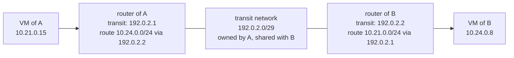

# Connecting two tenants

Tenants are isolated from each other: the isolation test checks that no tenant reaches another. When two tenants do need to talk — the equivalent of VPC peering on other clouds — there are two ways. This page explains both and when to use each. It is a pattern, not a part of the design: tenants never reach each other in this reference.

## First choice: a shared service

Most needs for "tenant A must reach tenant B" are a service that several tenants use: a database, a registry, a directory, an internal API. Run it as a shared service, in its own project, attached to a plane with the role `shared`: every tenant allowed to use it reaches it through the plane, and the tenants still never reach each other ([integration points](../reference/integration-points.md)).

This is the hub-and-spoke model, which public clouds also recommend over many point-to-point peerings: one place to admit or revoke a tenant, one isolation rule.

## When a direct connection is needed: a transit network

When the two tenants really need each other (two applications of one team, a migration between projects), connect them through a **transit network**, the same mechanism as a hub plane ([How a tenant joins a plane](plane-attachment.md), mode 2), with two tenants only.

1. **A creates a small network** (a `/29`, no gateway, no DHCP) and shares it with B's project by RBAC (`access_as_shared`, target: B's project ID).
2. **Each router gets an interface** on it, at a fixed address.
3. **Each router gets a route** to the other tenant's range, through the other router's address on the transit network.
4. **The instances learn the route**: when the router holding the transit interface is not their default gateway — the case in this architecture, with a router per plane — the other tenant's range is pushed to them by DHCP (host route). When it is their default gateway, the router routes are enough.
5. **The security groups of each side admit the other tenant's range** on the ports needed, and only those.

### Why not share A's own network with B

Sharing A's application network directly looks simpler: B's router joins it and nothing else is needed on A's router. But `access_as_shared` lets B create **any** port on that network, instances included: B would be inside A's network, protected by security groups only. The transit network keeps each tenant's network to itself; only the two routers meet.

### Conditions and limits

- **Explicit on both sides**: A shares, B attaches, each adds its routes and admission rules. Revoking is removing the RBAC policy (refused while B's port is still there) or B's interface.
- **Ranges must not overlap**, between the two tenants and with the transit network.
- **Not transitive**: A–B and B–C do not give A–C. Many pairs quickly cost more than a hub.
- **Router routes are capped** by Neutron (`max_routes`, 30 by default per router).
- **The isolation test** must declare the connection: the rows between A and B become "open" on the admitted ports, every other row stays closed.

## In this repository

When an exception is needed, the building blocks are there (router interfaces and routes in [terraform-openstack-tenant](https://github.com/CyprisTech/terraform-openstack-tenant), RBAC sharing and address plan in `stacks/shared/planes`): a pair of tenants declared explicitly, the routes between their ranges, and the rows of the isolation test that open for them.
