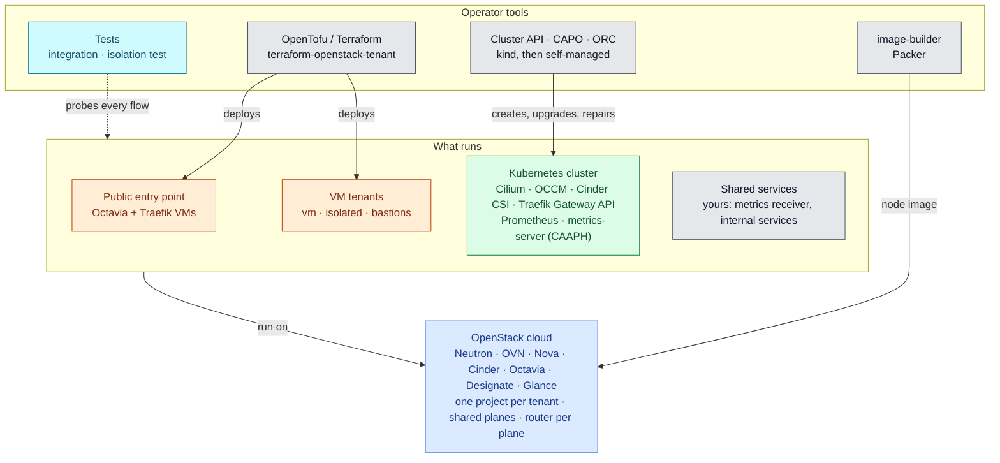

# Technology landscape

Who builds what: OpenTofu or Terraform deploys the infrastructure and the VM workloads, Cluster API creates and maintains the Kubernetes cluster, image-builder provides its node image, and the tests probe every flow. The shared services (metrics receiver, internal services) are yours ([ADR-0003](../adr/0003-scope-and-boundary.md), D4). Grey: tools and your services; orange: VM workloads; green: Kubernetes; blue: the cloud; cyan: tests.

One row per layer of the architecture: what is used, what was considered instead, and why. The reasoning is in the ADRs and in the [trade-offs](trade-offs.md); this page is the map.

| Layer | Used | Alternatives considered | Why this one | Decision |
|---|---|---|---|---|
| Cloud (IaaS) | OpenStack: Nova, Neutron with OVN, Cinder, Octavia (amphora), Designate | — | The target: public, sovereign and private OpenStack clouds | [ADR-0003](../adr/0003-scope-and-boundary.md) |
| Infrastructure as code | OpenTofu or Terraform, module [terraform-openstack-tenant](https://github.com/CyprisTech/terraform-openstack-tenant), one state and one credential per stack, contracts as outputs | Heat, Ansible, Pulumi; remote state between stacks | Declarative, plan before apply, one module for every tenant; works without admin rights | [ADR-0005](../adr/0005-stacks-contracts-and-access.md) |
| Network isolation | One project per tenant, shared planes (`svc_public`, `monitoring`, `intranet`) provided by the operator or built in a hub project (Neutron RBAC, transit router), one router per plane, security groups by source | One flat shared network; ports of the instances on the planes; a firewall at the hub (OVHcloud landing zone) | Every flow is explicit, and each one is a row of the isolation test; works with a member role | [ADR-0004](../adr/0004-planes-and-isolation.md) |
| Public entry point | Octavia (TCP, PROXY) in front of two Traefik VMs, SNI passthrough, PROXY v2 to each tenant's service address, routes through instance metadata; optional per tenant | A load balancer per tenant only; Traefik in Kubernetes; HAProxy | Many domains on one address, TLS stays with each tenant; no orchestrator in front of the tenants; one proxy technology across the architecture | [ADR-0006](../adr/0006-exposure.md) |
| Administration | One bastion per stack, floating IP on the administration network, specific operator addresses | VPN; SSH through a plane | Small, auditable surface, per tenant | [ADR-0005](../adr/0005-stacks-contracts-and-access.md), D5 |
| Monitoring | Push: Prometheus in agent mode on the instances, the cluster's Prometheus with remote write, OTLP; your receiver | A central collector scraping every tenant; federation; OpenTelemetry Collector as the agent | Nothing connects into a tenant; the common practice across boundaries; the contract does not depend on the agent | [ADR-0007](../adr/0007-monitoring.md) |
| Kubernetes node image | [image-builder](https://github.com/kubernetes-sigs/image-builder), OpenStack builder (Packer), Ubuntu 24.04 | Generic cloud image with cloud-init installs | Reproducible, versioned with Kubernetes, fast and offline-friendly node boot | ADR-0002, D1 |
| Kubernetes lifecycle | Cluster API with CAPO (ClusterClass), ORC for OpenStack resources, bootstrap in kind then `clusterctl move` | Magnum, Kubespray, RKE2, Talos | Upstream standard, declarative upgrades and machine replacement, no extra product to run | ADR-0002, D2 and D3 |
| Kubernetes add-ons | Cluster API Add-on Provider Helm (CAAPH) | Flux or Argo CD; manifests applied by script | Add-ons declared next to the cluster and moved with it | ADR-0002, D1 |
| Cloud integration | OpenStack cloud controller manager, Cinder CSI | — | The reference integration of Kubernetes with OpenStack | ADR-0002, D1 |
| Pod network | Cilium, VXLAN, MTU of the network minus 50 | Calico | eBPF datapath, policies at layers 3 to 7, flow visibility | ADR-0002, D4 |
| Kubernetes ingress | Traefik with the Gateway API, behind an Octavia load balancer at the tenant's service address | Envoy Gateway; ingress-nginx (retired) | Same proxy as the entry point; Gateway API and PROXY protocol supported | ADR-0002, D5 |
| Certificates | ACME DNS-01 on each tenant's zone | HTTP-01 through the entry point; Octavia `TERMINATED_HTTPS` with Barbican | Works with several instances and for wildcards; nothing asked of the entry point | ADR-0006, D5 |
| Tests | Integration tests on a real cloud: apply, empty plan, functional checks, destroy; the isolation test | Static review only | Isolation claims become a test that fails | [ADR-0003](../adr/0003-scope-and-boundary.md), D5 |
