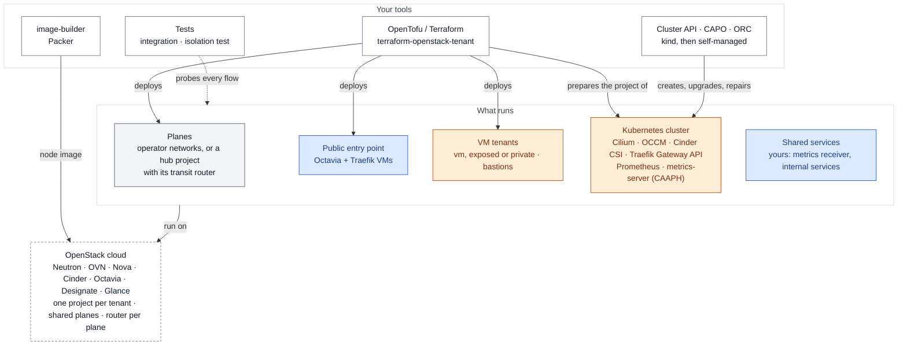

# Technology landscape

Who builds what: OpenTofu or Terraform deploys the planes, the infrastructure of every project and the VM workloads, Cluster API creates and maintains the Kubernetes cluster, image-builder provides its node image, and the tests probe every flow. The shared services (metrics receiver, internal services) are yours ([ADR-0003](../adr/0003-scope-and-boundary.md), D4). Blue: shared services; orange: tenants; grey: planes; white: your tools and tests; dashed: the cloud, below the landing zone.

One row per concern of the design: what is used, what was considered instead, and why. The reasoning is in the ADRs and in the [trade-offs](trade-offs.md); this page is the map.

| Concern | Used | Alternatives considered | Why this one | Decision |
|---|---|---|---|---|
| Cloud (IaaS) | OpenStack: Nova, Neutron with OVN, Cinder, Octavia (amphora), Designate | — | The target: public, sovereign and private OpenStack clouds | [ADR-0003](../adr/0003-scope-and-boundary.md) |
| Infrastructure as code | OpenTofu or Terraform, module [terraform-openstack-tenant](https://github.com/CyprisTech/terraform-openstack-tenant), one state and one credential per stack, contracts as outputs | Heat, Ansible, Pulumi; remote state between stacks | Declarative, plan before apply, one module for every tenant; works without admin rights | [ADR-0005](../adr/0005-stacks-contracts-and-access.md) |
| Network isolation | One project per tenant, shared planes (any number; in the scenario publication, observability, internal services) provided by the cloud operator or built in a hub project (Neutron RBAC, transit router), one router per plane, security groups by source | One flat shared network; ports of the instances on the planes; a firewall at the hub (OVHcloud landing zone) | Every flow is explicit, and each one is a row of the isolation test; works with a member role; a firewall isolates only projects that reach each other through it alone ([trade-offs, 7](trade-offs.md#7-isolation-on-the-publication-plane)) | [ADR-0004](../adr/0004-planes-and-isolation.md) |
| Public entry point | Octavia (TCP, PROXY) in front of two Traefik VMs, SNI passthrough, PROXY v2 to each tenant's service address, routes through instance metadata; optional per tenant | A load balancer per tenant only; Traefik in Kubernetes; HAProxy | Many domains on one address, TLS stays with each tenant; no orchestrator in front of the tenants; one proxy technology across the architecture | [ADR-0006](../adr/0006-exposure.md) |
| Administration | One bastion per stack, floating IP on the administration network, specific administrator addresses | VPN; SSH through a plane | Small, auditable surface, per tenant | [ADR-0005](../adr/0005-stacks-contracts-and-access.md), D5 |
| Observability | Push: Prometheus in agent mode on the instances, the cluster's Prometheus with remote write, OTLP; logs and audit events the same way; your receivers | A central server pulling from every tenant; federation; OpenTelemetry Collector as the agent | Nothing connects into a tenant; the common practice across boundaries; the contract does not depend on the agent | [ADR-0007](../adr/0007-monitoring.md) |
| Kubernetes node image | [image-builder](https://github.com/kubernetes-sigs/image-builder), OpenStack builder (Packer), Ubuntu 24.04 | Generic cloud image with cloud-init installs | Reproducible, versioned with Kubernetes, fast and offline-friendly node boot | ADR-0002, D1 |
| Kubernetes lifecycle | Cluster API with CAPO (ClusterClass), ORC for OpenStack resources, bootstrap in kind then `clusterctl move`; the reference owns only what the landing zone requires of the lifecycle | Magnum with its Cluster API driver (offered by operators, for example on Atmosphere), Sovereign Cloud Stack cluster stacks, Kubespray, RKE2, Talos | Upstream standard, declarative upgrades and machine replacement, no extra product to run; a managed offer can replace the stack, attached to the planes the same way | ADR-0002, D2 and D3; [ADR-0009](../adr/0009-kubernetes-lifecycle.md) |
| Kubernetes add-ons | Cluster API Add-on Provider Helm (CAAPH) | Flux or Argo CD; manifests applied by script | Add-ons declared next to the cluster and moved with it | ADR-0002, D1 |
| Cloud integration | OpenStack cloud controller manager, Cinder CSI | — | The reference integration of Kubernetes with OpenStack | ADR-0002, D1 |
| Pod network | Cilium, VXLAN, MTU of the network minus 50 | Calico | eBPF datapath, policies at layers 3 to 7, flow visibility | ADR-0002, D4 |
| Kubernetes ingress | Traefik with the Gateway API, behind an Octavia load balancer at the tenant's service address | Envoy Gateway; ingress-nginx (retired) | Same proxy as the entry point; Gateway API and PROXY protocol supported | ADR-0002, D5 |
| Certificates | ACME DNS-01 on each tenant's zone | HTTP-01 through the entry point; Octavia `TERMINATED_HTTPS` with Barbican | Works with several instances and for wildcards; nothing asked of the entry point | ADR-0006, D5 |
| Several regions | An encrypted overlay between the hubs of the regions; an entry point per region, failover by DNS | Provider features (OVHcloud's vRack); active-active with global load balancing | Works on any OpenStack cloud; failover rehearsed with the isolation test | [ADR-0003](../adr/0003-scope-and-boundary.md), D2 |
| Network services | Egress and exposure declared per tenant, with an optional shared egress; resolvers and time required of the cloud; internal names in Designate or as an output; package mirrors and registry caches as an integration point (`v0.8`); IPv4 | Every network service run by the reference; each tenant on its own resolvers and the Internet | The landing zone owns what the landing zones of the large providers own, requires of the cloud what an OpenStack cloud provides, and connects to the rest | [ADR-0016](../adr/0016-network-services-and-edge-by-level.md), [ADR-0015](../adr/0015-ipv6.md) |
| Backups and secrets | Integration points: the tenants push to your backup and secret stores | A backup or secret tool chosen by the reference | Tool choices stay yours | [ADR-0003](../adr/0003-scope-and-boundary.md), D4 |
| Automation | Independent stacks; a GitOps pipeline as an integration point | One state for everything; manual applies | Each stack can be reviewed and owned separately | [ADR-0005](../adr/0005-stacks-contracts-and-access.md) |
| Tests | Integration tests on a real cloud: apply, empty plan, functional checks, destroy; the isolation test | Static review only | Isolation claims become a test that fails | [ADR-0003](../adr/0003-scope-and-boundary.md), D5 |

## Related designs

Other ways to organise several projects on OpenStack, and how this reference compares. Only public, documented designs are listed.

| | This reference | OVHcloud's hub-and-spoke landing zone |
|---|---|---|
| Transit between projects | Neutron networks: external networks of the cloud operator, or networks of a hub project shared by RBAC, with a Neutron transit router | The vRack, OVHcloud's private layer 2 network, as a transit segment |
| Centre of the hub | A Neutron router, static routes derived from the roles of the projects | A firewall appliance (OPNsense) in high availability |
| Isolation | Security groups at every target, verified by an executable test | Firewall rules at the hub |
| Regions | One set of planes per region; hubs joined by an encrypted overlay | Several regions, through the vRack |
| Portability | Standard Neutron APIs, any OpenStack cloud; member role | OVHcloud-specific (vRack) |
| What runs at the centre | A Neutron router | Firewall instances to run, update and keep available |
| Central inspection and egress control | No: filtering at each target; a firewall at the hub is a possible variant ([trade-offs, 7](trade-offs.md#7-isolation-on-the-publication-plane)) | Yes |
| Other design areas | Exposure, observability, network services, administration, resilience, Kubernetes tenants | The network, as published |

The two answer different questions, and they combine. A firewall isolates projects when they reach each other only through it, each on a segment or a transit network of its own; it is also where flows are inspected and logged in one place, and where egress is controlled centrally. This reference isolates at each target and tests it, on any OpenStack cloud and with a member role. Where the network is the operator's, both apply: on a cloud of segments (`v0.7`), the operator's firewall stands between the projects and the security groups stay at every target.
