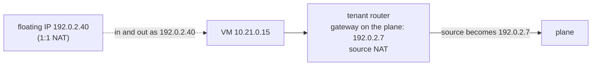
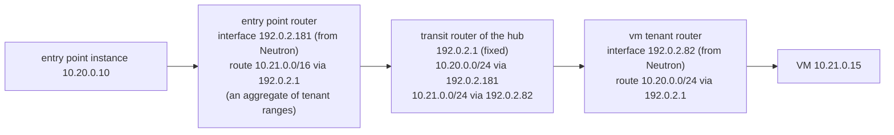

# How a tenant joins a plane

A plane is a network shared by several projects, any number of them, each with its own purpose; in the reference scenario, `svc_public` for publication, `monitoring` for observability, `intranet` for internal services. This page explains the two ways a tenant joins a plane, what each means for addresses, routing and isolation, and why a third way — ports of the instances directly on the planes — is not used. The decision is [ADR-0004](../adr/0004-planes-and-isolation.md).

## Gateway and interface: two kinds of router port

A Neutron router has two kinds of ports, and Neutron treats them in opposite ways:

| | **Gateway** port (`external_gateway_info`) | **Interface** ports (`router interface add`) |
|---|---|---|
| Network | a network marked `router:external` (only an admin can set the mark) | any other network |
| How many | one per router | any number |
| Role | the outside: default route, **source NAT**, **floating IPs** | the inside: the router is the gateway of these subnets, **no translation** |

The kind of network the plane is decides which port a tenant router can use on it.

## Mode 1 — Gateway on the plane (planes provided by the operator)

The cloud operator creates the plane as an external network. Each tenant joins it with a router whose gateway is on the plane.

- **Leaving the tenant**, traffic is translated to the address of the router's gateway (`enable_snat` is true by default, and only an admin can turn it off). A target on the plane sees the router, shared by the whole tenant.
- **With a floating IP of the plane**, an address enters and leaves as its own stable address: a 1:1 translation. The architecture gives one only to what others must reach on the plane: a tenant's service address on `svc_public`, the receiver on `monitoring`. At most one floating IP per address ([ADR-0006](../adr/0006-exposure.md), D4).
- **No return route is needed**: the target answers the router's or the floating IP's address, which is on the plane.
- **Tenant ranges may overlap**: they are never seen on the plane.

## Mode 2 — Interface on the plane, through a transit router (shared private planes)

You create the plane, with a member role, as a private network of the hub project — a project that holds the network only — and share it with the projects of the tenants and of the shared services (Neutron RBAC, `access_as_shared`). It is not an external network: a tenant router can only join it with an interface. Stack [`shared/planes`](../../stacks/shared/planes/README.md) does it.

- **No translation**: the target sees the real address of the instance, in its tenant network. Admission rules name the entry point's range, or the tenant ranges routed to the receiver.
- **No floating IP**: floating IPs only exist on external networks. A service address on the plane is the load balancer's own address (a `vm` tenant's, a Kubernetes ingress at a fixed address of the cluster network).
- **One fixed address per plane: the transit router's.** A project cannot choose its address on a network it does not own (Neutron policy `create_port:fixed_ips:ip_address`), so each attached router takes an address from Neutron; the hub, owner of the plane, places the transit router where it wants.
- **Routes of the attached routers, known in advance**, all through the transit router. Each attachment has a **role per plane**: `shared` (the entry point on `svc_public`, the receiver on `monitoring`) or `tenant` (a workload, or a client of the shared services, such as the entry point pushing its metrics on `monitoring`). A tenant routes to the shared services of the plane; a shared service routes to the other shared services and to the tenants, through aggregates of their ranges when given. **Never between two tenants.** The routes reach the instances by DHCP, at lease renewal.
- **Routes of the transit router, discovered.** The plane's owner sees every port on it: at each apply, `shared/planes` finds the address of each attached router and routes the attachment's range to it. OpenStack has no route propagation between projects: this apply is where it happens.
- **Adding a tenant**: apply `shared/planes` (RBAC policy), the tenant's stack, then `shared/planes` again (route on the transit router). No shared service is applied again when the tenant's range is inside the aggregates.
- **Tenant ranges must not overlap**, with each other or with the planes; `shared/planes` checks it.
- **Limit**: Neutron caps the routes of a router (`max_routes`, 30 by default), so a transit router serves about 30 attachments per plane.

## What isolates tenants, in both modes

The absence of a route is not a security boundary: a tenant controls its own router and could add a route towards another tenant's range. What blocks it is the **security groups of the target**, which admit only the entry point (on service addresses), their own load balancer, their bastion or the operators. The isolation test checks it in both modes: a row "tenant → other tenant: closed" must stay closed whatever routes a tenant adds. Verified on the reference cloud: a tenant that routes to another through the transit router still reaches none of its ports.

## The alternative not used: ports of the instances on the planes

Instead of routers, each instance gets one port per plane it needs, directly on the plane network. This is a common design — provider networks in private clouds, OVHcloud's vRack with multi-interface instances — and it gives real addresses without translation or routes. It is not used here:

| | Router (modes 1 and 2) | Ports on the planes |
|---|---|---|
| Network boundary of the tenant | the router, one point of passage | none: the instance sits on the shared segment |
| Isolation rests on | router and security groups | security groups and anti-spoofing only |
| Interfaces in the instance | one | one per plane: default routes to avoid, routes per interface, an added plane needs a manual change or a new instance (cloud-init configures interfaces at first boot only) |
| Kubernetes nodes | one interface | several: node address selection and network plugin harder to configure |
| Tenant ranges | may overlap (mode 1) | must not overlap; every instance consumes plane addresses |
| Routers and floating IPs | one router per plane and tenant | none |

Use it when the tenants trust each other (teams of one organisation) and the plane design is under your control: plane subnets without a gateway, plane ranges pushed as host routes by DHCP, images that handle several interfaces. It is not part of this design.

## Which mode where

| Cloud | Planes are | Mode |
|---|---|---|
| Private or sovereign, planes provided by the operator | external networks | 1 — gateway, floating IPs for service addresses |
| Public, planes built with a member role | private networks shared by RBAC | 2 — interface, through the hub's transit router |
| Private, operator coordinates the addressing (address scopes, BGP) | external networks in a shared address scope | 1 without translation: real addresses, routes advertised on the plane side; with cloud-baseline ([ADR-0004](../adr/0004-planes-and-isolation.md), D1) |
