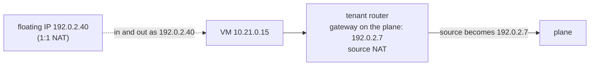
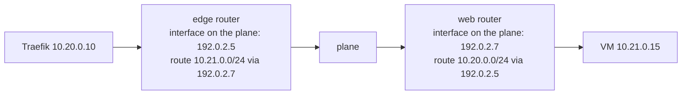

# How a tenant joins a plane

A plane is a network shared by several projects: `svc_public` for publication, `monitoring` for metrics, `intranet` for internal services. This page explains the two ways a tenant joins a plane, what each means for addresses, routing and isolation, and why a third way — ports of the instances directly on the planes — is not used. The decision is [ADR-0003](../adr/0003-scope-and-plane-provisioning.md), D2.

## Gateway and interface: two kinds of router port

A Neutron router has two kinds of ports, and Neutron treats them in opposite ways:

| | **Gateway** port (`external_gateway_info`) | **Interface** ports (`router interface add`) |
|---|---|---|
| Network | a network marked `router:external` (only an admin can set the mark) | any other network |
| How many | one per router | any number |
| Role | the outside: default route, **source NAT**, **floating IPs** | the inside: the router is the gateway of these subnets, **no translation** |

The kind of network the plane is decides which port a tenant router can use on it.

## Mode 1 — Gateway on the plane (planes provided by the operator)

The operator creates the plane as an external network. Each tenant joins it with a router whose gateway is on the plane.

- **Leaving the tenant**, traffic is translated to the address of the router's gateway (`enable_snat` is true by default, and only an admin can turn it off). A target on the plane sees the router, shared by the whole tenant.
- **With a floating IP of the plane**, an instance enters and leaves with its own stable address: a 1:1 translation. The architecture gives a floating IP of the plane to every instance that must be reachable or identifiable on it (published backends, metrics targets).
- **No return route is needed**: the target answers the router's or the floating IP's address, which is on the plane.
- **Tenant ranges may overlap**: they are never seen on the plane.

## Mode 2 — Interface on the plane (shared private planes)

The account holder creates the plane as a private network of a hub project and shares it with the tenant projects (Neutron RBAC, `access_as_shared`). It is not an external network: a tenant router can only join it with an interface.

- **No translation**: the target sees the real address of the instance, in its tenant network. Admission rules can name the entry point's or the collector's instances precisely.
- **No floating IP**: floating IPs only exist on external networks.
- **Routes in both directions**: the router of the side that opens the connection gets a route to the target tenant's range through the target router's address on the plane, and the target tenant's router gets the route back. These are router routes (Neutron extra routes), generated from the stacks' outputs, like the routes of the entry point: no address is written by hand.
- Routes are added only between tenants and the shared services (entry point, collector, internal services), **never between two tenants**.
- **Tenant ranges must not overlap**, with each other or with the planes.

## What isolates tenants, in both modes

The absence of a route is not a security boundary: a tenant controls its own router and could add a route towards another tenant's range. What blocks it is the **security groups of the target**, which admit only the entry point, the collector or the operators. The isolation test checks it in both modes: a row "tenant → other tenant: closed" must stay closed whatever routes a tenant adds.

## The alternative not used: ports of the instances on the planes

Instead of routers, each instance gets one port per plane it needs, directly on the plane network. This is a common design — provider networks in private clouds, OVHcloud's vRack with multi-interface instances — and it gives real addresses without translation or routes. It is not used here:

| | Router (modes 1 and 2) | Ports on the planes |
|---|---|---|
| Network boundary of the tenant | the router, one point of passage | none: the instance sits on the shared segment |
| Isolation rests on | router and security groups | security groups and anti-spoofing only |
| Interfaces in the instance | one | one per plane: default routes to avoid, routes per interface, an added plane needs a manual change or a new instance (cloud-init configures interfaces at first boot only) |
| Kubernetes nodes | one interface | several: node address selection and network plugin harder to configure |
| Tenant ranges | may overlap (mode 1) | must not overlap; every instance consumes plane addresses |
| Routers and floating IPs | one router per plane and tenant | none |

Use it when the tenants trust each other (teams of one organisation) and the plane design is under your control: plane subnets without a gateway, plane ranges pushed as host routes by DHCP, images that handle several interfaces. It can be added to the stacks if there is demand.

## Which mode where

| Cloud | Planes are | Mode |
|---|---|---|
| Private or sovereign, planes provided by the operator | external networks | 1 — gateway, floating IPs for identifiable instances |
| Public, planes built by the account holder | private networks shared by RBAC | 2 — interface, routes generated by the stacks |
| Private, operator allows `enable_snat = false` | external networks | 1 without translation: real addresses, but return routes on the plane side; possible, not provided |
