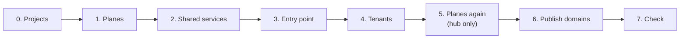

# Getting started

One path for every cloud. Only step 1 depends on where the shared planes come from: the operator's external networks (private or sovereign cloud), or private networks you build in a hub project (public cloud, member role). Every other stack takes its `plane_attachment` from step 1 and works the same way ([How a tenant joins a plane](../concepts/plane-attachment.md)).



> [!WARNING]
> These steps create real resources: instances, Octavia load balancers, floating IPs and DNS records.

About 20 minutes with the entry point and a `vm` tenant; add about 20 minutes for a Kubernetes tenant, plus 25 minutes once for its node image. Every stack follows the same pattern: copy `terraform.tfvars.example` to `terraform.tfvars` (git-ignored), adapt it, add its `plane_attachment`, then `tofu init && tofu apply` (`terraform` works the same).

## What the example shows

The stacks with their example values, and the test fixtures, deploy one instance of each choice. Keep what you need; each row says where the choice is made.

| Area | The example shows | Where |
|---|---|---|
| Planes | the cloud operator's external networks, or shared networks built in a hub project with transit routers; addresses translated or not | step 1, [`examples/planes`](../../examples/planes/README.md) |
| Exposure | a `vm` and a `kubernetes` tenant behind the shared entry point; each may instead have its own public address (`exposure = "public"`) | steps 3 and 4 |
| Isolation | no route between two tenants; an `isolated` tenant with no exposure and no way out but the observability plane | step 4, [isolation matrix](../reference/isolation-matrix.md) |
| Internal services | a service open to declared consumers only ([fixture](../../tests/fixtures/internal-service/README.md)), and the [shared cluster](../../stacks/shared/kubernetes/README.md) (a Kubernetes cluster for shared services) | after step 4 |
| Observability | every project pushes its metrics to one receiver ([fixture](../../tests/fixtures/receiver/README.md)) | step 2 |
| Certificates | ACME DNS-01 from an internal authority ([fixture](../../tests/fixtures/acme/README.md)); without it, a self-signed demonstration mode | `certificates` of each tenant |
| Administration | bastions, and the Kubernetes API and bootstrap instance on an administration network | `admin`, `admin_network` |

The fixtures stand for your own receivers, internal services and certificate authority: they are there to test the contracts, not to run in production.

## 0. Projects

- OpenTofu or Terraform ≥ 1.9, `jq`, Python 3, `ssh` and the `openstack` client.
- One region of the cloud, where every stack is deployed, and projects: one for the **entry point**, one for the **shared services** (receivers, internal services), one **per tenant** — plus a **hub** project holding the network only if you build the planes. A `clouds.yaml` entry for each with a project-scoped credential (`member`, plus `load-balancer_member`). Mind the provider's limit of projects per customer. No `OS_*` variable in the shell.
- Operator planes: the [planes contract](../reference/planes-contract.md) met by the cloud operator (names, ranges, MTU, reserved ranges).
- Hub planes: check that a member may share a network, with the hub's credentials — `openstack network create probe && openstack network rbac create --target-project <another project> --action access_as_shared --type network probe` must succeed; then delete both. Check also the quotas of each project and the number of projects the provider allows. Some clouds forbid it (the Sovereign Cloud Stack recommends it in scs-0126).
- Kubernetes tenant only: build the [node image](../../images/kubernetes-node/README.md) now; it depends on nothing else.

## 1. Planes

Every command runs from the root of the repository.

```bash
cp examples/planes/operator.tfvars.example stacks/shared/planes/terraform.tfvars   # operator planes, or:
cp examples/planes/hub.tfvars.example stacks/shared/planes/terraform.tfvars        # planes built in a hub project
tofu -chdir=stacks/shared/planes init && tofu -chdir=stacks/shared/planes apply
tofu -chdir=stacks/shared/planes output -json attachments   # one plane_attachment per stack
```

Give each stack its entry, for example:

```bash
# "edge" is the name of the entry point's attachment in the example configurations
tofu -chdir=stacks/shared/planes output -json attachments | jq '{plane_attachment: .edge.planes}' > stacks/shared/entry-point/planes.auto.tfvars.json
```

## 2. Shared services

The services the tenants push to come first: your metrics receiver (Prometheus, Mimir, VictoriaMetrics…) runs in a project of shared services and joins the observability plane with its `plane_attachment`; every stack pushes to it, with its URL as `monitoring.receiver` ([integration points](../reference/integration-points.md#observability-metrics)). The [test receiver](../../tests/fixtures/receiver/README.md) shows the pattern.

The services that admit named consumers — internal services — come after the tenants, whose outputs (`internal_sources`) they need.

## 3. Entry point

```bash
cp stacks/shared/entry-point/terraform.tfvars.example stacks/shared/entry-point/terraform.tfvars   # adapt
tofu -chdir=stacks/shared/entry-point init && tofu -chdir=stacks/shared/entry-point apply
tofu -chdir=stacks/shared/entry-point output -json publication_sources   # edge_sources of the tenants
```

## 4. Tenants

Independent of each other, each in its own project, with its `plane_attachment` and `monitoring.receiver`; the tenants published through the entry point (`vm`, `kubernetes`) also take its `edge_sources`. A `vm` or `kubernetes` tenant may instead expose itself with its own public address (`exposure = "public"`). From the root of the repository:

```bash
for t in vm isolated; do
  cp stacks/tenants/$t/terraform.tfvars.example stacks/tenants/$t/terraform.tfvars   # adapt
  tofu -chdir=stacks/tenants/$t init && tofu -chdir=stacks/tenants/$t apply
done
```

Kubernetes tenant: [its README](../../stacks/tenants/kubernetes/README.md). On hub planes the published cluster's ingress gets an internal load balancer at a fixed address; the Kubernetes API and the bootstrap instance need floating IPs on an external network (`admin_network`).

## 5. Planes again (hub only)

```bash
tofu -chdir=stacks/shared/planes apply && tofu -chdir=stacks/shared/planes output -json transit
```

The hub discovers the address of each attached router and routes to it. Until then, the entry point cannot reach the tenants' service addresses, and the receiver cannot answer their pushes.

## 6. Publish the domains

```bash
OS_CLOUD=<entry of the entry point's project> scripts/publish-domains.sh
```

It gathers the `published_domains` output of every tenant and applies the entry point: its instances read the routes from their metadata within seconds, none is replaced ([publish a domain](../guides/publish-a-domain.md)).

## 7. Check

```bash
curl -k --resolve site-a.example.org:443:<public IP of the entry point> https://site-a.example.org/
```

`-k`: without `certificates`, the tenants run in demonstration mode, with a self-signed certificate (a warning at every plan says so). For certificates clients trust, see [certificates](../guides/certificates.md).

The answer shows the backend and the client address it received through the PROXY protocol. Then [check the isolation](../guides/check-isolation.md). Adding a tenant later: [add a tenant](../guides/add-a-tenant.md). Every step with its checkpoint and measured duration: [test procedure](../reference/test-procedure.md).
