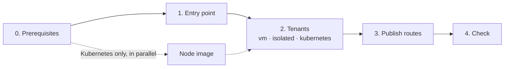

# Getting started: private or sovereign cloud (planes provided by the operator)

The cloud operator provides the shared planes as external networks ([planes contract](../reference/planes-contract.md)); you deploy the shared entry point and the tenants, one project each, with a member role.



> [!WARNING]
> These steps create real resources: instances, Octavia load balancers, floating IPs and DNS records.

About 20 minutes with the entry point and a `vm` tenant; add about 20 minutes for a Kubernetes tenant, plus 25 minutes once for its node image. Every stack follows the same pattern: copy `terraform.tfvars.example` to `terraform.tfvars` (git-ignored), adapt it, then `tofu init && tofu apply` (`terraform` works the same).

## 0. Prerequisites

- OpenTofu or Terraform ≥ 1.9, `jq`, Python 3, `ssh` and the `openstack` client.
- **One project per tenant**, plus one for the entry point, in the same account, and a `clouds.yaml` entry for each with a project-scoped credential (`member`, plus `load-balancer_member` if your Octavia policy requires it). No `OS_*` variable in the shell: the client would mix it with the entry.
- The [planes contract](../reference/planes-contract.md) met by the operator: plane names and ranges, MTU (`network_mtu`), monitoring DNS zone, reserved ranges.
- The addresses of your monitoring collector, for `monitoring.collector_cidrs` ([integration points](../reference/integration-points.md#monitoring)); `[]` keeps metrics closed.
- An SSH key in `admin.users` of every stack, and the same `site` in every stack.
- Kubernetes tenant only: build the [node image](../../images/kubernetes-node/README.md) now; it depends on nothing else.

## 1. Shared entry point

```bash
cd stacks/shared/entry-point && cp terraform.tfvars.example terraform.tfvars   # adapt
tofu init && tofu apply
```

## 2. Tenants

Independent of each other; apply the ones you need, each in its own project.

```bash
cd stacks/tenants/vm       && cp terraform.tfvars.example terraform.tfvars && tofu init && tofu apply
cd stacks/tenants/isolated && cp terraform.tfvars.example terraform.tfvars && tofu init && tofu apply
```

Kubernetes tenant: follow [its README](../../stacks/tenants/kubernetes/README.md) (stack, cluster credential, `create-cluster.sh`).

## 3. Publish the routes

```bash
OS_CLOUD=<entry of the entry point's project> scripts/publish-routes.sh
```

It gathers the `routes` output of every tenant and replaces the entry point instances one at a time ([publish a domain](../guides/publish-a-domain.md)).

## 4. Check

```bash
curl -k --resolve site-a.example.org:443:<public IP of the entry point> https://site-a.example.org/
```

The answer shows the backend and the client address it received through the PROXY protocol; `tofu output load_balancer` in `stacks/shared/entry-point` gives the public IP. Then [check the isolation](../guides/check-isolation.md).

Every step with its checkpoint and measured duration: [test procedure](../reference/test-procedure.md).
