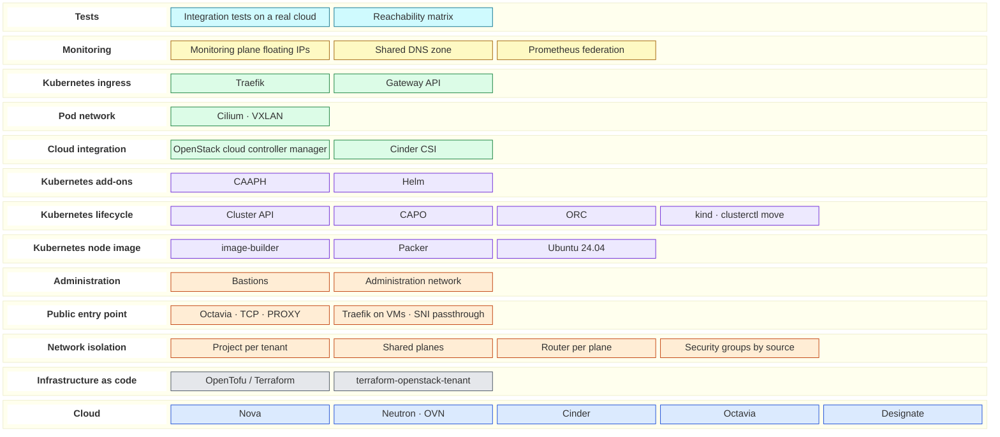

# Technology landscape

Colours by family: blue, the cloud; grey, infrastructure as code; orange, network, entry point and administration; violet, Kubernetes image, lifecycle and add-ons; green, components running in the cluster; yellow, monitoring; cyan, tests.

One row per layer of the architecture: what is used, what was considered instead, and why. The reasoning is in the ADRs and in [trade-offs.md](trade-offs.md); this page is the map.

| Layer | Used | Alternatives considered | Why this one | Decision |
|---|---|---|---|---|
| Cloud (IaaS) | OpenStack: Nova, Neutron with OVN, Cinder, Octavia (amphora), Designate | — | The target: private and sovereign OpenStack clouds | [ADR-0001](adr/0001-reference-architecture.md) |
| Infrastructure as code | OpenTofu or Terraform, module [terraform-openstack-tenant](https://github.com/CyprisTech/terraform-openstack-tenant), one state per stack | Heat, Ansible, Pulumi | Declarative, plan before apply, one module for every tenant; works without admin rights | ADR-0001, D1 |
| Network isolation | One project per tenant, shared planes (`svc_public`, `monitoring`, `intranet`), one router per plane, floating IP of the plane to publish, security groups by source | One flat shared network; Neutron RBAC between projects | Every flow is explicit, and each one is a row of the reachability matrix | ADR-0001, D2 and D6 |
| Public entry point | Octavia (TCP, PROXY) in front of two Traefik VMs, SNI passthrough, PROXY v2 to backends | Octavia only; Traefik in Kubernetes; HAProxy | TLS stays with each tenant; no orchestrator in front of the tenants; one proxy technology across the architecture | ADR-0001, D8 |
| Administration | One bastion per tenant, floating IP on the administration network, specific operator addresses | VPN; SSH through the monitoring plane | Small, auditable surface, per tenant | ADR-0002, D6 |
| Monitoring | Floating IP of the monitoring plane per instance, A records in a shared zone, one collector admitted by address; Prometheus federation for Kubernetes | Push (`remote_write`); one Prometheus per tenant reachable from everywhere | The collector stays in control; tenants cannot scrape each other | ADR-0001, D2; ADR-0002, D5 |
| Kubernetes node image | [image-builder](https://github.com/kubernetes-sigs/image-builder), OpenStack builder (Packer), Ubuntu 24.04 | Generic cloud image with cloud-init installs | Reproducible, versioned with Kubernetes, fast and offline-friendly node boot | ADR-0002, D1 |
| Kubernetes lifecycle | Cluster API with CAPO (ClusterClass), ORC for OpenStack resources, bootstrap in kind then `clusterctl move` | Magnum, Kubespray, RKE2, Talos | Upstream standard, declarative upgrades and machine replacement, no extra product to run | ADR-0002, D2 and D3 |
| Kubernetes add-ons | Cluster API Add-on Provider Helm (CAAPH) | Flux or Argo CD; manifests applied by script | Add-ons declared next to the cluster and moved with it | ADR-0002, D1 |
| Cloud integration | OpenStack cloud controller manager, Cinder CSI | — | The reference integration of Kubernetes with OpenStack | ADR-0002, D1 |
| Pod network | Cilium, VXLAN, MTU of the network minus 50 | Calico | eBPF datapath, policies at layers 3 to 7, flow visibility | ADR-0002, D4 |
| Kubernetes ingress | Traefik with the Gateway API, behind an Octavia load balancer with a floating IP of `svc_public` | Envoy Gateway; ingress-nginx (retired) | Same proxy as the entry point; Gateway API and PROXY protocol supported | ADR-0002, D5 |
| Tests | Integration tests on a real cloud: apply, empty plan, functional checks, destroy; executable reachability matrix | Static review only | Isolation claims become a test that fails | ADR-0001, D6 |
