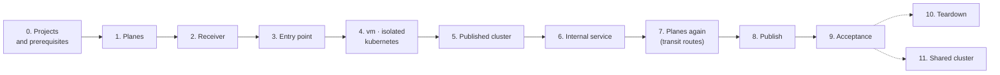

# Test procedure

Every step of a full test cycle, with the checkpoint that must pass before the next step and the duration measured on the reference test cloud. Each stack runs in its own project, as in production ([ADR-0003](../adr/0003-scope-and-boundary.md)), and the cycle runs in either plane mode: **gateway** (planes provided by the operator, with address translation) or **interface** (planes built in a hub project, with transit routers). The results of each cycle are in [test results](../concepts/test-results.md); the [getting started](../getting-started/README.md) is the short version.

Run everything from a machine that is an administration source of the stacks (`admin.sources`, `bastion.ssh_cidrs`), with a `clouds.yaml` entry per project and **no `OS_*` variable in the shell**.

`tests/campaign/run.sh` runs this procedure end to end ([usage](../../tests/campaign/README.md)).

## Overview



| Project | Stacks | Role on the planes |
|---|---|---|
| hub (interface mode) | `shared/planes` | owns the planes and their transit routers; no instance. With operator planes, `shared/planes` runs with the shared services' credentials and only adopts them |
| shared services | `tests/fixtures/receiver`, `tests/fixtures/internal-service`, `tests/fixtures/acme` | `shared` on `observability` (receiver), `shared` on `internal` (internal service, ACME authority). On hub planes, one attachment per project and plane: the internal service and the ACME authority then need a project each |
| shared cluster | `shared/kubernetes` ([section 11](#11-shared-cluster)) | `shared` on `internal`, `tenant` on `observability` |
| entry point | `shared/entry-point` | `shared` on `publication`, `tenant` on `observability` |
| one per tenant | `tenants/vm`, `tenants/isolated`, `tenants/kubernetes` | `tenant` |

| Step | Measured (2026-11-02, interface mode) |
|---|---|
| 1. Planes | 16 s |
| 2. Receiver and ACME authority | 1 min 15 s each |
| 3. Entry point | 3 to 10 min (Octavia) |
| 4. `vm` (with its load balancer), `isolated`, `kubernetes` | 1 to 4 min each |
| 5. Cluster (`create-cluster.sh`, add-ons included) | 18 min |
| 6. Internal service | 1 min |
| 7. Planes again | 7 s |
| 8. Domain publication | 19 s, the routes answering 13 s later |
| 9. Acceptance | 3 min |
| **Total, steps 1 to 9** | **about 45 minutes** without incident |
| 10. Teardown | 4 to 7 min for the cluster, about 7 for the stacks ([test results](../concepts/test-results.md), 2026-11-05 and 2026-11-06) |

Expected results are short extracts of the cycle of 2026-11-02 (interface mode); addresses outside the private ranges of the example are documentation addresses.

### Inputs between stacks

No stack reads an object of another project: each passes what the next ones need through its outputs. The simplest way to give a stack its per-cycle inputs is a git-ignored `mode.auto.tfvars.json` next to its `terraform.tfvars`: OpenTofu loads it automatically, also for the applies run by `scripts/publish-domains.sh`.

| Input | Of | From |
|---|---|---|
| `cloud` | every stack | the project's `clouds.yaml` entry |
| `plane_attachment` | every attached stack | `tofu -chdir=stacks/shared/planes output -json attachments \| jq .<name>.planes` |
| `monitoring.receiver` | entry point, `vm`, `isolated`, `kubernetes` | output `receiver_url` of the receiver |
| `edge_sources` | `vm`, `kubernetes` | output `publication_sources` of the entry point |
| `allowed_sources` | internal service | output `internal_sources` of `kubernetes` |
| `certificates` | `vm`, `kubernetes` | output `certificates` of the ACME authority, keyed by tenant (`jq .web`, `jq .published`) |

## 0. Projects and prerequisites

| Check | How | Expected |
|---|---|---|
| Projects and credentials | one project per row of the table above; an application credential `member` + `load-balancer_member` each, plus one for the cluster in the Kubernetes project | `openstack token issue` works for every `clouds.yaml` entry |
| DNS zones (optional) | the public zone with the entry point's project | `openstack zone list` from that project shows it |
| Quotas | `openstack quota show` per project | Kubernetes project: 25 security groups, 200 rules (the cloud controller manager creates its own); hub: one RBAC policy per attachment and hub plane |
| Node image | [images/kubernetes-node](../../images/kubernetes-node/README.md), shared with the Kubernetes project and accepted there | private image `ubuntu-2404-kube-<version>` visible from the Kubernetes project |
| Your address | the address the cloud sees for you | in `admin.sources` and `bastion.ssh_cidrs` of every stack |
| Capacity per host | ask the operator | the two entry point instances are in hard anti-affinity: replacing one needs room on another host than the other's |

## 1. Planes

```bash
cd stacks/shared/planes && tofu init && tofu apply && tofu plan -detailed-exitcode
```

`terraform.tfvars` declares the planes — adopted (`mode = "gateway"`) or built (`mode = "interface"`) — every attachment with its project, range and role per plane, and `tenant_ranges` per hub plane ([examples](../../examples/planes/README.md)).

| Checkpoint | If it fails |
|---|---|
| plan after apply empty | `DuplicateRbacPolicy`: an attachment was renamed on the same project; apply again |
| the planes are visible from every attached project (`openstack network show <site>-publication`) and from no other | check the project IDs of the attachments |

```console
$ openstack network show t1-publication -f value -c mtu -c shared     # from an attached project
1362 True
$ openstack network show t1-publication                               # from a project not attached
No Network found for t1-publication
```

## 2. Receiver

Create it before the stacks that push to it: they need its `receiver_url`.

```bash
cd tests/fixtures/receiver && tofu init && tofu apply && tofu plan -detailed-exitcode
tofu output -raw receiver_url   # with NAT: a floating IP of the observability plane; interface: its own address
```

```console
$ tofu output -raw receiver_url
http://10.34.0.12:9090
```

The **ACME authority** (Knot and step-ca, [`tests/fixtures/acme`](../../tests/fixtures/acme/README.md)) is created at the same step, a shared service of the internal services plane: the tenant stacks need its `certificates` output.

```bash
cd tests/fixtures/acme && tofu init && tofu apply && tofu plan -detailed-exitcode
tofu output -json certificates | jq '{certificates: .web}' > ../../../stacks/tenants/vm/certificates.auto.tfvars.json
tofu output -json certificates | jq '{certificates: .published}' > ../../../stacks/tenants/kubernetes/certificates.auto.tfvars.json
tofu output -raw root_certificate > root.pem      # for the clients of the acceptance
```

| Checkpoint | If it fails |
|---|---|
| `knot` and `step-ca` active on the instance (through its bastion) | cloud-init `error` with packages not installed: the instance had no Internet access at boot (its egress router); replace it once the egress works |

## 3. Entry point

```bash
cd stacks/shared/entry-point && tofu init && tofu apply && tofu plan -detailed-exitcode
tofu output -json publication_sources   # gateway: its router's address; interface: the edge range
```

```console
$ tofu output -json publication_sources
["10.20.0.0/24"]
```

| Checkpoint | How | If it fails |
|---|---|---|
| plan after apply empty | exit code 0 | report |
| cloud-init finished on every Traefik instance | `ssh -J ops@<bastion> ops@<instance> cloud-init status --wait` → `done`; a bastion just created may not answer for a minute: retry | `error`: read `/var/log/cloud-init-output.log`; a package mirror error leaves Traefik without podman; replace the instance |

DNS records are the slowest resources: seconds normally, several minutes when Designate is congested. A record created after an apply timeout must be imported ([pitfalls](https://github.com/CyprisTech/terraform-openstack-tenant/blob/main/docs/pitfalls.md#dns)).

## 4. Tenants

Independent of each other; run them in parallel.

```bash
for s in stacks/tenants/vm stacks/tenants/isolated stacks/tenants/kubernetes; do
  (cd $s && tofu init && tofu apply -auto-approve && tofu plan -detailed-exitcode) &
done; wait
```

| Checkpoint | If it fails |
|---|---|
| three empty plans | report |
| cloud-init `done` on the instances (through their bastions) and on the Kubernetes bootstrap instance | as in step 3 |
| `vm` instances: `/etc/nginx/conf.d/web.conf` present, certificate issued by the test authority (`openssl x509 -in /etc/nginx/tls/cert.pem -noout -issuer`) | `journalctl -u lego-certificate`: the authority and the DNS server must be reachable on the internal services plane |

## 5. Published cluster

```bash
B=$(tofu -chdir=stacks/tenants/kubernetes output -raw bootstrap)
scp cluster-clouds.yaml ops@$B:/tmp/clouds.yaml; scp cacert.pem ops@$B:/tmp/cacert.pem   # private CA only
ssh ops@$B 'sudo install -m 600 /tmp/clouds.yaml /opt/platform/clouds.yaml && sudo install -m 644 /tmp/cacert.pem /opt/platform/cacert.pem; rm -f /tmp/clouds.yaml /tmp/cacert.pem'
ssh -t ops@$B 'sudo /opt/platform/create-cluster.sh'
ssh ops@$B 'sudo cat /opt/platform/published.kubeconfig' > published.kubeconfig
```

`cluster-clouds.yaml` is the cluster credential's `clouds.yaml` entry, renamed `openstack`; it never goes through Terraform.

| Checkpoint | How | If it fails |
|---|---|---|
| script ends with "manages itself" | output | run it again: each step skips what exists |
| 5 nodes `Ready` | `kubectl get nodes` | `kubectl -n platform get machines,openstackmachines` |
| 7 chart proxies `Ready`, **one release proxy per chart** | `kubectl -n platform get helmchartproxy,helmreleaseproxy` | duplicated release proxies after the move happen intermittently; see [test results](../concepts/test-results.md#history) (One-shot rebuild, 2026-10-29) before deleting any (deleting one uninstalls the release) |
| ingress Service on the stack's address | `kubectl get svc -A --field-selector spec.type=LoadBalancer` against `tofu output published_domains` | with NAT: a floating IP of the publication plane; interface: a fixed address of the cluster network (internal load balancer). Another address means the requested one was not available |

```console
$ kubectl get nodes -o custom-columns=NAME:.metadata.name,STATUS:.status.conditions[-1].type,VERSION:.status.nodeInfo.kubeletVersion
NAME                              STATUS   VERSION
published-md-0-9xfjf-pcbmb-gzwj4  Ready    v1.36.5
published-md-0-9xfjf-pcbmb-mwxj4  Ready    v1.36.5
published-tsk82-5l6t4             Ready    v1.36.5
published-tsk82-pcqrh             Ready    v1.36.5
published-tsk82-ws9mp             Ready    v1.36.5
$ kubectl -n platform get helmreleaseproxy     # one per chart
NAME                                               CLUSTER   READY  STATUS
cilium-published-75wl7                             published True   deployed
kubelet-csr-approver-published-4dvwn               published True   deployed
metrics-server-published-tkrvw                     published True   deployed
openstack-cinder-csi-published-77nmh               published True   deployed
openstack-cloud-controller-manager-published-nzwqf published True   deployed
prometheus-published-hpz6g                         published True   deployed
traefik-published-vsj99                            published True   deployed
$ kubectl get svc -A --field-selector spec.type=LoadBalancer
NAMESPACE   NAME      TYPE           EXTERNAL-IP   PORT(S)
traefik     traefik   LoadBalancer   10.24.0.10    80:32745/TCP,443:31426/TCP
```

Optional, once the cluster manages itself: `tofu apply -var bootstrap=false` removes the bootstrap instance; set it back to `true` before teardown.

## 6. Internal service

```bash
cd tests/fixtures/internal-service && tofu init && tofu apply && tofu plan -detailed-exitcode
```

Its `allowed_sources` is the `internal_sources` output of the Kubernetes tenant, so it comes after step 4.

## 7. Planes again

```bash
cd stacks/shared/planes && tofu apply && tofu output -json transit
```

On hub planes, `shared/planes` discovers the address Neutron gave each attached router and adds one route per attachment on each transit router. Checkpoint: every attachment appears in `transit.<plane>.routes`; plan afterwards empty. Until this step, the shared services cannot answer the tenants: the agents' pushes time out, and they retry. On operator planes, nothing changes.

```console
$ tofu output -json transit
{
  "observability": {
    "address": "172.31.1.1",
    "routes": {
      "edge": "10.20.0.0/24 via 172.31.1.254",
      "isolated": "10.22.0.0/24 via 172.31.1.252",
      "published": "10.24.0.0/24 via 172.31.1.162",
      "receiver": "10.34.0.0/28 via 172.31.1.197",
      "web": "10.21.0.0/24 via 172.31.1.52"
    }
  },
  "publication": {
    "address": "172.31.0.1",
    "routes": {
      "edge": "10.20.0.0/24 via 172.31.0.9",
      "published": "10.24.0.0/24 via 172.31.0.246",
      "web": "10.21.0.0/24 via 172.31.0.190"
    }
  }
}
```

## 8. Domain publication

```bash
OS_CLOUD=<entry of the entry point's project> scripts/publish-domains.sh
```

| Checkpoint | If it fails |
|---|---|
| "domains published"; the apply changes the two Traefik instances in place (`0 added, 2 changed, 0 destroyed`) | an instance replaced means its static configuration changed: that is a separate change |
| the routes on each instance, within seconds | `cat /etc/traefik/dynamic/routes.yml` (through the bastion); `journalctl -u traefik-routes` | the timer leaves the routes untouched when the metadata service does not answer or answers fewer routes than announced |
| it stops: "deployed but its state has no published_domains output" | apply that tenant, then run it again |
| it stops: "refusing to remove them all" | a tenant is missing (not deployed, wrong directory); `--allow-empty` only to withdraw every domain on purpose |

```console
$ OS_CLOUD=entry-point scripts/publish-domains.sh
domains from kubernetes: apps.published.example.org
domains from vm: site-a.example.org, site-b.example.org
...
domains published: apps.published.example.org, site-a.example.org, site-b.example.org
```

Publication under load, measured: a new domain added while a client sends two requests per second to another — the apply takes 19 s, the new domain answers 13 s later, and none of the 290 requests sent meanwhile fails.

## 9. Acceptance

```bash
kubectl --kubeconfig published.kubeconfig apply -f stacks/tenants/kubernetes/demo/whoami.yaml
LB=$(tofu -chdir=stacks/shared/entry-point output -json load_balancer | jq -r .floating_ip)
for d in site-a.example.org site-b.example.org apps.published.example.org; do
  for i in $(seq 12); do curl -s --cacert tests/fixtures/acme/root.pem --resolve $d:443:$LB https://$d/ | grep -E "client=|X-Real-Ip"; done | sort | uniq -c
done
python3 tests/isolation/check.py --receiver tests/fixtures/receiver --key <ssh key> --published-kubeconfig published.kubeconfig \
  --acme tests/fixtures/acme
```

Wait until the ingress Service has its address and the agents have pushed once (30 s) before the acceptance.

| Checkpoint | Expected | If it fails |
|---|---|---|
| HTTPS through the entry point, verified with the test root | 12 answers per domain, all with the client's address | no answer: members (step 8), published domains (`stacks/shared/entry-point/domains.auto.tfvars.json`), Traefik Service (step 5); interface mode: transit routes (step 7) |
| isolation test | every row as expected (46 with the Kubernetes tenant and the ACME authority) | a row in error (not "open" nor "closed") is a probe that could not run — usually SSH through a bastion: run the test again; a wrong "open" or "closed" is a defect |
| plans | `tofu plan -detailed-exitcode` exits 0 in every stack | report |

```console
     12 host=site-a.example.org  client=198.51.100.100
     12 host=site-b.example.org  client=198.51.100.100
     12 X-Real-Ip: 198.51.100.100
$ python3 tests/isolation/check.py --receiver tests/fixtures/receiver --key ~/.ssh/id_ed25519 --published-kubeconfig published.kubeconfig
from                   to                                                    port  expected actual
edge t1-edge-1         web service address 10.21.0.90                         443  open     open     ok
edge t1-edge-1         web t1-web-1 (private 10.21.0.144)                     443  closed   closed   ok
...
receiver               t1-web-1 metrics (private 10.21.0.144)                9100  closed   closed   ok
receiver               series pushed by web                                     -  yes      yes      ok
...
33/33 rows as expected
```

### Direct exposure

Each tenant type that can leave the entry point is switched to `exposure = "public"`, checked, then put back.

1. **`vm`**: apply with `exposure = "public"`; HTTPS on `service_address`, verified with the test root; from an entry point instance, the tenant's instance on 443 is closed. Back to `"entry-point"`, apply.
2. **`kubernetes`**: apply with `exposure = "public"`, then apply the add-ons again in the cluster (`tofu output -json manifests | jq -r '."addons.yaml"' | kubectl apply -f -`); the Traefik Service gets the address of `service_address`; HTTPS there, verified; from an entry point instance, the former address of the ingress on 443 is closed. Back to `"entry-point"`: apply, add-ons, planes again (step 7), domain publication (step 8), HTTPS through the entry point.

| Checkpoint | Expected | If it fails |
|---|---|---|
| HTTPS on the public address | 12 answers, certificate verified | the Service keeps its former address: the add-ons were not applied, or the cloud controller manager did not move the load balancer (`kubectl -n traefik describe svc traefik`) |
| entry point to the former address | closed | the publication router is still there: plan of the tenant |
| back to the entry point | HTTPS through the entry point again | domains not republished (step 8); interface mode: transit routes (step 7) |

### Hostile route (interface mode)

A tenant adds a route to another tenant through the transit router, and must still reach nothing. The isolation test only opens connections and does not run this step; the campaign does (step `hostile` of [`tests/campaign`](../../tests/campaign/README.md), interface mode). By hand:

```bash
# isolated routes the web range through the observability transit router (172.31.1.1 here)
jq '.plane_attachment.observability.routes += [{destination: "10.21.0.0/24", next_hop: "172.31.1.1"}]' \
  stacks/tenants/isolated/mode.auto.tfvars.json > /tmp/hostile.json
tofu -chdir=stacks/tenants/isolated apply -var-file=/tmp/hostile.json
# on the isolated instance (through its bastion): renew DHCP, then probe a web instance
sudo networkctl renew ens3; for p in 443 22 9100; do timeout 4 bash -c "</dev/tcp/<web address>/$p" && echo "$p OPEN" || echo "$p closed"; done
tofu -chdir=stacks/tenants/isolated apply   # back to normal
```

```console
443 closed
22 closed
9100 closed
```

Expected: the route is there (`ip route`), every port closed — the security groups of the target admit only its load balancer, its bastion and the administrators.

### Spoofed source (interface mode)

Neutron's port security filters the ports of the instances, not those of the routers ([lateral movement](../concepts/architecture.md#lateral-movement)). This step checks whether a member can disable port security on its own instance, then whether a packet sent with another project's address reaches anything. It changes a tenant's port, so it is manual; run it after the hostile route, with the same route in place.

```bash
# credentials of the isolated stack (its clouds.yaml entry)
PORT=$(openstack --os-cloud <isolated entry> port list --server <isolated instance> -f value -c ID)
SGS=$(openstack --os-cloud <isolated entry> port show $PORT -f json -c security_group_ids | jq -r '.security_group_ids[]')
openstack --os-cloud <isolated entry> port set --no-security-group --disable-port-security $PORT
```

If the cloud refuses (`Forbidden`), a member cannot disable port security there: record it in the [test results](../concepts/test-results.md) and stop. Otherwise, with the hostile route of the previous step applied:

```bash
# on the isolated instance: send from the web load balancer's address, which the web instances admit on 443
sudo ip addr add <web load balancer address>/32 dev ens3
nc -s <web load balancer address> -z -w 4 <web address> 443 && echo "443 OPEN" || echo "443 closed"
sudo ip addr del <web load balancer address>/32 dev ens3
# back to normal: port security and security groups, then the route
openstack --os-cloud <isolated entry> port set --enable-port-security $(for g in $SGS; do printf -- '--security-group %s ' $g; done) $PORT
tofu -chdir=stacks/tenants/isolated apply
```

```console
443 closed
```

Expected: closed. The packet may reach the web instance, whose security group admits that source, but the answer goes to the real load balancer: no connection is established. Record whether port security could be disabled, and the result. Finally `openstack port show $PORT -c port_security_enabled` shows `True` and `tofu plan` is empty in the isolated stack.

## 10. Teardown

```bash
B=$(tofu -chdir=stacks/tenants/kubernetes output -raw bootstrap)    # with bootstrap = true
# The bootstrap instance must be admitted on the API again (it was removed after the move).
kubectl --kubeconfig published.kubeconfig -n platform patch cluster published --type=json \
  -p '[{"op": "add", "path": "/spec/topology/variables/0/value/-", "value": "'"$B"'/32"}]'
sleep 60   # the API load balancer takes the new sources
ssh -t ops@$B 'sudo /opt/platform/delete-cluster.sh'
for s in tests/fixtures/internal-service stacks/tenants/kubernetes stacks/tenants/isolated \
         stacks/tenants/vm stacks/shared/entry-point tests/fixtures/receiver tests/fixtures/acme stacks/shared/planes; do
  tofu -chdir=$s destroy -auto-approve
done
```

| Checkpoint | How |
|---|---|
| no leftover, in every project | servers, volumes, load balancers, floating IPs, routers, networks, ports, security groups, server groups, and the records of the DNS zones: all empty, except the node image if you keep it. `openstack loadbalancer list` needs the Octavia client plugin: an error is not an empty list |

## 11. Shared cluster

The test cloud holds one Kubernetes cluster at a time, so this cluster is tested on its own, in the middle of the cycle:

1. Steps 1 to 4 without the Kubernetes tenant, then step 8 for the domains of the `vm` tenant.
2. This section: the shared cluster (a Kubernetes cluster for shared services), with the `vm` tenant as its consumer, then its teardown.
3. The Kubernetes tenant: its stack (step 4), then steps 5 to 10.

The campaign script follows this order (sequence `full`). Deploy this cluster with the previous minor Kubernetes version, its node image shared with the project: the **Lifecycle** step below upgrades it.

1. **Stack and cluster**: `consumers` = `tofu -chdir=stacks/tenants/vm output -json internal_sources`, `certificates` from the authority (`shared`), then `create-cluster.sh` as in step 5, and the demonstration services: `kubectl apply -f stacks/shared/kubernetes/demo/whoami.yaml -f stacks/shared/kubernetes/demo/echo.yaml`.
2. **Names**: written by the stack in the Designate zone of `internal_zone` (the test zone, shared with the project), served by the cloud's DNS servers.
3. **Acceptance**: from a `vm` instance, the name resolves to the `services` address, and HTTPS answers, verified with `/etc/lego/ca.pem`. Then the isolation test with `--shared-kubeconfig`.
4. **A consumer added**: from an undeclared source the service is closed; added to `consumers`, applied, with `addons.yaml` and `services.yaml` applied again, it answers ([Add a consumer](../../stacks/shared/kubernetes/README.md#add-a-consumer)).
5. **Lifecycle** ([guide](../guides/kubernetes-lifecycle.md)): the credential rotated, a load balancer created with the new one, the old one revoked; then the minor upgrade, while a consumer sends requests.
6. **Teardown** of the cluster and the stack, as in step 10, with the kubeconfig of the shared cluster and its Cluster object, `shared` by default (`cluster.name`).

| Checkpoint | How | If it fails |
|---|---|---|
| the name resolves to the service address | `dig +short @<zone server> <name>` from a consumer | the record, and the zone server's admission of the consumer |
| HTTPS from a consumer, certificate verified | `curl --cacert /etc/lego/ca.pem https://<name>/` | the certificate in `traefik-internal` (`kubectl get certificate -A`) |
| closed to an undeclared consumer, open once added | `curl` before and after | the manifests applied again after the apply |
| after the rotation: a new load balancer | a Service of type `LoadBalancer` gets an address | the logs of the cloud controller manager |
| after the upgrade: every node at the new version, the API and service addresses unchanged | `kubectl get nodes`, kubeconfig, `services` output | `kubectl -n platform get machines`, the capacity of the project |

Durations: measured in the next campaign.
