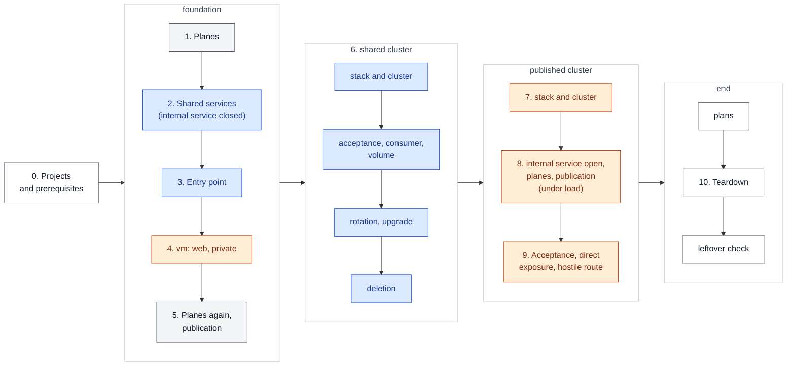

# Test procedure

Every step of a full test cycle, with the checkpoint that must pass before the next step and the duration measured on the reference test cloud. Each stack runs in its own project, as in production ([ADR-0003](../adr/0003-scope-and-boundary.md)), and the cycle runs in either plane mode: **gateway** (planes provided by the operator, with address translation) or **interface** (planes built in a hub project, with transit routers). The results of each cycle are in [test results](../concepts/test-results.md); the [getting started](../getting-started/README.md) is the short version.

Run everything from a machine that is an administration source of the stacks (`admin.sources`, `bastion.ssh_cidrs`), with a `clouds.yaml` entry per project and **no `OS_*` variable in the shell**.

`tools/landing-zone/lz` runs this procedure end to end, one scenario per profile ([usage](../../tools/landing-zone/README.md)).

## Overview

The sections follow the order of the campaign. The test cloud holds one Kubernetes cluster at a time, so the shared cluster (section 6) is created, tested and deleted before the published cluster (section 7); on a cloud large enough for both, section 6 may run after section 9.



| Project | Stacks | Role on the planes |
|---|---|---|
| hub (interface mode) | `shared/planes` | owns the planes and their transit routers; no instance. With operator planes, `shared/planes` runs with the shared services' credentials and only adopts them |
| shared services | `tests/fixtures/receiver`, `shared/vm` (the internal service), `tests/fixtures/acme` | `shared` on `observability` (receiver), `shared` on `internal` (internal service, ACME authority); the internal service does not join `observability`, its project holding the receiver. On hub planes, one attachment per project and plane: the internal service and the ACME authority then need a project each |
| shared cluster | `shared/kubernetes` ([section 6](#6-shared-cluster)) | `shared` on `internal`, `tenant` on `observability` |
| entry point | `shared/entry-point` | `shared` on `publication`, `tenant` on `observability` |
| one per tenant | `tenants/vm` (the web and private tenants, a state each), `tenants/kubernetes` | `tenant` |

The steps of the campaign, in the order it runs them, with the section of each and its duration measured on 2026-11-21 (interface mode, from the `report.json` of the run):

| Campaign step | Section | Measured |
|---|---|---|
| `prep` | 0, the credentials of the clusters, the SSH configuration | 0 s |
| `planes` | 1 | 20 s |
| `receiver`, `acme`, `internal` | 2 | 1 min 20, 1 min, 50 s |
| `resolver`, `egress` | 2, the test resolver and the shared egress (measured on 2026-11-24) | 1 min, 2 min 50 |
| `edge` | 3 | 3 min (2 min 30 to 3 min 20 over the five campaigns of 2026-11-20 and 21) |
| `web`, `private` | 4 | 3 min, 1 min 40 |
| `egress-tenant` | 4, the tenant with the shared egress (measured on 2026-11-24) | 2 min |
| `transit`, `publish` | 5 (first publication) | 8 s, 4 s |
| `k8s-shared`, `transit` | 6.1, the stack of the shared cluster, then its routes | 1 min, 6 s |
| `cluster-shared` | 6.1, `create-cluster.sh` | 13 min |
| `tour-shared`, `accept-shared` | 6.3 | 4 s, 2 min 40 |
| `consumer`, `volume` | 6.4, 6.5 | 50 s, 25 s |
| `rotate` | 6.6, the credential | 5 min |
| `upgrade` | 6.6, the Kubernetes upgrade under load | 18 min |
| `shared-down` | 6.7 | 6 min |
| `k8s` | 7, the stack of the published cluster: its network, routers and bootstrap instance | 1 min 15 |
| `cluster` | 7, `create-cluster.sh`, from the kind cluster to the cluster managing itself, add-ons and certificates included | 9 min |
| `internal-open`, `transit` | 8 | 20 s, 8 s |
| `tour`, `publish` | the [Kubernetes tour](../guides/kubernetes-tour.md) regenerated; 8, the publication under load | 1 s, 8 s |
| `accept` | 9 | 3 min 10 |
| `direct`, `direct-k8s` | 9, direct exposure | 2 min 40, 1 min 20 |
| `hostile` | 9, hostile route (interface mode) | 40 s |
| `plans` | every plan empty | 25 s |
| `teardown`, `leftovers` | 10 | 8 min 40, 1 min 30 |
| **Total** | | **about 1 h 30** without incident |

That is per plane mode: about 3 h for a release, which runs both.

**From the previous release** (`lz campaign --from <tag>`, [ADR-0017](../adr/0017-upgrades-between-releases.md)): the previous release deploys the foundation and the shared cluster with its own campaign, then step `migrate` applies the new release over its states, under load, in the order of the foundation, then the stack of the shared cluster, its routes and `update-shared` (`update-cluster.sh`, [update a cluster](../guides/kubernetes-lifecycle.md#update-a-cluster-after-an-apply)). It writes `migration.json`: for each stack, what the plan replaces and destroys, and the requests that failed during its apply. The scenario then goes on from `tour-shared`. `migrate`: 12 min 40 (interface mode, 2026-11-25). The spoofed source (section 9) is not run by the campaign: it changes the port of a tenant by hand.

Expected results are extracts of the campaign of 2026-11-21 (interface mode), and of the cycle of 2026-11-02 where it shows more; addresses outside the private ranges of the example are documentation addresses.

### Inputs between stacks

No stack reads an object of another project: each passes what the next ones need through its outputs. The simplest way to give a stack its per-cycle inputs is a git-ignored `mode.auto.tfvars.json` next to its `terraform.tfvars`: OpenTofu loads it automatically, also for the applies run by `scripts/publish-domains.sh`. The two tenants of the `vm` stack share its directory: their inputs go to `mode.web.tfvars.json` and `mode.private.tfvars.json`, given with `-var-file` (an auto file would be read by both).

| Input | Of | From |
|---|---|---|
| `cloud` | every stack | the project's `clouds.yaml` entry |
| `plane_attachment` | every attached stack | `tofu -chdir=stacks/shared/planes output -json attachments \| jq .<name>.planes` |
| `monitoring.receiver` | entry point, `vm`, `kubernetes` | output `receiver_url` of the receiver |
| `edge_sources` | `vm`, `kubernetes` | output `publication_sources` of the entry point |
| `allowed_sources` | internal service | output `internal_sources` of `kubernetes` |
| `certificates` | `vm`, `kubernetes` | output `certificates` of the ACME authority, keyed by tenant (`jq .web`, `jq .published`) |

## 0. Projects and prerequisites

| Check | How | Expected |
|---|---|---|
| Projects and credentials | one project per row of the table above; an application credential `member` + `load-balancer_member` each, plus one for the cluster in the Kubernetes project | `openstack token issue` works for every `clouds.yaml` entry |
| DNS zones (optional) | the public zone with the entry point's project | `openstack zone list` from that project shows it |
| Quotas | `openstack quota show` per project | Kubernetes project: 25 security groups, 200 rules (the cloud controller manager creates its own); hub: one RBAC policy per attachment and hub plane |
| Node image | [images/kubernetes-node](../../images/kubernetes-node/README.md), shared with the Kubernetes project and accepted there | private image `ubuntu-2404-kube-<version>` visible from the Kubernetes project |
| Your address | the address the cloud sees for you | in `admin.sources` and `bastion.ssh_cidrs` of every stack |
| Capacity per host | ask the operator | the two entry point instances are in hard anti-affinity: replacing one needs room on another host than the other's |

## 1. Planes

```bash
cd stacks/shared/planes && tofu init && tofu apply && tofu plan -detailed-exitcode
```

`terraform.tfvars` declares the planes — adopted (`mode = "gateway"`) or built (`mode = "interface"`) — every attachment with its project, range and role per plane, and `tenant_ranges` per hub plane ([examples](../../examples/planes/README.md)).

| Checkpoint | If it fails |
|---|---|
| plan after apply empty | `DuplicateRbacPolicy`: an attachment was renamed on the same project; apply again |
| the planes are visible from every attached project (`openstack network show <site>-publication`) and from no other | check the project IDs of the attachments |

```console
$ openstack network show t1-publication -f value -c mtu -c shared     # from an attached project
1362 True
$ openstack network show t1-publication                               # from a project not attached
No Network found for t1-publication
```

## 2. Shared services

Create it before the stacks that push to it: they need its `receiver_url`.

```bash
cd tests/fixtures/receiver && tofu init && tofu apply && tofu plan -detailed-exitcode
tofu output -raw receiver_url   # with NAT: a floating IP of the observability plane; interface: its own address
```

```console
$ tofu output -raw receiver_url
http://10.34.0.12:9090
```

The **ACME authority** (Knot and step-ca, [`tests/fixtures/acme`](../../tests/fixtures/acme/README.md)) is created at the same step, a shared service of the internal services plane: the tenant stacks need its `certificates` output.

```bash
cd tests/fixtures/acme && tofu init && tofu apply && tofu plan -detailed-exitcode
tofu output -json certificates | jq '{certificates: .web}' > ../../../stacks/tenants/vm/web-certificates.tfvars.json   # merge into mode.web.tfvars.json
tofu output -json certificates | jq '{certificates: .published}' > ../../../stacks/tenants/kubernetes/certificates.auto.tfvars.json
tofu output -raw root_certificate > root.pem      # for the clients of the acceptance
```

The **internal service**, a shared service on virtual machines ([`stacks/shared/vm`](../../stacks/shared/vm/README.md)) with its demonstration workload on port 8080, is created at the same step, **closed**: with an empty `consumers` it admits nobody, as a real internal service exists before its consumers. It is opened in [section 8](#8-internal-service-open-planes-and-publication). Its state is its own (`internal-service.tfstate`), as for the tenants of section 4; its inputs, in `mode.internal-service.tfvars.json`, are `name = "internal-service"`, `cidr`, `egress = "router"`, `services = { internal = { ports = [8080] } }` and `consumers = []`, with its attachment and the receiver.

```bash
s=stacks/shared/vm; export TF_DATA_DIR=.terraform/tenant-internal-service
printf 'terraform {\n  backend "local" {}\n}\n' > $s/backend_override.tf
tofu -chdir=$s init -backend-config=path=internal-service.tfstate
tofu -chdir=$s apply -auto-approve -var-file=mode.internal-service.tfvars.json && tofu -chdir=$s plan -detailed-exitcode -var-file=mode.internal-service.tfvars.json
unset TF_DATA_DIR
```

| Checkpoint | If it fails |
|---|---|
| `knot` and `step-ca` active on the instance (through its bastion) | cloud-init `error` with packages not installed: the instance had no Internet access at boot (its egress router); replace it once the egress works |

The **test resolver** ([`tests/fixtures/resolver`](../../tests/fixtures/resolver/README.md)), Unbound on the internal services plane, stands for a resolver behind a plane: the private tenant, which has no egress, takes it as its `dns_nameservers` ([name resolution](integration-points.md#name-resolution-time-and-package-mirrors)). The **shared egress** ([`stacks/shared/egress`](../../stacks/shared/egress/README.md)) is created with no tenant: it refuses every request until section 4 declares one.

```bash
cd tests/fixtures/resolver && tofu init && tofu apply && tofu plan -detailed-exitcode
cd stacks/shared/egress && tofu init && tofu apply && tofu plan -detailed-exitcode   # tenants = {}
```

## 3. Entry point

```bash
cd stacks/shared/entry-point && tofu init && tofu apply && tofu plan -detailed-exitcode
tofu output -json publication_sources   # gateway: its router's address; interface: the edge range
```

```console
$ tofu output -json publication_sources
["10.20.0.0/24"]
```

| Checkpoint | How | If it fails |
|---|---|---|
| plan after apply empty | exit code 0 | report |
| cloud-init finished on every Traefik instance | `ssh -J ops@<bastion> ops@<instance> cloud-init status --wait` → `done`; a bastion just created may not answer for a minute: retry | `error`: read `/var/log/cloud-init-output.log`; a package mirror error leaves Traefik without podman; replace the instance |

DNS records are the slowest resources: seconds normally, several minutes when Designate is congested. A record created after an apply timeout must be imported ([pitfalls](https://github.com/CyprisTech/terraform-openstack-tenant/blob/main/docs/pitfalls.md#dns)).

## 4. Tenants `web` and `private`

Two tenants of the `vm` stack ([ADR-0016](../adr/0016-network-services-and-edge-by-level.md), D1): `web`, behind the entry point, and `private`, with `exposure = "none"` and `egress = "none"`. They share the stack's directory, each with its own state (`<tenant>.tfstate`), its own data directory and its own inputs file: the commands on one of them run with `TF_DATA_DIR=.terraform/tenant-<tenant>`.

```bash
s=stacks/tenants/vm
printf 'terraform {\n  backend "local" {}\n}\n' > $s/backend_override.tf
for t in web private; do
  export TF_DATA_DIR=.terraform/tenant-$t
  tofu -chdir=$s init -backend-config=path=$t.tfstate
  tofu -chdir=$s apply -auto-approve -var-file=mode.$t.tfvars.json && tofu -chdir=$s plan -detailed-exitcode -var-file=mode.$t.tfvars.json
done
unset TF_DATA_DIR
```

| Checkpoint | If it fails |
|---|---|
| two empty plans | report |
| cloud-init `done` on the instances (through their bastions) | as in section 3 |
| `vm` instances: `/etc/nginx/conf.d/web.conf` present, certificate issued by the test authority (`openssl x509 -in /etc/nginx/tls/cert.pem -noout -issuer`) | `journalctl -u lego-certificate`: the authority and the DNS server must be reachable on the internal services plane |

A third tenant of the `vm` stack, `egress-shared`, goes out through the shared egress (`egress = "shared"`, `exposure = "none"`), as in [the stack's usage](../../stacks/shared/egress/README.md#usage): applied first, then declared in the `tenants` of `shared/egress` with its `internal_sources`; its instances wait for that admission, then install their packages through the proxy.

| Checkpoint | If it fails |
|---|---|
| cloud-init `done` on the instance, packages installed through the proxy | `/var/log/squid/access.log` on a proxy: a `TCP_DENIED` line names the source and the domain refused |

## 5. Planes again and domain publication

The routes to the tenants, then their domains on the entry point. Sections 6 and 8 run this section again, after each cluster's stack.

### Planes again

```bash
tofu -chdir=stacks/shared/planes apply && tofu -chdir=stacks/shared/planes output -json transit
```

On hub planes, `shared/planes` discovers the address Neutron gave each attached router and adds one route per attachment on each transit router. Checkpoint: every attachment appears in `transit.<plane>.routes`; plan afterwards empty. Until then, the shared services cannot answer the tenants: the agents' pushes time out, and they retry. On operator planes, nothing changes.

```console
$ tofu -chdir=stacks/shared/planes output -json transit     # here after section 8: with the published cluster
{
  "observability": {
    "address": "172.31.1.1",
    "routes": {
      "edge": "10.20.0.0/24 via 172.31.1.90",
      "private": "10.22.0.0/24 via 172.31.1.33",
      "published": "10.24.0.0/24 via 172.31.1.89",
      "receiver": "10.34.0.0/28 via 172.31.1.170",
      "web": "10.21.0.0/24 via 172.31.1.253"
    }
  },
  "publication": {
    "address": "172.31.0.1",
    "routes": {
      "edge": "10.20.0.0/24 via 172.31.0.92",
      "published": "10.24.0.0/24 via 172.31.0.250",
      "web": "10.21.0.0/24 via 172.31.0.30"
    }
  }
}
```

### Domain publication

Each tenant asks for its domains, the change a merge request would carry, then the entry point is applied ([publish a domain](../guides/publish-a-domain.md)):

```bash
TF_DATA_DIR=.terraform/tenant-web scripts/request-domains.sh stacks/tenants/vm
OS_CLOUD=<entry of the entry point's project> scripts/publish-domains.sh
```

| Checkpoint | If it fails |
|---|---|
| "domains published"; the apply changes the two Traefik instances in place (`0 added, 2 changed, 0 destroyed`) | an instance replaced means its static configuration changed: that is a separate change |
| the routes on each instance, within seconds | `cat /etc/traefik/dynamic/routes.yml` (through the bastion); `journalctl -u traefik-routes` | the timer leaves the routes untouched when the metadata service does not answer or answers fewer routes than announced |
| `request-domains.sh` stops: "has no published_domains output" | apply that tenant, then run it again |
| it stops: "refusing to remove them all" | the domains file lists no domain; `--allow-empty` only to withdraw every domain on purpose |

```console
$ TF_DATA_DIR=.terraform/tenant-web scripts/request-domains.sh stacks/tenants/vm
site-a.example.org: added -> ["172.31.0.28:443"]
site-b.example.org: added -> ["172.31.0.28:443"]
written to stacks/shared/entry-point/domains.auto.tfvars.json: commit it and open a merge request
$ OS_CLOUD=entry-point scripts/publish-domains.sh
domains added: site-a.example.org, site-b.example.org
...
Apply complete! Resources: 0 added, 2 changed, 0 destroyed.
domains published: site-a.example.org, site-b.example.org
```

Run again with nothing to change, it says `domains unchanged: nothing to do`.

## 6. Shared cluster

The test cloud holds one Kubernetes cluster at a time: this cluster is created, tested and deleted here, before the published cluster (section 7). Deploy it with the previous minor Kubernetes version, its node image shared with the project: the **Lifecycle** step below upgrades it.

1. **Stack and cluster**: `consumers` = `TF_DATA_DIR=.terraform/tenant-web tofu -chdir=stacks/tenants/vm output -json internal_sources`, `certificates` from the authority (`shared`), then section 5 again for its routes, then `create-cluster.sh` as in [section 7](#7-published-cluster), and the demonstration services: `kubectl apply -f stacks/shared/kubernetes/demo/whoami.yaml -f stacks/shared/kubernetes/demo/echo.yaml`.
2. **Names**: written by the stack in the Designate zone of `internal_zone` (the test zone, shared with the project), served by the cloud's DNS servers.
3. **Acceptance**: from a `vm` instance, the name resolves to the `services` address, and HTTPS answers, verified with `/etc/lego/ca.pem`. Then the isolation test with `--shared-kubeconfig`.
4. **A consumer added**: from an undeclared source the service is closed; added to `consumers`, applied, then `update-cluster.sh` run, it answers ([Add a consumer](../../stacks/shared/kubernetes/README.md#add-a-consumer)).
5. **A volume**: a StatefulSet of one replica writes 1 MiB of random data on a claim of the default storage class; its checksum is kept.
6. **Lifecycle** ([guide](../guides/kubernetes-lifecycle.md)): the credential rotated, a load balancer and a volume created with the new one, the pod of the volume moved (detached, attached again) with its data intact, the old credential revoked; then the minor upgrade, while a consumer sends requests, and the volume checked again once its node was replaced.
7. **Teardown** of the volumes (the namespace of the check, while Cinder CSI runs), then of the cluster and the stack, as in [section 10](#10-teardown), with the kubeconfig of the shared cluster and its Cluster object, `shared` by default (`cluster.name`).

| Checkpoint | How | If it fails |
|---|---|---|
| the name resolves to the service address | `dig +short @<zone server> <name>` from a consumer | the record, and the zone server's admission of the consumer |
| HTTPS from a consumer, certificate verified | `curl --cacert /etc/lego/ca.pem https://<name>/` | the certificate in `traefik-internal` (`kubectl get certificate -A`) |
| closed to an undeclared consumer, open once added | `curl` before and after | the manifests applied again after the apply |
| after the rotation: a new load balancer | a Service of type `LoadBalancer` gets an address | the logs of the cloud controller manager |
| after the rotation and after the upgrade: the volume moved intact; a new volume after the rotation | `sha256sum` in the pod, compared with the one written; a claim bound and mounted | `kubectl -n volume-check describe pvc,pod`, the logs of Cinder CSI (`kube-system`) |
| after the upgrade: every node at the new version, the API and service addresses unchanged | `kubectl get nodes`, kubeconfig, `services` output | `kubectl -n platform get machines`, the capacity of the project |

Durations: in the [overview](#overview) (`k8s-shared` to `shared-down`).

## 7. Published cluster

Its stack first: the network, the routers and the bootstrap instance; then the cluster, created from the bootstrap instance.

```bash
tofu -chdir=stacks/tenants/kubernetes init && tofu -chdir=stacks/tenants/kubernetes apply && tofu -chdir=stacks/tenants/kubernetes plan -detailed-exitcode
```

Checkpoint: plan empty, cloud-init `done` on the bootstrap instance (`ssh ops@<bootstrap> cloud-init status --wait`; it may not answer SSH for a minute after its creation).

```bash
B=$(tofu -chdir=stacks/tenants/kubernetes output -raw bootstrap)
scp cluster-clouds.yaml ops@$B:/tmp/clouds.yaml; scp cacert.pem ops@$B:/tmp/cacert.pem   # private CA only
ssh ops@$B 'sudo install -m 600 /tmp/clouds.yaml /opt/platform/clouds.yaml && sudo install -m 644 /tmp/cacert.pem /opt/platform/cacert.pem; rm -f /tmp/clouds.yaml /tmp/cacert.pem'
ssh -t ops@$B 'sudo /opt/platform/create-cluster.sh'
ssh ops@$B 'sudo cat /opt/platform/published.kubeconfig' > published.kubeconfig
```

`cluster-clouds.yaml` is the cluster credential's `clouds.yaml` entry, renamed `openstack`; it never goes through Terraform.

| Checkpoint | How | If it fails |
|---|---|---|
| script ends with "manages itself" | output | run it again: each step skips what exists |
| every node `Ready`: 5 by default (3 control plane nodes, 2 workers), 3 in the campaign (`control_plane_count = 1`) | `kubectl get nodes` | `kubectl -n platform get machines,openstackmachines` |
| 7 chart proxies `Ready`, **one release proxy per chart** | `kubectl -n platform get helmchartproxy,helmreleaseproxy` | CAAPH v0.6.6 creates one per chart; `create-cluster.sh` stops if a duplicate appears. To repair one by hand, delete both proxies of the chart, never one only: CAAPH installs it again ([test results](../concepts/test-results.md#detailed-results-campaigns-of-2026-11-18)) |
| ingress Service on the stack's address | `kubectl get svc -A --field-selector spec.type=LoadBalancer` against `tofu output published_domains` | with NAT: a floating IP of the publication plane; interface: a fixed address of the cluster network (internal load balancer). Another address means the requested one was not available |

```console
$ kubectl get nodes        # the campaign: 1 control plane node, 2 workers
NAME                               STATUS   ROLES           VERSION   INTERNAL-IP
published-chq69-cqhf7              Ready    control-plane   v1.36.5   10.24.0.44
published-md-0-2j5vw-v9g2p-qb2j6   Ready    <none>          v1.36.5   10.24.0.82
published-md-0-2j5vw-v9g2p-rwnz2   Ready    <none>          v1.36.5   10.24.0.94
$ kubectl -n platform get helmreleaseproxy     # one per chart
NAME                                               CLUSTER   READY  STATUS
cilium-published-75wl7                             published True   deployed
kubelet-csr-approver-published-4dvwn               published True   deployed
metrics-server-published-tkrvw                     published True   deployed
openstack-cinder-csi-published-77nmh               published True   deployed
openstack-cloud-controller-manager-published-nzwqf published True   deployed
prometheus-published-hpz6g                         published True   deployed
traefik-published-vsj99                            published True   deployed
$ kubectl get svc -A --field-selector spec.type=LoadBalancer
NAMESPACE   NAME      TYPE           CLUSTER-IP       EXTERNAL-IP   PORT(S)
traefik     traefik   LoadBalancer   10.101.124.161   10.24.0.10    80:31415/TCP,443:30594/TCP
```

Optional, once the cluster manages itself: `tofu apply -var bootstrap=false` removes the bootstrap instance; set it back to `true` before teardown.

## 8. Internal service open, planes and publication

### Open the internal service

Give the internal service its consumers: `consumers` is the `internal_sources` output of the Kubernetes tenant, known once its stack is applied (section 7). The change is in place: the service is not replaced ([add a consumer](../../stacks/shared/vm/README.md#add-a-consumer)).

```bash
s=stacks/shared/vm; export TF_DATA_DIR=.terraform/tenant-internal-service
jq --argjson c "$(tofu -chdir=stacks/tenants/kubernetes output -json internal_sources)" '.consumers = $c' $s/mode.internal-service.tfvars.json > /tmp/inputs.json && mv /tmp/inputs.json $s/mode.internal-service.tfvars.json
tofu -chdir=$s apply -auto-approve -var-file=mode.internal-service.tfvars.json && tofu -chdir=$s plan -detailed-exitcode -var-file=mode.internal-service.tfvars.json
unset TF_DATA_DIR
```

### Planes and publication

Section 5 again: the routes of the published cluster on the transit routers, then its domain on the entry point. The campaign measures the publication under load here: a client sends two requests per second to a domain already published while the new one is added.

```console
$ scripts/request-domains.sh stacks/tenants/kubernetes
apps.published.example.org: added -> ["172.31.0.185:443"]
written to stacks/shared/entry-point/domains.auto.tfvars.json: commit it and open a merge request
$ OS_CLOUD=entry-point scripts/publish-domains.sh
domains added: apps.published.example.org
...
Apply complete! Resources: 0 added, 2 changed, 0 destroyed.
domains published: apps.published.example.org, site-a.example.org, site-b.example.org
```

Measured (2026-11-23, operator planes): the two instances are updated in place in 1 to 5 s, and none of the 147 requests sent to the published domains meanwhile fails.

## 9. Acceptance

```bash
kubectl --kubeconfig published.kubeconfig apply -f stacks/tenants/kubernetes/demo/whoami.yaml
LB=$(tofu -chdir=stacks/shared/entry-point output -json load_balancer | jq -r .floating_ip)
for d in site-a.example.org site-b.example.org apps.published.example.org; do
  for i in $(seq 12); do curl -s --cacert tests/fixtures/acme/root.pem --resolve $d:443:$LB https://$d/ | grep -E "client=|X-Real-Ip"; done | sort | uniq -c
done
# the internal service has its own state: its outputs in a file
TF_DATA_DIR=.terraform/tenant-internal-service tofu -chdir=stacks/shared/vm output -json > internal-service-outputs.json
python3 tests/isolation/check.py --receiver tests/fixtures/receiver --key <ssh key> --published-kubeconfig published.kubeconfig \
  --internal-service internal-service-outputs.json --acme tests/fixtures/acme
```

Wait until the ingress Service has its address and the agents have pushed once (30 s) before the acceptance.

| Checkpoint | Expected | If it fails |
|---|---|---|
| HTTPS through the entry point, verified with the test root | 12 answers per domain, all with the client's address | no answer: members and published domains (section 5, `stacks/shared/entry-point/domains.auto.tfvars.json`), Traefik Service (section 7); interface mode: transit routes (section 5) |
| isolation test | every row as expected (68 with the published cluster and the internal service; 66 with the shared cluster, [section 6](#6-shared-cluster)) | a row in error (not "open" nor "closed") is a probe that could not run — usually SSH through a bastion: run the test again; a wrong "open" or "closed" is a defect |
| plans | `tofu plan -detailed-exitcode` exits 0 in every stack | report |

```console
     12 host=site-a.example.org  client=198.51.100.100
     12 host=site-b.example.org  client=198.51.100.100
     12 X-Real-Ip: 198.51.100.100
$ python3 tests/isolation/check.py --receiver tests/fixtures/receiver --key ~/.ssh/id_ed25519 --published-kubeconfig published.kubeconfig \
    --internal-service internal-service-outputs.json --acme tests/fixtures/acme
from                   to                                                    port  expected actual
test runner            entry point (public IP)                                443  open     open     ✅
test runner            web service address 10.21.0.227                        443  closed   closed   ✅
edge t1-edge-1         web service address 10.21.0.227                        443  open     open     ✅
...
receiver               series pushed by web                                     -  yes      yes      ✅
...
edge t1-edge-1         routed IPv6 (global address, default route)              -  none     none     ✅
...
51/51 rows as expected
```

### Direct exposure

Each tenant type that can leave the entry point is switched to `exposure = "public"`, checked, then put back.

1. **`vm`**: apply with `exposure = "public"`; HTTPS on `service_address`, verified with the test root; from an entry point instance, the tenant's instance on 443 is closed. Back to `"entry-point"`: apply, then section 5 (planes, domain publication), HTTPS through the entry point once it answers steadily.
2. **`kubernetes`**: apply with `exposure = "public"`, then `update-cluster.sh` ([update a cluster](../guides/kubernetes-lifecycle.md#update-a-cluster-after-an-apply)); the Traefik Service gets the address of `service_address`; HTTPS there, verified; from an entry point instance, the former address of the ingress on 443 is closed. Back to `"entry-point"`: apply, `update-cluster.sh`, section 5 (planes, domain publication), HTTPS through the entry point.

| Checkpoint | Expected | If it fails |
|---|---|---|
| HTTPS on the public address | 12 answers, certificate verified | the Service keeps its former address: the add-ons were not applied, or the cloud controller manager did not move the load balancer (`kubectl -n traefik describe svc traefik`) |
| entry point to the former address | closed | the publication router is still there: plan of the tenant |
| back to the entry point | HTTPS through the entry point again, answered by the load balancer that existed before the change | domains not republished, or, interface mode, transit routes (section 5); the load balancer answers no SYN while the tenant's routes are host routes of its subnet: it keeps the next hop it found when its VIP was plugged ([ADR-0013](../adr/0013-plane-routes-on-a-transit-router.md)) |

### Hostile route (interface mode)

A tenant adds a route to another tenant through the transit router, and must still reach nothing. The isolation test only opens connections and does not run this step; the campaign does (step `hostile` of [`tools/landing-zone`](../../tools/landing-zone/README.md), interface mode). By hand:

```bash
# the private tenant routes the web range through the observability transit router (172.31.1.1 here)
s=stacks/tenants/vm
jq '.plane_attachment.observability.routes += [{destination: "10.21.0.0/24", next_hop: "172.31.1.1"}]' \
  $s/mode.private.tfvars.json > /tmp/hostile.json
TF_DATA_DIR=.terraform/tenant-private tofu -chdir=$s apply -var-file=/tmp/hostile.json
# the route is on the tenant's transit router at once; on the private instance (through its bastion), probe a web instance
for p in 443 22 9100; do timeout 4 bash -c "</dev/tcp/<web address>/$p" && echo "$p OPEN" || echo "$p closed"; done
TF_DATA_DIR=.terraform/tenant-private tofu -chdir=$s apply -var-file=mode.private.tfvars.json   # back to normal
```

```console
443 closed
22 closed
9100 closed
```

Expected: the route is there (`ip route`), every port closed — the security groups of the target admit only its load balancer, its bastion and the administrators.

### Hostile route (gateway mode)

The same case on planes with NAT, run by hand once per cloud: the stacks give no input for such a route, so the tenant adds it through the API, as a hostile member would. In the private tenant's project, on its observability router and on its transit router; the next hop is the web tenant's observability router address on the plane (`openstack router show <router> -c external_gateway_info`, in the web tenant's project):

```bash
openstack router add route --route destination=10.21.0.0/24,gateway=<web router address on the plane> <private observability router>
openstack router add route --route destination=10.21.0.0/24,gateway=<observability router address on the subnet> <private transit router>
# on the private instance (through its bastion), probe a web instance
for p in 443 22 9100; do timeout 4 bash -c "</dev/tcp/<web address>/$p" && echo "$p OPEN" || echo "$p closed"; done
openstack router remove route --route destination=10.21.0.0/24,gateway=<web router address on the plane> <private observability router>
openstack router remove route --route destination=10.21.0.0/24,gateway=<observability router address on the subnet> <private transit router>
TF_DATA_DIR=.terraform/tenant-private tofu -chdir=stacks/tenants/vm plan -var-file=mode.private.tfvars.json   # no change
```

Expected: every port closed, the security groups decide. Record in the [test results](../concepts/test-results.md) whether the packets reached the web tenant's subnet (its instance's security group log, or `tcpdump` on the web instance): that says whether address translation is a further layer on this cloud.

### Spoofed source (interface mode)

Neutron's port security filters the ports of the instances, not those of the routers ([lateral movement](../concepts/security.md#lateral-movement)). This step checks whether a member can disable port security on its own instance, then whether a packet sent with another project's address reaches anything. It changes a tenant's port, so it is manual; run it after the hostile route, with the same route in place.

```bash
# credentials of the private tenant (its clouds.yaml entry)
PORT=$(openstack --os-cloud <private entry> port list --server <private instance> -f value -c ID)
SGS=$(openstack --os-cloud <private entry> port show $PORT -f json -c security_group_ids | jq -r '.security_group_ids[]')
openstack --os-cloud <private entry> port set --no-security-group --disable-port-security $PORT
```

If the cloud refuses (`Forbidden`), a member cannot disable port security there: record it in the [test results](../concepts/test-results.md) and stop. Otherwise, with the hostile route of the previous step applied:

```bash
# on the private instance: send from the web load balancer's address, which the web instances admit on 443
sudo ip addr add <web load balancer address>/32 dev ens3
nc -s <web load balancer address> -z -w 4 <web address> 443 && echo "443 OPEN" || echo "443 closed"
sudo ip addr del <web load balancer address>/32 dev ens3
# back to normal: port security and security groups, then the route
openstack --os-cloud <private entry> port set --enable-port-security $(for g in $SGS; do printf -- '--security-group %s ' $g; done) $PORT
TF_DATA_DIR=.terraform/tenant-private tofu -chdir=stacks/tenants/vm apply -var-file=mode.private.tfvars.json
```

```console
443 closed
```

Expected: closed. The packet may reach the web instance, whose security group admits that source, but the answer goes to the real load balancer: no connection is established. Record whether port security could be disabled, and the result. Finally `openstack port show $PORT -c port_security_enabled` shows `True` and the plan of the private tenant is empty.

## 10. Teardown

In three waves, consumers before what they consume: the clusters and the tenants, then the shared services and the fixtures, then the planes. Inside a wave nothing depends on anything else: the campaign destroys its stacks in parallel.

The published cluster first, as in [delete a cluster](../guides/kubernetes-lifecycle.md#delete-a-cluster) (with `bootstrap = true`); then the stacks, wave by wave:

```bash
for t in private web egress-shared; do
  TF_DATA_DIR=.terraform/tenant-$t tofu -chdir=stacks/tenants/vm destroy -auto-approve -var-file=mode.$t.tfvars.json
done
TF_DATA_DIR=.terraform/tenant-internal-service tofu -chdir=stacks/shared/vm destroy -auto-approve -var-file=mode.internal-service.tfvars.json
for s in tests/fixtures/resolver stacks/shared/egress stacks/shared/entry-point \
         tests/fixtures/receiver tests/fixtures/acme; do
  tofu -chdir=$s destroy -auto-approve
done
tofu -chdir=stacks/shared/planes destroy -auto-approve
```

| Checkpoint | How |
|---|---|
| no leftover, in every project | servers, volumes, load balancers, floating IPs, routers, networks, ports, security groups, server groups, and the records of the DNS zones: all empty, except the node image if you keep it. `openstack loadbalancer list` needs the Octavia client plugin: an error is not an empty list |
