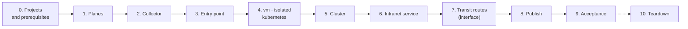

# Test procedure

Every step of a full test cycle, with the checkpoint that must pass before the next step and the duration measured on the reference test cloud. Each stack runs in its own project, as in production ([ADR-0003](../adr/0003-scope-and-boundary.md)), and the cycle runs in either plane mode: **gateway** (planes provided by the operator) or **interface** (shared private planes of a hub project, with transit routers). The results of each cycle are in [test results](../concepts/test-results.md); the [getting started](../getting-started/README.md) is the short version.

Run everything from a machine that is an administration source of the stacks (`admin.sources`, `bastion.ssh_cidrs`), with a `clouds.yaml` entry per project and **no `OS_*` variable in the shell**.

## Overview



| Project | Stacks | Role on the planes |
|---|---|---|
| hub (interface mode) | `shared/planes` | owns the planes and their transit routers; no instance. With operator planes, `shared/planes` runs with the shared services' credentials and only adopts them |
| shared services | `tests/fixtures/collector`, `tests/fixtures/intranet-service` | `shared` on `monitoring`, `shared` on `intranet` |
| entry point | `shared/entry-point` | `shared` on `svc_public`, `tenant` on `monitoring` |
| one per tenant | `tenants/vm`, `tenants/isolated`, `tenants/kubernetes` | `tenant` |

| Step | Measured (2026-10-31) |
|---|---|
| 1. Planes | 10 s |
| 2. Collector | 1 min |
| 3. Entry point | 3 to 4 min |
| 4. `vm`, `isolated`, `kubernetes` | 1 to 2.5 min each, up to 10 min when DNS is slow |
| 5. Cluster (`create-cluster.sh`, add-ons included) | 17 to 19 min |
| 6. Intranet service | 1 min |
| 7. Transit routes (interface mode) | 5 s |
| 8. Domain publication (two entry point instances replaced) | 4 min |
| 9. Acceptance | 3 min |
| **Total, steps 1 to 9** | **about 40 minutes** without incident |
| 10. Teardown | 11 min: 7 for the cluster, 4 for the stacks |

Expected results are short extracts of the cycle of 2026-10-31 (interface mode); addresses outside the private ranges of the example are documentation addresses.

### Inputs between stacks

No stack reads an object of another project: each passes what the next ones need through its outputs. The simplest way to give a stack its per-cycle inputs is a git-ignored `mode.auto.tfvars.json` next to its `terraform.tfvars`: OpenTofu loads it automatically, also for the applies run by `scripts/publish-domains.sh`.

| Input | Of | From |
|---|---|---|
| `cloud` | every stack | the project's `clouds.yaml` entry |
| `plane_attachment` | every attached stack | `tofu -chdir=stacks/shared/planes output -json attachments \| jq .<name>.planes` |
| `monitoring.collector_cidrs` | entry point, `vm`, `isolated`, `kubernetes` | output `collector_cidrs` of the collector |
| `edge_sources` | `vm`, `kubernetes` | output `svc_public_sources` of the entry point |
| `allowed_sources` | intranet service | output `intranet_sources` of `kubernetes` |

## 0. Projects and prerequisites

| Check | How | Expected |
|---|---|---|
| Projects and credentials | one project per row of the table above; an application credential `member` + `load-balancer_member` each, plus one for the cluster in the Kubernetes project | `openstack token issue` works for every `clouds.yaml` entry |
| DNS zones | the monitoring zone shared with every project that writes monitoring records (entry point, tenants, shared services); the public zone with the entry point's project | `openstack zone list` from each project shows them |
| Quotas | `openstack quota show` per project | Kubernetes project: 25 security groups, 200 rules (the cloud controller manager creates its own); hub: one RBAC policy per attachment and interface plane |
| Node image | [images/kubernetes-node](../../images/kubernetes-node/README.md), shared with the Kubernetes project and accepted there | private image `ubuntu-2404-kube-<version>` visible from the Kubernetes project |
| Your address | the address the cloud sees for you | in `admin.sources` and `bastion.ssh_cidrs` of every stack |
| Capacity per host | ask the operator | the two entry point instances are in hard anti-affinity: replacing one needs room on another host than the other's |

## 1. Planes

```bash
cd stacks/shared/planes && tofu init && tofu apply && tofu plan -detailed-exitcode
```

`terraform.tfvars` declares the planes — adopted (`mode = "gateway"`) or built (`mode = "interface"`) — every attachment with its project, range and role per plane, and `tenant_ranges` per interface plane ([examples](../../examples/planes/README.md)).

| Checkpoint | If it fails |
|---|---|
| plan after apply empty | `DuplicateRbacPolicy`: an attachment was renamed on the same project; apply again |
| the planes are visible from every attached project (`openstack network show <site>-svc-public`) and from no other | check the project IDs of the attachments |

```console
$ openstack network show t1-svc-public -f value -c mtu -c shared     # from an attached project
1362 True
$ openstack network show t1-svc-public                               # from a project not attached
No Network found for t1-svc-public
```

## 2. Collector

Create it before the stacks that admit it: they need its `collector_cidrs`.

```bash
cd tests/fixtures/collector && tofu init && tofu apply && tofu plan -detailed-exitcode
tofu output -json collector_cidrs   # gateway: its router's address; interface: its range
```

```console
$ tofu output -json collector_cidrs
["10.34.0.0/28"]
```

## 3. Entry point

```bash
cd stacks/shared/entry-point && tofu init && tofu apply && tofu plan -detailed-exitcode
tofu output -json svc_public_sources   # gateway: its router's address; interface: the edge range
```

```console
$ tofu output -json svc_public_sources
["10.20.0.0/24"]
```

| Checkpoint | How | If it fails |
|---|---|---|
| plan after apply empty | exit code 0 | report |
| cloud-init finished on every Traefik instance | `ssh -J ops@<bastion> ops@<instance> cloud-init status --wait` → `done`; a bastion just created may not answer for a minute: retry | `error`: read `/var/log/cloud-init-output.log`; a package mirror error leaves Traefik without podman; replace the instance |

DNS records are the slowest resources: seconds normally, several minutes when Designate is congested. A record created after an apply timeout must be imported ([pitfalls](https://github.com/CyprisTech/terraform-openstack-tenant/blob/main/docs/pitfalls.md#dns)).

## 4. Tenants

Independent of each other; run them in parallel.

```bash
for s in stacks/tenants/vm stacks/tenants/isolated stacks/tenants/kubernetes; do
  (cd $s && tofu init && tofu apply -auto-approve && tofu plan -detailed-exitcode) &
done; wait
```

| Checkpoint | If it fails |
|---|---|
| three empty plans | report |
| cloud-init `done` on the instances (through their bastions) and on the Kubernetes bootstrap instance | as in step 3 |

## 5. Cluster

```bash
B=$(tofu -chdir=stacks/tenants/kubernetes output -raw bootstrap)
scp cluster-clouds.yaml ops@$B:/tmp/clouds.yaml; scp cacert.pem ops@$B:/tmp/cacert.pem   # private CA only
ssh ops@$B 'sudo install -m 600 /tmp/clouds.yaml /opt/platform/clouds.yaml && sudo install -m 644 /tmp/cacert.pem /opt/platform/cacert.pem; rm -f /tmp/clouds.yaml /tmp/cacert.pem'
ssh -t ops@$B 'sudo /opt/platform/create-cluster.sh'
ssh ops@$B 'sudo cat /opt/platform/platform.kubeconfig' > platform.kubeconfig
```

`cluster-clouds.yaml` is the cluster credential's `clouds.yaml` entry, renamed `openstack`; it never goes through Terraform.

| Checkpoint | How | If it fails |
|---|---|---|
| script ends with "manages itself" | output | run it again: each step skips what exists |
| 5 nodes `Ready` | `kubectl get nodes` | `kubectl -n platform get machines,openstackmachines` |
| 7 chart proxies `Ready`, **one release proxy per chart** | `kubectl -n platform get helmchartproxy,helmreleaseproxy` | duplicated release proxies after the move happen intermittently; see [test results](../concepts/test-results.md#one-shot-rebuild-2026-10-29) before deleting any (deleting one uninstalls the release) |
| Services on the stack's addresses | `kubectl get svc -A --field-selector spec.type=LoadBalancer` against `tofu output published_domains` and `tofu output prometheus` | gateway: floating IPs of the planes; interface: fixed addresses of the cluster network (internal load balancers). Another address means the requested one was not available |

```console
$ kubectl get nodes -o custom-columns=NAME:.metadata.name,STATUS:.status.conditions[-1].type,VERSION:.status.nodeInfo.kubeletVersion
NAME                              STATUS   VERSION
platform-md-0-9xfjf-pcbmb-gzwj4   Ready    v1.36.5
platform-md-0-9xfjf-pcbmb-mwxj4   Ready    v1.36.5
platform-tsk82-5l6t4              Ready    v1.36.5
platform-tsk82-pcqrh              Ready    v1.36.5
platform-tsk82-ws9mp              Ready    v1.36.5
$ kubectl -n platform get helmreleaseproxy     # one per chart
NAME                                               CLUSTER   READY  STATUS
cilium-platform-75wl7                              platform  True   deployed
kubelet-csr-approver-platform-4dvwn                platform  True   deployed
metrics-server-platform-tkrvw                      platform  True   deployed
openstack-cinder-csi-platform-77nmh                platform  True   deployed
openstack-cloud-controller-manager-platform-nzwqf  platform  True   deployed
prometheus-platform-hpz6g                          platform  True   deployed
traefik-platform-vsj99                             platform  True   deployed
$ kubectl get svc -A --field-selector spec.type=LoadBalancer
NAMESPACE   NAME               TYPE          EXTERNAL-IP  PORT(S)
monitoring  prometheus-server  LoadBalancer  10.24.0.11   9090:32072/TCP
traefik     traefik            LoadBalancer  10.24.0.10   80:31592/TCP,443:30520/TCP
```

Optional, once the cluster manages itself: `tofu apply -var bootstrap=false` removes the bootstrap instance; set it back to `true` before teardown.

## 6. Intranet service

```bash
cd tests/fixtures/intranet-service && tofu init && tofu apply && tofu plan -detailed-exitcode
```

Its `allowed_sources` is the `intranet_sources` output of the Kubernetes tenant, so it comes after step 4.

## 7. Transit routes (interface mode only)

```bash
cd stacks/shared/planes && tofu apply && tofu output -json transit
```

`shared/planes` discovers the address Neutron gave each attached router and adds one route per attachment on each transit router. Checkpoint: every attachment appears in `transit.<plane>.routes`; plan afterwards empty. Until this step, the shared services cannot reach the tenants.

```console
$ tofu output -json transit
{
  "monitoring": {
    "address": "172.31.1.1",
    "routes": {
      "collector": "10.34.0.0/28 via 172.31.1.179",
      "edge": "10.20.0.0/24 via 172.31.1.109",
      "isolated": "10.22.0.0/24 via 172.31.1.86",
      "platform": "10.24.0.0/24 via 172.31.1.181",
      "web": "10.21.0.0/24 via 172.31.1.246"
    }
  },
  "svc_public": {
    "address": "172.31.0.1",
    "routes": {
      "edge": "10.20.0.0/24 via 172.31.0.14",
      "platform": "10.24.0.0/24 via 172.31.0.211",
      "web": "10.21.0.0/24 via 172.31.0.78"
    }
  }
}
```

## 8. Domain publication

```bash
OS_CLOUD=<entry of the entry point's project> scripts/publish-domains.sh
```

| Checkpoint | If it fails |
|---|---|
| "domains published" and every member `ONLINE` | the script replaces unhealthy instances first and refuses to replace the last healthy one: fix the unhealthy instance (step 3), then run it again; it resumes |
| it stops: "deployed but its state has no published_domains output" | apply that tenant, then run it again |
| it stops: "refusing to remove them all" | a tenant is missing (not deployed, wrong directory); `--allow-empty` only to withdraw every domain on purpose |

```console
$ OS_CLOUD=entry-point scripts/publish-domains.sh
domains from kubernetes: apps.platform.example.org
domains from vm: site-a.example.org, site-b.example.org
...
domains published: apps.platform.example.org, site-a.example.org, site-b.example.org
```

## 9. Acceptance

```bash
kubectl --kubeconfig platform.kubeconfig apply -f stacks/tenants/kubernetes/demo/whoami.yaml
LB=$(tofu -chdir=stacks/shared/entry-point output -json load_balancer | jq -r .floating_ip)
for d in site-a.example.org site-b.example.org apps.platform.example.org; do
  for i in $(seq 12); do curl -sk --resolve $d:443:$LB https://$d/ | grep -E "client=|X-Real-Ip"; done | sort | uniq -c
done
python3 tests/isolation/check.py --key <ssh key> --platform-kubeconfig platform.kubeconfig
```

| Checkpoint | Expected | If it fails |
|---|---|---|
| HTTPS through the entry point | 12 answers per domain, all with the client's address | no answer: members (step 8), published domains (`stacks/shared/entry-point/domains.auto.tfvars.json`), Traefik Service (step 5); interface mode: transit routes (step 7) |
| isolation test | every row as expected (45 with the Kubernetes tenant) | a row in error (not "open" nor "closed") is a probe that could not run — usually SSH through a bastion: run the test again; a wrong "open" or "closed" is a defect |
| plans | `tofu plan -detailed-exitcode` exits 0 in every stack | report |

```console
     12 host=site-a.example.org  client=198.51.100.100
     12 host=site-b.example.org  client=198.51.100.100
     12 X-Real-Ip: 198.51.100.100
$ python3 tests/isolation/check.py --key ~/.ssh/id_ed25519 --platform-kubeconfig platform.kubeconfig
from                   to                                                    port  expected actual
...
isolated t1-isolated-1 web t1-web-1 (private 10.21.0.15)                      443  closed   closed   ok
...
45/45 rows as expected
```

### Hostile route (interface mode)

The automatic test only opens connections. This step changes a tenant's router, so it is manual: a tenant adds a route to another tenant through the transit router, and must still reach nothing.

```bash
# isolated routes the web range through the monitoring transit router (172.31.1.1 here)
jq '.plane_attachment.monitoring.routes += [{destination: "10.21.0.0/24", next_hop: "172.31.1.1"}]' \
  stacks/tenants/isolated/mode.auto.tfvars.json > /tmp/hostile.json
tofu -chdir=stacks/tenants/isolated apply -var-file=/tmp/hostile.json
# on the isolated instance (through its bastion): renew DHCP, then probe a web instance
sudo networkctl renew ens3; for p in 443 22 9100; do timeout 4 bash -c "</dev/tcp/<web address>/$p" && echo "$p OPEN" || echo "$p closed"; done
tofu -chdir=stacks/tenants/isolated apply   # back to normal
```

```console
443 closed
22 closed
9100 closed
```

Expected: the route is there (`ip route`), every port closed — the security groups of the target admit only the entry point, the collector and the operators.

## 10. Teardown

```bash
B=$(tofu -chdir=stacks/tenants/kubernetes output -raw bootstrap)    # with bootstrap = true
# The bootstrap instance must be admitted on the API again (it was removed after the move).
tofu -chdir=stacks/tenants/kubernetes output -json manifests | jq -r '."cluster.yaml"' \
  | sed "s|BOOTSTRAP_SOURCE|$B/32|" | kubectl --kubeconfig platform.kubeconfig apply -f -
sleep 60   # the API load balancer takes the new sources
ssh -t ops@$B 'sudo /opt/platform/delete-cluster.sh'
for s in tests/fixtures/intranet-service stacks/tenants/kubernetes stacks/tenants/isolated \
         stacks/tenants/vm stacks/shared/entry-point tests/fixtures/collector stacks/shared/planes; do
  tofu -chdir=$s destroy -auto-approve
done
```

| Checkpoint | How |
|---|---|
| no leftover, in every project | servers, volumes, load balancers, floating IPs, routers, networks, ports, security groups, server groups, and the records of the DNS zones: all empty, except the node image if you keep it. `openstack loadbalancer list` needs the Octavia client plugin: an error is not an empty list |
