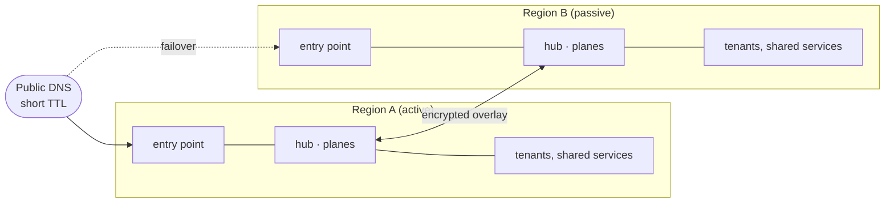

# Spec: several regions

- **Status:** Proposed — its release is given in the README's [status](../../README.md#status) (`v0.9`)
- **Related:** [ADR-0012](../adr/0012-resilience-scope.md) (resilience scope), [ADR-0004](../adr/0004-planes-and-isolation.md) (planes), [ADR-0006](../adr/0006-exposure.md) (exposure), [trade-offs](../concepts/trade-offs.md#6-regions-and-sites) (regions and sites)

## Problem

A deployment of the reference lives in one region: its planes, routers, load balancers and their amphorae are regional in Neutron and Octavia. An organisation that runs in several regions, or that wants a second region to fail over to, has no way today to join the shared services and tenants of one region to those of another with the same roles and checks.

## Goal

The same stacks deploy one site per region, without collision, and the sites are joined so that the shared services and tenants of one region reach those of another through the planes. The published domains fail over from one region's entry point to the other's by DNS.

Out of scope, as for the other failures ([ADR-0012](../adr/0012-resilience-scope.md)): deciding and running the failover, replicating the tenants' data, and the recovery objectives of each workload. The maintainers test the deployment of two sites side by side, not the failover.

## Design

1. **The site is the name of a region in a deployment.** A project is not tied to a region, but its resources and the planes are: each region has its own planes, its own hub and its own entry point. The site is already an input of every stack and part of every name (delivered).
2. **No hand-written address.** Routes and admission rules come from stack outputs of the same region; each region generates its own.
3. **One `shared/planes` per region.** The hubs of the regions are joined by an encrypted overlay, so that the planes extend across regions with the same roles and admission rules.
4. **One entry point per region, active/passive**, with a short TTL on the public records. A failover between regions is a DNS change.

The rules, and why:

| Rule | Why |
|---|---|
| The site is an input of every stack and part of every name | The same stacks deploy in several regions without collision |
| No hand-written address: routes and admission rules come from stack outputs of the same region | Each region generates its own |
| One `shared/planes` per region; the hubs of the regions joined by an encrypted overlay | Shared services and tenants of one region reach those of another through the planes, with the same roles and checks |
| One entry point per region, active/passive, short TTL on the public records | Failover between regions is a DNS change; you run and rehearse it, for example by replaying the isolation test in the other region |

Replicating tenant data between regions belongs to the tenants and to the backup integration point.

## Dependencies and order

1. Network services (`v0.6`): the resolvers and the egress of each region, which the other region's tenants may need after a failover.
2. The overlay between hubs: its point of attachment on the hub, the routes of the remote ranges through it, and the admission of remote sources.
3. Two sites deployed side by side by the test campaign, with the isolation test run in each and across them.

## Proposed decisions

- An overlay that works on any OpenStack cloud, above Neutron, rather than a provider feature such as OVHcloud's vRack ([trade-offs](../concepts/trade-offs.md#6-regions-and-sites)).
- Active/passive entry points with a DNS failover; active-active is left to a global load balancing service outside OpenStack.

## Open questions

- The overlay itself: WireGuard between instances of the hubs, IPsec as a VPN service of the cloud, or a provider interconnect where one exists; who operates it.
- The ranges: one aggregate per region, so that a region's routes to the other stay short.
- Where the remote shared services are admitted: on the same plane roles, or on a plane of their own.
