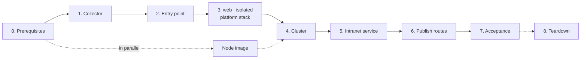

# Test procedure

Every step of a full test cycle, with the checkpoint that must pass before the next step, the duration measured on the reference test cloud, and what to do when a checkpoint fails. The results of each cycle are in [testing.md](testing.md); the [quick start](../README.md#quick-start) is the short version of steps 1 to 6.

Run everything from a machine that is an administration source of the stacks (`admin.sources`, `bastion.ssh_cidrs`), with a `clouds.yaml` entry per stack and **no `OS_*` variable in the shell**.

## Overview



| Step | Measured duration |
|---|---|
| Node image (once, kept between cycles) | 25 min |
| 1. Test collector | 2 min |
| 2. Entry point (60 resources) | 3 min, up to 10 min when DNS is slow |
| 3. `web`, `isolated`, platform stack, in parallel | 3 min |
| 4. Cluster (`create-cluster.sh`, add-ons included) | 16 min |
| 5. Intranet demonstration service | 1 min |
| 6. Route publication (two edge instances replaced) | 5 to 8 min |
| 7. Acceptance | 3 min |
| **Total, steps 1 to 7** | **about 35 minutes** without incident |
| 8. Teardown | 25 min, of which 21 for the cluster |

Durations come from the rebuild of 2026-10-29 ([results](testing.md#one-shot-rebuild-2026-10-29)).

## 0. Prerequisites

| Check | How | Expected |
|---|---|---|
| Quotas | `openstack quota show --usage` | room for 16 instances, 3 load balancers plus the entry point's, one root volume per instance **plus one per group** for rolling replacements |
| Node image (platform only) | [images/kubernetes-node](../images/kubernetes-node/README.md) | private image `ubuntu-2404-kube-<version>` active |
| Cluster credential | application credential `member` + `load-balancer_member`, as a `clouds.yaml` entry renamed `openstack` | file ready, never in Terraform |
| Your address | the address the cloud sees for you (often a router address, not your workstation's) | in `admin.sources` and `bastion.ssh_cidrs` of every stack |

## 1. Test collector

Create it **first**: the tenants admit its address on their metrics ports, and a recreated collector gets a new address.

```bash
cd tests/integration/collector && tofu init && tofu apply && tofu plan -detailed-exitcode
tofu output -json collector_cidrs    # into monitoring.collector_cidrs of every stack
```

| Checkpoint | If it fails |
|---|---|
| plan after apply empty (exit code 0) | a non-empty plan is a defect: report it |
| `collector_cidrs` copied into stacks 20 and 30 | later: 8 matrix rows fail; update the stacks, apply, and apply the platform add-ons again |

## 2. Public entry point

```bash
cd stacks/20-public-edge && tofu init && tofu apply && tofu plan -detailed-exitcode
```

| Checkpoint | How | If it fails |
|---|---|---|
| plan after apply empty | exit code 0 | report |
| cloud-init finished on every Traefik instance | `ssh -J ops@<bastion> ops@<instance> cloud-init status` → `done` | `error`: read `/var/log/cloud-init-output.log`; a package mirror error leaves Traefik without podman (`status=203/EXEC`); replace the instance |
| every load balancer member `ONLINE` | `openstack loadbalancer member list <pool>` | an `ERROR` member serves nothing; see the cloud-init check |

DNS records are the slowest resources: from 10 to 40 s normally, several minutes when Designate is congested. A record created after an apply timeout must be imported ([pitfalls](https://github.com/CyprisTech/terraform-openstack-tenant/blob/main/docs/pitfalls.md#dns)).

## 3. Tenants and the platform stack

Independent of each other; run them in parallel.

```bash
for s in stacks/30-tenants/web stacks/30-tenants/isolated stacks/30-tenants/platform; do
  (cd $s && tofu init && tofu apply -auto-approve && tofu plan -detailed-exitcode) &
done; wait
```

| Checkpoint | If it fails |
|---|---|
| three empty plans | report |
| cloud-init `done` on the web instances and on the bootstrap instance | as in step 2 |

Root volumes created from the image take most of the time (about 80 s each on a Cinder LVM backend; seconds on Ceph).

## 4. Cluster

```bash
B=$(tofu -chdir=stacks/30-tenants/platform output -raw bootstrap)
scp clouds.yaml ops@$B:/tmp/clouds.yaml; scp cacert.pem ops@$B:/tmp/cacert.pem   # private CA only
ssh ops@$B 'sudo install -m 600 /tmp/clouds.yaml /opt/platform/clouds.yaml && sudo install -m 644 /tmp/cacert.pem /opt/platform/cacert.pem; rm -f /tmp/clouds.yaml /tmp/cacert.pem'
ssh -t ops@$B 'cloud-init status --wait; sudo /opt/platform/create-cluster.sh'
ssh ops@$B 'sudo cat /opt/platform/platform.kubeconfig' > platform.kubeconfig
```

| Checkpoint | How | If it fails |
|---|---|---|
| script ends with "manages itself" | output | run it again: each step skips what exists |
| 5 nodes `Ready` | `kubectl get nodes` | `kubectl -n platform get machines,openstackmachines` |
| 7 chart proxies `Ready`, **one release proxy per chart** | `kubectl -n platform get helmchartproxy,helmreleaseproxy` | duplicates after the move block later updates; see [testing](testing.md#one-shot-rebuild-2026-10-29) before deleting any (deleting one uninstalls the release) |
| Services on the stack's addresses | `kubectl get svc -A --field-selector spec.type=LoadBalancer` against `tofu output routes` and `tofu output prometheus` | another address means the requested one was not available |

## 5. Intranet demonstration service

```bash
cd tests/integration/intranet-service && tofu init && tofu apply && tofu plan -detailed-exitcode
```

Checkpoint: empty plan. Apply it after the platform stack: it reads the platform's intranet router.

## 6. Route publication

```bash
OS_CLOUD=<entry of stack 20> scripts/publish-routes.sh
```

| Checkpoint | If it fails |
|---|---|
| "routes published" and every member `ONLINE` | the script replaces unhealthy instances first and refuses to replace the last healthy one: fix the unhealthy instance (step 2), then run it again; it resumes |

## 7. Acceptance

```bash
kubectl --kubeconfig platform.kubeconfig apply -f stacks/30-tenants/platform/demo/whoami.yaml
LB=$(tofu -chdir=stacks/20-public-edge output -json load_balancer | jq -r .floating_ip)
for i in $(seq 12); do curl -sk --resolve apps.example.org:443:$LB https://apps.example.org/ | grep X-Real-Ip; done | sort | uniq -c
python3 tests/reachability/check.py --key <ssh key> --platform-kubeconfig platform.kubeconfig
```

| Checkpoint | Expected | If it fails |
|---|---|---|
| HTTPS through the entry point | 12 answers, all with the client's address | no answer: members (step 6), routes (`stacks/20-public-edge/routes.auto.tfvars.json`), Traefik Service (step 4) |
| reachability matrix | every row as expected (43 with `platform`) | collector rows: step 1; one instance only: its cloud-init (step 2) |

## 8. Teardown

```bash
# The bootstrap instance must be admitted on the API again (it was removed after the move).
tofu -chdir=stacks/30-tenants/platform output -json manifests | jq -r '."cluster.yaml"' \
  | sed "s|BOOTSTRAP_SOURCE|$B/32|" | kubectl --kubeconfig platform.kubeconfig apply -f -
ssh -t ops@$B 'sudo /opt/platform/delete-cluster.sh'
for s in tests/integration/intranet-service stacks/30-tenants/platform tests/integration/collector \
         stacks/30-tenants/isolated stacks/30-tenants/web stacks/20-public-edge; do
  tofu -chdir=$s destroy -auto-approve
done
```

| Checkpoint | How |
|---|---|
| no leftover | `openstack server list`, `volume list`, `loadbalancer list`, `floating ip list`, `router list`, `network list`, `security group list`, `server group list`, and the records of the DNS zones: all empty, except the node image if you keep it |
