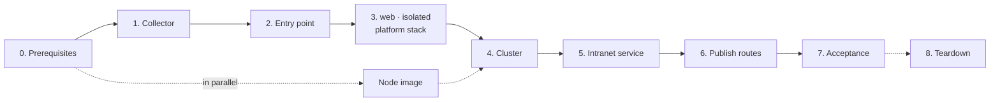

# Test procedure

Every step of a full test cycle, with the checkpoint that must pass before the next step, the duration measured on the reference test cloud, and what to do when a checkpoint fails. The results of each cycle are in [testing.md](testing.md); the [quick start](../README.md#quick-start) is the short version of steps 1 to 6.

Run everything from a machine that is an administration source of the stacks (`admin.sources`, `bastion.ssh_cidrs`), with a `clouds.yaml` entry per stack and **no `OS_*` variable in the shell**.

## Overview



| Step | Measured duration |
|---|---|
| Node image (once, kept between cycles) | 25 min |
| 1. Test collector | 1.5 min |
| 2. Entry point (60 resources) | 3 min, up to 10 min when DNS is slow |
| 3. `web`, `isolated`, platform stack, in parallel | 3 min |
| 4. Cluster (`create-cluster.sh`, add-ons included) | 16 min |
| 5. Intranet demonstration service | 1 min |
| 4b. Bootstrap instance removed | 1 min |
| 6. Route publication (two edge instances replaced) | 4 to 8 min |
| 7. Acceptance | 3 min |
| **Total, steps 1 to 7** | **about 35 minutes** without incident |
| 8. Teardown | 12 min: 5 for the cluster, 6 for the stacks |

Each step ends with the output of a real run, folded (anonymised and condensed: commands, planned resources one line each, summaries and checkpoints). Durations come from the two cycles of 2026-10-29 ([results](testing.md#one-shot-rebuild-2026-10-29)).

## 0. Prerequisites

| Check | How | Expected |
|---|---|---|
| Quotas | `openstack quota show --usage` | room for 16 instances, 3 load balancers plus the entry point's, one root volume per instance **plus one per group** for rolling replacements |
| Node image (platform only) | [images/kubernetes-node](../images/kubernetes-node/README.md) | private image `ubuntu-2404-kube-<version>` active |
| Cluster credential | application credential `member` + `load-balancer_member`, as a `clouds.yaml` entry renamed `openstack` | file ready, never in Terraform |
| Your address | the address the cloud sees for you (often a router address, not your workstation's) | in `admin.sources` and `bastion.ssh_cidrs` of every stack |
| Capacity per host | ask the operator | the two edge instances are in hard anti-affinity: replacing one needs room on **another host than the other's**, not only quota. On a cloud with few hosts, remove the bootstrap instance (step 4b) before publishing routes |

## 1. Test collector

Create it **first**: the tenants admit its address on their metrics ports, and a recreated collector gets a new address.

```bash
cd tests/integration/collector && tofu init && tofu apply && tofu plan -detailed-exitcode
tofu output -json collector_cidrs    # into monitoring.collector_cidrs of every stack
```

| Checkpoint | If it fails |
|---|---|
| plan after apply empty (exit code 0) | a non-empty plan is a defect: report it |
| `collector_cidrs` copied into stacks 20 and 30 | later: 8 matrix rows fail; update the stacks, apply, and apply the platform add-ons again |

<details>
<summary>Output: test collector, then its address copied into the stacks</summary>

```console
$ cd tests/integration/collector && tofu init -upgrade >/dev/null && tofu apply -auto-approve && tofu plan -detailed-exitcode; cd $R
  <= data.openstack_networking_router_v2.monitoring
  + module.collector.module.instance["t1-collector"].openstack_blockstorage_volume_v3.boot[0]
  + module.collector.module.instance["t1-collector"].openstack_compute_instance_v2.this
  + module.collector.module.instance["t1-collector"].openstack_networking_floatingip_associate_v2.this["main"]
  + module.collector.module.instance["t1-collector"].openstack_networking_floatingip_v2.this["main"]
  + module.collector.module.instance["t1-collector"].openstack_networking_port_v2.this["main"]
  + module.collector.module.network["t1-collector"].openstack_networking_network_v2.this
  + module.collector.module.network["t1-collector"].openstack_networking_port_v2.router["admin"]
  + module.collector.module.network["t1-collector"].openstack_networking_port_v2.router["monitoring"]
  + module.collector.module.network["t1-collector"].openstack_networking_router_interface_v2.this["admin"]
  + module.collector.module.network["t1-collector"].openstack_networking_router_interface_v2.this["monitoring"]
  + module.collector.module.network["t1-collector"].openstack_networking_router_v2.this["admin"]
  + module.collector.module.network["t1-collector"].openstack_networking_router_v2.this["monitoring"]
  + module.collector.module.network["t1-collector"].openstack_networking_subnet_route_v2.this["main/192.0.2.100/22"]
  + module.collector.module.network["t1-collector"].openstack_networking_subnet_v2.this["main"]
  + module.collector.module.security_group["t1-collector"].openstack_networking_secgroup_rule_v2.this["ssh-0"]
  + module.collector.module.security_group["t1-collector"].openstack_networking_secgroup_rule_v2.this["ssh-1"]
  + module.collector.module.security_group["t1-collector"].openstack_networking_secgroup_v2.this
Plan: 17 to add, 0 to change, 0 to destroy.
Apply complete! Resources: 17 added, 0 changed, 0 destroyed.
No changes. Your infrastructure matches the configuration.
$ CIDRS=$(tofu -chdir=tests/integration/collector output -json collector_cidrs); echo $CIDRS
["198.51.100.10/32"]
$ sed -i "s|collector_cidrs = \[[^]]*\]|collector_cidrs = $CIDRS|" stacks/20-public-edge/terraform.tfvars stacks/30-tenants/*/terraform.tfvars
$ grep -h collector_cidrs stacks/20-public-edge/terraform.tfvars stacks/30-tenants/*/terraform.tfvars
monitoring = { dns_zone = "mon.example.org.", collector_cidrs = ["198.51.100.10/32"] }
monitoring = { dns_zone = "mon.example.org.", collector_cidrs = ["198.51.100.10/32"] }
monitoring = { dns_zone = "mon.example.org.", collector_cidrs = ["198.51.100.10/32"] }
monitoring = { dns_zone = "mon.example.org.", collector_cidrs = ["198.51.100.10/32"] }
```

</details>

## 2. Public entry point

```bash
cd stacks/20-public-edge && tofu init && tofu apply && tofu plan -detailed-exitcode
```

| Checkpoint | How | If it fails |
|---|---|---|
| plan after apply empty | exit code 0 | report |
| cloud-init finished on every Traefik instance | `ssh -o ConnectionAttempts=10 -J ops@<bastion> ops@<instance> cloud-init status --wait` → `done` (right after the apply, sshd may not answer yet) | `error`: read `/var/log/cloud-init-output.log`; a package mirror error leaves Traefik without podman (`status=203/EXEC`); replace the instance |
| every load balancer member `ONLINE` | `openstack loadbalancer member list <pool>` | an `ERROR` member serves nothing; see the cloud-init check |

DNS records are the slowest resources: from 10 to 40 s normally, several minutes when Designate is congested. A record created after an apply timeout must be imported ([pitfalls](https://github.com/CyprisTech/terraform-openstack-tenant/blob/main/docs/pitfalls.md#dns)).

<details>
<summary>Output: entry point: plan, apply, empty plan, cloud-init on both instances</summary>

```console
$ cd stacks/20-public-edge && tofu init -upgrade >/dev/null && tofu apply -auto-approve && tofu plan -detailed-exitcode; cd $R
  <= data.openstack_networking_router_v2.svc_public
  + module.edge.openstack_compute_servergroup_v2.this["t1-edge"]
  + module.edge.openstack_networking_secgroup_rule_v2.cross_group["t1-edge-proxy/ssh-from-bastion"]
  + module.edge.module.instance["t1-edge-1"].openstack_blockstorage_volume_v3.boot[0]
  + module.edge.module.instance["t1-edge-1"].openstack_compute_instance_v2.this
  + module.edge.module.instance["t1-edge-1"].openstack_dns_recordset_v2.this["main/extra-floating/monitoring/t1-edge-1@mon.example.org."]
  + module.edge.module.instance["t1-edge-1"].openstack_networking_floatingip_associate_v2.extra["main/monitoring"]
  + module.edge.module.instance["t1-edge-1"].openstack_networking_floatingip_v2.extra["main/monitoring"]
  + module.edge.module.instance["t1-edge-1"].openstack_networking_port_v2.this["main"]
  + module.edge.module.instance["t1-edge-2"].openstack_blockstorage_volume_v3.boot[0]
  + module.edge.module.instance["t1-edge-2"].openstack_compute_instance_v2.this
  + module.edge.module.instance["t1-edge-2"].openstack_dns_recordset_v2.this["main/extra-floating/monitoring/t1-edge-2@mon.example.org."]
  + module.edge.module.instance["t1-edge-2"].openstack_networking_floatingip_associate_v2.extra["main/monitoring"]
  + module.edge.module.instance["t1-edge-2"].openstack_networking_floatingip_v2.extra["main/monitoring"]
  + module.edge.module.instance["t1-edge-2"].openstack_networking_port_v2.this["main"]
  + module.edge.module.instance["t1-edge-bastion"].openstack_blockstorage_volume_v3.boot[0]
  + module.edge.module.instance["t1-edge-bastion"].openstack_compute_instance_v2.this
  + module.edge.module.instance["t1-edge-bastion"].openstack_networking_floatingip_associate_v2.this["admin"]
  + module.edge.module.instance["t1-edge-bastion"].openstack_networking_floatingip_v2.this["admin"]
  + module.edge.module.instance["t1-edge-bastion"].openstack_networking_port_v2.this["admin"]
  + module.edge.module.instance["t1-edge-bastion"].openstack_networking_port_v2.this["edge"]
  + module.edge.module.loadbalancer["t1-edge"].openstack_dns_recordset_v2.this["edge@site.example.org."]
  + module.edge.module.loadbalancer["t1-edge"].openstack_lb_listener_v2.this["http"]
  + module.edge.module.loadbalancer["t1-edge"].openstack_lb_listener_v2.this["https"]
  + module.edge.module.loadbalancer["t1-edge"].openstack_lb_loadbalancer_v2.this
  + module.edge.module.loadbalancer["t1-edge"].openstack_lb_member_v2.this["http/t1-edge-1.main"]
  + module.edge.module.loadbalancer["t1-edge"].openstack_lb_member_v2.this["http/t1-edge-2.main"]
  + module.edge.module.loadbalancer["t1-edge"].openstack_lb_member_v2.this["https/t1-edge-1.main"]
  + module.edge.module.loadbalancer["t1-edge"].openstack_lb_member_v2.this["https/t1-edge-2.main"]
  + module.edge.module.loadbalancer["t1-edge"].openstack_lb_monitor_v2.this["http"]
  + module.edge.module.loadbalancer["t1-edge"].openstack_lb_monitor_v2.this["https"]
  + module.edge.module.loadbalancer["t1-edge"].openstack_lb_pool_v2.this["http"]
  + module.edge.module.loadbalancer["t1-edge"].openstack_lb_pool_v2.this["https"]
  + module.edge.module.loadbalancer["t1-edge"].openstack_networking_floatingip_associate_v2.this[0]
  + module.edge.module.loadbalancer["t1-edge"].openstack_networking_floatingip_v2.this[0]
  + module.edge.module.network["t1-edge"].openstack_networking_network_v2.this
  + module.edge.module.network["t1-edge"].openstack_networking_port_v2.router["monitoring"]
  + module.edge.module.network["t1-edge"].openstack_networking_port_v2.router["public"]
  + module.edge.module.network["t1-edge"].openstack_networking_port_v2.router["svc-public"]
  + module.edge.module.network["t1-edge"].openstack_networking_router_interface_v2.this["monitoring"]
  + module.edge.module.network["t1-edge"].openstack_networking_router_interface_v2.this["public"]
  + module.edge.module.network["t1-edge"].openstack_networking_router_interface_v2.this["svc-public"]
  + module.edge.module.network["t1-edge"].openstack_networking_router_v2.this["monitoring"]
  + module.edge.module.network["t1-edge"].openstack_networking_router_v2.this["public"]
  + module.edge.module.network["t1-edge"].openstack_networking_router_v2.this["svc-public"]
  + module.edge.module.network["t1-edge"].openstack_networking_subnet_route_v2.this["main/192.0.2.100/22"]
  + module.edge.module.network["t1-edge"].openstack_networking_subnet_route_v2.this["main/192.0.2.10/24"]
  + module.edge.module.network["t1-edge"].openstack_networking_subnet_v2.this["main"]
  + module.edge.module.network["t1-edge-admin"].openstack_networking_network_v2.this
  + module.edge.module.network["t1-edge-admin"].openstack_networking_port_v2.router["admin"]
  + module.edge.module.network["t1-edge-admin"].openstack_networking_router_interface_v2.this["admin"]
  + module.edge.module.network["t1-edge-admin"].openstack_networking_router_v2.this["admin"]
  + module.edge.module.network["t1-edge-admin"].openstack_networking_subnet_v2.this["main"]
  + module.edge.module.security_group["t1-edge-bastion"].openstack_networking_secgroup_rule_v2.this["ssh-0"]
  + module.edge.module.security_group["t1-edge-bastion"].openstack_networking_secgroup_rule_v2.this["ssh-1"]
  + module.edge.module.security_group["t1-edge-bastion"].openstack_networking_secgroup_v2.this
  + module.edge.module.security_group["t1-edge-proxy"].openstack_networking_secgroup_rule_v2.this["http"]
  + module.edge.module.security_group["t1-edge-proxy"].openstack_networking_secgroup_rule_v2.this["https"]
  + module.edge.module.security_group["t1-edge-proxy"].openstack_networking_secgroup_rule_v2.this["metrics-8082-198.51.100.10_32"]
  + module.edge.module.security_group["t1-edge-proxy"].openstack_networking_secgroup_rule_v2.this["metrics-9100-198.51.100.10_32"]
  + module.edge.module.security_group["t1-edge-proxy"].openstack_networking_secgroup_v2.this
Plan: 60 to add, 0 to change, 0 to destroy.
Apply complete! Resources: 60 added, 0 changed, 0 destroyed.
No changes. Your infrastructure matches the configuration.
$ BASTION=$(tofu -chdir=stacks/20-public-edge output -raw bastion)
$ for ip in $(tofu -chdir=stacks/20-public-edge output -json instances | jq -r ".[]"); do ssh -F ssh.cfg -J $BASTION $ip "hostname; cloud-init status --wait"; done
t1-edge-1
status: done
t1-edge-2
status: done
```

</details>

## 3. Tenants and the platform stack

Independent of each other; run them in parallel.

```bash
for s in stacks/30-tenants/web stacks/30-tenants/isolated stacks/30-tenants/platform; do
  (cd $s && tofu init && tofu apply -auto-approve && tofu plan -detailed-exitcode) &
done; wait
```

| Checkpoint | If it fails |
|---|---|
| three empty plans | report |
| cloud-init `done` on the web instances and on the bootstrap instance | as in step 2 |

Root volumes created from the image take most of the time (about 80 s each on a Cinder LVM backend; seconds on Ceph).

<details>
<summary>Output: stack web</summary>

```console
$ cd stacks/30-tenants/web && tofu init -upgrade >/dev/null && tofu apply -auto-approve && tofu plan -detailed-exitcode; cd $R
  + module.web.openstack_compute_servergroup_v2.this["t1-web"]
  + module.web.openstack_networking_secgroup_rule_v2.cross_group["t1-web-https/ssh-from-bastion"]
  + module.web.module.instance["t1-web-1"].openstack_blockstorage_volume_v3.boot[0]
  + module.web.module.instance["t1-web-1"].openstack_compute_instance_v2.this
  + module.web.module.instance["t1-web-1"].openstack_dns_recordset_v2.this["main/extra-floating/monitoring/t1-web-1@mon.example.org."]
  + module.web.module.instance["t1-web-1"].openstack_networking_floatingip_associate_v2.extra["main/monitoring"]
  + module.web.module.instance["t1-web-1"].openstack_networking_floatingip_associate_v2.this["main"]
  + module.web.module.instance["t1-web-1"].openstack_networking_floatingip_v2.extra["main/monitoring"]
  + module.web.module.instance["t1-web-1"].openstack_networking_floatingip_v2.this["main"]
  + module.web.module.instance["t1-web-1"].openstack_networking_port_v2.this["main"]
  + module.web.module.instance["t1-web-2"].openstack_blockstorage_volume_v3.boot[0]
  + module.web.module.instance["t1-web-2"].openstack_compute_instance_v2.this
  + module.web.module.instance["t1-web-2"].openstack_dns_recordset_v2.this["main/extra-floating/monitoring/t1-web-2@mon.example.org."]
  + module.web.module.instance["t1-web-2"].openstack_networking_floatingip_associate_v2.extra["main/monitoring"]
  + module.web.module.instance["t1-web-2"].openstack_networking_floatingip_associate_v2.this["main"]
  + module.web.module.instance["t1-web-2"].openstack_networking_floatingip_v2.extra["main/monitoring"]
  + module.web.module.instance["t1-web-2"].openstack_networking_floatingip_v2.this["main"]
  + module.web.module.instance["t1-web-2"].openstack_networking_port_v2.this["main"]
  + module.web.module.instance["t1-web-bastion"].openstack_blockstorage_volume_v3.boot[0]
  + module.web.module.instance["t1-web-bastion"].openstack_compute_instance_v2.this
  + module.web.module.instance["t1-web-bastion"].openstack_networking_floatingip_associate_v2.this["admin"]
  + module.web.module.instance["t1-web-bastion"].openstack_networking_floatingip_v2.this["admin"]
  + module.web.module.instance["t1-web-bastion"].openstack_networking_port_v2.this["admin"]
  + module.web.module.instance["t1-web-bastion"].openstack_networking_port_v2.this["web"]
  + module.web.module.network["t1-web"].openstack_networking_network_v2.this
  + module.web.module.network["t1-web"].openstack_networking_port_v2.router["egress"]
  + module.web.module.network["t1-web"].openstack_networking_port_v2.router["monitoring"]
  + module.web.module.network["t1-web"].openstack_networking_port_v2.router["svc-public"]
  + module.web.module.network["t1-web"].openstack_networking_router_interface_v2.this["egress"]
  + module.web.module.network["t1-web"].openstack_networking_router_interface_v2.this["monitoring"]
  + module.web.module.network["t1-web"].openstack_networking_router_interface_v2.this["svc-public"]
  + module.web.module.network["t1-web"].openstack_networking_router_v2.this["egress"]
  + module.web.module.network["t1-web"].openstack_networking_router_v2.this["monitoring"]
  + module.web.module.network["t1-web"].openstack_networking_router_v2.this["svc-public"]
  + module.web.module.network["t1-web"].openstack_networking_subnet_route_v2.this["main/192.0.2.100/22"]
  + module.web.module.network["t1-web"].openstack_networking_subnet_route_v2.this["main/192.0.2.10/24"]
  + module.web.module.network["t1-web"].openstack_networking_subnet_v2.this["main"]
  + module.web.module.network["t1-web-admin"].openstack_networking_network_v2.this
  + module.web.module.network["t1-web-admin"].openstack_networking_port_v2.router["admin"]
  + module.web.module.network["t1-web-admin"].openstack_networking_router_interface_v2.this["admin"]
  + module.web.module.network["t1-web-admin"].openstack_networking_router_v2.this["admin"]
  + module.web.module.network["t1-web-admin"].openstack_networking_subnet_v2.this["main"]
  + module.web.module.security_group["t1-web-bastion"].openstack_networking_secgroup_rule_v2.this["ssh-0"]
  + module.web.module.security_group["t1-web-bastion"].openstack_networking_secgroup_rule_v2.this["ssh-1"]
  + module.web.module.security_group["t1-web-bastion"].openstack_networking_secgroup_v2.this
  + module.web.module.security_group["t1-web-https"].openstack_networking_secgroup_rule_v2.this["https-from-edge-0"]
  + module.web.module.security_group["t1-web-https"].openstack_networking_secgroup_rule_v2.this["metrics-9100-198.51.100.10_32"]
  + module.web.module.security_group["t1-web-https"].openstack_networking_secgroup_v2.this
Plan: 48 to add, 0 to change, 0 to destroy.
Apply complete! Resources: 48 added, 0 changed, 0 destroyed.
No changes. Your infrastructure matches the configuration.
$ BASTION=$(tofu -chdir=stacks/30-tenants/web output -raw bastion)
```

</details>

<details>
<summary>Output: stack isolated</summary>

```console
$ cd stacks/30-tenants/isolated && tofu init -upgrade >/dev/null && tofu apply -auto-approve && tofu plan -detailed-exitcode; cd $R
  + module.isolated.openstack_networking_secgroup_rule_v2.cross_group["t1-isolated-workload/ssh-from-bastion"]
  + module.isolated.module.instance["t1-isolated-1"].openstack_blockstorage_volume_v3.boot[0]
  + module.isolated.module.instance["t1-isolated-1"].openstack_compute_instance_v2.this
  + module.isolated.module.instance["t1-isolated-1"].openstack_dns_recordset_v2.this["main/floating/t1-isolated-1@mon.example.org."]
  + module.isolated.module.instance["t1-isolated-1"].openstack_networking_floatingip_associate_v2.this["main"]
  + module.isolated.module.instance["t1-isolated-1"].openstack_networking_floatingip_v2.this["main"]
  + module.isolated.module.instance["t1-isolated-1"].openstack_networking_port_v2.this["main"]
  + module.isolated.module.instance["t1-isolated-bastion"].openstack_blockstorage_volume_v3.boot[0]
  + module.isolated.module.instance["t1-isolated-bastion"].openstack_compute_instance_v2.this
  + module.isolated.module.instance["t1-isolated-bastion"].openstack_networking_floatingip_associate_v2.this["admin"]
  + module.isolated.module.instance["t1-isolated-bastion"].openstack_networking_floatingip_v2.this["admin"]
  + module.isolated.module.instance["t1-isolated-bastion"].openstack_networking_port_v2.this["admin"]
  + module.isolated.module.instance["t1-isolated-bastion"].openstack_networking_port_v2.this["isolated"]
  + module.isolated.module.network["t1-isolated"].openstack_networking_network_v2.this
  + module.isolated.module.network["t1-isolated"].openstack_networking_port_v2.router["monitoring"]
  + module.isolated.module.network["t1-isolated"].openstack_networking_router_interface_v2.this["monitoring"]
  + module.isolated.module.network["t1-isolated"].openstack_networking_router_v2.this["monitoring"]
  + module.isolated.module.network["t1-isolated"].openstack_networking_subnet_v2.this["main"]
  + module.isolated.module.network["t1-isolated-admin"].openstack_networking_network_v2.this
  + module.isolated.module.network["t1-isolated-admin"].openstack_networking_port_v2.router["admin"]
  + module.isolated.module.network["t1-isolated-admin"].openstack_networking_router_interface_v2.this["admin"]
  + module.isolated.module.network["t1-isolated-admin"].openstack_networking_router_v2.this["admin"]
  + module.isolated.module.network["t1-isolated-admin"].openstack_networking_subnet_v2.this["main"]
  + module.isolated.module.security_group["t1-isolated-bastion"].openstack_networking_secgroup_rule_v2.this["ssh-0"]
  + module.isolated.module.security_group["t1-isolated-bastion"].openstack_networking_secgroup_rule_v2.this["ssh-1"]
  + module.isolated.module.security_group["t1-isolated-bastion"].openstack_networking_secgroup_v2.this
  + module.isolated.module.security_group["t1-isolated-workload"].openstack_networking_secgroup_rule_v2.this["metrics-9100-198.51.100.10_32"]
  + module.isolated.module.security_group["t1-isolated-workload"].openstack_networking_secgroup_v2.this
Plan: 28 to add, 0 to change, 0 to destroy.
Apply complete! Resources: 28 added, 0 changed, 0 destroyed.
No changes. Your infrastructure matches the configuration.
$ BASTION=$(tofu -chdir=stacks/30-tenants/isolated output -raw bastion)
```

</details>

<details>
<summary>Output: platform stack</summary>

```console
$ cd stacks/30-tenants/platform && tofu init -upgrade >/dev/null && tofu apply -auto-approve && tofu plan -detailed-exitcode; cd $R
  + openstack_networking_floatingip_v2.ingress
  + openstack_networking_floatingip_v2.prometheus[0]
  + module.platform.openstack_compute_servergroup_v2.this["t1-platform-control-plane"]
  + module.platform.openstack_compute_servergroup_v2.this["t1-platform-workers"]
  + module.platform.module.dns.openstack_dns_recordset_v2.this["prometheus"]
  + module.platform.module.instance["t1-platform-bootstrap"].openstack_blockstorage_volume_v3.boot[0]
  + module.platform.module.instance["t1-platform-bootstrap"].openstack_compute_instance_v2.this
  + module.platform.module.instance["t1-platform-bootstrap"].openstack_networking_floatingip_associate_v2.this["main"]
  + module.platform.module.instance["t1-platform-bootstrap"].openstack_networking_floatingip_v2.this["main"]
  + module.platform.module.instance["t1-platform-bootstrap"].openstack_networking_port_v2.this["main"]
  + module.platform.module.network["t1-platform"].openstack_networking_network_v2.this
  + module.platform.module.network["t1-platform"].openstack_networking_port_v2.router["egress"]
  + module.platform.module.network["t1-platform"].openstack_networking_port_v2.router["intranet"]
  + module.platform.module.network["t1-platform"].openstack_networking_port_v2.router["monitoring"]
  + module.platform.module.network["t1-platform"].openstack_networking_port_v2.router["svc-public"]
  + module.platform.module.network["t1-platform"].openstack_networking_router_interface_v2.this["egress"]
  + module.platform.module.network["t1-platform"].openstack_networking_router_interface_v2.this["intranet"]
  + module.platform.module.network["t1-platform"].openstack_networking_router_interface_v2.this["monitoring"]
  + module.platform.module.network["t1-platform"].openstack_networking_router_interface_v2.this["svc-public"]
  + module.platform.module.network["t1-platform"].openstack_networking_router_v2.this["egress"]
  + module.platform.module.network["t1-platform"].openstack_networking_router_v2.this["intranet"]
  + module.platform.module.network["t1-platform"].openstack_networking_router_v2.this["monitoring"]
  + module.platform.module.network["t1-platform"].openstack_networking_router_v2.this["svc-public"]
  + module.platform.module.network["t1-platform"].openstack_networking_subnet_route_v2.this["main/192.0.2.100/22"]
  + module.platform.module.network["t1-platform"].openstack_networking_subnet_route_v2.this["main/192.0.2.11/22"]
  + module.platform.module.network["t1-platform"].openstack_networking_subnet_route_v2.this["main/192.0.2.10/24"]
  + module.platform.module.network["t1-platform"].openstack_networking_subnet_v2.this["main"]
  + module.platform.module.security_group["t1-platform-bootstrap"].openstack_networking_secgroup_rule_v2.this["ssh-0"]
  + module.platform.module.security_group["t1-platform-bootstrap"].openstack_networking_secgroup_rule_v2.this["ssh-1"]
  + module.platform.module.security_group["t1-platform-bootstrap"].openstack_networking_secgroup_v2.this
Plan: 30 to add, 0 to change, 0 to destroy.
Apply complete! Resources: 30 added, 0 changed, 0 destroyed.
No changes. Your infrastructure matches the configuration.
```

</details>

<details>
<summary>Output: checkpoints: cloud-init on every instance, load balancer members</summary>

```console
$ BASTION=$(tofu -chdir=stacks/30-tenants/web output -raw bastion)
$ for ip in $(tofu -chdir=stacks/30-tenants/web output -json instances | jq -r '.[]'); do ssh -F ssh.cfg -o ConnectionAttempts=10 -J $BASTION $ip 'hostname; cloud-init status --wait'; done
t1-web-1
......................................................................status: done
t1-web-2
status: done
$ BASTION=$(tofu -chdir=stacks/30-tenants/isolated output -raw bastion)
$ for ip in $(tofu -chdir=stacks/30-tenants/isolated output -json instances | jq -r '.[]'); do ssh -F ssh.cfg -o ConnectionAttempts=10 -J $BASTION $ip 'hostname; cloud-init status --wait'; done
t1-isolated-1
status: done
$ B=$(tofu -chdir=stacks/30-tenants/platform output -raw bootstrap); ssh -F ssh.cfg -o ConnectionAttempts=10 $B "hostname; cloud-init status --wait"
t1-platform-bootstrap
status: done
$ OS_CLOUD=demo python3 -c "import openstack; c=openstack.connect(); lb=c.load_balancer.find_load_balancer(\"t1-edge\"); [print(p.name, m.address, m.operating_status) for p in c.load_balancer.pools(loadbalancer_id=lb.id) for m in c.load_balancer.members(p)]"
t1-edge-http 10.20.0.108 ONLINE
t1-edge-http 10.20.0.55 ONLINE
t1-edge-https 10.20.0.55 ONLINE
t1-edge-https 10.20.0.108 ONLINE
```

</details>

## 4. Cluster

```bash
B=$(tofu -chdir=stacks/30-tenants/platform output -raw bootstrap)
scp clouds.yaml ops@$B:/tmp/clouds.yaml; scp cacert.pem ops@$B:/tmp/cacert.pem   # private CA only
ssh ops@$B 'sudo install -m 600 /tmp/clouds.yaml /opt/platform/clouds.yaml && sudo install -m 644 /tmp/cacert.pem /opt/platform/cacert.pem; rm -f /tmp/clouds.yaml /tmp/cacert.pem'
ssh -t ops@$B 'cloud-init status --wait; sudo /opt/platform/create-cluster.sh'
ssh ops@$B 'sudo cat /opt/platform/platform.kubeconfig' > platform.kubeconfig
```

| Checkpoint | How | If it fails |
|---|---|---|
| script ends with "manages itself" | output | run it again: each step skips what exists |
| 5 nodes `Ready` | `kubectl get nodes` | `kubectl -n platform get machines,openstackmachines` |
| 7 chart proxies `Ready`, **one release proxy per chart** | `kubectl -n platform get helmchartproxy,helmreleaseproxy` | duplicates after the move block later updates; see [testing](testing.md#one-shot-rebuild-2026-10-29) before deleting any (deleting one uninstalls the release) |
| Services on the stack's addresses | `kubectl get svc -A --field-selector spec.type=LoadBalancer` against `tofu output routes` and `tofu output prometheus` | another address means the requested one was not available |

<details>
<summary>Output: create-cluster.sh, then nodes, chart and release proxies, Services</summary>

```console
$ B=$(tofu -chdir=stacks/30-tenants/platform output -raw bootstrap)
$ scp -F ssh.cfg -q cluster-clouds.yaml $B:/tmp/clouds.yaml && scp -F ssh.cfg -q cacert.pem $B:/tmp/cacert.pem
$ ssh -F ssh.cfg $B "sudo install -m 600 /tmp/clouds.yaml /opt/platform/clouds.yaml && sudo install -m 644 /tmp/cacert.pem /opt/platform/cacert.pem; rm -f /tmp/clouds.yaml /tmp/cacert.pem"
$ ssh -F ssh.cfg -t $B sudo /opt/platform/create-cluster.sh
No kind clusters found.
Creating cluster "bootstrap" ...
 ✓ Ensuring node image (kindest/node:v1.37.0) 🖼️
 ✓ Preparing nodes 📦
 ✓ Writing configuration 📜
 ✓ Starting control-plane 🕹️
 ✓ Installing CNI 🔌
 ✓ Installing StorageClass 💾
Set kubectl context to "kind-bootstrap"
You can now use your cluster with:
kubectl cluster-info --context kind-bootstrap --kubeconfig /opt/platform/bootstrap.kubeconfig
Thanks for using kind! 😊
namespace/orc-system serverside-applied
customresourcedefinition.apiextensions.k8s.io/addressscopes.openstack.k-orc.cloud serverside-applied
customresourcedefinition.apiextensions.k8s.io/applicationcredentials.openstack.k-orc.cloud serverside-applied
customresourcedefinition.apiextensions.k8s.io/domains.openstack.k-orc.cloud serverside-applied
customresourcedefinition.apiextensions.k8s.io/endpoints.openstack.k-orc.cloud serverside-applied
customresourcedefinition.apiextensions.k8s.io/flavors.openstack.k-orc.cloud serverside-applied
customresourcedefinition.apiextensions.k8s.io/floatingips.openstack.k-orc.cloud serverside-applied
customresourcedefinition.apiextensions.k8s.io/groups.openstack.k-orc.cloud serverside-applied
customresourcedefinition.apiextensions.k8s.io/images.openstack.k-orc.cloud serverside-applied
customresourcedefinition.apiextensions.k8s.io/keypairs.openstack.k-orc.cloud serverside-applied
customresourcedefinition.apiextensions.k8s.io/networks.openstack.k-orc.cloud serverside-applied
customresourcedefinition.apiextensions.k8s.io/ports.openstack.k-orc.cloud serverside-applied
customresourcedefinition.apiextensions.k8s.io/projects.openstack.k-orc.cloud serverside-applied
customresourcedefinition.apiextensions.k8s.io/roles.openstack.k-orc.cloud serverside-applied
customresourcedefinition.apiextensions.k8s.io/routerinterfaces.openstack.k-orc.cloud serverside-applied
customresourcedefinition.apiextensions.k8s.io/routers.openstack.k-orc.cloud serverside-applied
customresourcedefinition.apiextensions.k8s.io/securitygroups.openstack.k-orc.cloud serverside-applied
customresourcedefinition.apiextensions.k8s.io/servergroups.openstack.k-orc.cloud serverside-applied
customresourcedefinition.apiextensions.k8s.io/servers.openstack.k-orc.cloud serverside-applied
customresourcedefinition.apiextensions.k8s.io/services.openstack.k-orc.cloud serverside-applied
customresourcedefinition.apiextensions.k8s.io/subnets.openstack.k-orc.cloud serverside-applied
customresourcedefinition.apiextensions.k8s.io/trunks.openstack.k-orc.cloud serverside-applied
customresourcedefinition.apiextensions.k8s.io/users.openstack.k-orc.cloud serverside-applied
customresourcedefinition.apiextensions.k8s.io/volumes.openstack.k-orc.cloud serverside-applied
customresourcedefinition.apiextensions.k8s.io/volumetypes.openstack.k-orc.cloud serverside-applied
serviceaccount/orc-controller-manager serverside-applied
role.rbac.authorization.k8s.io/orc-leader-election-role serverside-applied
clusterrole.rbac.authorization.k8s.io/orc-image-editor-role serverside-applied
clusterrole.rbac.authorization.k8s.io/orc-image-viewer-role serverside-applied
clusterrole.rbac.authorization.k8s.io/orc-manager-role serverside-applied
clusterrole.rbac.authorization.k8s.io/orc-metrics-auth-role serverside-applied
clusterrole.rbac.authorization.k8s.io/orc-metrics-reader serverside-applied
rolebinding.rbac.authorization.k8s.io/orc-leader-election-rolebinding serverside-applied
clusterrolebinding.rbac.authorization.k8s.io/orc-manager-rolebinding serverside-applied
clusterrolebinding.rbac.authorization.k8s.io/orc-metrics-auth-rolebinding serverside-applied
service/orc-controller-manager-metrics-service serverside-applied
deployment.apps/orc-controller-manager serverside-applied
customresourcedefinition.apiextensions.k8s.io/addressscopes.openstack.k-orc.cloud labeled
customresourcedefinition.apiextensions.k8s.io/applicationcredentials.openstack.k-orc.cloud labeled
customresourcedefinition.apiextensions.k8s.io/domains.openstack.k-orc.cloud labeled
customresourcedefinition.apiextensions.k8s.io/endpoints.openstack.k-orc.cloud labeled
customresourcedefinition.apiextensions.k8s.io/flavors.openstack.k-orc.cloud labeled
customresourcedefinition.apiextensions.k8s.io/floatingips.openstack.k-orc.cloud labeled
customresourcedefinition.apiextensions.k8s.io/groups.openstack.k-orc.cloud labeled
customresourcedefinition.apiextensions.k8s.io/images.openstack.k-orc.cloud labeled
customresourcedefinition.apiextensions.k8s.io/keypairs.openstack.k-orc.cloud labeled
customresourcedefinition.apiextensions.k8s.io/networks.openstack.k-orc.cloud labeled
customresourcedefinition.apiextensions.k8s.io/ports.openstack.k-orc.cloud labeled
customresourcedefinition.apiextensions.k8s.io/projects.openstack.k-orc.cloud labeled
customresourcedefinition.apiextensions.k8s.io/roles.openstack.k-orc.cloud labeled
customresourcedefinition.apiextensions.k8s.io/routerinterfaces.openstack.k-orc.cloud labeled
customresourcedefinition.apiextensions.k8s.io/routers.openstack.k-orc.cloud labeled
customresourcedefinition.apiextensions.k8s.io/securitygroups.openstack.k-orc.cloud labeled
customresourcedefinition.apiextensions.k8s.io/servergroups.openstack.k-orc.cloud labeled
customresourcedefinition.apiextensions.k8s.io/servers.openstack.k-orc.cloud labeled
customresourcedefinition.apiextensions.k8s.io/services.openstack.k-orc.cloud labeled
customresourcedefinition.apiextensions.k8s.io/subnets.openstack.k-orc.cloud labeled
customresourcedefinition.apiextensions.k8s.io/trunks.openstack.k-orc.cloud labeled
customresourcedefinition.apiextensions.k8s.io/users.openstack.k-orc.cloud labeled
customresourcedefinition.apiextensions.k8s.io/volumes.openstack.k-orc.cloud labeled
customresourcedefinition.apiextensions.k8s.io/volumetypes.openstack.k-orc.cloud labeled
Fetching providers
Installing cert-manager version="v1.21.2"
Waiting for cert-manager to be available...
Installing provider="cluster-api" version="v1.14.3" targetNamespace="capi-system"
Installing provider="bootstrap-kubeadm" version="v1.14.3" targetNamespace="capi-kubeadm-bootstrap-system"
Installing provider="control-plane-kubeadm" version="v1.14.3" targetNamespace="capi-kubeadm-control-plane-system"
Installing provider="infrastructure-openstack" version="v0.15.1" targetNamespace="capo-system"
Installing provider="addon-helm" version="v0.6.4" targetNamespace="caaph-system"
Waiting for providers to be available...
Your management cluster has been initialized successfully!
You can now create your first workload cluster by running the following:
  clusterctl generate cluster [name] --kubernetes-version [version] | kubectl apply -f -
namespace/platform created
secret/t1-platform-cloud-config created
clusterclass.cluster.x-k8s.io/t1-platform created
openstackclustertemplate.infrastructure.cluster.x-k8s.io/t1-platform-cluster-c990ce3b created
kubeadmcontrolplanetemplate.controlplane.cluster.x-k8s.io/t1-platform-control-plane-c990ce3b created
kubeadmconfigtemplate.bootstrap.cluster.x-k8s.io/t1-platform-worker-c990ce3b created
openstackmachinetemplate.infrastructure.cluster.x-k8s.io/t1-platform-control-plane-c990ce3b created
openstackmachinetemplate.infrastructure.cluster.x-k8s.io/t1-platform-worker-c990ce3b created
image.openstack.k-orc.cloud/node-image created
helmchartproxy.addons.cluster.x-k8s.io/cilium created
helmchartproxy.addons.cluster.x-k8s.io/cinder-csi created
helmchartproxy.addons.cluster.x-k8s.io/kubelet-csr-approver created
helmchartproxy.addons.cluster.x-k8s.io/metrics-server created
helmchartproxy.addons.cluster.x-k8s.io/occm created
helmchartproxy.addons.cluster.x-k8s.io/prometheus created
helmchartproxy.addons.cluster.x-k8s.io/traefik created
cluster.cluster.x-k8s.io/platform created
cluster.cluster.x-k8s.io/platform condition met
secret/cloud-config created
customresourcedefinition.apiextensions.k8s.io/backendtlspolicies.gateway.networking.k8s.io serverside-applied
customresourcedefinition.apiextensions.k8s.io/gatewayclasses.gateway.networking.k8s.io serverside-applied
customresourcedefinition.apiextensions.k8s.io/gateways.gateway.networking.k8s.io serverside-applied
customresourcedefinition.apiextensions.k8s.io/grpcroutes.gateway.networking.k8s.io serverside-applied
customresourcedefinition.apiextensions.k8s.io/httproutes.gateway.networking.k8s.io serverside-applied
customresourcedefinition.apiextensions.k8s.io/listenersets.gateway.networking.k8s.io serverside-applied
customresourcedefinition.apiextensions.k8s.io/referencegrants.gateway.networking.k8s.io serverside-applied
customresourcedefinition.apiextensions.k8s.io/tcproutes.gateway.networking.k8s.io serverside-applied
customresourcedefinition.apiextensions.k8s.io/tlsroutes.gateway.networking.k8s.io serverside-applied
customresourcedefinition.apiextensions.k8s.io/udproutes.gateway.networking.k8s.io serverside-applied
validatingadmissionpolicy.admissionregistration.k8s.io/safe-upgrades.gateway.networking.k8s.io serverside-applied
validatingadmissionpolicybinding.admissionregistration.k8s.io/safe-upgrades.gateway.networking.k8s.io serverside-applied
namespace/traefik created
secret/platform-tls created
cluster.cluster.x-k8s.io/platform condition met
kubeadmcontrolplane.controlplane.cluster.x-k8s.io/platform-kp7gh condition met
machinedeployment.cluster.x-k8s.io/platform-md-0-n4lcx condition met
machine.cluster.x-k8s.io/platform-kp7gh-7hd29 condition met
machine.cluster.x-k8s.io/platform-kp7gh-kwvcv condition met
machine.cluster.x-k8s.io/platform-kp7gh-vl6md condition met
machine.cluster.x-k8s.io/platform-md-0-n4lcx-7bsnl-nrvf8 condition met
machine.cluster.x-k8s.io/platform-md-0-n4lcx-7bsnl-xgpcp condition met
node/platform-kp7gh-7hd29 condition met
node/platform-kp7gh-kwvcv condition met
node/platform-kp7gh-vl6md condition met
node/platform-md-0-n4lcx-7bsnl-nrvf8 condition met
node/platform-md-0-n4lcx-7bsnl-xgpcp condition met
Fetching providers
Installing cert-manager version="v1.21.2"
Waiting for cert-manager to be available...
Installing provider="cluster-api" version="v1.14.3" targetNamespace="capi-system"
Installing provider="bootstrap-kubeadm" version="v1.14.3" targetNamespace="capi-kubeadm-bootstrap-system"
Installing provider="control-plane-kubeadm" version="v1.14.3" targetNamespace="capi-kubeadm-control-plane-system"
Installing provider="infrastructure-openstack" version="v0.15.1" targetNamespace="capo-system"
Installing provider="addon-helm" version="v0.6.4" targetNamespace="caaph-system"
Waiting for providers to be available...
Your management cluster has been initialized successfully!
You can now create your first workload cluster by running the following:
  clusterctl generate cluster [name] --kubernetes-version [version] | kubectl apply -f -
namespace/orc-system serverside-applied
customresourcedefinition.apiextensions.k8s.io/addressscopes.openstack.k-orc.cloud serverside-applied
customresourcedefinition.apiextensions.k8s.io/applicationcredentials.openstack.k-orc.cloud serverside-applied
customresourcedefinition.apiextensions.k8s.io/domains.openstack.k-orc.cloud serverside-applied
customresourcedefinition.apiextensions.k8s.io/endpoints.openstack.k-orc.cloud serverside-applied
customresourcedefinition.apiextensions.k8s.io/flavors.openstack.k-orc.cloud serverside-applied
customresourcedefinition.apiextensions.k8s.io/floatingips.openstack.k-orc.cloud serverside-applied
customresourcedefinition.apiextensions.k8s.io/groups.openstack.k-orc.cloud serverside-applied
customresourcedefinition.apiextensions.k8s.io/images.openstack.k-orc.cloud serverside-applied
customresourcedefinition.apiextensions.k8s.io/keypairs.openstack.k-orc.cloud serverside-applied
customresourcedefinition.apiextensions.k8s.io/networks.openstack.k-orc.cloud serverside-applied
customresourcedefinition.apiextensions.k8s.io/ports.openstack.k-orc.cloud serverside-applied
customresourcedefinition.apiextensions.k8s.io/projects.openstack.k-orc.cloud serverside-applied
customresourcedefinition.apiextensions.k8s.io/roles.openstack.k-orc.cloud serverside-applied
customresourcedefinition.apiextensions.k8s.io/routerinterfaces.openstack.k-orc.cloud serverside-applied
customresourcedefinition.apiextensions.k8s.io/routers.openstack.k-orc.cloud serverside-applied
customresourcedefinition.apiextensions.k8s.io/securitygroups.openstack.k-orc.cloud serverside-applied
customresourcedefinition.apiextensions.k8s.io/servergroups.openstack.k-orc.cloud serverside-applied
customresourcedefinition.apiextensions.k8s.io/servers.openstack.k-orc.cloud serverside-applied
customresourcedefinition.apiextensions.k8s.io/services.openstack.k-orc.cloud serverside-applied
customresourcedefinition.apiextensions.k8s.io/subnets.openstack.k-orc.cloud serverside-applied
customresourcedefinition.apiextensions.k8s.io/trunks.openstack.k-orc.cloud serverside-applied
customresourcedefinition.apiextensions.k8s.io/users.openstack.k-orc.cloud serverside-applied
customresourcedefinition.apiextensions.k8s.io/volumes.openstack.k-orc.cloud serverside-applied
customresourcedefinition.apiextensions.k8s.io/volumetypes.openstack.k-orc.cloud serverside-applied
serviceaccount/orc-controller-manager serverside-applied
role.rbac.authorization.k8s.io/orc-leader-election-role serverside-applied
clusterrole.rbac.authorization.k8s.io/orc-image-editor-role serverside-applied
clusterrole.rbac.authorization.k8s.io/orc-image-viewer-role serverside-applied
clusterrole.rbac.authorization.k8s.io/orc-manager-role serverside-applied
clusterrole.rbac.authorization.k8s.io/orc-metrics-auth-role serverside-applied
clusterrole.rbac.authorization.k8s.io/orc-metrics-reader serverside-applied
rolebinding.rbac.authorization.k8s.io/orc-leader-election-rolebinding serverside-applied
clusterrolebinding.rbac.authorization.k8s.io/orc-manager-rolebinding serverside-applied
clusterrolebinding.rbac.authorization.k8s.io/orc-metrics-auth-rolebinding serverside-applied
service/orc-controller-manager-metrics-service serverside-applied
deployment.apps/orc-controller-manager serverside-applied
Performing move...
Discovering Cluster API objects
Moving Cluster API objects Clusters=1
Moving Cluster API objects ClusterClasses=1
Waiting for all resources to be ready to move
Creating objects in the target cluster
[API Server Warning] Cluster refers to ClusterClass platform/t1-platform, but this ClusterClass hasn't been successfully reconciled. Cluster topology has not been fully validated. Please take a look at the ClusterClass status
[API Server Warning] Cluster refers to ClusterClass platform/t1-platform, but this ClusterClass hasn't been successfully reconciled. Cluster topology has not been fully validated. Please take a look at the ClusterClass status
Deleting objects from the source cluster
image.openstack.k-orc.cloud/node-image created
cluster.cluster.x-k8s.io/platform configured
Deleting cluster "bootstrap" ...
Deleted nodes: ["bootstrap-control-plane"]
Cluster platform manages itself. Kubeconfig: /opt/platform/platform.kubeconfig
$ ssh -F ssh.cfg $B sudo cat /opt/platform/platform.kubeconfig > $KUBECONFIG
$ kubectl get nodes
NAME                              STATUS   ROLES           AGE     VERSION
platform-kp7gh-7hd29              Ready    control-plane   4m57s   v1.36.5
platform-kp7gh-kwvcv              Ready    control-plane   9m42s   v1.36.5
platform-kp7gh-vl6md              Ready    control-plane   2m18s   v1.36.5
platform-md-0-n4lcx-7bsnl-nrvf8   Ready    <none>          6m19s   v1.36.5
platform-md-0-n4lcx-7bsnl-xgpcp   Ready    <none>          6m11s   v1.36.5
$ kubectl -n platform get helmchartproxy,helmreleaseproxy
NAME                                                          READY   REASON
helmchartproxy.addons.cluster.x-k8s.io/cilium                 True    InfoReported
helmchartproxy.addons.cluster.x-k8s.io/cinder-csi             True    InfoReported
helmchartproxy.addons.cluster.x-k8s.io/kubelet-csr-approver   True    InfoReported
helmchartproxy.addons.cluster.x-k8s.io/metrics-server         True    InfoReported
helmchartproxy.addons.cluster.x-k8s.io/occm                   True    InfoReported
helmchartproxy.addons.cluster.x-k8s.io/prometheus             True    InfoReported
helmchartproxy.addons.cluster.x-k8s.io/traefik                True    InfoReported
NAME                                                                                         CLUSTER    READY   REASON         STATUS     REVISION
helmreleaseproxy.addons.cluster.x-k8s.io/cilium-platform-5svs5                               platform   True    InfoReported   deployed   1
helmreleaseproxy.addons.cluster.x-k8s.io/kubelet-csr-approver-platform-tjgr2                 platform   True    InfoReported   deployed   1
helmreleaseproxy.addons.cluster.x-k8s.io/metrics-server-platform-pdv79                       platform   True    InfoReported   deployed   1
helmreleaseproxy.addons.cluster.x-k8s.io/openstack-cinder-csi-platform-w46kn                 platform   True    InfoReported   deployed   1
helmreleaseproxy.addons.cluster.x-k8s.io/openstack-cloud-controller-manager-platform-vs2q8   platform   True    InfoReported   deployed   1
helmreleaseproxy.addons.cluster.x-k8s.io/prometheus-platform-mm2fb                           platform   True    InfoReported   deployed   1
helmreleaseproxy.addons.cluster.x-k8s.io/traefik-platform-vdhl5                              platform   True    InfoReported   deployed   1
$ kubectl get svc -A --field-selector spec.type=LoadBalancer
NAMESPACE    NAME                TYPE           CLUSTER-IP       EXTERNAL-IP     PORT(S)                      AGE
monitoring   prometheus-server   LoadBalancer   10.97.10.173     198.51.100.11   9090:30480/TCP               8m45s
traefik      traefik             LoadBalancer   10.102.158.110   198.51.100.1    80:31944/TCP,443:32545/TCP   8m44s
```

</details>

### 4b. Remove the bootstrap instance

The cluster manages itself: the bootstrap instance is only needed again for teardown ([ADR-0002](adr/0002-platform-kubernetes.md), D3). Removing it frees an instance on the cloud.

```bash
tofu -chdir=stacks/30-tenants/platform apply -var bootstrap=false   # or set it in terraform.tfvars
```

Checkpoint: 5 resources destroyed, the cluster unaffected (`kubectl get nodes`).

<details>
<summary>Output: bootstrap instance removed, then route publication (steps 4b and 6)</summary>

```console
$ tofu -chdir=stacks/30-tenants/platform apply -auto-approve -var bootstrap=false
  - module.platform.module.instance["t1-platform-bootstrap"].openstack_blockstorage_volume_v3.boot[0]
  - module.platform.module.instance["t1-platform-bootstrap"].openstack_compute_instance_v2.this
  - module.platform.module.instance["t1-platform-bootstrap"].openstack_networking_floatingip_associate_v2.this["main"]
  - module.platform.module.instance["t1-platform-bootstrap"].openstack_networking_floatingip_v2.this["main"]
  - module.platform.module.instance["t1-platform-bootstrap"].openstack_networking_port_v2.this["main"]
Plan: 0 to add, 0 to change, 5 to destroy.
Apply complete! Resources: 0 added, 0 changed, 5 destroyed.
$ OS_CLOUD=demo scripts/publish-routes.sh
routes from platform: apps.platform.example.org
routes from web: site-a.example.org, site-b.example.org
replacing t1-edge-2
indicated with the following symbols:
  -/+ module.edge.module.instance["t1-edge-2"].openstack_compute_instance_v2.this is tainted, so it
-/+ resource "openstack_compute_instance_v2" "this" {
        # (6 unchanged attributes hidden)
            # (6 unchanged attributes hidden)
Plan: 1 to add, 0 to change, 1 to destroy.
Apply complete! Resources: 1 added, 0 changed, 1 destroyed.
bastion = "198.51.100.2"
instances = {
load_balancer = {
monitoring_targets = {
routes = tolist([
])
svc_public_source_ips = [
replacing t1-edge-1
indicated with the following symbols:
  -/+ module.edge.module.instance["t1-edge-1"].openstack_compute_instance_v2.this
-/+ resource "openstack_compute_instance_v2" "this" {
        # (7 unchanged attributes hidden)
            # (6 unchanged attributes hidden)
            # (2 unchanged attributes hidden)
Plan: 1 to add, 0 to change, 1 to destroy.
Apply complete! Resources: 1 added, 0 changed, 1 destroyed.
bastion = "198.51.100.2"
instances = {
load_balancer = {
monitoring_targets = {
routes = tolist([
])
svc_public_source_ips = [
routes published: apps.platform.example.org, site-a.example.org, site-b.example.org
```

</details>

## 5. Intranet demonstration service

```bash
cd tests/integration/intranet-service && tofu init && tofu apply && tofu plan -detailed-exitcode
```

Checkpoint: empty plan. Apply it after the platform stack: it reads the platform's intranet router.

<details>
<summary>Output: intranet demonstration service</summary>

```console
$ cd tests/integration/intranet-service && tofu init -upgrade >/dev/null && tofu apply -auto-approve && tofu plan -detailed-exitcode; cd $R
  + module.service.module.instance["t1-intranet-service"].openstack_compute_instance_v2.this
  + module.service.module.instance["t1-intranet-service"].openstack_networking_floatingip_associate_v2.this["main"]
  + module.service.module.instance["t1-intranet-service"].openstack_networking_floatingip_v2.this["main"]
  + module.service.module.instance["t1-intranet-service"].openstack_networking_port_v2.this["main"]
  + module.service.module.network["t1-intranet-service"].openstack_networking_network_v2.this
  + module.service.module.network["t1-intranet-service"].openstack_networking_port_v2.router["intranet"]
  + module.service.module.network["t1-intranet-service"].openstack_networking_router_interface_v2.this["intranet"]
  + module.service.module.network["t1-intranet-service"].openstack_networking_router_v2.this["intranet"]
  + module.service.module.network["t1-intranet-service"].openstack_networking_subnet_v2.this["main"]
  + module.service.module.security_group["t1-intranet-service"].openstack_networking_secgroup_rule_v2.this["service-0"]
  + module.service.module.security_group["t1-intranet-service"].openstack_networking_secgroup_rule_v2.this["ssh-0"]
  + module.service.module.security_group["t1-intranet-service"].openstack_networking_secgroup_rule_v2.this["ssh-1"]
  + module.service.module.security_group["t1-intranet-service"].openstack_networking_secgroup_v2.this
Plan: 13 to add, 0 to change, 0 to destroy.
Apply complete! Resources: 13 added, 0 changed, 0 destroyed.
No changes. Your infrastructure matches the configuration.
```

</details>

## 6. Route publication

```bash
OS_CLOUD=<entry of stack 20> scripts/publish-routes.sh
```

| Checkpoint | If it fails |
|---|---|
| "routes published" and every member `ONLINE` | the script replaces unhealthy instances first and refuses to replace the last healthy one: fix the unhealthy instance (step 2), then run it again; it resumes |

## 7. Acceptance

```bash
kubectl --kubeconfig platform.kubeconfig apply -f stacks/30-tenants/platform/demo/whoami.yaml
LB=$(tofu -chdir=stacks/20-public-edge output -json load_balancer | jq -r .floating_ip)
for i in $(seq 12); do curl -sk --resolve apps.example.org:443:$LB https://apps.example.org/ | grep X-Real-Ip; done | sort | uniq -c
python3 tests/reachability/check.py --key <ssh key> --platform-kubeconfig platform.kubeconfig
```

| Checkpoint | Expected | If it fails |
|---|---|---|
| HTTPS through the entry point | 12 answers, all with the client's address | no answer: members (step 6), routes (`stacks/20-public-edge/routes.auto.tfvars.json`), Traefik Service (step 4) |
| reachability matrix | every row as expected (43 with `platform`) | collector rows: step 1; one instance only: its cloud-init (step 2) |

<details>
<summary>Output: acceptance: HTTPS with the client address, matrix 43/43</summary>

```console
$ kubectl apply -f stacks/30-tenants/platform/demo/whoami.yaml && kubectl -n demo rollout status deploy/whoami
namespace/demo unchanged
deployment.apps/whoami unchanged
service/whoami unchanged
httproute.gateway.networking.k8s.io/whoami configured
deployment "whoami" successfully rolled out
$ LB=$(tofu -chdir=stacks/20-public-edge output -json load_balancer | jq -r .floating_ip)
$ for i in $(seq 12); do curl -sk --resolve apps.platform.example.org:443:$LB https://apps.platform.example.org/ | grep X-Real-Ip; done | sort | uniq -c
     12 X-Real-Ip: 198.51.100.100
$ python3 tests/reachability/check.py --key ~/.ssh/id_ed25519 --platform-kubeconfig $KUBECONFIG
from                   to                                                    port  expected actual
test runner            entry point (public IP)                                443  open     open     ok
test runner            entry point (public IP)                                 80  open     open     ok
test runner            web, published address 192.0.2.101                     443  closed   closed   ok
test runner            web, published address 198.51.100.3                    443  closed   closed   ok
edge t1-edge-1         web, published address 192.0.2.101                     443  open     open     ok
edge t1-edge-1         web, published address 198.51.100.3                    443  open     open     ok
collector              t1-edge-1 (monitoring 198.51.100.4)                   9100  open     open     ok
collector              t1-edge-1 (monitoring 198.51.100.4)                   8082  open     open     ok
collector              t1-edge-2 (monitoring 198.51.100.12)                  9100  open     open     ok
collector              t1-edge-2 (monitoring 198.51.100.12)                  8082  open     open     ok
collector              t1-isolated-1 (monitoring 198.51.100.5)               9100  open     open     ok
collector              t1-web-1 (monitoring 198.51.100.13)                   9100  open     open     ok
collector              t1-web-2 (monitoring 198.51.100.14)                   9100  open     open     ok
edge t1-edge-1         t1-isolated-1 (monitoring 198.51.100.5)               9100  closed   closed   ok
edge t1-edge-1         t1-web-1 (monitoring 198.51.100.13)                   9100  closed   closed   ok
edge t1-edge-1         t1-web-2 (monitoring 198.51.100.14)                   9100  closed   closed   ok
web t1-web-1           t1-edge-1 (monitoring 198.51.100.4)                   9100  closed   closed   ok
web t1-web-1           t1-edge-2 (monitoring 198.51.100.12)                  9100  closed   closed   ok
web t1-web-1           t1-isolated-1 (monitoring 198.51.100.5)               9100  closed   closed   ok
web t1-web-1           edge t1-edge-1 (private 10.20.0.108)                   443  closed   closed   ok
isolated t1-isolated-1 web, published address 192.0.2.101                     443  closed   closed   ok
isolated t1-isolated-1 web, published address 198.51.100.3                    443  closed   closed   ok
isolated t1-isolated-1 t1-edge-1 (monitoring 198.51.100.4)                   9100  closed   closed   ok
isolated t1-isolated-1 t1-edge-2 (monitoring 198.51.100.12)                  9100  closed   closed   ok
isolated t1-isolated-1 t1-web-1 (monitoring 198.51.100.13)                   9100  closed   closed   ok
isolated t1-isolated-1 t1-web-2 (monitoring 198.51.100.14)                   9100  closed   closed   ok
isolated t1-isolated-1 Internet (1.1.1.1)                                     443  closed   closed   ok
platform Services      ingress and Prometheus on the stack addresses            -  yes      yes      ok
edge t1-edge-1         platform ingress 198.51.100.1                          443  open     open     ok
test runner            platform ingress 198.51.100.1                          443  closed   closed   ok
web t1-web-1           platform ingress 198.51.100.1                          443  closed   closed   ok
isolated t1-isolated-1 platform ingress 198.51.100.1                          443  closed   closed   ok
collector              platform Prometheus 198.51.100.11                     9090  open     open     ok
edge t1-edge-1         platform Prometheus 198.51.100.11                     9090  closed   closed   ok
web t1-web-1           platform Prometheus 198.51.100.11                     9090  closed   closed   ok
isolated t1-isolated-1 platform Prometheus 198.51.100.11                     9090  closed   closed   ok
test runner (operator) platform Kubernetes API 192.0.2.102                   6443  open     open     ok
platform pod           edge bastion 198.51.100.2 (SSH)                         22  closed   closed   ok
platform pod           web bastion 192.0.2.103 (SSH)                           22  closed   closed   ok
platform pod           isolated bastion 192.0.2.104 (SSH)                      22  closed   closed   ok
platform pod           intranet service 192.0.2.12                           8080  open     open     ok
web t1-web-1           intranet service 192.0.2.12                           8080  closed   closed   ok
isolated t1-isolated-1 intranet service 192.0.2.12                           8080  closed   closed   ok
43/43 rows as expected
```

</details>

## 8. Teardown

```bash
tofu -chdir=stacks/30-tenants/platform apply -var bootstrap=true     # the bootstrap instance again
B=$(tofu -chdir=stacks/30-tenants/platform output -raw bootstrap)    # then copy clouds.yaml as in step 4
# The bootstrap instance must be admitted on the API again (it was removed after the move).
tofu -chdir=stacks/30-tenants/platform output -json manifests | jq -r '."cluster.yaml"' \
  | sed "s|BOOTSTRAP_SOURCE|$B/32|" | kubectl --kubeconfig platform.kubeconfig apply -f -
ssh -t ops@$B 'sudo /opt/platform/delete-cluster.sh'
for s in tests/integration/intranet-service stacks/30-tenants/platform tests/integration/collector \
         stacks/30-tenants/isolated stacks/30-tenants/web stacks/20-public-edge; do
  tofu -chdir=$s destroy -auto-approve
done
```

| Checkpoint | How |
|---|---|
| no leftover | `openstack server list`, `volume list`, `loadbalancer list`, `floating ip list`, `router list`, `network list`, `security group list`, `server group list`, and the records of the DNS zones: all empty, except the node image if you keep it |

<details>
<summary>Output: bootstrap admitted on the API, then delete-cluster.sh</summary>

```console
$ B=$(tofu -chdir=stacks/30-tenants/platform output -raw bootstrap)
$ tofu -chdir=stacks/30-tenants/platform output -json manifests | jq -r ".\"cluster.yaml\"" | sed "s|BOOTSTRAP_SOURCE|$B/32|" | kubectl apply -f -
cluster.cluster.x-k8s.io/platform configured
$ sleep 60   # the API load balancer takes the new sources
$ ssh -F ssh.cfg -t $B sudo /opt/platform/delete-cluster.sh
service "prometheus-server" deleted from monitoring namespace
service "traefik" deleted from traefik namespace
cluster.cluster.x-k8s.io/platform unchanged
No kind clusters found.
Creating cluster "bootstrap" ...
 ✓ Ensuring node image (kindest/node:v1.37.0) 🖼️
 ✓ Preparing nodes 📦
 ✓ Writing configuration 📜
 ✓ Starting control-plane 🕹️
 ✓ Installing CNI 🔌
 ✓ Installing StorageClass 💾
Set kubectl context to "kind-bootstrap"
You can now use your cluster with:
kubectl cluster-info --context kind-bootstrap --kubeconfig /opt/platform/bootstrap.kubeconfig
Have a question, bug, or feature request? Let us know! https://kind.sigs.k8s.io/#community 🙂
namespace/orc-system serverside-applied
customresourcedefinition.apiextensions.k8s.io/addressscopes.openstack.k-orc.cloud serverside-applied
customresourcedefinition.apiextensions.k8s.io/applicationcredentials.openstack.k-orc.cloud serverside-applied
customresourcedefinition.apiextensions.k8s.io/domains.openstack.k-orc.cloud serverside-applied
customresourcedefinition.apiextensions.k8s.io/endpoints.openstack.k-orc.cloud serverside-applied
customresourcedefinition.apiextensions.k8s.io/flavors.openstack.k-orc.cloud serverside-applied
customresourcedefinition.apiextensions.k8s.io/floatingips.openstack.k-orc.cloud serverside-applied
customresourcedefinition.apiextensions.k8s.io/groups.openstack.k-orc.cloud serverside-applied
customresourcedefinition.apiextensions.k8s.io/images.openstack.k-orc.cloud serverside-applied
customresourcedefinition.apiextensions.k8s.io/keypairs.openstack.k-orc.cloud serverside-applied
customresourcedefinition.apiextensions.k8s.io/networks.openstack.k-orc.cloud serverside-applied
customresourcedefinition.apiextensions.k8s.io/ports.openstack.k-orc.cloud serverside-applied
customresourcedefinition.apiextensions.k8s.io/projects.openstack.k-orc.cloud serverside-applied
customresourcedefinition.apiextensions.k8s.io/roles.openstack.k-orc.cloud serverside-applied
customresourcedefinition.apiextensions.k8s.io/routerinterfaces.openstack.k-orc.cloud serverside-applied
customresourcedefinition.apiextensions.k8s.io/routers.openstack.k-orc.cloud serverside-applied
customresourcedefinition.apiextensions.k8s.io/securitygroups.openstack.k-orc.cloud serverside-applied
customresourcedefinition.apiextensions.k8s.io/servergroups.openstack.k-orc.cloud serverside-applied
customresourcedefinition.apiextensions.k8s.io/servers.openstack.k-orc.cloud serverside-applied
customresourcedefinition.apiextensions.k8s.io/services.openstack.k-orc.cloud serverside-applied
customresourcedefinition.apiextensions.k8s.io/subnets.openstack.k-orc.cloud serverside-applied
customresourcedefinition.apiextensions.k8s.io/trunks.openstack.k-orc.cloud serverside-applied
customresourcedefinition.apiextensions.k8s.io/users.openstack.k-orc.cloud serverside-applied
customresourcedefinition.apiextensions.k8s.io/volumes.openstack.k-orc.cloud serverside-applied
customresourcedefinition.apiextensions.k8s.io/volumetypes.openstack.k-orc.cloud serverside-applied
serviceaccount/orc-controller-manager serverside-applied
role.rbac.authorization.k8s.io/orc-leader-election-role serverside-applied
clusterrole.rbac.authorization.k8s.io/orc-image-editor-role serverside-applied
clusterrole.rbac.authorization.k8s.io/orc-image-viewer-role serverside-applied
clusterrole.rbac.authorization.k8s.io/orc-manager-role serverside-applied
clusterrole.rbac.authorization.k8s.io/orc-metrics-auth-role serverside-applied
clusterrole.rbac.authorization.k8s.io/orc-metrics-reader serverside-applied
rolebinding.rbac.authorization.k8s.io/orc-leader-election-rolebinding serverside-applied
clusterrolebinding.rbac.authorization.k8s.io/orc-manager-rolebinding serverside-applied
clusterrolebinding.rbac.authorization.k8s.io/orc-metrics-auth-rolebinding serverside-applied
service/orc-controller-manager-metrics-service serverside-applied
deployment.apps/orc-controller-manager serverside-applied
customresourcedefinition.apiextensions.k8s.io/addressscopes.openstack.k-orc.cloud labeled
customresourcedefinition.apiextensions.k8s.io/applicationcredentials.openstack.k-orc.cloud labeled
customresourcedefinition.apiextensions.k8s.io/domains.openstack.k-orc.cloud labeled
customresourcedefinition.apiextensions.k8s.io/endpoints.openstack.k-orc.cloud labeled
customresourcedefinition.apiextensions.k8s.io/flavors.openstack.k-orc.cloud labeled
customresourcedefinition.apiextensions.k8s.io/floatingips.openstack.k-orc.cloud labeled
customresourcedefinition.apiextensions.k8s.io/groups.openstack.k-orc.cloud labeled
customresourcedefinition.apiextensions.k8s.io/images.openstack.k-orc.cloud labeled
customresourcedefinition.apiextensions.k8s.io/keypairs.openstack.k-orc.cloud labeled
customresourcedefinition.apiextensions.k8s.io/networks.openstack.k-orc.cloud labeled
customresourcedefinition.apiextensions.k8s.io/ports.openstack.k-orc.cloud labeled
customresourcedefinition.apiextensions.k8s.io/projects.openstack.k-orc.cloud labeled
customresourcedefinition.apiextensions.k8s.io/roles.openstack.k-orc.cloud labeled
customresourcedefinition.apiextensions.k8s.io/routerinterfaces.openstack.k-orc.cloud labeled
customresourcedefinition.apiextensions.k8s.io/routers.openstack.k-orc.cloud labeled
customresourcedefinition.apiextensions.k8s.io/securitygroups.openstack.k-orc.cloud labeled
customresourcedefinition.apiextensions.k8s.io/servergroups.openstack.k-orc.cloud labeled
customresourcedefinition.apiextensions.k8s.io/servers.openstack.k-orc.cloud labeled
customresourcedefinition.apiextensions.k8s.io/services.openstack.k-orc.cloud labeled
customresourcedefinition.apiextensions.k8s.io/subnets.openstack.k-orc.cloud labeled
customresourcedefinition.apiextensions.k8s.io/trunks.openstack.k-orc.cloud labeled
customresourcedefinition.apiextensions.k8s.io/users.openstack.k-orc.cloud labeled
customresourcedefinition.apiextensions.k8s.io/volumes.openstack.k-orc.cloud labeled
customresourcedefinition.apiextensions.k8s.io/volumetypes.openstack.k-orc.cloud labeled
Fetching providers
Installing cert-manager version="v1.21.2"
Waiting for cert-manager to be available...
Installing provider="cluster-api" version="v1.14.3" targetNamespace="capi-system"
Installing provider="bootstrap-kubeadm" version="v1.14.3" targetNamespace="capi-kubeadm-bootstrap-system"
Installing provider="control-plane-kubeadm" version="v1.14.3" targetNamespace="capi-kubeadm-control-plane-system"
Installing provider="infrastructure-openstack" version="v0.15.1" targetNamespace="capo-system"
Installing provider="addon-helm" version="v0.6.4" targetNamespace="caaph-system"
Waiting for providers to be available...
Your management cluster has been initialized successfully!
You can now create your first workload cluster by running the following:
  clusterctl generate cluster [name] --kubernetes-version [version] | kubectl apply -f -
Performing move...
Discovering Cluster API objects
Moving Cluster API objects Clusters=1
Moving Cluster API objects ClusterClasses=1
Waiting for all resources to be ready to move
Creating objects in the target cluster
[API Server Warning] Cluster refers to ClusterClass platform/t1-platform, but this ClusterClass hasn't been successfully reconciled. Cluster topology has not been fully validated. Please take a look at the ClusterClass status
[API Server Warning] Cluster refers to ClusterClass platform/t1-platform, but this ClusterClass hasn't been successfully reconciled. Cluster topology has not been fully validated. Please take a look at the ClusterClass status
Deleting objects from the source cluster
image.openstack.k-orc.cloud/node-image created
cluster.cluster.x-k8s.io "platform" deleted from platform namespace
Deleting cluster "bootstrap" ...
Deleted nodes: ["bootstrap-control-plane"]
Cluster platform deleted: destroy the stack now.
```

</details>

<details>
<summary>Output: destroy of the stacks, in order</summary>

```console
$ tofu -chdir=tests/integration/intranet-service destroy -auto-approve
Plan: 0 to add, 0 to change, 13 to destroy.
Destroy complete! Resources: 13 destroyed.
$ tofu -chdir=stacks/30-tenants/platform destroy -auto-approve
Plan: 0 to add, 0 to change, 30 to destroy.
Destroy complete! Resources: 30 destroyed.
$ tofu -chdir=stacks/30-tenants/isolated destroy -auto-approve
Plan: 0 to add, 0 to change, 28 to destroy.
Destroy complete! Resources: 28 destroyed.
$ tofu -chdir=stacks/30-tenants/web destroy -auto-approve
Plan: 0 to add, 0 to change, 48 to destroy.
Destroy complete! Resources: 48 destroyed.
$ tofu -chdir=tests/integration/collector destroy -auto-approve
Plan: 0 to add, 0 to change, 17 to destroy.
Destroy complete! Resources: 17 destroyed.
$ tofu -chdir=stacks/20-public-edge destroy -auto-approve
Plan: 0 to add, 0 to change, 60 to destroy.
Destroy complete! Resources: 60 destroyed.
```

</details>
