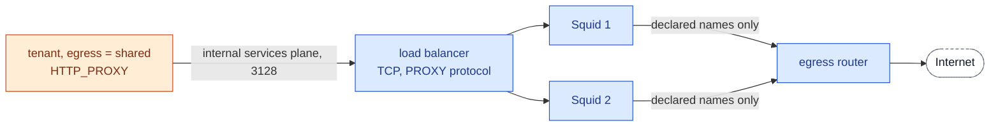

# Stack `shared/egress`

The **shared egress** of the landing zone ([ADR-0016](../../../docs/adr/0016-network-services-and-edge-by-level.md), D1): the way out to the Internet of the tenants with `egress = "shared"`, which restricts each of them to the names it declares and logs every request. A shared service of the internal services plane, in a project of its own.

- **Two Squid forward proxies** (`instance_count`) behind an **Octavia load balancer** in TCP, in PROXY protocol: the proxies see each tenant's address, and the load balancer admits the declared tenants only (`allowed_cidrs`).
- **Per tenant** (`tenants`), delivered as instance metadata: its sources on the internal services plane (its `internal_sources` output) and the names it may reach (Squid's `dstdomain`: `example.org`, or `.example.org` with its subdomains). Everything else is refused, HTTP on port 80 and HTTPS through `CONNECT` on port 443 only.
- **The log** of each proxy is `/var/log/squid/access.log` on the instance: every request, allowed or refused, with the tenant's address. Sending it to your log tools is an integration point of `v0.8`.
- **The proxies go out through the stack's own egress router** (`egress_network`) and resolve names with the resolvers of its network.

A tenant with `egress = "shared"` (stack [`vm`](../../tenants/vm/README.md)) has no egress router and no default route: it joins the internal services plane and takes the `proxy` output as its `shared_egress.proxy`. Kubernetes tenants keep their own egress router until the integration point of registry mirrors (`v0.8`).



```bash
cp terraform.tfvars.example terraform.tfvars   # adapt
tofu -chdir=../planes output -json attachments | jq '{plane_attachment: .egress.planes}' > planes.auto.tfvars.json
tofu init && tofu apply
tofu output -raw proxy   # the shared_egress.proxy of the tenants
```

A new tenant: add it to `tenants` (its sources and names) and apply this stack, then apply the tenant. The tenants reach the proxies as instance metadata, updated in place and rendered by a timer on each proxy every 10 seconds (`squid-tenants`, as the routes of the entry point, [ADR-0006](../../../docs/adr/0006-exposure.md), D3): no instance is replaced, and Squid reloads its rules.

## Inputs and outputs

<!-- BEGIN_TF_DOCS -->
### Requirements

| Name | Version |
| ---- | ------- |
| terraform | >= 1.9 |
| openstack | ~> 3.2 |

### Modules

| Name | Source | Version |
| ---- | ------ | ------- |
| admission | ../../../modules/admission | n/a |
| bastion | ../../../modules/bastion | n/a |
| cloudinit | git::https://github.com/CyprisTech/terraform-openstack-tenant.git//modules/cloudinit | v0.1.6 |
| egress | git::https://github.com/CyprisTech/terraform-openstack-tenant.git | v0.1.6 |
| metrics | ../../../modules/metrics-agent | n/a |
| planes | ../../../modules/plane-attachment | n/a |

### Inputs

| Name | Description | Type | Default | Required |
| ---- | ----------- | ---- | ------- | :------: |
| cloud | Entry of clouds.yaml used by this stack. | `string` | n/a | yes |
| egress\_network | External network of the stack's egress router: the way out to the Internet of the proxies. subnet: optional, the subnet of that network to look up by name. | <pre>object({<br/>    network = string<br/>    subnet  = optional(string)<br/>  })</pre> | n/a | yes |
| flavor | Flavor name of the proxy instances. | `string` | n/a | yes |
| image | Image name of the proxy instances (an Ubuntu LTS cloud image). | `string` | n/a | yes |
| plane\_attachment | The stack's entry of the attachments output of stack shared/planes (attachments.<name>.planes),<br/>keyed by plane: how its router joins each plane and how its instances are seen there,<br/>whatever provides the plane (the operator, or a hub project). The proxies are a<br/>shared service of the internal services plane (role shared). | <pre>map(object({<br/>    mode         = string<br/>    nat          = bool<br/>    cidr         = string<br/>    network_id   = string<br/>    network_name = string<br/>    subnet_id    = string<br/>    routes = optional(list(object({<br/>      destination = string<br/>      next_hop    = string<br/>    })), [])<br/>  }))</pre> | n/a | yes |
| site | Short site name: the name of the region in this deployment, used in resource names. | `string` | n/a | yes |
| zones | Availability zones of the instances, at least one. The instances of a role are spread over them in order (the first instance in the first zone); changing the order moves instances. One zone places everything in it. | `list(string)` | n/a | yes |
| admin | Administration access to the proxy instances. users: login => SSH public keys (sudo granted).<br/>ssh\_cidrs: sources allowed on port 22. Empty by default: no SSH access. | <pre>object({<br/>    users     = optional(map(list(string)), {})<br/>    ssh_cidrs = optional(list(string), [])<br/>  })</pre> | `{}` | no |
| bastion | Optional administration bastion. By default it lives in its own small network whose router joins<br/>external\_network (an administration network such as an intranet) and carries a floating<br/>IP on it. A second port on the stack's network gives it access to the proxy instances; that<br/>network itself gets no route to the administration network.<br/>var.bastion\_placement may put it on the stack's network instead (ADR-0014, D2).<br/>- ssh\_cidrs: sources allowed to reach the bastion on port 22.<br/>The users of var.admin are created on the bastion and on the proxy instances. | <pre>object({<br/>    external_network = object({<br/>      network = string<br/>      subnet  = optional(string)<br/>    })<br/>    cidr      = optional(string)<br/>    flavor    = optional(string)<br/>    ssh_cidrs = list(string)<br/>  })</pre> | `null` | no |
| bastion\_placement | Where the bastion lives (ADR-0014, D2): "own-network" (default), its own small network whose<br/>router joins bastion.external\_network; or "stack-network", one port on the stack's network<br/>and its floating IP on the egress router, when bastion.external\_network is the egress\_network.<br/>A choice of the profile: private-cloud keeps "own-network", public-cloud takes "stack-network". | `string` | `"own-network"` | no |
| boot\_volume\_size | Size in GiB of a root volume created from the image; null boots from the flavor's local disk. | `number` | `null` | no |
| dns\_nameservers | DNS resolvers of the stack's network; empty (the default), those of Neutron's DHCP (ADR-0016, D3). The proxies resolve the names the tenants ask for with them: they must resolve public names. | `list(string)` | `[]` | no |
| egress\_cidr | Range of the stack's network: the load balancer, its amphorae and the proxy instances live in it. On a hub plane, the attachment's cidr in shared/planes. | `string` | `"10.39.0.0/27"` | no |
| instance\_count | Number of proxy instances behind the load balancer: two or more keeps the egress up while one is replaced or its host fails. | `number` | `2` | no |
| monitoring | Monitoring as a push integration point (ADR-0007): each proxy instance runs its exporters<br/>and a Prometheus agent that reads them, and pushes to the receiver<br/>through the observability plane. Nothing connects into the instances for their metrics.<br/>- receiver: base URL of the receiver, for example "http://192.0.2.10:9090" (output<br/>  receiver\_url of the receiver); null runs no agent. | <pre>object({<br/>    receiver = optional(string)<br/>  })</pre> | `{}` | no |
| network\_mtu | MTU of the networks of this stack. It must not exceed the MTU the cloud can carry for tenant<br/>networks, nor the MTU of the planes they join (planes contract): a larger value creates a<br/>path MTU black hole, since OVN routers do not send "fragmentation needed" unless the operator<br/>enables it. null keeps the cloud default. | `number` | `null` | no |
| octavia\_flavor\_id | Octavia flavor; an active/standby flavor is recommended. null uses the cloud default. | `string` | `null` | no |
| server\_group\_policy | Placement of the proxy instances: "anti-affinity" (two hosts required) or "soft-anti-affinity". | `string` | `"anti-affinity"` | no |
| squid\_port | Port of the proxy, on the load balancer and the instances. | `number` | `3128` | no |
| tenants | The tenants that go out through this egress (egress = "shared", ADR-0016 D1), keyed by name<br/>(lowercase letters, digits, dashes):<br/>- sources: the addresses the tenant arrives from on the internal services plane: its<br/>  internal\_sources output (its router's address on a plane with NAT, its range otherwise).<br/>- domains: the names it may reach, in Squid's dstdomain form: "example.org" for that name<br/>  only, ".example.org" for it and its subdomains. Everything else is refused.<br/>Empty: the proxies refuse every request. | <pre>map(object({<br/>    sources = list(string)<br/>    domains = list(string)<br/>  }))</pre> | `{}` | no |
| volume\_zones | Block storage zone of the root volumes (boot\_volume\_size), for each compute zone. A compute zone missing from the map gets the cloud's default storage zone. | `map(string)` | `{}` | no |

### Outputs

| Name | Description |
| ---- | ----------- |
| bastion | Floating IP of the bastion on the administration network, or null. |
| instances | The proxy instances and their addresses on the stack's network, reached through the bastion (SSH): the access log of each is /var/log/squid/access.log. |
| proxy | URL of the shared egress on the internal services plane, for the shared\_egress input of the tenants with egress = "shared": a floating IP of the plane with NAT, the load balancer's address otherwise. |
| tenants | The tenants admitted, with their sources and the names they may reach. |
<!-- END_TF_DOCS -->
