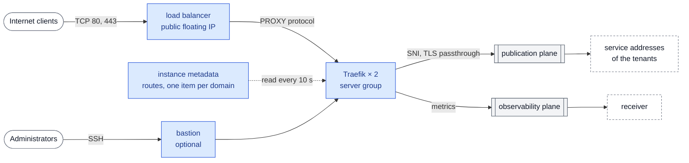

# Shared public entry point

One public address for the domains of the tenants that choose it ([ADR-0006](../../../docs/adr/0006-exposure.md); ADR-0001, D3):

- an Octavia load balancer with a public floating IP; listeners in **TCP** on 80 and 443, pools in **PROXY** protocol, **TCP** health monitors;
- two Traefik instances on plain VMs, in a server group (anti-affinity), Traefik running as a Podman container started by systemd;
- routes by **SNI with TLS passthrough** to each tenant's **service address**, PROXY protocol v2 with the client address;
- routes delivered as **instance metadata**, updated in place: a timer on each instance renders them into Traefik's dynamic configuration within seconds;
- routers to the publication and observability planes, and a transit router, gateway of the edge network, holding the routes to them (the default route to the public router; [ADR-0013](../../../docs/adr/0013-plane-routes-on-a-transit-router.md));
- metrics pushed to your receiver by a Prometheus agent on each instance (node exporter and Traefik metrics, `monitoring.receiver`); nothing connects into the instances.



Arrows show who opens the connection. TLS ends in the tenants: Traefik routes by name and holds no key. Solid boxes: created by this stack; dashed boxes: provided by other stacks or outside the landing zone; grey: planes.

## Settings

| Element | Setting |
|---|---|
| Public address | one floating IP for every domain published through it; Traefik tells the domains apart by SNI |
| Octavia listener 443 | `TCP`, pool protocol `PROXY`, TCP health monitor on 443 |
| Octavia listener 80 | `TCP`, pool protocol `PROXY`; Traefik answers with a redirection to HTTPS |
| Traefik entry points | `proxyProtocol.trustedIPs` limited to the entry point network |
| Traefik routers | TCP routers, `HostSNI` per domain, `tls.passthrough: true`, connection limit per client |
| Traefik services | the tenant's service address, PROXY protocol v2 |
| Runtime | Traefik container started by a systemd unit, pinned image, no orchestrator |
| Static configuration | cloud-init; a change replaces the instances one at a time |
| Routes | instance metadata, one item per domain, updated in place ([ADR-0006](../../../docs/adr/0006-exposure.md), D3; [publish a domain](../../../docs/guides/publish-a-domain.md)) |
| Dashboard | not exposed |

What the entry point does not do: TLS termination, L7 routing, WAF. Each tenant owns its certificates ([certificates](../../../docs/guides/certificates.md)).

## Usage

```bash
cp terraform.tfvars.example terraform.tfvars   # adapt to your cloud
tofu init
tofu apply
```

The stack uses the `cloud` entry of `clouds.yaml` given in `terraform.tfvars`. Make sure no `OS_*` variable is set in the shell: the client would mix it with the `clouds.yaml` entry.

The instances need Internet access at first boot (package index, Podman, Traefik image): `public_network` must provide a default route to the Internet, and `dns_nameservers` must be reachable through it.

Give the tenants published through the entry point its `publication_sources` output, as their `edge_sources`: their service addresses admit these addresses only.

## Changing the published domains

The domains are a reviewed input of this stack ([ADR-0016](../../../docs/adr/0016-network-services-and-edge-by-level.md), D5): `domains.auto.tfvars.json`, kept in your deployment repository. A tenant asks for its domains with a merge request that [`scripts/request-domains.sh`](../../../scripts/request-domains.sh) writes from its `published_domains` output; once it is merged, [`scripts/publish-domains.sh`](../../../scripts/publish-domains.sh) plans and applies this stack. It reads no state of the tenants. Each domain becomes a metadata item of both instances (`route-<domain>`), updated in place; the timer renders them into `/etc/traefik/dynamic/routes.yml`, which Traefik reloads without dropping connections. No instance is replaced.

The timer leaves the routes untouched when the metadata service does not answer or answers fewer routes than announced. Limits: about 120 domains (Nova quota `metadata_items`), and a route must fit in a metadata value (255 characters).

A change of the static configuration (Traefik image, entry points) is written by cloud-init: replace the instances one at a time, so that the load balancer keeps a healthy member:

```bash
tofu apply -replace='module.edge.module.instance["SITE-edge-1"].openstack_compute_instance_v2.this'
# wait until the member is ONLINE again: openstack loadbalancer member list SITE-edge-https
tofu apply -replace='module.edge.module.instance["SITE-edge-2"].openstack_compute_instance_v2.this'
```

## Backends

- `domains.<domain>.backends` take the tenant's service address, `address:port`.
- Service addresses admit the ranges of the `publication_sources` output. With `proxy_protocol = true` (default), the backends expect a PROXY protocol v2 header.
- Tenants terminate TLS and manage their certificates, with ACME DNS-01 challenges on their zone ([ADR-0006](../../../docs/adr/0006-exposure.md), D5).

## Inputs and outputs

<!-- BEGIN_TF_DOCS -->
### Requirements

| Name | Version |
| ---- | ------- |
| terraform | >= 1.9 |
| openstack | ~> 3.2 |

### Providers

| Name | Version |
| ---- | ------- |
| openstack | ~> 3.2 |

### Modules

| Name | Source | Version |
| ---- | ------ | ------- |
| admission | ../../../modules/admission | n/a |
| bastion | ../../../modules/bastion | n/a |
| cloudinit | git::https://github.com/CyprisTech/terraform-openstack-tenant.git//modules/cloudinit | v0.1.6 |
| edge | git::https://github.com/CyprisTech/terraform-openstack-tenant.git | v0.1.6 |
| metrics | ../../../modules/metrics-agent | n/a |
| planes | ../../../modules/plane-attachment | n/a |

### Resources

| Name | Type |
| ---- | ---- |
| [openstack_networking_router_v2.publication](https://registry.terraform.io/providers/terraform-provider-openstack/openstack/latest/docs/data-sources/networking_router_v2) | data source |

### Inputs

| Name | Description | Type | Default | Required |
| ---- | ----------- | ---- | ------- | :------: |
| cloud | Entry of clouds.yaml used by this stack. | `string` | n/a | yes |
| flavor | Flavor name of the edge instances. | `string` | n/a | yes |
| image | Image name of the edge instances (an Ubuntu LTS cloud image). | `string` | n/a | yes |
| plane\_attachment | The stack's entry of the attachments output of stack shared/planes (attachments.<name>.planes),<br/>keyed by plane: how its router joins each plane and how its instances are seen there,<br/>whatever provides the plane (the operator, or a hub project). | <pre>map(object({<br/>    mode         = string<br/>    nat          = bool<br/>    cidr         = string<br/>    network_id   = string<br/>    network_name = string<br/>    subnet_id    = string<br/>    routes       = optional(list(object({ destination = string, next_hop = string })), [])<br/>  }))</pre> | n/a | yes |
| public\_network | External network providing the public floating IP of the load balancer and the default route of the edge network. subnet: optional, the subnet of that network to look up by name; without it, Neutron chooses (a public network with several subnets of the same name). | <pre>object({<br/>    network = string<br/>    subnet  = optional(string)<br/>  })</pre> | n/a | yes |
| site | Short site name: the name of the region in this deployment, used in resource names. | `string` | n/a | yes |
| zones | Availability zones of the instances, at least one. The instances of a role are spread over them in order (the first instance in the first zone); changing the order moves instances. One zone places everything in it. | `list(string)` | n/a | yes |
| admin | Administration access to the Traefik instances. users: login => SSH public keys (sudo granted).<br/>ssh\_cidrs: sources allowed on port 22. Empty by default: no SSH access. | <pre>object({<br/>    users     = optional(map(list(string)), {})<br/>    ssh_cidrs = optional(list(string), [])<br/>  })</pre> | `{}` | no |
| bastion | Optional administration bastion. By default it lives in its own small network whose router joins<br/>external\_network (an administration network such as an intranet) and carries a floating<br/>IP on it. A second port on the edge network gives it access to the Traefik instances; the edge<br/>network itself gets no route to the administration network.<br/>var.bastion\_placement may put it on the stack's network instead (ADR-0014, D2).<br/>- ssh\_cidrs: sources allowed to reach the bastion on port 22.<br/>The users of var.admin are created on the bastion and on the Traefik instances. | <pre>object({<br/>    external_network = object({ network = string, subnet = optional(string) })<br/>    cidr             = optional(string)<br/>    flavor           = optional(string)<br/>    ssh_cidrs        = list(string)<br/>  })</pre> | `null` | no |
| bastion\_placement | Where the bastion lives (ADR-0014, D2): "own-network" (default), its own small network whose<br/>router joins bastion.external\_network; or "stack-network", one port on the stack's network<br/>and its floating IP on the egress router, when bastion.external\_network is the public\_network.<br/>A choice of the profile: private-cloud keeps "own-network", public-cloud takes "stack-network". | `string` | `"own-network"` | no |
| boot\_volume\_size | Size in GiB of a root volume created from the image; null boots from the flavor's local disk. | `number` | `null` | no |
| dns\_nameservers | DNS resolvers pushed by DHCP on the edge network. They must be reachable through the edge routes (public network or a plane), and resolve the backend names used in routes. Without them, the first boot cannot install Podman nor pull the Traefik image. | `list(string)` | `[]` | no |
| domains | Public domains routed by SNI, keyed by domain name (ADR-0006).<br/>- backends: "address:port" of the tenant's service address (its load balancer, or its only<br/>  instance); several only for a tenant that exposes several addresses for one domain.<br/>- proxy\_protocol: send PROXY protocol v2 to the backends; they must be configured to accept it.<br/>- max\_connections: simultaneous connections allowed per client address.<br/>Delivered to the Traefik instances through their metadata, updated in place: a change takes<br/>effect in seconds, without replacing an instance. A reviewed input (ADR-0016, D5): the file<br/>domains.auto.tfvars.json of your deployment repository, written for each tenant from its<br/>published\_domains output by scripts/request-domains.sh, applied by scripts/publish-domains.sh. | <pre>map(object({<br/>    backends        = list(string)<br/>    proxy_protocol  = optional(bool, true)<br/>    max_connections = optional(number, 100)<br/>  }))</pre> | `{}` | no |
| edge\_cidr | Range of the edge network. The load balancer, its amphorae and the Traefik instances live in it. | `string` | `"10.20.0.0/24"` | no |
| monitoring | Monitoring as a push integration point (ADR-0007): each Traefik instance runs its exporters<br/>and a Prometheus agent that reads them, with the Traefik metrics, and pushes to the receiver<br/>through the observability plane. Nothing connects into the instances for their metrics.<br/>- receiver: base URL of the receiver, for example "http://192.0.2.10:9090" (output<br/>  receiver\_url of the receiver); null runs no agent. | <pre>object({<br/>    receiver = optional(string)<br/>  })</pre> | `{}` | no |
| network\_mtu | MTU of the networks of this stack. It must not exceed the MTU the cloud can carry for tenant<br/>networks, nor the MTU of the planes they join (planes contract): a larger value creates a<br/>path MTU black hole, since OVN routers do not send "fragmentation needed" unless the operator<br/>enables it. null keeps the cloud default. | `number` | `null` | no |
| octavia\_flavor\_id | Octavia flavor; an active/standby flavor is recommended for the edge. null uses the cloud default. | `string` | `null` | no |
| public\_dns | Optional A records on the public floating IP: an existing zone (name with its trailing dot) and relative names ("" for the apex). | <pre>object({<br/>    zone  = string<br/>    names = list(string)<br/>    ttl   = optional(number, 300)<br/>  })</pre> | `null` | no |
| server\_group\_policy | Placement of the two Traefik instances: "anti-affinity" (two hosts required) or "soft-anti-affinity". | `string` | `"anti-affinity"` | no |
| traefik\_image | Fully qualified, pinned Traefik image. | `string` | `"docker.io/library/traefik:v3.7.16"` | no |
| volume\_zones | Block storage zone of the root volumes (boot\_volume\_size), for each compute zone. A compute zone missing from the map gets the cloud's default storage zone. | `map(string)` | `{}` | no |

### Outputs

| Name | Description |
| ---- | ----------- |
| bastion | Floating IP of the bastion on the administration network, or null. |
| domains | Domains currently routed by the entry point. |
| instances | Traefik instances and their addresses on the edge network. |
| load\_balancer | Virtual IP, public floating IP and DNS names of the entry point. |
| publication\_sources | Ranges the entry point connects from on publication, in CIDR notation: the router's gateway address in gateway mode, the entry point's range in interface mode. Backends admit them on their published ports (ADR-0001, D7); pass them to the tenant stacks (edge\_sources). |
<!-- END_TF_DOCS -->
