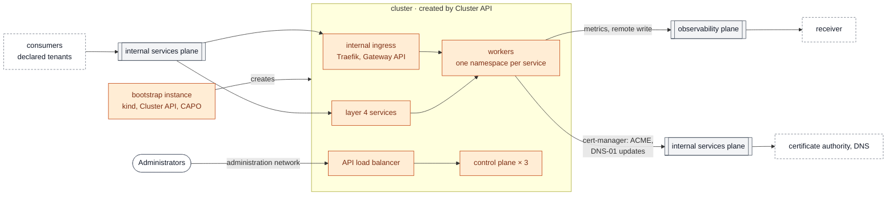

# Kubernetes cluster for shared services

A Kubernetes cluster that offers services to the tenants ([spec](../../../docs/specs/kubernetes-shared-services.md)): the same cluster as the [Kubernetes tenant](../../tenants/kubernetes/README.md), built by [`modules/kubernetes-cluster`](../../../modules/kubernetes-cluster/README.md), in a project of shared services, attached with the role `shared` on the internal services plane.

- **Not published:** it does not join the publication plane. A cluster for published applications is another cluster ([lateral movement](../../../docs/concepts/architecture.md#lateral-movement)).
- **HTTP services** behind an **internal ingress**: its own Traefik deployment, Gateway (`traefik-internal-gateway`) and Service, one `HTTPRoute` per service, TLS for the names of `cluster.domains` ([ADR-0008](../../../docs/adr/0008-tenant-certificates.md)).
- **Layer 4 services**: a Service of type `LoadBalancer` per service, at an address the stack prepares.
- **Closed by default, then admitted to its consumers only** (`consumers`): the `internal_sources` output of each consuming tenant, and the ranges of the users. Deploy the cluster first, then [add its consumers](#add-a-consumer). Network admission does not identify a user: authentication belongs to the service.
- **Between services, the cluster's boundary**: one namespace per service, a default-deny network policy, ingress from the internal ingress or the service's own load balancer only.
- Its Prometheus pushes to the receiver through the observability plane ([ADR-0007](../../../docs/adr/0007-monitoring.md)).

The reference demonstrates two services, not operated ([`demo/`](demo)): `whoami` over HTTPS behind the internal ingress, and a TCP echo on port 7000. Real products are yours ([ADR-0003](../../../docs/adr/0003-scope-and-boundary.md), D4).



Arrows show who opens the connection. The internal services plane appears twice: on the left what comes in, on the right what the cluster calls. Solid boxes: created by this stack; dashed boxes: provided by other stacks; grey: planes.

## Prerequisites

- The attachment of the cluster in `shared/planes`: role `shared` on the internal services plane, `tenant` on the observability plane.
- The node image built by [images/kubernetes-node](../../../images/kubernetes-node/README.md).
- An application credential **dedicated to the cluster**, restricted, with the `member` and `load-balancer_member` roles of the project, created by an administrator ([Kubernetes tenant](../../tenants/kubernetes/README.md#prerequisites)).
- Resolvers (`dns_nameservers`) that resolve the cloud API endpoints, and, when the cloud APIs use a private certificate authority, its certificates in a file.
- For `certificates`: an ACME directory and a DNS provider for the names of `cluster.domains` ([guide](../../../docs/guides/certificates.md)).

The entry point is not a prerequisite: this cluster is not published.

## Load balancers of your own Services

A Service of type `LoadBalancer` gets an internal load balancer, reachable from the cluster network only: the cloud controller runs with `internal-lb = true`. To give it a floating IP on a plane, annotate it with `loadbalancer.openstack.org/floating-network-id` and `service.beta.kubernetes.io/openstack-internal-load-balancer: "false"`, and admit its sources, as the entries of the stack do.

## Usage

The same as the [Kubernetes tenant](../../tenants/kubernetes/README.md#usage): an application credential dedicated to the cluster, the node image, then `create-cluster.sh` on the bootstrap instance. In `shared/planes`, the cluster's attachment has the role `shared` on the internal services plane and `tenant` on the observability plane; each consuming tenant joins the internal services plane.

```bash
cp terraform.tfvars.example terraform.tfvars   # adapt; consumers = the consumers' internal_sources
tofu init && tofu apply
# create the cluster from the bootstrap instance (see the Kubernetes tenant), then:
kubectl apply -f demo/whoami.yaml -f demo/echo.yaml
```

The `services` output gives what the consumers reach; the `domains` output, the names and their address (written in `internal_zone` when it is set).

## Names and root certificate for the consumers

The consumers need two things the cluster does not give them.

- **The names.** With Designate, set `internal_zone` to a zone owned by or shared with the project: the stack writes the record of each name of `cluster.domains`, and updates it with the address. Otherwise, the `domains` output lists each name and its address, to write with your DNS provider (for example `nsupdate` over RFC 2136). The records hold internal addresses: a public zone reveals them but gives no access.
- **The root**, when the authority is not publicly trusted. It is the `ca_bundle` of the `certificates` input. A `vm` tenant with this input receives it at boot, in `/etc/lego/ca.pem`. For a Kubernetes tenant, the input only reaches cert-manager: mount the root in the workloads that call the service. Any other consumer gets it from your configuration management. With Let's Encrypt there is nothing to distribute.

## Add a consumer

The sources are written in the manifests, which `create-cluster.sh` applies once. A consumer is a tenant, once it has joined the internal services plane, or a range of users ([how they reach the plane](../../../docs/reference/integration-points.md#users-of-internal-services)):

```bash
# Add its internal_sources output, or the users' range, to consumers in terraform.tfvars, then:
tofu apply
tofu output -json manifests | jq -r '."addons.yaml"'   | kubectl --kubeconfig shared.kubeconfig apply -f -
tofu output -json manifests | jq -r '."services.yaml"' | kubectl --kubeconfig shared.kubeconfig apply -f -
```

The load balancers then admit the new sources; their addresses do not change.

## Inputs and outputs

<!-- BEGIN_TF_DOCS -->
### Requirements

| Name | Version |
| ---- | ------- |
| terraform | >= 1.9 |
| openstack | ~> 3.2 |

### Modules

| Name | Source | Version |
| ---- | ------ | ------- |
| cluster | ../../../modules/kubernetes-cluster | n/a |
| names | git::https://github.com/CyprisTech/terraform-openstack-tenant.git//modules/dns | v0.1.5 |

### Inputs

| Name | Description | Type | Default | Required |
| ---- | ----------- | ---- | ------- | :------: |
| admin | Administration access.<br/>- users: login => SSH public keys, created on the bootstrap instance with sudo.<br/>- sources: addresses of the operators as seen on the administration network (with source NAT,<br/>  the address of a router). They reach the bootstrap instance on port 22 and the Kubernetes<br/>  API on port 6443, and nothing else does.<br/>- ssh\_key\_name: Nova key pair injected in the cluster machines, or null for none. | <pre>object({<br/>    users        = optional(map(list(string)), {})<br/>    sources      = list(string)<br/>    ssh_key_name = optional(string)<br/>  })</pre> | n/a | yes |
| az | Availability zone of the bootstrap instance and of the cluster machines. | `string` | n/a | yes |
| cloud | Entry of clouds.yaml used by this stack (the shared-services project of the cluster). | `string` | n/a | yes |
| cluster | The Kubernetes cluster created by Cluster API.<br/>- node\_image: name of the image built by images/kubernetes-node.<br/>- kubernetes\_version: must match the node image.<br/>- control\_plane\_count: 3 for a highly available control plane.<br/>- control\_plane\_root\_volume\_size, worker\_root\_volume\_size: GiB of the root volume of each<br/>  machine (container images, ephemeral storage, logs, and etcd on the control plane). They<br/>  must not be smaller than the virtual size of the node image.<br/>- domains: names of the HTTP services, served by the internal ingress, with a certificate.<br/>- pod\_cidr, service\_cidr: must not overlap the cluster network nor the planes. | <pre>object({<br/>    name                           = optional(string, "shared")<br/>    node_image                     = string<br/>    kubernetes_version             = optional(string, "v1.36.5")<br/>    control_plane_flavor           = string<br/>    worker_flavor                  = string<br/>    control_plane_count            = optional(number, 3)<br/>    worker_count                   = optional(number, 2)<br/>    control_plane_root_volume_size = optional(number, 30)<br/>    worker_root_volume_size        = optional(number, 40)<br/>    domains                        = optional(list(string), ["services.example.org"])<br/>    pod_cidr                       = optional(string, "10.244.0.0/16")<br/>    service_cidr                   = optional(string, "10.96.0.0/12")<br/>  })</pre> | n/a | yes |
| egress\_network | External network giving the default route (packages, container images). The cluster gets no public address on it. | `object({ network = string, subnet = string })` | n/a | yes |
| flavor | Flavor name of the bootstrap instance (kind runs there: 2 vCPU and 4 GiB at least). | `string` | n/a | yes |
| image | Image name of the bootstrap instance (an Ubuntu LTS cloud image). | `string` | n/a | yes |
| plane\_attachment | The stack's entry of the attachments output of stack shared/planes (attachments.<name>.planes),<br/>keyed by plane: how its router joins each plane and how its instances are seen there,<br/>whatever provides the plane (the operator, or a hub project). | <pre>map(object({<br/>    mode         = string<br/>    nat          = bool<br/>    cidr         = string<br/>    network_id   = string<br/>    network_name = string<br/>    subnet_id    = string<br/>    routes       = optional(list(object({ destination = string, next_hop = string })), [])<br/>  }))</pre> | n/a | yes |
| site | Short site name; must match the site of the other stacks. | `string` | n/a | yes |
| admin\_network | Administration network carrying the floating IPs of the Kubernetes API and of the bootstrap<br/>instance (ADR-0002, D6). null uses the internal services plane for this role, which requires an<br/>operator plane (gateway mode): then admin.sources must be specific addresses, never the range<br/>of the plane. | `object({ network = string, subnet = string, cidr = string })` | `null` | no |
| boot\_volume\_size | Size in GiB of the root volume of the bootstrap instance; null boots from the flavor's local disk. | `number` | `null` | no |
| bootstrap | Create the bootstrap instance. Set to false once the cluster manages itself (ADR-0002, D3); set back to true before tearing the cluster down. | `bool` | `true` | no |
| certificates | Certificates of the domains of the cluster (ADR-0008): cert-manager obtains and renews them<br/>through the ACME DNS-01 challenge, from any ACME directory (Let's Encrypt, or the<br/>organisation's authority), and writes the secret of the ingress listener. null runs the<br/>demonstration mode: a self-signed certificate, with a warning at every plan.<br/>- directory\_url, ca\_bundle (PEM, for an authority that is not publicly trusted), email.<br/>- dns.provider "rfc2136" with dns.settings nameserver ("host:port"), tsig\_key\_name,<br/>  tsig\_algorithm, tsig\_secret: the stack writes the TSIG secret in the cert-manager<br/>  namespace. Any other provider: dns.solver, a cert-manager dns01 solver, whose credentials<br/>  Secret you create in the cert-manager namespace.<br/>- dns.resolvers: name servers ("host:port") cert-manager checks the TXT record on; empty<br/>  uses the cluster's resolvers.<br/>The settings reach the cluster through the bootstrap instance's user data, readable by the<br/>members of the project: give a key restricted to the \_acme-challenge records of the domains. | <pre>object({<br/>    directory_url = string<br/>    ca_bundle     = optional(string)<br/>    email         = string<br/>    dns = object({<br/>      provider  = string<br/>      settings  = optional(map(string), {})<br/>      solver    = optional(any)<br/>      resolvers = optional(list(string), [])<br/>    })<br/>  })</pre> | `null` | no |
| cluster\_cidr | Range of the cluster network (nodes, load balancer VIPs, bootstrap instance). | `string` | `"10.36.0.0/24"` | no |
| consumers | Who may use the services of the cluster on the internal services plane, as CIDRs: the<br/>internal\_sources output of each consuming tenant, and the ranges of the users (a VPN, the<br/>corporate network) as the cluster sees them. Admitted by the internal ingress and the layer 4<br/>services. Empty keeps the services closed: only the cluster network is admitted. Network<br/>admission does not identify a user: authentication belongs to the service. | `list(string)` | `[]` | no |
| dns\_nameservers | DNS resolvers of the cluster network, reachable through its routes. They must resolve the endpoints of the cloud APIs (Cluster API, the cloud controller manager and Cinder CSI call them from the cluster), and public names for the images. | `list(string)` | `[]` | no |
| internal\_zone | Designate zone of the internal names, owned by or shared with this project: the stack writes<br/>the records of cluster.domains in it. null: write them yourself from the domains output.<br/>- id, name (with its trailing dot): the zone.<br/>- ttl: of the records. | <pre>object({<br/>    id   = string<br/>    name = string<br/>    ttl  = optional(number, 300)<br/>  })</pre> | `null` | no |
| monitoring | Monitoring as a push integration point (ADR-0007): the Prometheus of the cluster pushes to<br/>the receiver through the observability plane (remote write). Nothing connects into the cluster<br/>for its metrics.<br/>- receiver: base URL of the receiver, for example "http://192.0.2.10:9090" (output<br/>  receiver\_url of the receiver); null keeps the metrics in the cluster. | <pre>object({<br/>    receiver = optional(string)<br/>  })</pre> | `{}` | no |
| network\_mtu | MTU of the cluster network. It must not exceed the MTU the cloud can carry for tenant<br/>networks, nor the MTU of the planes the network joins (planes contract). The pod network<br/>uses this value minus the VXLAN overhead (ADR-0002, D4). null keeps the cloud default. | `number` | `null` | no |
| service\_addresses | Host numbers, in the cluster network, of the entries on a plane without NAT: the internal<br/>ingress and the demonstrated TCP service. Neutron does not allocate the host numbers below<br/>reserved\_hosts to anything else, so these addresses are known before the cluster exists. | <pre>object({<br/>    ingress        = optional(number, 10)<br/>    echo           = optional(number, 11)<br/>    reserved_hosts = optional(number, 32)<br/>  })</pre> | `{}` | no |

### Outputs

| Name | Description |
| ---- | ----------- |
| bootstrap | Floating IP of the bootstrap instance on the administration network, or null once it is removed. |
| domains | Names of the HTTP services and the address they resolve to: written in internal\_zone when it is set, to write with your DNS provider otherwise. |
| manifests | Rendered Cluster API manifests, as written on the bootstrap instance. Sensitive with certificates (the DNS provider's key). |
| scripts | Rendered create and delete scripts, as written on the bootstrap instance (cloud-init writes them once: copy them again after a change). |
| services | What the consumers reach, on the internal services plane: the internal ingress (HTTPS, names of cluster.domains) and the TCP echo, at a floating IP of the plane with NAT, at their address in the cluster network otherwise. The consumers admit nothing from the cluster for them. |
| sources | Addresses the cluster connects from on each plane it joins, for the admission rules of what it calls (allowed\_sources). |
<!-- END_TF_DOCS -->
