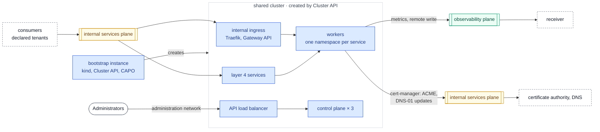

# Shared cluster

The shared cluster (a Kubernetes cluster for shared services) offers services to the tenants ([ADR-0010](../../../docs/adr/0010-kubernetes-shared-services.md)): the same cluster as the [published cluster](../../tenants/kubernetes/README.md), built by [`modules/kubernetes-cluster`](../../../modules/kubernetes-cluster/README.md), in a project of shared services, attached with the role `shared` on the internal services plane.

- **Not published:** it does not join the publication plane. A cluster for published applications is another cluster ([lateral movement](../../../docs/concepts/security.md#lateral-movement)).
- **HTTP services** behind an **internal ingress**: its own Traefik deployment, Gateway (`traefik-internal-gateway`) and Service, one `HTTPRoute` per service, TLS for the names of `cluster.domains` ([ADR-0008](../../../docs/adr/0008-tenant-certificates.md)), or passed through per route for a service that manages its own TLS. No PROXY protocol: its clients are tenants, not the entry point. A route restricted to some consumers takes an `IPAllowList` middleware. It is separate from any public ingress: with one Traefik for both, a route attached to the wrong listener would publish an internal service on the Internet.
- **Layer 4 services**: a Service of type `LoadBalancer` per service, at an address the stack prepares.
- **Closed by default, then admitted to its consumers only** (`consumers`): the `internal_sources` output of each consuming tenant, and the ranges of the users. In the other direction, the output `sources` gives the cluster's address on each plane (its range on a plane without NAT, its router's address with NAT), for the admission rules of the consumers it calls. Deploy the cluster first, then [add its consumers](#add-a-consumer). Network admission does not identify a user: authentication belongs to the service.
- **Between services, the cluster's boundary**: one namespace per service, a default-deny network policy, ingress from the internal ingress or the service's own load balancer only. The stack applies no network policy: they come with each service, applied by the operator, as in [`demo/`](demo). The Gateway admits routes from all namespaces.
- **Names**: records of a zone of the internal names, written by the stack when the cloud has Designate, output otherwise ([ADR-0010](../../../docs/adr/0010-kubernetes-shared-services.md), D3). For a zone that must stay private, a resolver of the cluster (CoreDNS) exposed on the internal services plane can serve it to the consumers.
- Its Prometheus pushes to the receiver through the observability plane ([ADR-0007](../../../docs/adr/0007-monitoring.md)).

The reference demonstrates two services, not operated ([`demo/`](demo)): `whoami` over HTTPS behind the internal ingress, and a TCP echo on port 7000. Real products are yours ([ADR-0003](../../../docs/adr/0003-scope-and-boundary.md), D4).



Arrows show who opens the connection. The internal services plane appears twice: on the left what comes in, on the right what the cluster calls. Solid boxes: created by this stack; dashed boxes: provided by other stacks; the planes in their colour (publication blue, internal services dark yellow, observability green).

## Prerequisites

- The attachment of the cluster in `shared/planes`: role `shared` on the internal services plane, `tenant` on the observability plane.
- The node image built by [images/kubernetes-node](../../../images/kubernetes-node/README.md).
- An application credential **dedicated to the cluster**, restricted, with the `member` and `load-balancer_member` roles of the project, created by an administrator ([Kubernetes tenant](../../tenants/kubernetes/README.md#prerequisites)).
- Resolvers (`dns_nameservers`) that resolve the cloud API endpoints, and, when the cloud APIs use a private certificate authority, its certificates in a file.
- For `certificates`: an ACME directory and a DNS provider for the names of `cluster.domains` ([guide](../../../docs/guides/certificates.md)).

The entry point is not a prerequisite: this cluster is not published.

## Load balancers of your own Services

The cluster admits two kinds of Services of type `LoadBalancer` (a ValidatingAdmissionPolicy, `load-balancer-entries`, applied by `update-cluster.sh`):

- the entries of the stack (the internal ingress and the layer 4 services), in their namespace and at the address the stack prepared (`loadBalancerIP`);
- internal load balancers, reached from the cluster network only: the annotation `service.beta.kubernetes.io/openstack-internal-load-balancer: "true"` and `loadBalancerSourceRanges` within `cluster_cidr`.

Any other is refused: without annotation, the cloud controller would give it a floating IP of an external network it picks by itself; with `loadbalancer.openstack.org/floating-network-id`, a floating IP on a plane the landing zone does not account for; an internal load balancer without source ranges is reached by every source of a routed plane, which reaches the cluster network. A layer 4 service of your own is declared in the `services` input: the stack prepares its address on the internal services plane, admitted to the consumers by default, and the cluster admits it. The cloud controller does not run with `internal-lb = true`: with it, it ignores the annotation `"false"`.

## Usage

With [`lz deploy`](../../../tools/landing-zone/README.md), it is a shared service of type `kubernetes` in `landing-zone.toml`: `lz` gives it its attachment, the receiver, the certificates and the `internal_sources` of the consumers it names, creates the cluster from its bootstrap instance and updates it after each apply; its other inputs are in its inputs file. By hand, as below.

The same as the [Kubernetes tenant](../../tenants/kubernetes/README.md#usage): an application credential dedicated to the cluster, the node image, then `create-cluster.sh` on the bootstrap instance. In `shared/planes`, the cluster's attachment has the role `shared` on the internal services plane and `tenant` on the observability plane; each consuming tenant joins the internal services plane.

```bash
cp terraform.tfvars.example terraform.tfvars   # adapt; consumers = the consumers' internal_sources
tofu init && tofu apply
# create the cluster from the bootstrap instance (see the Kubernetes tenant), then:
kubectl apply -f demo/whoami.yaml -f demo/echo.yaml
```

The `services` output gives what the consumers reach; the `domains` output, the names and their address (written in `internal_zone` when it is set).

## Names and root certificate for the consumers

The consumers need two things the cluster does not give them.

- **The names.** With Designate, set `internal_zone` to a zone owned by or shared with the project: the stack writes the record of each name of `cluster.domains`, and updates it with the address. Otherwise, the `domains` output lists each name and its address, to write with your DNS provider (for example `nsupdate` over RFC 2136). The records hold internal addresses: a public zone reveals them but gives no access.
- **The root**, when the authority is not publicly trusted. It is the `ca_bundle` of the `certificates` input. A `vm` tenant with this input receives it at boot, in `/etc/lego/ca.pem`. For a Kubernetes tenant, the input only reaches cert-manager: mount the root in the workloads that call the service. Any other consumer gets it from your configuration management. With Let's Encrypt there is nothing to distribute.

## Add a consumer

The sources are written in the manifests. A consumer is a tenant, once it has joined the internal services plane, or a range of users ([how they reach the plane](../../../docs/reference/integration-points.md#users-of-internal-services)). Add its `internal_sources` output, or the users' range, to `consumers` in `terraform.tfvars`, apply the stack and [update the cluster](../../../docs/guides/kubernetes-lifecycle.md#update-a-cluster-after-an-apply).

The load balancers then admit the new sources; their addresses do not change.

## Teardown

As for both clusters: [delete a cluster](../../../docs/guides/kubernetes-lifecycle.md#delete-a-cluster), from its bootstrap instance, then `tofu destroy`.

## Inputs and outputs

<!-- BEGIN_TF_DOCS -->
### Requirements

| Name | Version |
| ---- | ------- |
| terraform | >= 1.9 |
| openstack | ~> 3.2 |

### Providers

| Name | Version |
| ---- | ------- |
| terraform | n/a |

### Modules

| Name | Source | Version |
| ---- | ------ | ------- |
| cluster | ../../../modules/kubernetes-cluster | n/a |
| names | git::https://github.com/CyprisTech/terraform-openstack-tenant.git//modules/dns | v0.1.6 |

### Resources

| Name | Type |
| ---- | ---- |
| [terraform_data.service_hosts](https://registry.terraform.io/providers/hashicorp/terraform/latest/docs/resources/data) | resource |

### Inputs

| Name | Description | Type | Default | Required |
| ---- | ----------- | ---- | ------- | :------: |
| admin | Administration access.<br/>- users: login => SSH public keys, created on the bootstrap instance with sudo.<br/>- sources: addresses of the operators as seen on the administration network (with source NAT,<br/>  the address of a router). They reach the bootstrap instance on port 22 and the Kubernetes<br/>  API on port 6443, and nothing else does.<br/>- ssh\_key\_name: Nova key pair injected in the cluster machines, or null for none. | <pre>object({<br/>    users        = optional(map(list(string)), {})<br/>    sources      = list(string)<br/>    ssh_key_name = optional(string)<br/>  })</pre> | n/a | yes |
| cloud | Entry of clouds.yaml used by this stack (the shared-services project of the cluster). | `string` | n/a | yes |
| cluster | The Kubernetes cluster created by Cluster API.<br/>- node\_image: name of the image built by images/kubernetes-node.<br/>- kubernetes\_version: must match the node image.<br/>- control\_plane\_count: 3 for a highly available control plane.<br/>- control\_plane\_root\_volume\_size, worker\_root\_volume\_size: GiB of the root volume of each<br/>  machine (container images, ephemeral storage, logs, and etcd on the control plane). They<br/>  must not be smaller than the virtual size of the node image. 0 boots from the flavor's<br/>  local disk instead: faster to create, lost with the machine, no live migration without<br/>  shared storage; the flavor's disk must then be large enough.<br/>- domains: names of the HTTP services, served by the internal ingress, with a certificate.<br/>- pod\_cidr, service\_cidr: must not overlap the cluster network nor the planes. | <pre>object({<br/>    name               = optional(string, "shared")<br/>    node_image         = string<br/>    kubernetes_version = optional(string, "v1.36.5")<br/><br/>    control_plane_flavor = string<br/>    control_plane_count  = optional(number, 3)<br/>    worker_flavor        = string<br/>    worker_count         = optional(number, 2)<br/><br/>    control_plane_root_volume_size = optional(number, 30)<br/>    worker_root_volume_size        = optional(number, 40)<br/><br/>    domains = optional(list(string), [<br/>      "services.example.org",<br/>    ])<br/>    pod_cidr     = optional(string, "10.244.0.0/16")<br/>    service_cidr = optional(string, "10.96.0.0/12")<br/>  })</pre> | n/a | yes |
| egress\_network | External network giving the default route (packages, container images). The cluster gets no public address on it. | <pre>object({<br/>    network = string<br/>    subnet  = optional(string)<br/>  })</pre> | n/a | yes |
| flavor | Flavor name of the bootstrap instance (kind runs there: 2 vCPU and 4 GiB at least). | `string` | n/a | yes |
| image | Image name of the bootstrap instance (an Ubuntu LTS cloud image). | `string` | n/a | yes |
| plane\_attachment | The stack's entry of the attachments output of stack shared/planes (attachments.<name>.planes),<br/>keyed by plane: how its router joins each plane and how its instances are seen there,<br/>whatever provides the plane (the operator, or a hub project). | <pre>map(object({<br/>    mode         = string<br/>    nat          = bool<br/>    cidr         = string<br/>    network_id   = string<br/>    network_name = string<br/>    subnet_id    = string<br/>    routes = optional(list(object({<br/>      destination = string<br/>      next_hop    = string<br/>    })), [])<br/>  }))</pre> | n/a | yes |
| site | Short site name; must match the site of the other stacks. | `string` | n/a | yes |
| zones | Availability zones of the cluster, at least one: the control plane nodes are spread over them by Cluster API, the workers get one machine deployment per zone, and the bootstrap instance runs in the first. Keeping the quorum of the control plane when a zone is lost needs three zones. | `list(string)` | n/a | yes |
| admin\_network | Administration network carrying the floating IPs of the Kubernetes API and of the bootstrap<br/>instance (ADR-0002, D6). null uses the internal services plane for this role, which requires an<br/>operator plane (gateway mode): then admin.sources must be specific addresses, never the range<br/>of the plane. | <pre>object({<br/>    network = string<br/>    subnet  = optional(string)<br/>    cidr    = string<br/>  })</pre> | `null` | no |
| boot\_volume\_size | Size in GiB of the root volume of the bootstrap instance; null boots from the flavor's local disk. | `number` | `null` | no |
| bootstrap | Create the bootstrap instance. Set to false once the cluster manages itself (ADR-0002, D3); set back to true before tearing the cluster down. | `bool` | `true` | no |
| certificates | Certificates of the domains of the cluster (ADR-0008): cert-manager obtains and renews them<br/>through the ACME DNS-01 challenge, from any ACME directory (Let's Encrypt, or the<br/>organisation's authority), and writes the secret of the ingress listener. null runs the<br/>demonstration mode: a self-signed certificate, with a warning at every plan.<br/>- directory\_url, ca\_bundle (PEM, for an authority that is not publicly trusted), email.<br/>- dns.provider "rfc2136" with dns.settings nameserver ("host:port"), tsig\_key\_name,<br/>  tsig\_algorithm, tsig\_secret: the stack writes the TSIG secret in the cert-manager<br/>  namespace. Any other provider: dns.solver, a cert-manager dns01 solver, whose credentials<br/>  Secret you create in the cert-manager namespace.<br/>- dns.resolvers: name servers ("host:port") cert-manager checks the TXT record on; empty<br/>  uses the cluster's resolvers.<br/>The settings reach the cluster through the bootstrap instance's user data, readable by the<br/>members of the project: give a key restricted to the \_acme-challenge records of the domains. | <pre>object({<br/>    directory_url = string<br/>    ca_bundle     = optional(string)<br/>    email         = string<br/>    dns = object({<br/>      provider  = string<br/>      settings  = optional(map(string), {})<br/>      solver    = optional(any)<br/>      resolvers = optional(list(string), [])<br/>    })<br/>  })</pre> | `null` | no |
| cluster\_cidr | Range of the cluster network (nodes, load balancer VIPs, bootstrap instance). | `string` | `"10.36.0.0/24"` | no |
| consumers | Who may use the services of the cluster on the internal services plane, as CIDRs: the<br/>internal\_sources output of each consuming tenant, and the ranges of the users (a VPN, the<br/>corporate network) as the cluster sees them. Admitted by the internal ingress and the layer 4<br/>services. Empty keeps the services closed: only the cluster network is admitted. Network<br/>admission does not identify a user: authentication belongs to the service. | `list(string)` | `[]` | no |
| dns | Where the records of internal\_zone go (ADR-0016, D2): "designate", written in the cloud's Designate, or "output", written nowhere, for your DNS provider. The dns\_records output gives them in both cases. | `string` | `"designate"` | no |
| dns\_nameservers | DNS resolvers of the cluster network, reachable through its routes; empty (the default), those of Neutron's DHCP (ADR-0016, D3). They must resolve the endpoints of the cloud APIs (Cluster API, the cloud controller manager and Cinder CSI call them from the cluster), and public names for the images. | `list(string)` | `[]` | no |
| internal\_zone | Zone of the internal names: the records of cluster.domains, in the dns\_records output. With<br/>dns = "designate", the stack writes them in this Designate zone, owned by or shared with this<br/>project. null: no records, the domains output gives the names and their address.<br/>- name (with its trailing dot): the zone; id: its Designate ID, needed with dns = "designate".<br/>- ttl: of the records. | <pre>object({<br/>    id   = optional(string)<br/>    name = string<br/>    ttl  = optional(number, 300)<br/>  })</pre> | `null` | no |
| monitoring | Monitoring as a push integration point (ADR-0007): the Prometheus of the cluster pushes to<br/>the receiver through the observability plane (remote write). Nothing connects into the cluster<br/>for its metrics.<br/>- receiver: base URL of the receiver, for example "http://192.0.2.10:9090" (output<br/>  receiver\_url of the receiver); null keeps the metrics in the cluster. | <pre>object({<br/>    receiver = optional(string)<br/>  })</pre> | `{}` | no |
| network\_mtu | MTU of the cluster network. It must not exceed the MTU the cloud can carry for tenant<br/>networks, nor the MTU of the planes the network joins (planes contract). The pod network<br/>uses this value minus the VXLAN overhead (ADR-0002, D4). null keeps the cloud default. | `number` | `null` | no |
| service\_addresses | Host numbers, in the cluster network, of the entries on a plane without NAT: the internal<br/>ingress and the demonstrated TCP service. Neutron does not allocate the host numbers below<br/>reserved\_hosts to anything else, so these addresses are known before the cluster exists. | <pre>object({<br/>    ingress        = optional(number, 10)<br/>    echo           = optional(number, 11)<br/>    reserved_hosts = optional(number, 32)<br/>  })</pre> | `{}` | no |
| services | Layer 4 services you offer to the consumers, besides the demonstrated echo: for each, a<br/>Service of type LoadBalancer on the internal services plane, at an address the stack prepares,<br/>for the workload you deploy in namespace, selected by selector. Keyed by name ("echo" and<br/>"internal" are taken). The cluster admits no other load balancer outside the cluster network<br/>(admission policy load-balancer-entries).<br/>- sources: who may connect; the consumers by default.<br/>- host: host number of the address in the cluster network, required on a plane without NAT,<br/>  below service\_addresses.reserved\_hosts and distinct from the other entries. | <pre>map(object({<br/>    namespace = string<br/>    selector  = map(string)<br/>    ports     = list(number)<br/>    sources   = optional(list(string))<br/>    host      = optional(number)<br/>  }))</pre> | `{}` | no |
| volume\_zones | Block storage zone of the bootstrap instance's root volume (boot\_volume\_size), for each compute zone. A compute zone missing from the map gets the cloud's default storage zone. The root volumes of the cluster machines take the zone of their machine. It also sets where persistent volumes go: every zone mapped to one storage zone means shared storage, volumes created there and usable from every zone; without it, each volume is created in the zone of its node. | `map(string)` | `{}` | no |

### Outputs

| Name | Description |
| ---- | ----------- |
| bootstrap | Floating IP of the bootstrap instance on the administration network, or null once it is removed. |
| dns\_records | The records of cluster.domains in internal\_zone (ADR-0016, D2), keyed "<name> <type>", each { zone, name, type, ttl, records }: written in Designate with dns = "designate", to publish with your DNS provider otherwise (a for\_each of its record resource). Empty without internal\_zone. |
| domains | Names of the HTTP services and the address they resolve to; as records, in dns\_records. |
| manifests | Rendered Cluster API manifests, as written on the bootstrap instance. Sensitive with certificates (the DNS provider's key). |
| revision | Digest of the manifests and scripts of the cluster: a cluster whose ConfigMap platform/landing-zone holds another one is behind its stack (update-cluster.sh --check, lz status). |
| scripts | Rendered scripts: create-cluster.sh and delete-cluster.sh, written on the bootstrap instance at its creation; update-cluster.sh, run from the administration sources after each apply (scripts/cluster-files.sh writes them in a directory). |
| services | What the consumers reach, on the internal services plane: the internal ingress (HTTPS, names of cluster.domains) and the TCP echo, at a floating IP of the plane with NAT, at their address in the cluster network otherwise. The consumers admit nothing from the cluster for them. |
| sources | Addresses the cluster connects from on each plane it joins, for the admission rules of what it calls (allowed\_sources). |
<!-- END_TF_DOCS -->
