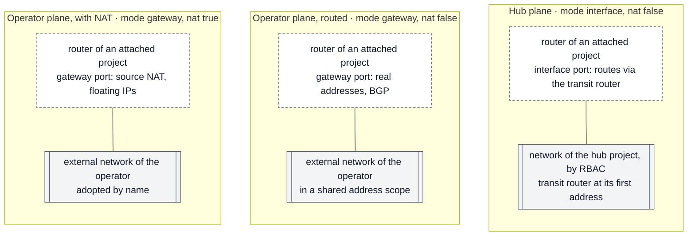
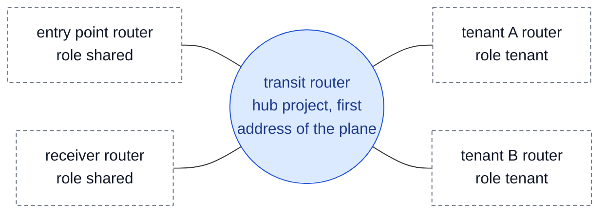

# Stack `shared/planes`

The single description of the shared planes, read by every other stack whatever provides the planes ([ADR-0004](../../../docs/adr/0004-planes-and-isolation.md); [How a tenant joins a plane](../../../docs/concepts/plane-attachment.md)).

- **When:** before the other stacks, and again after an attachment joins or leaves.
- **With which credentials:** those of the **hub** project when it builds planes; those of any project, such as the shared services', when it only adopts the operator's.
- **What the hub project holds:** the network only — the planes, their RBAC policies and their transit routers. Shared services (entry point, receivers, internal services) run in their own projects, attached with the role `shared`.

## Two kinds of plane

A plane comes from the cloud operator or from your hub project; that is its `mode` in `planes`. An operator plane is used with or without address translation (`nat` in the attachments output).

- **Operator plane, with NAT.** The stack adopts the operator's external network by name and creates nothing. An attached router joins with its gateway port: source NAT, floating IPs.
- **Operator plane, routed.** Adopted the same way, without translation. The operator puts the tenants' ranges in the plane's address scope (subnet pools) and advertises them (BGP): tenants reach the plane at their real addresses.
- **Hub plane.** The stack creates, in the hub project, a private network without DHCP, shares it with every attached project by RBAC (`access_as_shared`), and puts a **transit router** at its first address. An attached router joins with an interface port, with routes through the transit router.

Lines show attachments, not connections. Dashed boxes: the routers of the stacks that attach; grey: planes.

## The transit router

On a hub plane, attached routers never route to each other directly: every route goes through the transit router, the hub-and-spoke a transit gateway provides on other clouds.

Lines are routes through the transit router: a tenant reaches the shared services of the plane, a shared service reaches the tenants and the other shared services. Two tenants have no route to each other.

- **Roles are per plane.** Each attachment declares its role on every plane it joins: `shared` (the entry point on `publication`, the metrics receiver on `observability`, an internal service on `internal`) or `tenant` (a workload, or a client of the shared services: the entry point pushes its metrics on `observability`).
- **Routes of the attached routers** (output `attachments.<name>.planes.<plane>.routes`), known before the attachment exists: a tenant reaches the shared services of the plane; a shared service reaches the other shared services and the tenants of the plane — through the plane's `tenant_ranges` aggregates when given.
- **Routes of the transit router**: one per attachment already joined, to the address Neutron gave its router on the plane. The hub owns the plane, so it sees every port on it: this stack discovers the addresses itself, at every plan ([`modules/plane-discovery`](../../../modules/plane-discovery/README.md)).

A project cannot choose its own address on a network it does not own (Neutron policy `create_port:fixed_ips:ip_address`); the hub can, which is why the only fixed address is the transit router's.

## Adding, changing, removing an attachment

1. Add the entry here and apply: the RBAC policies are created.
2. Apply the attachment's stack with its `attachments.<name>.planes` (stacks read it through [`modules/plane-attachment`](../../../modules/plane-attachment/README.md)): its router joins the plane, with its routes through the transit router.
3. Apply this stack again: it discovers the new router's address and adds the route on the transit router.

With `tenant_ranges` covering the new tenant, no shared service is applied again. Removing goes the other way: destroy the attachment's stack, apply this stack (the route goes away), then remove the entry and apply (Neutron refuses to remove an RBAC policy while a port of the project is still on the plane).

If an attachment's router is recreated, its address changes: apply this stack again; traffic to that attachment is cut until then.

To rename an attachment, remove it and apply, then add it under its new name and apply: in a single apply, the new RBAC policy may be created before the old one is deleted, and Neutron refuses two identical policies (`DuplicateRbacPolicy`; a second apply completes the change).

## Checks and limits

- The hub project is not an attachment: it holds the network only.
- Planes do not overlap each other nor any attachment ([`modules/range-overlaps`](../../../modules/range-overlaps/README.md)); attachments sharing a hub plane do not overlap (on an operator plane with NAT they may, being never seen); every plane of an attachment is declared; an attachment has a single router interface on a plane.

- Neutron caps the routes of a router (`max_routes`, 30 by default): the transit router of a plane routes to about 30 attachments.
- Discovery relies on the default Neutron policy that lets a network's owner read the ports on it; check it on each cloud.

The plane and its transit router are created with the network module of [terraform-openstack-tenant](https://github.com/CyprisTech/terraform-openstack-tenant).

## Inputs and outputs

<!-- BEGIN_TF_DOCS -->
### Requirements

| Name | Version |
| ---- | ------- |
| terraform | >= 1.9 |
| openstack | ~> 3.2 |

### Providers

| Name | Version |
| ---- | ------- |
| openstack | ~> 3.2 |
| terraform | n/a |

### Modules

| Name | Source | Version |
| ---- | ------ | ------- |
| discovery | ../../../modules/plane-discovery | n/a |
| overlaps | ../../../modules/range-overlaps | n/a |
| plane | git::https://github.com/CyprisTech/terraform-openstack-tenant.git//modules/network | v0.1.5 |

### Resources

| Name | Type |
| ---- | ---- |
| [openstack_networking_rbac_policy_v2.plane](https://registry.terraform.io/providers/terraform-provider-openstack/openstack/latest/docs/resources/networking_rbac_policy_v2) | resource |
| [openstack_networking_router_route_v2.transit](https://registry.terraform.io/providers/terraform-provider-openstack/openstack/latest/docs/resources/networking_router_route_v2) | resource |
| [terraform_data.checks](https://registry.terraform.io/providers/hashicorp/terraform/latest/docs/resources/data) | resource |
| [openstack_identity_auth_scope_v3.hub](https://registry.terraform.io/providers/terraform-provider-openstack/openstack/latest/docs/data-sources/identity_auth_scope_v3) | data source |
| [openstack_networking_network_v2.operator](https://registry.terraform.io/providers/terraform-provider-openstack/openstack/latest/docs/data-sources/networking_network_v2) | data source |
| [openstack_networking_subnet_v2.operator](https://registry.terraform.io/providers/terraform-provider-openstack/openstack/latest/docs/data-sources/networking_subnet_v2) | data source |

### Inputs

| Name | Description | Type | Default | Required |
| ---- | ----------- | ---- | ------- | :------: |
| attachments | Projects joining the planes, keyed by name. - project\_id: project of the attachment (the target of the RBAC policies). - cidr: range of the attachment's network. Must not overlap a plane, nor another   attachment of the same hub plane. - planes: the planes it joins, each with its role on that plane:   - "shared": a shared service of the plane (the entry point on publication, the metrics     receiver on observability, an internal service on internal). It reaches the tenants and the other     shared services of the plane, and they reach it.   - "tenant": a workload, or a client of the shared services (the entry point pushes its     metrics on observability). It reaches the shared services of the plane only. | <pre>map(object({     project_id = string     cidr       = string     planes     = map(string)   }))</pre> | n/a | yes |
| cloud | Entry of clouds.yaml of the hub project: the project that owns the shared private planes. | `string` | n/a | yes |
| planes | Shared planes, any number, keyed by name (in the reference scenario: publication, observability, internal). - mode "gateway": an external network provided by the cloud operator, adopted by name   (network, subnet). Tenant routers join it with their gateway; nothing is created here. - mode "interface": a private network created in the hub project and shared with the   attached projects by RBAC, with a transit router. Attached routers join it with an interface   and reach each other through the transit router. - cidr: range of the plane. - mtu: MTU of a created plane; null uses the cloud default. | <pre>map(object({     mode    = string     cidr    = string     network = optional(string)     subnet  = optional(string)     mtu     = optional(number)   }))</pre> | n/a | yes |
| site | Short site name: the name of the region in this deployment, used in resource names. | `string` | n/a | yes |
| tenant\_ranges | Per hub plane, aggregates covering the ranges of its tenants, routed by the shared services through the transit router: adding a tenant inside them changes no shared service. A plane absent here: the shared services get one route per tenant of the plane. | `map(list(string))` | `{}` | no |

### Outputs

| Name | Description |
| ---- | ----------- |
| attachments | The plane\_attachment input of each attached stack, keyed like the input: for every plane it joins, how its router joins it (mode: gateway or interface), whether its addresses are translated there (nat: floating IPs) or seen as they are, the plane's network and subnet, and the router routes (through the transit router, hub planes only). The same shape for operator planes and for planes built here: the stacks do not depend on where the planes come from. |
| planes | Planes keyed like the input: { mode, cidr, network\_id, subnet\_id }. |
| transit | Transit router of each hub plane: its address, and the attachments it routes to (address Neutron gave their router on the plane). |
<!-- END_TF_DOCS -->
