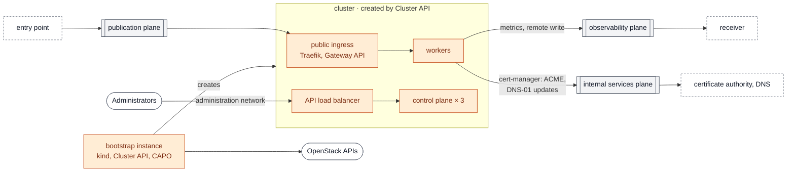

# Tenant type `kubernetes`

A Kubernetes cluster created by Cluster API with the OpenStack provider (CAPO), published on the publication plane behind the entry point, pushing its metrics to your receiver, administered from the administration network only. Design: [ADR-0002](../../../docs/adr/0002-platform-kubernetes.md).

| Created by | What |
|---|---|
| this stack (Terraform) | cluster network and its routers (egress, publication, observability and internal services planes, optional administration network), server groups, bootstrap instance, address of the ingress (publication plane) — a floating IP of the plane when it translates addresses, a fixed address of the cluster network otherwise |
| `create-cluster.sh` on the bootstrap instance | kind, Cluster API with CAPO, ORC and CAAPH, then the cluster: 3 control-plane nodes behind the API load balancer, workers, add-ons |
| the add-ons (CAAPH) | Cilium, OpenStack cloud controller manager, Cinder CSI, metrics-server, kubelet-csr-approver, Traefik (Gateway API) behind a load balancer that takes the address prepared by this stack, and Prometheus, which pushes to the receiver (remote write) |

Every version is pinned in [`modules/kubernetes-cluster/cluster.tf`](../../../modules/kubernetes-cluster/cluster.tf).



Arrows show who opens the connection. The cluster is published through the entry point. On the internal services plane it is only a client; a cluster that offers services to the tenants is [another cluster](../../shared/kubernetes/README.md), not this one with a second ingress. The internal services plane appears twice: on the left what comes in, on the right what the cluster calls. Terraform creates the network, its routers, the bootstrap instance and the addresses of the entries; the bootstrap instance creates the cluster, which then manages itself. Solid boxes: created by this stack; dashed boxes: provided by other stacks or outside the landing zone; grey: planes.

## Prerequisites

- The shared entry point (`stacks/shared/entry-point`) applied for the same site: the ingress admits its `publication_sources` only, given as `edge_sources`.
- The node image built by [images/kubernetes-node](../../../images/kubernetes-node/README.md).
- An application credential **dedicated to the cluster**, restricted, with the `member` and `load-balancer_member` roles of the project. Created by an administrator, never by OpenTofu or Terraform (ADR-0002, D1):

  ```bash
  openstack application credential create published-cluster \
    --role member --role load-balancer_member --expiration 2027-01-01T00:00:00
  ```

- Resolvers (`dns_nameservers`) that resolve the cloud API endpoints: the controllers call them from the bootstrap instance and from the cluster.
- When the cloud APIs use a private certificate authority, its certificates in a file: `create-cluster.sh` gives them to Cluster API, ORC, the cloud controller manager and Cinder CSI.

## Usage

```bash
cp terraform.tfvars.example terraform.tfvars    # adapt
tofu init && tofu apply

# Copy the cluster credential as the clouds.yaml entry "openstack", then create the cluster.
scp clouds.yaml ops@$(tofu output -raw bootstrap):/tmp/clouds.yaml
scp cacert.pem ops@$(tofu output -raw bootstrap):/tmp/cacert.pem      # private CA only
ssh ops@$(tofu output -raw bootstrap) 'sudo install -m 600 /tmp/clouds.yaml /opt/platform/clouds.yaml && sudo install -m 644 /tmp/cacert.pem /opt/platform/cacert.pem; rm -f /tmp/clouds.yaml /tmp/cacert.pem; sudo /opt/platform/create-cluster.sh'
```

The script can be run again after a failure: each step skips what already exists.

- It ends with `clusterctl move`: the cluster then manages itself, and the kubeconfig is `/opt/platform/<cluster>.kubeconfig` on the bootstrap instance.
- The bootstrap instance can be removed with `bootstrap = false`; set it back to `true` before deleting the cluster.

### Publish the domains

Publish the ingress through the entry point with [`scripts/publish-domains.sh`](../../../scripts/publish-domains.sh): the `published_domains` output of this stack sends the domains of `cluster.domains` to the ingress address, known before the cluster exists.

The ingress Service requests this address (`loadBalancerIP`) and keeps it when it is deleted (`keep-floatingip`): recreating the Service or the whole cluster does not change the published route. If the requested address is not available, the cloud controller manager silently allocates another one; `kubectl -n traefik get svc traefik` must show the address of `tofu output published_domains`.

### Who reaches what

- The ingress admits the entry point only, by the `edge_sources` input (output `publication_sources` of the entry point).
- The internal services admit the cluster by its `internal_sources` output.
- The cluster's Prometheus pushes to the receiver given as `monitoring.receiver`, with the labels `site`, `tenant` and `instance`.

### Certificates

With `certificates` ([ADR-0008](../../../docs/adr/0008-tenant-certificates.md)), the script's last step configures cert-manager, already in the cluster for Cluster API: a `ClusterIssuer` for the ACME directory with a DNS-01 solver (RFC 2136, or the cert-manager solver you give), and a `Certificate` for `cluster.domains` that writes `published-tls`, the secret of the ingress listener; cert-manager renews it.

- The TSIG key is written in the `cert-manager` namespace; it reaches the cluster through the bootstrap instance's user data, readable by the members of the project, so give a key restricted to the `_acme-challenge` records of the domains.
- With `dns.resolvers`, cert-manager checks the TXT record on these name servers only.
- Without `certificates`, the tenant runs in **demonstration mode**: a self-signed `published-tls`, and a warning at every plan.

## Checks

```bash
# Demonstration application behind the Gateway API, then the domain routed by the entry point
kubectl apply -f demo/whoami.yaml
curl -k --resolve apps.published.example.org:443:<public IP of the entry point> https://apps.published.example.org/

# Isolation test with the Kubernetes rows; needs tests/fixtures/receiver and tests/fixtures/internal-service
tests/isolation/check.py --key <ssh key> --published-kubeconfig published.kubeconfig
```

A guided discovery of the cluster, with real outputs, is in the [Kubernetes tour](../../../docs/guides/kubernetes-tour.md).

## Teardown

```bash
# 1. The bootstrap instance must exist (bootstrap = true) and be admitted on the API again:
#    after the move, the cluster no longer admits it, and it cannot admit itself.
tofu output -json manifests | jq -r '."cluster.yaml"' \
  | sed "s|BOOTSTRAP_SOURCE|$(tofu output -raw bootstrap)/32|" | kubectl --kubeconfig published.kubeconfig apply -f -

# 2. Delete the cluster from the bootstrap instance, then the stack.
ssh ops@$(tofu output -raw bootstrap) 'sudo /opt/platform/delete-cluster.sh'
tofu destroy
```

If step 1 was skipped, `delete-cluster.sh` stops at once and prints the command to run.

`delete-cluster.sh` deletes the `LoadBalancer` Services first (their load balancers belong to the cloud controller manager), moves Cluster API back to a kind cluster, deletes the `Cluster` and waits until its servers and API load balancer are gone. The floating IPs of the Services (gateway mode) are kept and destroyed by `tofu destroy` with the rest of the stack.

## Inputs and outputs

<!-- BEGIN_TF_DOCS -->
### Requirements

| Name | Version |
| ---- | ------- |
| terraform | >= 1.9 |
| openstack | ~> 3.2 |

### Modules

| Name | Source | Version |
| ---- | ------ | ------- |
| cluster | ../../../modules/kubernetes-cluster | n/a |

### Inputs

| Name | Description | Type | Default | Required |
| ---- | ----------- | ---- | ------- | :------: |
| admin | Administration access.<br/>- users: login => SSH public keys, created on the bootstrap instance with sudo.<br/>- sources: addresses of the operators as seen on the administration network (with source NAT,<br/>  the address of a router). They reach the bootstrap instance on port 22 and the Kubernetes<br/>  API on port 6443, and nothing else does.<br/>- ssh\_key\_name: Nova key pair injected in the cluster machines, or null for none. | <pre>object({<br/>    users        = optional(map(list(string)), {})<br/>    sources      = list(string)<br/>    ssh_key_name = optional(string)<br/>  })</pre> | n/a | yes |
| az | Availability zone of the bootstrap instance and of the cluster machines. | `string` | n/a | yes |
| cloud | Entry of clouds.yaml used by this stack (the published project). | `string` | n/a | yes |
| cluster | The Kubernetes cluster created by Cluster API.<br/>- node\_image: name of the image built by images/kubernetes-node.<br/>- kubernetes\_version: must match the node image.<br/>- control\_plane\_count: 3 for a highly available control plane.<br/>- control\_plane\_root\_volume\_size, worker\_root\_volume\_size: GiB of the root volume of each<br/>  machine (container images, ephemeral storage, logs, and etcd on the control plane). They<br/>  must not be smaller than the virtual size of the node image.<br/>- domains: domains served by the ingress and published through the entry point.<br/>- pod\_cidr, service\_cidr: must not overlap the cluster network nor the planes. | <pre>object({<br/>    name                           = optional(string, "published")<br/>    node_image                     = string<br/>    kubernetes_version             = optional(string, "v1.36.5")<br/>    control_plane_flavor           = string<br/>    worker_flavor                  = string<br/>    control_plane_count            = optional(number, 3)<br/>    worker_count                   = optional(number, 2)<br/>    control_plane_root_volume_size = optional(number, 30)<br/>    worker_root_volume_size        = optional(number, 40)<br/>    domains                        = optional(list(string), ["apps.example.org"])<br/>    pod_cidr                       = optional(string, "10.244.0.0/16")<br/>    service_cidr                   = optional(string, "10.96.0.0/12")<br/>  })</pre> | n/a | yes |
| edge\_sources | Ranges the entry point connects from on publication: output publication\_sources of stack shared/entry-point. Only they may reach the ingress and send a PROXY protocol header. | `list(string)` | n/a | yes |
| egress\_network | External network giving the default route (packages, container images). The cluster gets no public address on it. | `object({ network = string, subnet = string })` | n/a | yes |
| flavor | Flavor name of the bootstrap instance (kind runs there: 2 vCPU and 4 GiB at least). | `string` | n/a | yes |
| image | Image name of the bootstrap instance (an Ubuntu LTS cloud image). | `string` | n/a | yes |
| plane\_attachment | The stack's entry of the attachments output of stack shared/planes (attachments.<name>.planes),<br/>keyed by plane: how its router joins each plane and how its instances are seen there,<br/>whatever provides the plane (the operator, or a hub project). | <pre>map(object({<br/>    mode         = string<br/>    nat          = bool<br/>    cidr         = string<br/>    network_id   = string<br/>    network_name = string<br/>    subnet_id    = string<br/>    routes       = optional(list(object({ destination = string, next_hop = string })), [])<br/>  }))</pre> | n/a | yes |
| site | Short site name; must match the site of the entry point (stack shared/entry-point). | `string` | n/a | yes |
| admin\_network | Administration network carrying the floating IPs of the Kubernetes API and of the bootstrap<br/>instance (ADR-0002, D6). null uses the internal services plane for this role, which requires an<br/>operator plane (gateway mode): then admin.sources must be specific addresses, never the range<br/>of the plane. | `object({ network = string, subnet = string, cidr = string })` | `null` | no |
| boot\_volume\_size | Size in GiB of the root volume of the bootstrap instance; null boots from the flavor's local disk. | `number` | `null` | no |
| bootstrap | Create the bootstrap instance. Set to false once the cluster manages itself (ADR-0002, D3); set back to true before tearing the cluster down. | `bool` | `true` | no |
| certificates | Certificates of the domains of the cluster (ADR-0008): cert-manager obtains and renews them<br/>through the ACME DNS-01 challenge, from any ACME directory (Let's Encrypt, or the<br/>organisation's authority), and writes the secret of the ingress listener. null runs the<br/>demonstration mode: a self-signed certificate, with a warning at every plan.<br/>- directory\_url, ca\_bundle (PEM, for an authority that is not publicly trusted), email.<br/>- dns.provider "rfc2136" with dns.settings nameserver ("host:port"), tsig\_key\_name,<br/>  tsig\_algorithm, tsig\_secret: the stack writes the TSIG secret in the cert-manager<br/>  namespace. Any other provider: dns.solver, a cert-manager dns01 solver, whose credentials<br/>  Secret you create in the cert-manager namespace.<br/>- dns.resolvers: name servers ("host:port") cert-manager checks the TXT record on; empty<br/>  uses the cluster's resolvers.<br/>The settings reach the cluster through the bootstrap instance's user data, readable by the<br/>members of the project: give a key restricted to the \_acme-challenge records of the domains. | <pre>object({<br/>    directory_url = string<br/>    ca_bundle     = optional(string)<br/>    email         = string<br/>    dns = object({<br/>      provider  = string<br/>      settings  = optional(map(string), {})<br/>      solver    = optional(any)<br/>      resolvers = optional(list(string), [])<br/>    })<br/>  })</pre> | `null` | no |
| cluster\_cidr | Range of the cluster network (nodes, load balancer VIPs, bootstrap instance). | `string` | `"10.24.0.0/24"` | no |
| dns\_nameservers | DNS resolvers of the cluster network, reachable through its routes. They must resolve the endpoints of the cloud APIs (Cluster API, the cloud controller manager and Cinder CSI call them from the cluster), and public names for the images. | `list(string)` | `[]` | no |
| monitoring | Monitoring as a push integration point (ADR-0007): the Prometheus of the cluster pushes to<br/>the receiver through the observability plane (remote write). Nothing connects into the cluster<br/>for its metrics.<br/>- receiver: base URL of the receiver, for example "http://192.0.2.10:9090" (output<br/>  receiver\_url of the receiver); null keeps the metrics in the cluster. | <pre>object({<br/>    receiver = optional(string)<br/>  })</pre> | `{}` | no |
| network\_mtu | MTU of the cluster network. It must not exceed the MTU the cloud can carry for tenant<br/>networks, nor the MTU of the planes the network joins (planes contract). The pod network<br/>uses this value minus the VXLAN overhead (ADR-0002, D4). null keeps the cloud default. | `number` | `null` | no |
| service\_addresses | Host numbers, in the cluster network, of the load balancer of the ingress on an interface<br/>plane. Neutron does not allocate the first addresses of the cluster network to anything else<br/>(reserved below reserved\_hosts), so this address is known before the cluster exists. | <pre>object({<br/>    ingress        = optional(number, 10)<br/>    reserved_hosts = optional(number, 32)<br/>  })</pre> | `{}` | no |

### Outputs

| Name | Description |
| ---- | ----------- |
| bootstrap | Floating IP of the bootstrap instance on the administration network, or null once it is removed. |
| edge\_sources | Addresses of the entry point admitted by the ingress load balancer. |
| internal\_sources | Addresses the cluster reaches the internal services plane from, for the services of that plane (allowed\_sources): its router's gateway address on a plane with NAT, the cluster range on a plane without NAT. |
| manifests | Rendered Cluster API manifests, as written on the bootstrap instance. Sensitive with certificates (the DNS provider's key). |
| published\_domains | Domains to publish through the entry point and the tenant's service address, its ingress (ADR-0006, D1): a floating IP of publication when the plane translates addresses, the load balancer address otherwise. For the domains input of the entry point (scripts/publish-domains.sh). |
| scripts | Rendered create and delete scripts, as written on the bootstrap instance (cloud-init writes them once: copy them again after a change). |
<!-- END_TF_DOCS -->
