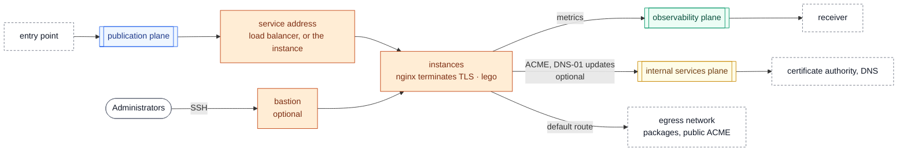

# Tenant type `vm`

Virtual machines whose exposure and egress are declared ([ADR-0016](../../../docs/adr/0016-network-services-and-edge-by-level.md), D1): exposed, they serve several domains behind one service address; with neither exposure nor egress, they are a [private tenant](#private-tenant).

Exposed, instances serve several domains behind **one service address** ([ADR-0006](../../../docs/adr/0006-exposure.md)):

- `instance_count` instances (2 by default) in a server group (anti-affinity) on the tenant network;
- with more than one instance, an Octavia load balancer in TCP on 443 is the service address; with one, the instance itself;
- the service address is published through the shared entry point (`exposure = "entry-point"`, the default), admitting the entry point's addresses only (`edge_sources`), or exposed with its own public floating IP (`exposure = "public"`);
- on the publication plane, the service address is a floating IP of the plane when it translates addresses, its own address otherwise; the instances have no address on the planes;
- routers to the egress network, the publication and observability planes, and a transit router, gateway of the network, holding the routes to them (the default route to the egress router; [ADR-0013](../../../docs/adr/0013-plane-routes-on-a-transit-router.md)); with `exposure = "public"`, no router on the publication plane: the entry point cannot reach the tenant;
- metrics pushed to your receiver by a Prometheus agent on each instance (`monitoring.receiver`); nothing connects into the instances;
- an optional bastion for administration.

The web server is a demonstration backend: nginx terminates TLS, accepts the PROXY protocol v2 header from its load balancer only, and answers with the host, the server name and the client address it received.

**Certificates** ([ADR-0008](../../../docs/adr/0008-tenant-certificates.md)). With `certificates`, each instance runs lego ([`modules/acme-client`](../../../modules/acme-client/README.md)): it obtains the certificate of the domains through the ACME DNS-01 challenge, from Let's Encrypt or the organisation's authority, renews it when it is due (checked every hour), and enables the site once the certificate is issued; until then the load balancer keeps the instance out of its pool. The DNS provider's settings are written to `/etc/lego/dns.env`, readable by root only, through the instance's user data, which the members of the project can read: give a key restricted to the `_acme-challenge` records of the domains. Without `certificates`, the tenant runs in **demonstration mode**: a self-signed certificate, and a warning at every plan.

The tenant joins the internal services plane when its entry of the `shared/planes` attachments has it, for instance to reach the organisation's certificate authority; its `internal_sources` output gives the addresses the services of that plane must admit.



Arrows show who opens the connection. With `exposure = "public"`, the service address gets a public floating IP instead of the entry point. Solid boxes: created by this stack; dashed boxes: provided by other stacks or outside the landing zone; the planes in their colour (publication blue, internal services dark yellow, observability green).

## Private tenant

`exposure = "none"` and `egress = "none"`: a tenant connected to its planes only, the equivalent of the landing zones' workloads connected to the hub and not exposed to the Internet.

- no service address, no router on the publication plane, an empty `published_domains`;
- no egress router and no default route on the transit router: unknown destinations are dropped; the tenant reaches the destinations of its planes, and nothing else;
- no package can be installed: the instances run a workload from their image. The stack's stand-in, a Python standard-library service, pushes one metric (`workload_up`, OTLP) to the receiver. A real workload comes in the image, or from a package mirror reached on a plane ([integration points](../../../docs/reference/integration-points.md#name-resolution-time-and-package-mirrors));
- `egress = "none"` needs `exposure = "none"` and no `certificates` (nothing would install the web server or the ACME client); `exposure = "public"` needs `egress = "router"` (its floating IP is on the egress network).

## Usage

```bash
cp terraform.tfvars.example terraform.tfvars   # adapt to your cloud
tofu init
tofu apply
```

The stack uses the `cloud` entry of `clouds.yaml` given in `terraform.tfvars`. Make sure no `OS_*` variable is set in the shell.

### Several tenants of this stack

Each tenant has its own state, under its own key, with its own access rights when the backend is shared. The code stays the same: the common values in `terraform.tfvars`, the values of each tenant in its own file (never in an `*.auto.tfvars` file, which every tenant of the directory would read), and `name` to tell their resources apart (`<site>-<name>`).

- **In production**, a backend key per tenant, given at init, with the tenant's values: what a pipeline runs for each tenant. The stacks declare no backend (no imposed tooling): add yours in a git-ignored `backend_override.tf`, for example `terraform { backend "s3" {} }`, and give its settings per tenant.

  ```bash
  tofu init -reconfigure -backend-config=private.backend.hcl   # the private tenant's state key
  tofu apply -var-file=private.tfvars
  ```

- **Locally**, to evaluate, a workspace per tenant. Every workspace shares the backend and its credentials: whoever reads one state reads the others, which does not suit tenants run by different teams.

  ```bash
  cp private.tfvars.example private.tfvars   # adapt
  tofu workspace select -or-create=true web && tofu apply
  tofu workspace select -or-create=true private && tofu apply -var-file=private.tfvars
  ```

The web tenant is the one of `terraform.tfvars.example`; the private tenant, the one of [`private.tfvars.example`](private.tfvars.example). The test campaign uses workspaces (local states on one machine).

## Publishing the domains on the entry point

The `published_domains` output maps each domain to the service address, in the shape of the `domains` input of the entry point. [`scripts/request-domains.sh`](../../../scripts/request-domains.sh) writes it into the entry point's domains file, the change to review; [`scripts/publish-domains.sh`](../../../scripts/publish-domains.sh) applies the entry point once it is merged ([publish a domain](../../../docs/guides/publish-a-domain.md)). With `exposure = "public"`, the output is empty: point the domains to the `service_address` output instead.

## Requirements

- **MTU.** Set `network_mtu` to the smallest of the tenant overlay MTU and the plane MTUs (planes contract). A larger value lets TCP connections open but drops large packets: the TLS handshake then hangs.
- **Range.** `web_cidr` must avoid the ranges reserved by the cloud; on hub planes, it must also be the range of the attachment in `shared/planes`.
- **Internet access at first boot.** The egress network must route to the Internet and the resolvers must be reachable through it (package installation).

## Bastion

With `bastion` set, the stack creates a small network whose only router joins the administration network, and a bastion with a floating IP on it and a second port on the web network. SSH to the web instances is admitted from the bastion, and from the ranges of `admin.ssh_cidrs` (empty by default).

```bash
ssh -J ops@<bastion floating IP> ops@<web instance address>
```

## Inputs and outputs

<!-- BEGIN_TF_DOCS -->
### Requirements

| Name | Version |
| ---- | ------- |
| terraform | >= 1.9 |
| openstack | ~> 3.2 |

### Providers

| Name | Version |
| ---- | ------- |
| openstack | ~> 3.2 |
| terraform | n/a |

### Modules

| Name | Source | Version |
| ---- | ------ | ------- |
| acme | ../../../modules/acme-client | n/a |
| admission | ../../../modules/admission | n/a |
| bastion | ../../../modules/bastion | n/a |
| cloudinit | git::https://github.com/CyprisTech/terraform-openstack-tenant.git//modules/cloudinit | v0.1.6 |
| metrics | ../../../modules/metrics-agent | n/a |
| planes | ../../../modules/plane-attachment | n/a |
| web | git::https://github.com/CyprisTech/terraform-openstack-tenant.git | v0.1.6 |

### Resources

| Name | Type |
| ---- | ---- |
| [terraform_data.checks](https://registry.terraform.io/providers/hashicorp/terraform/latest/docs/resources/data) | resource |
| [openstack_networking_router_v2.internal](https://registry.terraform.io/providers/terraform-provider-openstack/openstack/latest/docs/data-sources/networking_router_v2) | data source |

### Inputs

| Name | Description | Type | Default | Required |
| ---- | ----------- | ---- | ------- | :------: |
| cloud | Entry of clouds.yaml used by this stack. | `string` | n/a | yes |
| flavor | Flavor name of the instances. | `string` | n/a | yes |
| image | Image name of the instances (an Ubuntu LTS cloud image). | `string` | n/a | yes |
| plane\_attachment | The stack's entry of the attachments output of stack shared/planes (attachments.<name>.planes),<br/>keyed by plane: how its router joins each plane and how its instances are seen there,<br/>whatever provides the plane (the operator, or a hub project). | <pre>map(object({<br/>    mode         = string<br/>    nat          = bool<br/>    cidr         = string<br/>    network_id   = string<br/>    network_name = string<br/>    subnet_id    = string<br/>    routes = optional(list(object({<br/>      destination = string<br/>      next_hop    = string<br/>    })), [])<br/>  }))</pre> | n/a | yes |
| site | Short site name; must match the site of the entry point (stack shared/entry-point). | `string` | n/a | yes |
| zones | Availability zones of the instances, at least one. The instances of a role are spread over them in order (the first instance in the first zone); changing the order moves instances. One zone places everything in it. | `list(string)` | n/a | yes |
| admin | Administration access: users (login => SSH public keys, sudo granted) and SSH source ranges. No access by default. | <pre>object({<br/>    users     = optional(map(list(string)), {})<br/>    ssh_cidrs = optional(list(string), [])<br/>  })</pre> | `{}` | no |
| bastion | Optional administration bastion. By default it lives in its own small network whose router joins<br/>external\_network (an administration network such as an intranet) and carries a floating<br/>IP on it. A second port on the web network gives it access to the instances; the web<br/>network itself gets no route to the administration network.<br/>var.bastion\_placement may put it on the stack's network instead (ADR-0014, D2).<br/>- ssh\_cidrs: sources allowed to reach the bastion on port 22.<br/>The users of var.admin are created on the bastion and on the instances. | <pre>object({<br/>    external_network = object({<br/>      network = string<br/>      subnet  = optional(string)<br/>    })<br/>    cidr      = optional(string)<br/>    flavor    = optional(string)<br/>    ssh_cidrs = list(string)<br/>  })</pre> | `null` | no |
| bastion\_placement | Where the bastion lives (ADR-0014, D2): "own-network" (default), its own small network whose<br/>router joins bastion.external\_network; or "stack-network", one port on the stack's network<br/>and its floating IP on the egress router, when bastion.external\_network is the egress\_network.<br/>A choice of the profile: private-cloud keeps "own-network", public-cloud takes "stack-network". | `string` | `"own-network"` | no |
| boot\_volume\_size | Size in GiB of a root volume created from the image; null boots from the flavor's local disk. | `number` | `null` | no |
| certificates | Certificates of the domains (ADR-0008): obtained and renewed by lego on each instance, through<br/>the ACME DNS-01 challenge, from any ACME directory (Let's Encrypt, or the organisation's<br/>authority). null runs the demonstration mode: a self-signed certificate, with a warning at<br/>every plan.<br/>- directory\_url: the ACME directory, for example<br/>  "https://acme-v02.api.letsencrypt.org/directory".<br/>- ca\_bundle: root certificate (PEM) of an authority that is not publicly trusted.<br/>- email: contact of the ACME account.<br/>- dns.provider: a lego DNS provider code, for example "rfc2136".<br/>- dns.settings: for rfc2136, nameserver ("host:port"), tsig\_key\_name, tsig\_algorithm and<br/>  tsig\_secret; for any other provider, its lego environment variables, as documented by lego.<br/>- dns.resolvers: name servers ("host:port") lego checks the TXT record on, and only on;<br/>  empty uses the instance's resolvers and the zone's authoritative servers.<br/>The settings reach the instances through their user data, readable by the members of the<br/>project: give a key restricted to the \_acme-challenge records of these domains. | <pre>object({<br/>    directory_url = string<br/>    ca_bundle     = optional(string)<br/>    email         = string<br/>    dns = object({<br/>      provider  = string<br/>      settings  = map(string)<br/>      resolvers = optional(list(string), [])<br/>    })<br/>  })</pre> | `null` | no |
| dns\_nameservers | DNS resolvers of the tenant network, reachable through its routes; empty (the default), those of Neutron's DHCP. A tenant without egress takes a resolver behind one of its planes (ADR-0016, D3). | `list(string)` | `[]` | no |
| domains | Domains served by the instances and published through the entry point. Unused with exposure = "none". | `list(string)` | <pre>[<br/>  "site-a.example.org",<br/>  "site-b.example.org"<br/>]</pre> | no |
| edge\_sources | Ranges the entry point connects from on publication, in CIDR notation: output<br/>publication\_sources of stack shared/entry-point. Only they may reach the service address.<br/>Required with exposure = "entry-point". | `list(string)` | `[]` | no |
| egress | How the tenant reaches the Internet (ADR-0016, D1):<br/>- "router": its own router to egress\_network, which takes the default route (package<br/>  installation at first boot);<br/>- "shared": the shared egress of the landing zone (stack shared/egress), on the internal<br/>  services plane: no egress router and no default route, the proxy of shared\_egress for<br/>  packages and the names the tenant declared there; the tenant joins the internal services<br/>  plane;<br/>- "none": no default route, no package: the instances run a workload from the image only, a<br/>  stand-in that pushes one metric (workload\_up) to the receiver. With exposure = "none", a<br/>  private tenant. | `string` | `"router"` | no |
| egress\_network | External network of the egress router (egress = "router"). The instances get no public address on it; with exposure = "public", the service address is a floating IP of this network. subnet: optional, the subnet of that network to look up by name; without it, Neutron chooses (a public network with several subnets of the same name). null with egress = "none". | <pre>object({<br/>    network = string<br/>    subnet  = optional(string)<br/>  })</pre> | `null` | no |
| exposure | How the service address is published (ADR-0006, D2; ADR-0016, D1):<br/>- "entry-point": through the shared entry point (output published\_domains), reachable from<br/>  the entry point only;<br/>- "public": a floating IP of egress\_network, reachable from anywhere; the shared entry point<br/>  is not used;<br/>- "none": no service address, no route to the publication plane; nothing reaches the<br/>  instances but the bastion. | `string` | `"entry-point"` | no |
| instance\_count | Number of instances. Above one, a load balancer is the service address (ADR-0006, D1); with one, the instance itself. | `number` | `2` | no |
| lego\_version | Version of lego installed on the instances (release archive from GitHub), pinned. | `string` | `"5.6.0"` | no |
| monitoring | Monitoring as a push integration point (ADR-0007): each instance runs its exporters and a<br/>Prometheus agent that pushes to the receiver through the observability plane. Nothing connects<br/>into the instances for their metrics.<br/>- receiver: base URL of the receiver, for example "http://192.0.2.10:9090" (output<br/>  receiver\_url of the receiver); null runs no agent. | <pre>object({<br/>    receiver = optional(string)<br/>  })</pre> | `{}` | no |
| name | Name of the tenant, in the names of its resources (<site>-<name>) and in the labels of its metrics. Two tenants of one site need two names. | `string` | `"web"` | no |
| network\_mtu | MTU of the networks of this stack. It must not exceed the MTU the cloud can carry for tenant<br/>networks, nor the MTU of the planes they join (planes contract): a larger value creates a<br/>path MTU black hole, since OVN routers do not send "fragmentation needed" unless the operator<br/>enables it. null keeps the cloud default. | `number` | `null` | no |
| server\_group\_policy | Placement of the instances: "anti-affinity" or "soft-anti-affinity". | `string` | `"anti-affinity"` | no |
| shared\_egress | The shared egress of the landing zone, with egress = "shared": proxy, the URL of the proxy output of stack shared/egress, where this tenant is declared with its internal\_sources and its names (ADR-0016, D1). | <pre>object({<br/>    proxy = string<br/>  })</pre> | `null` | no |
| volume\_zones | Block storage zone of the root volumes (boot\_volume\_size), for each compute zone. A compute zone missing from the map gets the cloud's default storage zone. | `map(string)` | `{}` | no |
| web\_cidr | Range of the tenant network. On planes with NAT tenants may reuse the same range; on planes without NAT it must be unique (stack shared/planes checks it). | `string` | `"10.21.0.0/24"` | no |

### Outputs

| Name | Description |
| ---- | ----------- |
| bastion | Floating IP of the bastion on the administration network, or null. |
| edge\_sources | Addresses of the entry point admitted on the service address. |
| instances | Instances and their private addresses. |
| internal\_sources | Addresses the tenant reaches the internal services plane from, for the services of that plane (allowed\_sources): its router's gateway address on a plane with NAT, the tenant range on a plane without NAT. Empty when the tenant does not join the plane. |
| published\_domains | Domains to publish through the entry point and their service address, for its domains input (scripts/request-domains.sh). Empty with exposure = "public" or "none". |
| service\_address | The tenant's service address, "address:443" (ADR-0006, D1): its load balancer, or its only instance. On publication through the entry point (a floating IP of the plane when it translates addresses, the address itself otherwise), or a public floating IP with exposure = "public". null with exposure = "none". |
<!-- END_TF_DOCS -->
